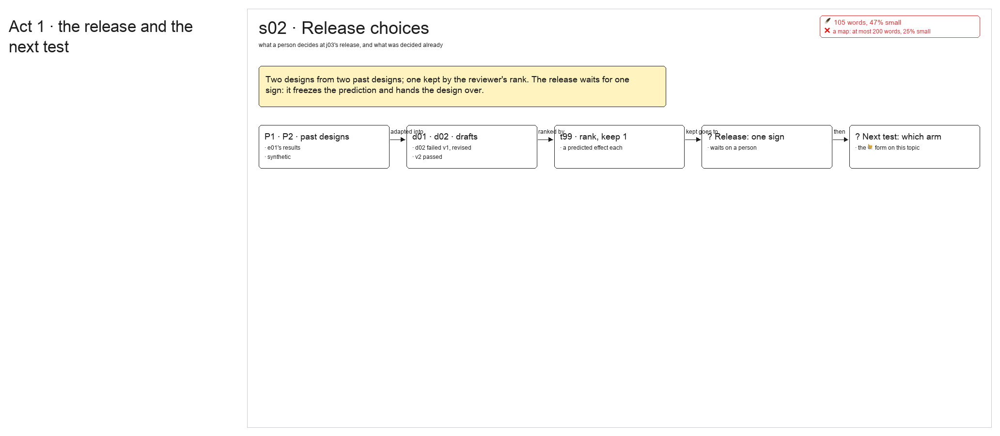

# s02 · Release choices <!-- root #bef4d0 -->

**Stage:** explore

- For <!-- @for #f78806 -->
  - the person who signs j03's release: what … <!-- @for/0 #95083b -->
    the person who signs j03's release: what the sign does, and what this Job has decided already.
- Delivery type <!-- @delivery-type #58a44f -->
  - ui <!-- @delivery-type/0 #636117 -->
- Covers <!-- @covers #a6c44a -->
  - the one release sign (freeze the prediction, … <!-- @covers/0 #4be867 -->
    the one release sign (freeze the prediction, hand the design over); which arm the next example test carries; the ranking rule this Job used.
- Excluded <!-- @excluded #980495 -->
  - the designs' words (each design Task's own … <!-- @excluded/0 #f03a36 -->
    the designs' words (each design Task's own page); the method itself (the registry, run-propose-method).
- Topic <!-- @topic #7e13bd -->
  - Every word is a placeholder. j03 adapts … <!-- @topic/0 #7c5c4c -->
    Every word is a placeholder. j03 adapts two past designs into two drafts, one fails its first verify and is revised, the reviewer ranks them and keeps one.
  - The release waits on a person; a … <!-- @topic/1 #f39d2d -->
    The release waits on a person; a form on this topic asks which arm the next example test carries.
- Feeds <!-- @feeds #ffe8e9 -->
  - `reports/` q01_example_test <!-- @feeds/0 #d1a5a1 -->
- Files <!-- @files #6ce6c5 -->
  - [py] [build_s02_release_choices.py](build_s02_release_choices.py) <!-- @files/0 #853f51 -->
  - delivery/ <!-- @files/1 #404761 -->
  - [excalidraw] [s02-release-choices.excalidraw](s02-release-choices.excalidraw) <!-- @files/2 #3d5748 -->
  - [md] [s02-release-choices.md](s02-release-choices.md) <!-- @files/3 #daecf2 -->
  - [png] [s02-release-choices.png](s02-release-choices.png) <!-- @files/4 #bed9cc -->
    
- Decided <!-- @decided #55615a -->
  - s02-D01 · rank by how much of … <!-- @decided/0 #fdc207 -->
    s02-D01 · rank by how much of the stronger past design each draft keeps (placeholder decision on the example, 261108)
- Open <!-- @open #cf9b77 -->
  - Which arm does the next example test … <!-- @open/0 #1e1b6e -->
    Which arm does the next example test carry? (the waiting form on this topic)
