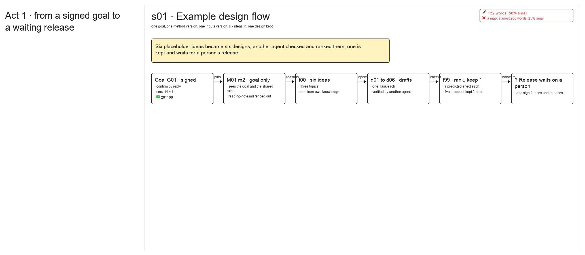

# s01 · Example design flow <!-- root #d5fa1f -->

**Stage:** shaping

- For <!-- @for #f78806 -->
  - the design prototype: one drawing of how … <!-- @for/0 #99f7c9 -->
    the design prototype: one drawing of how a signed goal becomes kept designs and a release, for anyone reading this placeholder Block before opening a real one.
- Delivery type <!-- @delivery-type #58a44f -->
  - ui <!-- @delivery-type/0 #636117 -->
- Covers <!-- @covers #a6c44a -->
  - the goal and its sign; the method … <!-- @covers/0 #85520c -->
    the goal and its sign; the method version and what its fence leaves out; t00's ideas; one Task per design and its verify; t99's rank; the release that waits on a person; the example test that comes back.
- Excluded <!-- @excluded #980495 -->
  - how a page looks (the theme Block's … <!-- @excluded/0 #f8f694 -->
    how a page looks (the theme Block's 3×3 pages, b12 j01); real designs (a Project's own design Block).
- Topic <!-- @topic #7e13bd -->
  - A placeholder walk through the design ladder … <!-- @topic/0 #c7fa50 -->
    A placeholder walk through the design ladder on this Block.
  - Every word is made up: the goal, … <!-- @topic/1 #b9bfe6 -->
    Every word is made up: the goal, the designs, the predictions and the example test's totals.
  - It shows each state once: signed, running, … <!-- @topic/2 #4f703a -->
    It shows each state once: signed, running, waiting for a person, released, scored.
- Feeds <!-- @feeds #ffe8e9 -->
  - `reports/` q01_example_test <!-- @feeds/0 #d1a5a1 -->
- Files <!-- @files #6ce6c5 -->
  - [py] [build_s01_example_design_flow.py](build_s01_example_design_flow.py) <!-- @files/0 #c242c4 -->
  - delivery/ <!-- @files/1 #404761 -->
  - [excalidraw] [s01-example-design-flow.excalidraw](s01-example-design-flow.excalidraw) <!-- @files/2 #9c59e9 -->
  - [md] [s01-example-design-flow.md](s01-example-design-flow.md) <!-- @files/3 #ca343a -->
  - [png] [s01-example-design-flow.png](s01-example-design-flow.png) <!-- @files/4 #302e07 -->
    
- Decided <!-- @decided #55615a -->
  - s01-D01 · one goal, three Jobs, one … <!-- @decided/0 #ec0c24 -->
    s01-D01 · one goal, three Jobs, one clock each: the inputs move from j01 to j02, the method from j02 to j03 (placeholder decision on the example, 261106)
- Open <!-- @open #cf9b77 -->
  - Should the example test also try the … <!-- @open/0 #11d02d -->
    Should the example test also try the goal-only design made on i2 (j02), once it is done?
