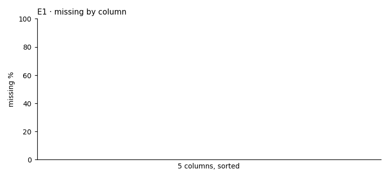

# D01 · extract shape · r01_full

**The ask**: How many rows, columns and days does the example extract hold, and how much of each column is missing?

**Run**: ok · 600 of 600 rows · dataset data-v1 · partition full · ended 2026-11-06T18:57:46Z

Generated by haipipe-insight ref/run_job.py from this run's results; rerun the ticket `Tools/blueprints/Project-Ladder/insight/Insight-Example/j01_code-v1-example-questions_data-v1/t01_D01_extract-shape/runs/r01_full/run.sh` to change it.

## D01.E1 · the extract's size, its window and the share missing in each column

- 5 of 5 columns complete, 0 partly, 0 mostly missing, 0 empty (`missing_by_column.csv`)

**Pass**: every column listed with its missing share, zero included; the row and day counts exact

### shape.json

| key | value |
|---|---|
| n_rows | 600 |
| n_cols | 5 |
| n_days | 10 |
| first_day | 2026-01-05 |
| last_day | 2026-01-14 |

### missing_by_column.csv

| column | null_pct |
|---|---|
| date | 0 |
| arm | 0 |
| group | 0 |
| outcome | 0 |
| score | 0 |

## Power, before any contrast

| partition | test | n | base_rate | mde | effect | answerable |
|---|---|---|---|---|---|---|
| full | none | 600 |  |  |  | True |
