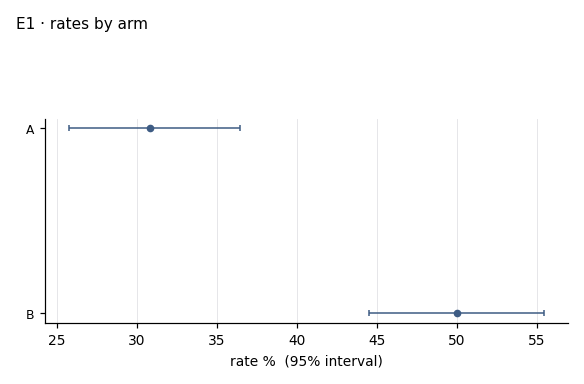
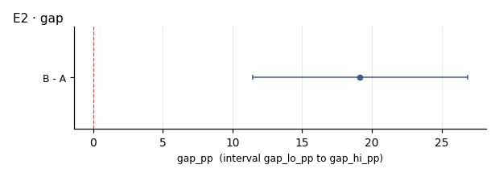

# I01 · outcome by arm · r01_full

**The ask**: In each cut, what is the outcome rate in arm A and in arm B, and how wide is the gap between them?

**Run**: ok · 600 of 600 rows · dataset data-v1 · partition full · ended 2026-11-06T18:57:51Z

Generated by haipipe-insight ref/run_job.py from this run's results; rerun the ticket `Tools/blueprints/Project-Ladder/insight/Insight-Example/j01_code-v1-example-questions_data-v1/t03_I01_outcome-by-arm/runs/r01_full/run.sh` to change it.

## I01.E1 · the outcome rate in each arm, with its 95% interval

**Pass**: both arms with n, k and a Wilson interval; a rate of zero shown, never left out

### rates_by_arm.csv

| level | n | k | rate_pct | ci_lo_pct | ci_hi_pct |
|---|---|---|---|---|---|
| A | 282 | 87 | 30.9 | 25.7 | 36.5 |
| B | 318 | 159 | 50 | 44.5 | 55.5 |

## I01.E2 · the gap, arm B minus arm A, in points, with its 95% interval

- gap_pp 19.15 (11.45 to 26.85) (`gap.csv`)

**Pass**: one row, the gap and its interval; a gap whose interval crosses zero is said as such

### gap.csv

| contrast | gap_pp | gap_lo_pp | gap_hi_pp |
|---|---|---|---|
| B - A | 19.1 | 11.5 | 26.8 |

## Power, before any contrast

| partition | test | n | base_rate | mde | effect | answerable |
|---|---|---|---|---|---|---|
| full | two_proportion | 600 | 0.41 | 11.6 | 20 | True |
