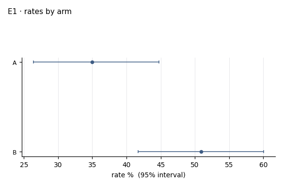
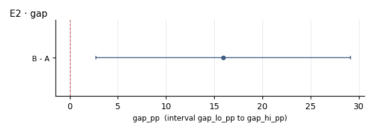

# I01 · outcome by arm · r03_second

**The ask**: In each cut, what is the outcome rate in arm A and in arm B, and how wide is the gap between them?

**Run**: ok · 210 of 600 rows · dataset data-v1 · partition second · ended 2026-11-06T18:57:53Z

Generated by haipipe-insight ref/run_job.py from this run's results; rerun the ticket `Tools/blueprints/Project-Ladder/insight/Insight-Example/j01_code-v1-example-questions_data-v1/t03_I01_outcome-by-arm/runs/r03_second/run.sh` to change it.

## I01.E1 · the outcome rate in each arm, with its 95% interval

**Pass**: both arms with n, k and a Wilson interval; a rate of zero shown, never left out

### rates_by_arm.csv

| level | n | k | rate_pct | ci_lo_pct | ci_hi_pct |
|---|---|---|---|---|---|
| A | 100 | 35 | 35 | 26.4 | 44.7 |
| B | 110 | 56 | 50.9 | 41.7 | 60.1 |

## I01.E2 · the gap, arm B minus arm A, in points, with its 95% interval

- gap_pp 15.91 (2.69 to 29.13) (`gap.csv`)

**Pass**: one row, the gap and its interval; a gap whose interval crosses zero is said as such

### gap.csv

| contrast | gap_pp | gap_lo_pp | gap_hi_pp |
|---|---|---|---|
| B - A | 15.9 | 2.7 | 29.1 |

## Power, before any contrast

| partition | test | n | base_rate | mde | effect | answerable |
|---|---|---|---|---|---|---|
| second | two_proportion | 210 | 0.433 | 19.6 | 20 | True |
