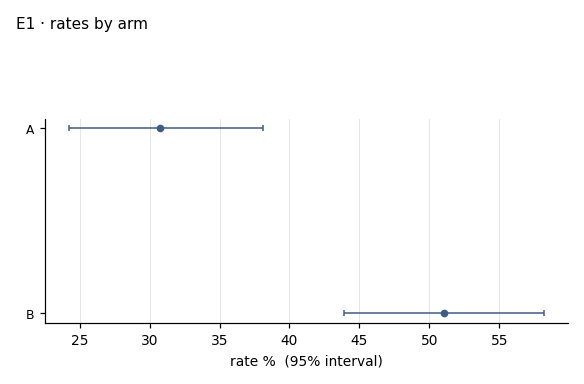
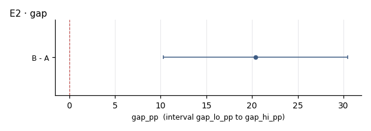

# I01 · outcome by arm · r02_first

**The ask**: In each cut, what is the outcome rate in arm A and in arm B, and how wide is the gap between them?

**Run**: ok · 350 of 600 rows · dataset Examplev1 · partition first · ended 2026-11-06T18:57:52Z

Generated by haipipe-insight ref/run_job.py from this run's results; rerun the ticket `Tools/blueprints/Project-Ladder/insight/Insight-Example/j01_prototype-p1-example-questions_data-Examplev1/t03_I01_outcome-by-arm/runs/r02_first/run.sh` to change it.

## I01.E1 · the outcome rate in each arm, with its 95% interval

**Pass**: both arms with n, k and a Wilson interval; a rate of zero shown, never left out

### rates_by_arm.csv

| level | n | k | rate_pct | ci_lo_pct | ci_hi_pct |
|---|---|---|---|---|---|
| A | 166 | 51 | 30.7 | 24.2 | 38.1 |
| B | 184 | 94 | 51.1 | 43.9 | 58.2 |

## I01.E2 · the gap, arm B minus arm A, in points, with its 95% interval

- gap_pp 20.36 (10.29 to 30.43) (`gap.csv`)

**Pass**: one row, the gap and its interval; a gap whose interval crosses zero is said as such

### gap.csv

| contrast | gap_pp | gap_lo_pp | gap_hi_pp |
|---|---|---|---|
| B - A | 20.4 | 10.3 | 30.4 |

## Power, before any contrast

| partition | test | n | base_rate | mde | effect | answerable |
|---|---|---|---|---|---|---|
| first | two_proportion | 350 | 0.414 | 15.1 | 20 | True |
