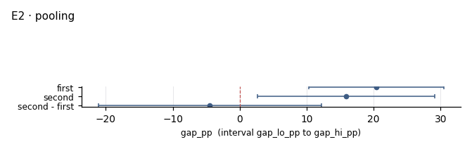

# K01 · gap by group · r04_cross

**The ask**: Is the gap between arm B and arm A the same in the first and second groups, so that one counsel serves both?

**Run**: ok · 0 of 0 rows · dataset Examplev1 · partition cross · ended 2026-11-06T18:57:56Z

Generated by haipipe-insight ref/run_job.py from this run's results; rerun the ticket `Tools/blueprints/Project-Ladder/insight/Insight-Example/j01_prototype-p1-example-questions_data-Examplev1/t05_K01_gap-holds/runs/r04_cross/run.sh` to change it.

## K01.E2 · the two groups' gaps, their difference, and the pooling verdict

- gap_pp 20.36 (10.29 to 30.43) for first; gap_pp 15.91 (2.69 to 29.13) for second; gap_pp -4.45 (-21.07 to 12.16) for second - first (`pooling.csv`)

**Pass**: three rows (each group's gap and their difference) with intervals, and one verdict word (POOL, SPLIT or UNDETERMINED) with its rule; a difference that cannot be told from zero is never POOL on that alone

### pooling.csv

| part | gap_pp | gap_lo_pp | gap_hi_pp |
|---|---|---|---|
| first | 20.4 | 10.3 | 30.4 |
| second | 15.9 | 2.7 | 29.1 |
| second - first | -4.5 | -21.1 | 12.2 |

### verdict.json

| key | value |
|---|---|
| verdict | UNDETERMINED |
| test | pooling: z test of two gaps |
| p_value | 0.599 |
| rule | no difference shown, but its 95% interval reaches past ±20 points |

## Power, before any contrast

| partition | test | n | base_rate | mde | effect | answerable |
|---|---|---|---|---|---|---|
| first | none | 0 |  |  |  | True |
| second | none | 0 |  |  |  | True |
