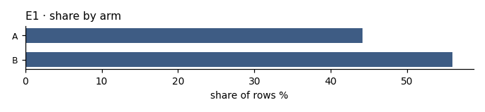
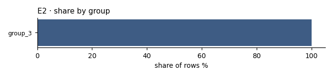

# D02 · arm balance · r05_third

**The ask**: In each cut, how many rows does each arm and each group hold, and what share of the cut is each?

**Run**: ok · 68 of 960 rows · dataset data-v2 · partition third · ended 2026-11-06T18:58:01Z

Generated by haipipe-insight ref/run_job.py from this run's results; rerun the ticket `Tools/blueprints/Project-Ladder/insight/Insight-Example/j02_code-v1-example-questions_data-v2/t02_D02_arm-balance/runs/r05_third/run.sh` to change it.

## D02.E1 · the rows and share of the cut in each arm

- 2 levels; the largest is B at 55.9% (`share_by_arm.csv`)

**Pass**: both arms listed with their counts; an empty arm shown as zero, never dropped

### share_by_arm.csv

| level | n | share_pct |
|---|---|---|
| A | 30 | 44.1 |
| B | 38 | 55.9 |

## D02.E2 · the rows and share of the cut in each group

- 1 levels; the largest is group_3 at 100.0% (`share_by_group.csv`)

**Pass**: every group present in the cut listed; a cut of one group says so

### share_by_group.csv

| level | n | share_pct |
|---|---|---|
| group_3 | 68 | 100 |

## Power, before any contrast

| partition | test | n | base_rate | mde | effect | answerable |
|---|---|---|---|---|---|---|
| third | none | 68 |  |  |  | True |
