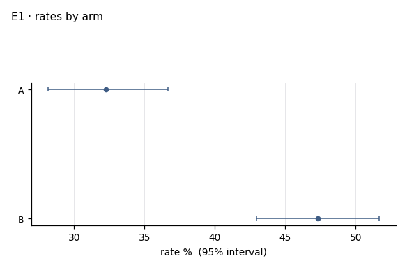
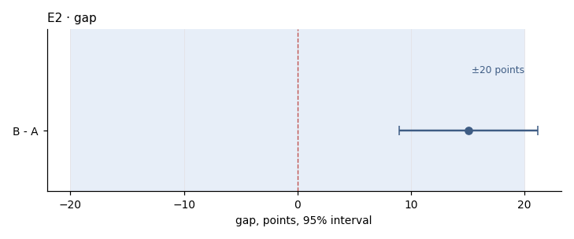

# I01 · outcome by arm · r01_full

**The ask**: In each cut, what is the outcome rate in arm A and in arm B, and how wide is the gap between them?

**Run**: ok · 960 of 960 rows · dataset data-v2 · partition full · ended 2026-11-06T20:27:40Z

Generated by haipipe-insight ref/run_job.py from this run's results; rerun the ticket `Tools/blueprints/Project-Ladder/insight/Insight-Example/j02_code-v1-example-questions_data-v2/t03_I01_outcome-by-arm/runs/r01_full/run.sh` to change it.

## I01.E1 · the outcome rate in each arm, with its 95% interval

**Pass**: both arms with n, k and a Wilson interval; a rate of zero shown, never left out

### rates_by_arm.csv

| level | n | k | rate_pct | ci_lo_pct | ci_hi_pct |
|---|---|---|---|---|---|
| A | 459 | 148 | 32.2 | 28.1 | 36.7 |
| B | 501 | 237 | 47.3 | 43 | 51.7 |

## I01.E2 · the gap, arm B minus arm A, in points, with its 95% interval

- gap_pp 15.06 (8.95 to 21.18) (`gap.csv`)

**Pass**: one row, the gap and its interval; a gap whose interval crosses zero is said as such

### gap.csv

| contrast | gap_pp | gap_lo_pp | gap_hi_pp |
|---|---|---|---|
| B - A | 15.1 | 8.9 | 21.2 |

## Power, before any contrast

| partition | test | n | base_rate | mde | effect | answerable |
|---|---|---|---|---|---|---|
| full | two_proportion | 960 | 0.401 | 9.1 | 20 | True |
