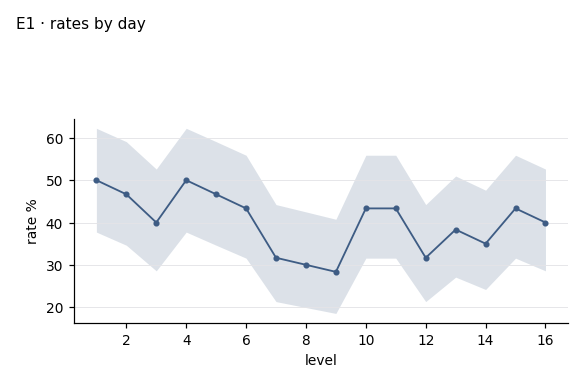

# I02 · outcome by day · r01_full

**The ask**: Across the days of the window, what is the outcome rate each day, and does it drift up or down?

**Run**: ok · 960 of 960 rows · dataset data-v2 · partition full · ended 2026-11-06T18:58:07Z

Generated by haipipe-insight ref/run_job.py from this run's results; rerun the ticket `Tools/blueprints/Project-Ladder/insight/Insight-Example/j02_code-v1-example-questions_data-v2/t04_I02_outcome-by-day/runs/r01_full/run.sh` to change it.

## I02.E1 · the outcome rate on each day, with its 95% interval

**Pass**: every day of the window listed, a day with no rows shown as missing

### rates_by_day.csv

| level | n | k | rate_pct | ci_lo_pct | ci_hi_pct |
|---|---|---|---|---|---|
| 1 | 60 | 30 | 50 | 37.7 | 62.3 |
| 2 | 60 | 28 | 46.7 | 34.6 | 59.1 |
| 3 | 60 | 24 | 40 | 28.6 | 52.6 |
| 4 | 60 | 30 | 50 | 37.7 | 62.3 |
| 5 | 60 | 28 | 46.7 | 34.6 | 59.1 |
| 6 | 60 | 26 | 43.3 | 31.6 | 55.9 |
| 7 | 60 | 19 | 31.7 | 21.3 | 44.2 |
| 8 | 60 | 18 | 30 | 19.9 | 42.5 |
| 9 | 60 | 17 | 28.3 | 18.5 | 40.8 |
| 10 | 60 | 26 | 43.3 | 31.6 | 55.9 |
| 11 | 60 | 26 | 43.3 | 31.6 | 55.9 |
| 12 | 60 | 19 | 31.7 | 21.3 | 44.2 |
| 13 | 60 | 23 | 38.3 | 27.1 | 51 |
| 14 | 60 | 21 | 35 | 24.2 | 47.6 |
| 15 | 60 | 26 | 43.3 | 31.6 | 55.9 |
| 16 | 60 | 24 | 40 | 28.6 | 52.6 |

## I02.E2 · the drift, in points per day, with its 95% interval

**Pass**: one slope and its interval; a slope whose interval crosses zero is said as no clear drift

### trend.csv

| term | slope_pp | slope_lo_pp | slope_hi_pp |
|---|---|---|---|
| points per day | -0.625 | -1.4 | 0.138 |

## Power, before any contrast

| partition | test | n | base_rate | mde | effect | answerable |
|---|---|---|---|---|---|---|
| full | none | 960 |  |  |  | True |
