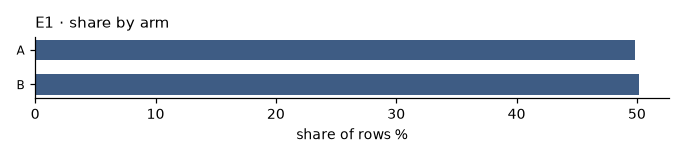
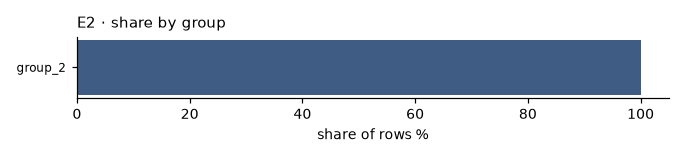

# D02 · arm balance · r03_second

**The ask**: In each segment, how many rows does each arm and each group hold, and what share of the segment is each?

**Run**: ok · 351 of 960 rows · dataset Exampledata-v2 · segment second · ended 2026-11-10T02:39:11Z

Generated by haipipe-insight ref/run_job.py from this run's results; rerun the ticket `Tools/blueprints/Project-Ladder/insight/Insight-Example/j02_question-v1-example-questions_data-v2/t02_D02_arm-balance/runs/r03_second/run.sh` to change it.

## D02.E1 · the rows and share of the segment in each arm

- 2 levels; the largest is B at 50.1% (`share_by_arm.csv`)

**Pass**: both arms listed with their counts; an empty arm shown as zero, never dropped

### share_by_arm.csv

| level | n | share_pct |
|---|---|---|
| A | 175 | 49.9 |
| B | 176 | 50.1 |

## D02.E2 · the rows and share of the segment in each group

- 1 levels; the largest is group_2 at 100.0% (`share_by_group.csv`)

**Pass**: every group present in the segment listed; a segment of one group says so

### share_by_group.csv

| level | n | share_pct |
|---|---|---|
| group_2 | 351 | 100 |

## Power, before any contrast

| segment | test | n | base_rate | mde | effect | answerable |
|---|---|---|---|---|---|---|
| second | none | 351 |  |  |  | True |
