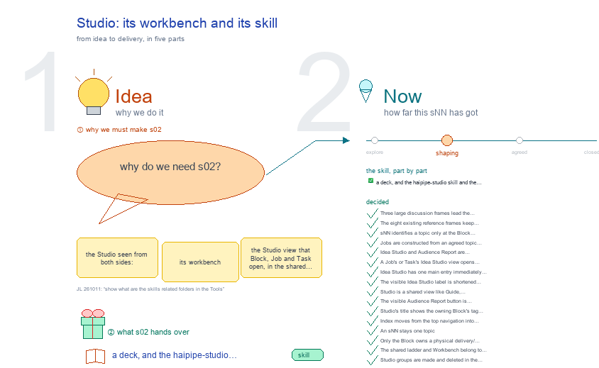
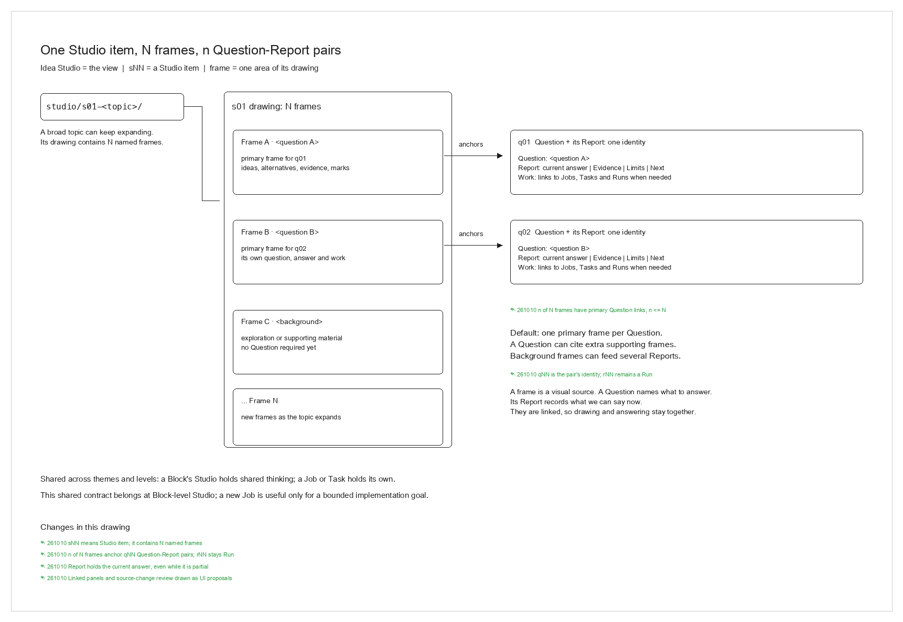
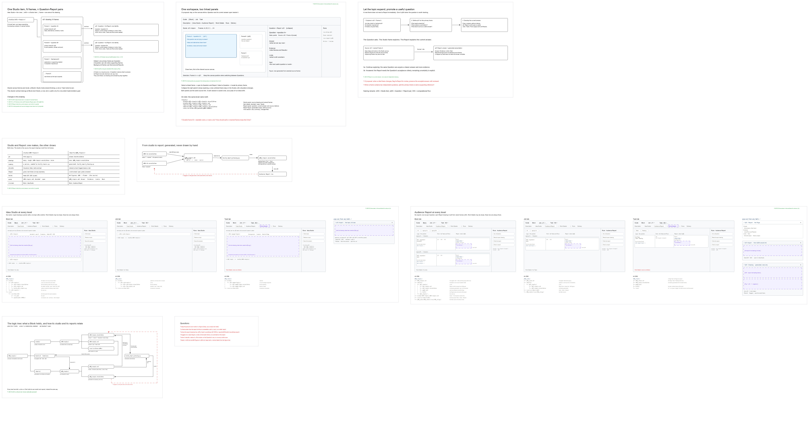
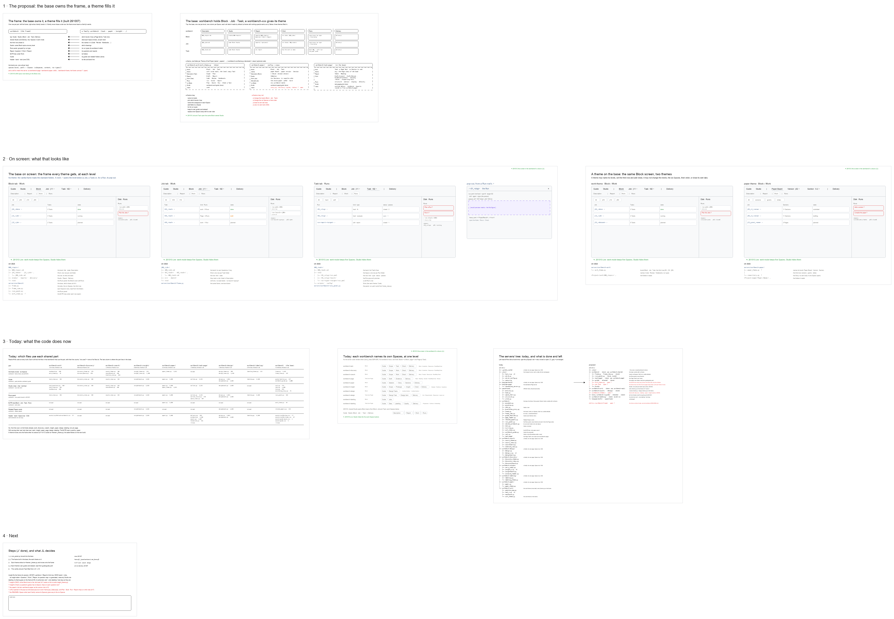

# s02 · Studio: its workbench and its skill <!-- root #b95af8 -->

**Tags:** `UI` · `Structure`
**Stage:** shaping

- For <!-- @for #f78806 -->
  - a deck, and the haipipe-studio skill and … <!-- @for/0 #37bf3d -->
    a deck, and the haipipe-studio skill and the Studio view it drives, for the people who write the toolkit skills
- Delivery type <!-- @delivery-type #58a44f -->
  - skill <!-- @delivery-type/0 #34b33e -->
- Topic <!-- @topic #7e13bd -->
  - the Studio seen from both sides: its … <!-- @topic/0 #d60cdf -->
    the Studio seen from both sides: its workbench (the Studio view that Block, Job and Task open, in the shared frame `servers/workbench`) and its skill (`haipipe-studio`), and how a Studio topic relates to a Report (from s04).
  - Also: what `Tools/plugins/haipipe-toolkit/servers/workbench` holds today, how every … <!-- @topic/1 #7b32c9 -->
    Also: what `Tools/plugins/haipipe-toolkit/servers/workbench` holds today, how every other workbench leans on it, and how it owns the Block / Job / Task frame.
  - The current model keeps sNN topics only … <!-- @topic/2 #9c9069 -->
    The current model keeps sNN topics only at Block level, constructs Jobs from those topics, and separates Studio from Audience Report (261010).
  - Earlier framing (JL 261007: "should it propose … <!-- @topic/3 #224b52 -->
    Earlier framing (JL 261007: "should it propose the structure of board, job, and tasks? ... what are their relationship to the workbench shared?").
- Feeds <!-- @feeds #ffe8e9 -->
  - `q03_block_questions` · `q07_workbench_mapping` · `q08_workbench_base` · `q09_studio_report_on_screen` <!-- @feeds/0 #9f6de9 -->
- Source <!-- @source #6da13a -->
  - the reference grid is read off each … <!-- @source/0 #0f2e3a -->
    the reference grid is read off each workbench's own Python every build (an import or link of a shared part; its own stylesheet), so it shows what the code does now.
  - The Space rows come from `../s01-overall-tree-structure/level_views.py` (`SERVER`, … <!-- @source/1 #d2f130 -->
    The Space rows come from `../s01-overall-tree-structure/level_views.py` (`SERVER`, read from the server code).
- Files <!-- @files #6ce6c5 -->
  - [py] [build_s02_studio_workbench_skill.py](build_s02_studio_workbench_skill.py) <!-- @files/0 #a39b92 -->
  - [py] [build_studio_and_report.py](build_studio_and_report.py) <!-- @files/1 #b380f7 -->
  - delivery/ <!-- @files/2 #404761 -->
  - passes/ <!-- @files/3 #49b302 -->
  - [excalidraw] [s02-studio-workbench-skill.excalidraw](s02-studio-workbench-skill.excalidraw) <!-- @files/4 #1cbba8 -->
  - [md] [s02-studio-workbench-skill.md](s02-studio-workbench-skill.md) <!-- @files/5 #5c084f -->
  - [png] [s02-studio-workbench-skill.png](s02-studio-workbench-skill.png) <!-- @files/6 #d49ee7 -->
    
  - [png] [studio-and-report-relationship.png](studio-and-report-relationship.png) <!-- @files/7 #510c70 -->
    
  - [excalidraw] [studio-and-report.excalidraw](studio-and-report.excalidraw) <!-- @files/8 #ef6da8 -->
  - [png] [studio-and-report.png](studio-and-report.png) <!-- @files/9 #422b4e -->
    
  - [excalidraw] [studio-workbench-reference.excalidraw](studio-workbench-reference.excalidraw) <!-- @files/10 #46753c -->
  - [png] [studio-workbench-reference.png](studio-workbench-reference.png) <!-- @files/11 #302db4 -->
    
  - [py] [studio_report_ui.py](studio_report_ui.py) <!-- @files/12 #297e8f -->
- In Tools <!-- @in-tools #f1ecea -->
  - Where its skill and code sit, under … <!-- @in-tools/0 #f573ca -->
    Where its skill and code sit, under `Tools/plugins/haipipe-toolkit/`. The drawing's "In Tools" frame reads the same off the disk on every build: the skill's folder as it is, its version, and each function looked up in its file (JL 261011: "show what are the skills related folders in the Tools").
- What the drawing says <!-- @what-the-drawing-says #6db02a -->
  - Four discussion frames lead in one row … <!-- @what-the-drawing-says/0 #693f06 -->
    Four discussion frames lead in one row (261010), sized to read as whole frames:
  - **Shared workbench across levels** (Q08): Guide · … <!-- @what-the-drawing-says/1 #7c3934 -->
    **Shared workbench across levels** (Q08): Guide · Studio | Block · Job · Task at the
  - top <!-- @what-the-drawing-says/2 #9cabeb -->
    top. Studio opens a shared view like Guide: only Studio is selected, and the work Space and subspace rows are absent. Block, Job and Task open the same Block-owned topics, Disk and topic sessions. The title says Workbench · Studio · bNN · Block name; the work level stays in the controls. Inside Guide, SPACE and Project come before Description: SPACE returns to the SPACE Home, Project to the Home showing only this folder's Project (s02-D31). Below the Studio title, Current, topic tags and All focus the list; drag a card into Current or use its button. Each row shows its tags and source. Clicking that level returns to its selected work Space and view (implemented 261010).
  - **Block topics construct Jobs** (Q07): an sNN … <!-- @what-the-drawing-says/3 #4f8e12 -->
    **Block topics construct Jobs** (Q07): an sNN topic holds ideas, choices and the agreed
  - plan <!-- @what-the-drawing-says/4 #ee973b -->
    plan. Construct a Job from that plan, keeping its jNN identity and a link back to the Block topic. A topic may lead to zero, one or several Jobs. Jobs hold their goal, close and Tasks; actual Runs execute the work and produce evidence.
  - **Studio and Report** (Q09): a shared Studio … <!-- @what-the-drawing-says/5 #5f92e1 -->
    **Studio and Report** (Q09): a shared Studio view and a separate work Space. Studio holds
  - working drawings, alternatives, decisions and topic sessions <!-- @what-the-drawing-says/6 #4aa0c2 -->
    working drawings, alternatives, decisions and topic sessions; Report shows Question / supporting work / Report. Open a Report in its Space, or open a source topic back in Studio. One topic may feed several Reports, and a Report may use several topics.
  - **Block Delivery**: the Block holds the delivered … <!-- @what-the-drawing-says/7 #f7b78b -->
    **Block Delivery**: the Block holds the delivered files; Job, Task and Report views
  - filter their source subtrees <!-- @what-the-drawing-says/8 #16cbab -->
    filter their source subtrees. Runs and Results remain with their sources.
  - These ownership and view rules are approved … <!-- @what-the-drawing-says/9 #d466ba -->
    These ownership and view rules are approved for the blueprint (261010). Shared Studio, its single selected top entry, hidden work rows, Block-owned topics, Disk, session history and new-topic prompts are implemented in the live shared frame (261010). The same shared view opens from Block, Job and Task. `studio=1` keeps the work path, Space and subspace for return; older `space=Idea Studio` links also open shared Studio. Each sNN source is `bNN_<block>/sNN-<topic>/`. A Job's own plan, Tasks and execution history remain in its Job folder. Topic-to-Job construction, linked-topic filtering and migration of existing local Studios remain proposed; existing local files have not moved. The shared list now includes those local topics by reference, with their source shown (D13). Report ownership is a separate rule; the blueprint makes sNN topics Block-only. Delivery storage is Block-only too: Job / Task / Report views select their source subtree (D14). The topic-to-Job link's stored field, migration of existing local Studios and topic / canvas return behavior remain open below. The s04 notes merged below are earlier background and need the same rule when they are revised.
  - The eight reference frames keep their names … <!-- @what-the-drawing-says/10 #048e95 -->
    The eight reference frames keep their names and positions below the discussion row. Their shared-base table shows Job / Task links to Block topics and separate Studio / Report columns. The screen references now show five lower buttons in work mode and no work rows in Studio; dated green notes mark the changes. Code-backed references show current server code. The following notes record the earlier discussion. New material uses black lines, red open questions and green change notes.
  - Today every workbench draws its own page … <!-- @what-the-drawing-says/11 #02e0f9 -->
    Today every workbench draws its own page (header, band, Space row, stylesheet) and borrows a few
  - parts: Guide (all eight), Studio (all but … <!-- @what-the-drawing-says/12 #31efe2 -->
    parts: Guide (all eight), Studio (all but labeling), the Runs panel (all eight, but it lives in workbench-page), the BJTR tree (paper only), Related Papers (insight, design). 1b. The servers/ tree (JL 261007: "the tree-structure, like draw"): today's tree read off the disk, beside the proposed one: `workbench/frame/` (levels, spaces, qwr, one css) new, `runs_panel.py` moved in from workbench-page, one `spaces()` adapter per family (task first), workbench-page at Task level only, and a `workbench` skill to pair with the server (?).
  - Each workbench names its own Spaces, at … <!-- @what-the-drawing-says/13 #866352 -->
    Each workbench names its own Spaces, at one level: a Block (task, discovery, cowork, paper,
  - insight, design board, labeling board) or one … <!-- @what-the-drawing-says/14 #aa7f39 -->
    insight, design board, labeling board) or one Page (page, design page, labeling page). No workbench has a Job level.
  - Proposed: workbench owns the frame (level tabs, … <!-- @what-the-drawing-says/15 #a4f9b8 -->
    Proposed: workbench owns the frame (level tabs, the six Spaces and their dividers, the
  - third row, Studio, the Runs panel, Report's … <!-- @what-the-drawing-says/16 #369497 -->
    third row, Studio, the Runs panel, Report's Question │ Work │ Report, the BJTR tree, Guide, one look); a family hands it, per level, its Spaces' subspaces, content and run types. 3b. The base and a theme (JL 261007: "in the shared, the structure of the board-level, job-level and task-level; the workbench-xxx just gives the themes"): workbench holds Block · Job · Task × the six Spaces, each cell what it reads by default from the standard folders, so a theme with nothing special works as is. A theme, one per Theme of the Project, is `theme.py` (declared: level names, which levels, subspaces, extra fields, run types, Guide) plus optional `views/` (code, where one Space needs its own body). Filled in: task (config only), paper (config + a Story view ?), page (Task only; config + its outline, evidence and export code). A theme may not change the levels, the six Spaces or their order, draw tab rows or carry CSS.
  - Steps: move `runs_panel.py` to shared; build the … <!-- @what-the-drawing-says/17 #e514bd -->
    Steps: move `runs_panel.py` to shared; build the frame and move one family (task, Block level);
  - the rest follow as s11 · s12 … <!-- @what-the-drawing-says/18 #ba8366 -->
    the rest follow as s11 · s12 · s13 settle; old routes stay meanwhile.
  - On screen (JL 261007: "I want the … <!-- @what-the-drawing-says/19 #2397b5 -->
    On screen (JL 261007: "I want the real ui, just like the s04"), two frames on the right, drawn
  - the s04 way: "the base, at Block, … <!-- @what-the-drawing-says/20 #2b692c -->
    the s04 way: "the base, at Block, Job and Task", one full screen per level opening the Space that holds its children or its Runs (Block › Work Details: its Jobs; Job › Work Details: its Tasks; Task › Runs: its Runs), an "on disk" tree under each naming the folders it reads and the base files that draw it (frame.py, frame_view.py, runs_panel.py, work_items.py ?), and a Run pop-out; then "a theme on the base", the same Block screen under the work theme and the paper theme: the same frame, its own level names, third row and rows, and the theme file behind it.
  - Done (261007, JL: "add the disks as … <!-- @what-the-drawing-says/21 #5793d4 -->
    Done (261007, JL: "add the disks as well, to show what files are associated with the content in
  - the screen ... so we have both … <!-- @what-the-drawing-says/22 #d37855 -->
    the screen ... so we have both disks and runs"): the right column holds a Disk box above the Runs panel. It lists what the open Space reads, under the open folder, each path with what it feeds on screen; a glob says how many it finds, what is not there yet is greyed, a .md links to the reader. The base fills it per Space (`frame.vanilla_disk`); an open Page view brings its own (`PAGE_VIEW_DISK`); a theme sets `Space(disk=...)` per subspace, so the box always names what that view really reads. The live twin of the "on disk" trees under each screen here.
- Decided <!-- @decided #55615a -->
  - s02-D01 · Three large discussion frames lead … <!-- @decided/0 #c66f57 -->
    s02-D01 · Three large discussion frames lead the shared workbench drawing; their Questions are Q08, Q07 and Q09 (drawing plan approved 261010; current model revised 261010).
  - s02-D02 · The eight existing reference frames … <!-- @decided/1 #4e5fa2 -->
    s02-D02 · The eight existing reference frames keep their names and positions. The builder writes through the Studio writer so existing marks survive a rebuild (261010).
  - s02-D03 · sNN identifies a topic only … <!-- @decided/2 #bb59e1 -->
    s02-D03 · sNN identifies a topic only at the Block level. The Block owns ideation, topic notes, drawings and topic sessions; Jobs and Tasks do not create a local sNN namespace (261010, requested by the user).
  - s02-D04 · Jobs are constructed from an … <!-- @decided/3 #c3eead -->
    s02-D04 · Jobs are constructed from an agreed topic plan and linked back to that Block topic. sNN and jNN remain separate names. A topic can stay exploratory or lead to more than one Job (261010).
  - s02-D05 · Idea Studio and Audience Report … <!-- @decided/4 #1df43a -->
    s02-D05 · Idea Studio and Audience Report are separate Spaces with separate purposes: working ideas and plans versus Questions, supporting work and audience-facing answers. Source and Report links connect them; a Report panel is not embedded in the Studio proposal (261010).
  - s02-D06 · A Job's or Task's Idea … <!-- @decided/5 #20dd50 -->
    s02-D06 · A Job's or Task's Idea Studio view opens related Block topics by reference. The source and topic history remain at the Block. Report ownership is decided separately from the Block-only sNN rule (261010).
  - s02-D07 · Idea Studio has one main … <!-- @decided/6 #f7a2fe -->
    s02-D07 · Idea Studio has one main entry immediately after Guide and before Block in the shared live header, with a divider before the work levels. Its second-row button is removed. The Block control shows its bNN tag, including at Job / Task level and while Guide is open. Existing Space routes and contents are kept; topic linking and migration remain separate work (261010, requested and implemented).
  - s02-D08 · The visible Idea Studio label … <!-- @decided/7 #29c2af -->
    s02-D08 · The visible Idea Studio label is shortened to Studio; the top Block button says Block without its bNN tag. The page title keeps the Block context at every level and while Guide is open. This updates D07's button labels; existing `space=Idea Studio` links and contents remain supported (261010, requested and implemented).
  - s02-D09 · Studio is a shared view … <!-- @decided/8 #eeca02 -->
    s02-D09 · Studio is a shared view like Guide, accessible from Block, Job and Task. Only Studio is selected; the work Space and subspace rows are absent. Topics, Disk, topic sessions and new-topic prompts all use the owning Block. The work path, Space and subspace stay available for return through the level controls. Existing Studio URLs remain supported. This completes D06's shared source behavior; topic-to-Job construction, linked-topic filtering and migration of existing local Studios remain separate work (261010, requested and implemented).
  - s02-D10 · The visible Audience Report button … <!-- @decided/9 #e985c9 -->
    s02-D10 · The visible Audience Report button is shortened to Report. Existing `space=Audience Report` links, theme adapters and report contents keep working (261010, requested and implemented).
  - s02-D11 · Studio's title shows the owning … <!-- @decided/10 #5263d9 -->
    s02-D11 · Studio's title shows the owning Block's tag and full name at Block, Job and Task level. Index sits before Guide and returns to the studio index; its destination is a host setting, defaulting to this SPACE. Each topic records one or more explicit Tags in its notes. The shared list shows tag badges and All / tag buttons with topic counts. Filtering changes the view, keeps the sNN identity and Block ownership, and stores the selected tag in the URL. Topics without tags remain visible in All and Untagged; a direct topic link can reveal its row across a filter. For b03 the first tags are Structure, Workflow, UI, Guide and Server (261010, requested and implemented).
  - s02-D12 · Index moves from the top … <!-- @decided/11 #cc64ba -->
    s02-D12 · Index moves from the top navigation into Guide's own button row, before Description, Method, RoadMap Draw and Related Paper. The top row is Guide · Studio | Block · Job · Task. Index remains a link to the configured SPACE studio overview and leaves the whole workbench rather than opening inside Guide's iframe. This updates D11's placement; the Studio title, tags and Block ownership stay the same (261010, requested and implemented).
  - s02-D13 · An sNN stays one topic; … <!-- @decided/12 #7c5c56 -->
    s02-D13 · An sNN stays one topic; a group holds references to topics. Current is the first group, type/tag groups follow, and All is last. Drag a card by its handle into Current, or use Add to Current / Remove from Current. This first version saves the Current selection in this browser per Block, shared across Block / Job / Task views; it does not sync between people, browsers or machines. Existing Job / Task topics are included with their source labels and a Source picker while file migration remains open. Repeated sNN names keep separate source-qualified references and anchors. New topics still belong to the Block; grouping changes membership only. The SPACE index counts the same shared list (261010, requested and implemented).
  - s02-D14 · Only the Block owns a … <!-- @decided/13 #fb8e2e -->
    s02-D14 · Only the Block owns a physical delivery/ directory. Block outputs use its delivery/<lane>/; Job, Task and Report outputs keep their source address under it: delivery/jNN_<job>/tNN_<task>/<lane>/ and delivery/reports/qNN_<report>/<lane>/. Job and Task Delivery views select their own files and link to all Block deliveries. Their local delivery/ folders are not writer destinations. Runs and Results remain with their source. Rebuild generated outputs before cleanup; preserve a hand-owned fragment until its source can reproduce it. Storage migration grants no release, send, submission or Page acceptance (261010, requested and implemented).
  - s02-D15 · The shared ladder and Workbench … <!-- @decided/14 #38beac -->
    s02-D15 · The shared ladder and Workbench belong to independent Block b10_project_workbench. Recommend at most 10 sNN topics per Block; preserve existing topic ids when regrouping (JL 261010).
  - s02-D16 · Studio groups are made and … <!-- @decided/15 #4dfd7f -->
    s02-D16 · Studio groups are made and deleted in the filter row. A group other than Current is a tag on each topic's **Tags:** line: + Group names it, dragging a card onto it adds the tag, × on a card's chip takes it out, × beside the group deletes the tag from every topic. There is no All button: no group picked shows every topic by default; picking the open group again unpicks it. Current stays personal to the browser. First group made: Levels = s11, s12, s13 (261010, requested and implemented).
  - s02-D17 · Group buttons can be dragged … <!-- @decided/16 #c51f2b -->
    s02-D17 · Group buttons can be dragged sideways to reorder them; the order, empty groups included, is saved in the Block's studio/_groups.txt, so every browser shows the same row. Each group shows an emoji picked from its name (a word table, else a fixed palette pick), the same for everyone. The × beside a group and on a card's group shows only under the mouse (261010, requested and implemented).
  - s02-D18 · Delivery joins the top row: … <!-- @decided/17 #d90dcd -->
    s02-D18 · Delivery joins the top row: Guide · Studio | Block · Job · Task | Delivery. Studio and Delivery are the Block's two shared views (b10 s09-D05): thinking comes in through the Studio, outputs leave through the Delivery. Selecting Delivery selects only it, hides the work Spaces row (Description | Report | Work Details | Runs) and shows this level's part of the Block's delivery/, with "All Block deliveries" from a Job or Task; a lanes row shows only when a level has more than one. A level button goes back to that level's work view. Existing `space=Delivery` links open the same view (JL 261010: "Studio | Block Job Task | Delivery", requested and implemented).
  - s02-D19 · The Work Details button says … <!-- @decided/18 #a88ae4 -->
    s02-D19 · The Work Details button says Work, as Audience Report became Report (s02-D10). The Space keeps its key, so `space=Work Details` links keep working; the second row reads Description | Report | Work | Runs (JL 261010: "change the Work Details into Work", requested and implemented).
  - s02-D20 · This topic is renamed s02-studio-workbench-skill … <!-- @decided/19 #94b0c2 -->
    s02-D20 · This topic is renamed s02-studio-workbench-skill and holds the Studio from both sides, its workbench and its skill; s04-studio-and-report is merged in (its ids kept) and its folder removed; Delivery has its own topic, s03-delivery-workbench-skill, which carries s02-D14 on (JL 261010: "rename the s04 to be the s02 studio-workbench-skill and also have a s03 delivery-workbench-skill and then delete the s04").
  - s02-D21 · The drawing tells one story … <!-- @decided/20 #175b41 -->
    s02-D21 · The drawing tells one story in four frames, one row, each joined to the next by a labelled arrow: one frame at every level --> the Block's Studio holds the ideas and an agreed topic builds Jobs --> every level reports --> the Block keeps every output (JL 261010: "use the frames to tell the stories with -->"; "do not use so many frames"). The eight reference frames move to studio-workbench-reference.excalidraw (this replaces s02-D02's "keep their places"). Each green note sits beside what it changed; the Spaces row says Work (s02-D19), the filter row has no All.
- Merged from s04-studio-and-report (261010) <!-- @merged-from-s04-studio-and-report-261010 #055014 -->
  - s04's notes, moved here whole; its decisions … <!-- @merged-from-s04-studio-and-report-261010/0 #72cc21 -->
    s04's notes, moved here whole; its decisions s04-D01 to D09 became s02-D22 to D30 on 261011, every citation renamed with them, so the new s04 (Related) has its own ids. Its drawing is this folder's second drawing, `studio-and-report.excalidraw`.
- What the drawing holds <!-- @what-the-drawing-holds #e0b05d -->
  - The first row holds the current relationship … <!-- @what-the-drawing-holds/0 #5e1995 -->
    The first row holds the current relationship and interaction proposal. The existing screen prototypes stay as reference; the proposed linked panel has not been implemented in the server.
- Decided <!-- n01 -->
  - s02-D28 · A row/folder `sNN-<topic>/` is called … <!-- n02 -->
    s02-D28 · A row/folder `sNN-<topic>/` is called a **Studio item**. Idea Studio is the view; a Studio item is a broad topic containing drawings, each with named frames (JL 261009-261010).
  - s02-D29 · One Studio item may have … <!-- n03 -->
    s02-D29 · One Studio item may have N frames, and only n of N need Question links. The default is one primary frame per Question; exploratory/background frames can stay without a Question and may be cited as supporting frames. A frame is the visual source, not the Question object itself (JL 261009-261010).
  - s02-D30 · Keep `qNN` for the Question … <!-- n04 -->
    s02-D30 · Keep `qNN` for the Question and its answering Report, which share one identity. Keep `rNN` for computational Runs. A Report can hold an open or partial current answer; its figure is generated from selected Studio frames (JL 261010, accepted naming proposal).
  - s02-D31 · Guide's first button, Index, is … <!-- n05 -->
    s02-D31 · Guide's first button, Index, is now **SPACE**, and a **Project** button follows it (JL 261012: "could you make the index to be SPACE, and also I want to have a link to the Project"). SPACE keeps Index's destination (the host's --index-url or INDEX_URL, default `/?view=radial&measure=studios`); Project opens this host's SPACE Home showing only the folder's Project, `/?project=<Project folder>`, or its SPACE bucket (`shared:space`) outside a Project (s01-D39). Both leave the whole workbench; a bar parts them from Description, Method, RoadMap Draw and Related Paper. This updates D12's name; its place stays (261012, requested and implemented in servers/workbench/workbench_guide.py).
  - The shared relationship is owned here: `b10_project_workbench/s02-studio-workbench-skill/`, … <!-- n06 -->
    The shared relationship is owned here: `b10_project_workbench/s02-studio-workbench-skill/`, at Block level. CoWork and other themes use the same contract. No new Job is needed to draw and discuss it; an implementation Job can be scoped later against Q09 if needed.
- Interaction proposal (261010) <!-- @interaction-proposal-261010 #942514 -->
  - Two linked panels on the same work … <!-- @interaction-proposal-261010/0 #797994 -->
    Two linked panels on the same work page: Studio canvas at left, collapsible Question/Report at right. Selecting a frame opens its qNN; selecting qNN locates its primary source frame. Keep the viewport and selection when switching. New frames can remain exploratory. Keep one session as a pass of `run-draw-sNN`; the panel does not create a second session log. The Report panel presents Answer, Evidence, Limits and Next, plus a source link. Its figure comes from the source canvas, with no independently edited second copy. Source changes should flag a Report for review before changing an accepted answer. These are UI proposals, not server behavior delivered by this drawing update.
- Earlier proposals <!-- @earlier-proposals #34afc8 -->
  - s02-D22 · Proposed (261007): the studio makes, … <!-- @earlier-proposals/0 #418deb -->
    s02-D22 · Proposed (261007): the studio makes, the report shows. A studio topic holds many rough drawings that a person edits freely; a report holds one drawing, generated. Refined by D07-D09: Studio item contains frames; a Report may still have a partial answer.
  - s02-D23 · Proposed (261007): a report's drawing … <!-- @earlier-proposals/1 #476514 -->
    s02-D23 · Proposed (261007): a report's drawing is built by the excalidraw-report skill's `ref/build_report_drawing.py` from the figure list in its own `.md` (a `## Figures` yaml block: `from` a studio drawing, the `frame` name, a `caption`). The builder copies each frame with the person's marks except their red notes, scales it to one width, straightens lines, and adds a heading frame and a source line per figure. It is generated output: change the studio drawing or the list, then rebuild.
  - s02-D24 · Proposed (261007): a frame's name … <!-- @earlier-proposals/2 #2e669b -->
    s02-D24 · Proposed (261007): a frame's name is the contract between a studio and a report. Rename a studio frame and every report citing it fails its build with the frame names it can find.
  - s02-D25 · Proposed (261007, JL's marks on … <!-- @earlier-proposals/3 #098378 -->
    s02-D25 · Proposed (261007, JL's marks on frames 3 and 4): on screen, Idea Studio lists its topics as closed rows showing only the topic's name; a click opens the row in place, with its details (decided/open · sessions · feeds) and the live drawing across the row. Audience Report keeps today's Report cell (workbench-work `report_html`): the report's title, its answer line, its one drawing as a thumbnail, and a tag; the title and the thumbnail each open a pop-out. Rebuild and Suggest live in the Runs panel. The Question cell also lists the studio topics that feed it ("from the Idea Studio: s01-<topic> ↗"), read from each topic's `feeds:` line; each opens that topic's live drawing in a pop-out. Audience Report's third row is buttons, the selected one outlined: the register's Question groups (All · <group A> · <group B>), and the table is grouped the same way, a heading per group as today's work workbench draws one table per group. On a Page Task the third row is the Page's two views, Table · Reading. The pop-outs, from any tab: a topic full size; the report as the Page; its drawing full size, view only.
  - s02-D26 · Proposed (261007, JL: "for B, … <!-- @earlier-proposals/4 #39cfb1 -->
    s02-D26 · Proposed (261007, JL: "for B, J, T we can have no children (the Work Details), but we can have the Idea Studio and Audience Report"): every level tab, Block, Job and Task, has Idea Studio and Audience Report. Work Details lists the level's children and may be empty: a Block with no Jobs yet, a Job with no Tasks, and always a Task (it has none), where it shows dashed. So any level can think in its own `studio/` and answer its own Questions in its own `reports/`, and its report drawings are built from its studio frames like the Block's. Drawn large in s11's two close-up frames ("Idea Studio · Block, Job, Task" and "Audience Report · Block, Job, Task"). Refines s01-D09 and s01-D14.
  - s02-D27 · Proposed (261007, JL: "I don't … <!-- @earlier-proposals/5 #ba1481 -->
    s02-D27 · Proposed (261007, JL: "I don't want the chat to be here ... is there a better way?"): a studio topic has no chat column and no `chat/` folder. A session that works on a topic is a pass of the topic's own soft Run, `runs/run-draw-<sNN>/passes/pNN-<MMDD>/`, holding the session's ask, its summary and what it changed (s06). The open topic shows its drawing across the whole row; its sessions list in the Runs panel beside it, and "Save this session" writes the pass. Changes s01-D02 (a topic held `chat/`); the existing `chat/` files move into passes once this is agreed.
  - First run: `reports/q03_block_questions/` cites s01's "1 · … <!-- @earlier-proposals/6 #af930c -->
    First run: `reports/q03_block_questions/` cites s01's "1 · The ladder" and s11's "work Block"; its drawing builds (1091 elements) with JL's marks in the work Block frame kept.
- Open <!-- @open #cf9b77 -->
  - How do existing Job and Task Studios … <!-- @open/0 #f616c9 -->
    How do existing Job and Task Studios move into the Block without losing names, marks,
  - session history or incoming links? <!-- @open/1 #17a2d7 -->
  - Where is the durable source-topic link stored … <!-- @open/2 #5ca6ea -->
    Where is the durable source-topic link stored on a Job face, and how does the topic list
  - discover its linked Jobs? <!-- @open/3 #187584 -->
  - When constructing a Job, how are goal, … <!-- @open/4 #20eec9 -->
    When constructing a Job, how are goal, close and Task slots taken from the agreed plan?
  - How do topic and frame links survive … <!-- @open/5 #3460e6 -->
    How do topic and frame links survive a topic or frame being renamed, split or merged?
  - How does moving between the separate Spaces … <!-- @open/6 #b53ba2 -->
    How does moving between the separate Spaces restore the topic, Job filter and canvas position?
  - When a cited frame changes, how should … <!-- @open/7 #860662 -->
    When a cited frame changes, how should its Report request review before the accepted answer changes?
  - A `workbench` skill to match the server … <!-- @open/8 #4d5d17 -->
    A `workbench` skill to match the server (the frame contract), as workbench-page and
  - workbench-paper have theirs? <!-- @open/9 #915be5 -->
  - Insight fits the frame (its session's answer, … <!-- @open/10 #0da9e6 -->
    Insight fits the frame (its session's answer, 261007): partitions are Audience Report's third row,
  - the DIKW levels are Jobs, its Insight … <!-- @open/11 #d33d40 -->
    the DIKW levels are Jobs, its Insight table is Question / Work / Report, and its question map is a generated, view-only Idea Studio row. Still open: its Check (a question's gates) has no Space; proposed as chips on each question row.
  - Labeling (own host, own write door): a … <!-- @open/12 #d928a7 -->
    Labeling (own host, own write door): a family's own body inside a Space?
  - The paper's Job tab: workbench-paper as the … <!-- @open/13 #01012e -->
    The paper's Job tab: workbench-paper as the version Job (s12).
  - The shared README's Space order gives way … <!-- @open/14 #71fc0e -->
    The shared README's Space order gives way to the six Spaces.
  - Write the contract now; code it once … <!-- @open/15 #1a7d4b -->
    Write the contract now; code it once s12 and s13 settle.
  - (from s04) Keep the person's own marks … <!-- @open/16 #c909b7 -->
    (from s04) Keep the person's own marks in a figure (today: yes, except red notes)?
  - (from s04) A frame much wider than … <!-- @open/17 #7f4439 -->
    (from s04) A frame much wider than the report shrinks to unreadable (s11's work Block, 8461 wide, at 0.34):
  - split it into narrower frames, crop to … <!-- @open/18 #7b962a -->
    split it into narrower frames, crop to a region, or a wider report?
  - (from s04) Where the report drawing lives: … <!-- @open/19 #2a6320 -->
    (from s04) Where the report drawing lives: `qNN_<topic>.excalidraw` beside the Page (s01-D03), or under
  - `reports/qNN/studio/` (the excalidraw-report skill's report mode)? <!-- @open/20 #5be1f7 -->
    `reports/qNN/studio/` (the excalidraw-report skill's report mode)? The builder follows s01-D03.
  - (from s04) What Suggest writes: a note … <!-- @open/21 #d84318 -->
    (from s04) What Suggest writes: a note on the studio frame, or a comment on the report?
  - (from s04) When it rebuilds: `make.sh`, a … <!-- @open/22 #83bddb -->
    (from s04) When it rebuilds: `make.sh`, a Run button on the Question's row, or on every studio save?
  - (from s04) `feeds:` in a studio face … <!-- @open/23 #543092 -->
    (from s04) `feeds:` in a studio face and `## Figures` in a report: keep both, or derive feeds from the lists?
  - (from s04) Q09: store a durable frame … <!-- @open/24 #9a6536 -->
    (from s04) Q09: store a durable frame ID alongside its readable name, or cite by name only? How do
  - renamed, split or merged frames preserve the … <!-- @open/25 #686a96 -->
    renamed, split or merged frames preserve the primary Question link?
  - (from s04) Q09: how should selection, viewport … <!-- @open/26 #f09bc4 -->
    (from s04) Q09: how should selection, viewport and open text edits survive panel switching, and what
  - exact source changes should mark a Report … <!-- @open/27 #9f225c -->
    exact source changes should mark a Report as needing review?
  - Agree its **For:** line and **Delivery type:** … <!-- @open/28 #09a2ba -->
    Agree its **For:** line and **Delivery type:** (skill), proposed by the agent 261030?
