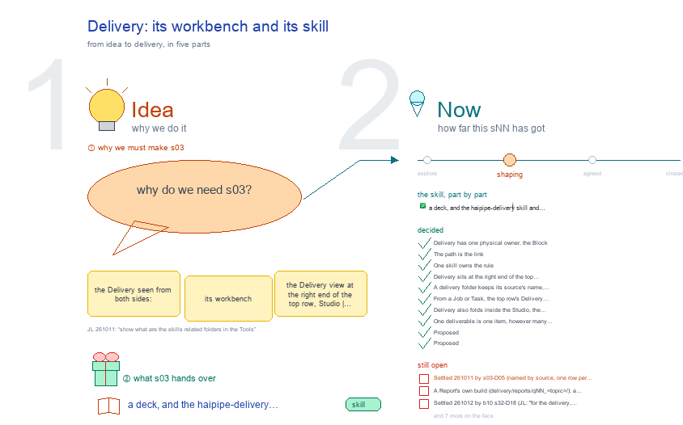

# s03 · Delivery: its workbench and its skill <!-- root #696554 -->

**Tags:** `Structure` · `UI`
**Stage:** shaping

- For <!-- @for #f78806 -->
  - a deck, and the haipipe-delivery skill and … <!-- @for/0 #559def -->
    a deck, and the haipipe-delivery skill and the Delivery view it drives, for the people who write the toolkit skills
- Delivery type <!-- @delivery-type #58a44f -->
  - skill <!-- @delivery-type/0 #34b33e -->
- Topic <!-- @topic #7e13bd -->
  - the Delivery seen from both sides: its … <!-- @topic/0 #439f66 -->
    the Delivery seen from both sides: its workbench (the Delivery view at the right end of the top row, Studio | Block · Job · Task | Delivery, opened from every level) and its skill (`/haipipe-delivery`).
  - Jobs and Tasks make outputs; only the … <!-- @topic/1 #5f3469 -->
    Jobs and Tasks make outputs; only the Block keeps them, in its one `delivery/`; each subfolder leads back to the Job or Task folder that made it.
  - A Report stays with each level (s09-D02); … <!-- @topic/2 #949f45 -->
    A Report stays with each level (s09-D02); what is handed over lives once, at the Block (s09-D05).
  - On screen (JL 261012: "add the UI … <!-- @topic/3 #6654ab -->
    On screen (JL 261012: "add the UI for the expected UI and card UI for showing the results of the delivery, what are the current results"): today's five Delivery screens, the one screen we expect, and one card per result.
- Feeds <!-- @feeds #ffe8e9 -->
  - `reports/` q07_workbench_mapping · q08_workbench_base <!-- @feeds/0 #f08963 -->
- Files <!-- @files #6ce6c5 -->
  - [py] [build_s03_delivery_workbench_skill.py](build_s03_delivery_workbench_skill.py) <!-- @files/0 #cdd658 -->
  - delivery/ <!-- @files/1 #404761 -->
  - history/ <!-- @files/2 #9a00ab -->
  - passes/ <!-- @files/3 #49b302 -->
  - [excalidraw] [s03-delivery-workbench-skill.excalidraw](s03-delivery-workbench-skill.excalidraw) <!-- @files/4 #405601 -->
  - [md] [s03-delivery-workbench-skill.md](s03-delivery-workbench-skill.md) <!-- @files/5 #544558 -->
  - [png] [s03-delivery-workbench-skill.png](s03-delivery-workbench-skill.png) <!-- @files/6 #1d7872 -->
    
- In Tools <!-- @in-tools #f1ecea -->
  - Where its skill and code sit, under … <!-- @in-tools/0 #f573ca -->
    Where its skill and code sit, under `Tools/plugins/haipipe-toolkit/`. The drawing's "In Tools" frame reads the same off the disk on every build: the skill's folder as it is, its version, and each function looked up in its file (JL 261011: "show what are the skills related folders in the Tools").
- What the drawing holds <!-- @what-the-drawing-holds #e0b05d -->
  - One sentence, told left to right by … <!-- @what-the-drawing-holds/0 #d9cca5 -->
    One sentence, told left to right by three frames joined with arrows:
  - Read from disk on every build: each … <!-- @what-the-drawing-holds/1 #7fc69d -->
    Read from disk on every build: each screen through `servers/workbench/frame.py` (`frame.render`, the Runs panel left out), and every Block's `delivery/` in `Tools/blueprints/` and in the SPACE beside Tools whose `Tools/` link leads here (its `examples-*/`).
- Finding (read 261012) <!-- @finding-read-261012 #b32114 -->
  - 13 Blocks keep a `delivery/`: 2 in … <!-- @finding-read-261012/0 #c411b0 -->
    13 Blocks keep a `delivery/`: 2 in Tools, 5 cowork, 5 paper, 1 design. Each theme draws it its own
  - way: a table of files (vanilla, SHIFT), … <!-- @finding-read-261012/1 #2b0112 -->
    way: a table of files (vanilla, SHIFT), a table of sends (Samsung), a PDF preview then tables (paper Boards), and, for a paper Section, a card per lane with its state and the result inside.
  - 9 of 13 show no result inside … <!-- @finding-read-261012/2 #4137ed -->
    9 of 13 show no result inside the page, only names and counts; the 4 paper Boards with a built PDF
  - show one <!-- @finding-read-261012/3 #174c40 -->
    show one. Only the Page Task's cards (`_delivery_cards`) show every result, embedded, with its state.
  - 3 of 13 keep `delivery.md` (SHIFT b02, … <!-- @finding-read-261012/4 #d94c8b -->
    3 of 13 keep `delivery.md` (SHIFT b02, b03, b04: 4 rows, all draft, none sent); none of their
  - screens shows those rows <!-- @finding-read-261012/5 #c0ec1a -->
    screens shows those rows. The other 10 have no record of what went out.
  - Samsung b11 and b12: cowork's send table … <!-- @finding-read-261012/6 #d5f6b4 -->
    Samsung b11 and b12: cowork's send table reads each file of a send folder as a message, so
  - `build.py` is listed with state `sent`; only … <!-- @finding-read-261012/7 #d0a3d8 -->
    `build.py` is listed with state `sent`; only a person may write sent (s03-D05).
  - 37 old `delivery/` folders still sit below … <!-- @finding-read-261012/8 #b46040 -->
    37 old `delivery/` folders still sit below a Block, against s03-D01: 13 in Paper-TimeEventDM, 11 in
  - Paper-AnchorPK, 9 in Paper-CGMtoHbA1c, 4 in Design-PreVisitChecklist <!-- @finding-read-261012/9 #74acb9 -->
- Decided <!-- @decided #55615a -->
  - s03-D01 · Delivery has one physical owner, … <!-- @decided/0 #fd615b -->
    s03-D01 · Delivery has one physical owner, the Block: Jobs and Tasks keep no `delivery/` of their own; their outputs sit under their source address, `delivery/jNN_<job>/tNN_<task>/<lane>/` (carries s02-D14 and s09-D05 on; JL 261010).
  - s03-D02 · The path is the link: … <!-- @decided/1 #1e5496 -->
    s03-D02 · The path is the link: each subfolder leads back to its source, `delivery/jNN_<job>/` to the Job folder and `delivery/jNN_<job>/tNN_<task>/` to the Task folder; `delivery_source()` and `delivery_dir()` in haipipe-draft/src/common.py map one to the other (JL 261010: "track the subfolder to link to the job folder and job/task folder").
  - s03-D03 · One skill owns the rule: … <!-- @decided/2 #cd587c -->
    s03-D03 · One skill owns the rule: `/haipipe-delivery`, beside haipipe-studio and haipipe-report; haipipe-block, haipipe-report, haipipe-cowork and haipipe-delivery (ref/page-delivery.md) point to it instead of each keeping a copy. How a file is built stays with its lane owner (JL 261010: "should we have a skill named /haipipe-delivery? ... just as we have the /haipipe-studio").
  - s03-D04 · Delivery sits at the right … <!-- @decided/3 #194196 -->
    s03-D04 · Delivery sits at the right end of the top row and opens like Studio: only it selected, the work row hidden, the level buttons keep the way back (s02-D18; JL 261010).
  - s03-D05 · A delivery folder keeps its … <!-- @decided/4 #2d48fe -->
    s03-D05 · A delivery folder keeps its source's name, `delivery/jNN_<job>/` (and `tNN_<task>/` under it); no `dNN-<send>/` card and no `dNN_jNN_<job>/` prefix (JL 261011: "could this be still the today's version or to make it like dNN_j01_vXXXX?"). A send is one row of one table, `delivery/delivery.md` (date · for · from · status), so a resend or a second reader is a row, not a copy, and Status turns `sent` only by a person. Why: the path stays the link (s03-D02) with nothing to strip; a paper's version Job already names the send (`j01_v1009_nmi`); and `dNN` is already a design in the design theme (b12, `run-generate-d<NN>`). Like `related/related.md` for what came in (b10 s01-D34), `delivery/delivery.md` lists what went out. Swept 261011: the s01 screens and the s11 · s12 · s13 mock screens show parts by source, and `run-delivery-<dNN>` is `run-delivery-<lane>`, as haipipe-run already names it.
  - s03-D06 · From a Job or Task, … <!-- @decided/5 #d846d1 -->
    s03-D06 · From a Job or Task, the top row's Delivery opens the Block's Delivery, as Studio opens the Block's Studio: a Job or Task has no Studio, Related or Delivery of its own (JL 261011, "apply it to all the workbench"). A source row, Block · jNN · tNN, comes first with the open Job or Task picked, and each source's part shows inside it. This refines s09-D05's "the Job and Task views show their own part": the part is now a pick inside the Block's Delivery, not a separate page. Built by the b16 session in servers/workbench/frame.py (render's Delivery mode).
  - s03-D09 · Delivery also folds inside the … <!-- @decided/6 #c6f9c0 -->
    s03-D09 · Delivery also folds inside the Studio, the third part, under Related and above Timeline (JL 261014: "a new item after the Related to name it as the delivery ... We will show all the delivery and preview them here"): what came in, then what went out. It holds every result of the Block's delivery/, from every Job and Task, as Delivery's own cards (s03-D08, `delivery_view`), each opened on its preview, under the same group bar; its line counts the results by kind (PDF · Word · Web page). The top row's Delivery (s03-D04) stays the full view: its source row, By source, its build. Built 261014 in servers/workbench/frame.py (`studio_delivery`).
  - s03-D10 · One deliverable is one item, … <!-- @decided/7 #0fac44 -->
    s03-D10 · One deliverable is one item, however many files and versions it has (JL 261014: "for the delivery, I think we just make the item to be the same ... all of them should one Delivery Item, and within it, we can see different versions"; "一个东西，我们会有一个 version 又一个 version ... 怎么去比较好地去 handle that?"). Its lanes fold in: a Section's web/, word/ and latex/ builds, a deck's slide/ and its picture in render/. Its versions fold in by name, `-v<N>`: stems that differ only by the number; a numbered stem whose name starts with another's (`…-Evaluation-Visual-v12` joins `…-Evaluation`); an unnumbered variant of a numbered item (`…-Workflow-Symmetric`). Names with no number stay apart (`Paper-SI` beside `Paper`). Opened, a row of versions, newest picked, over that version's preview; a deck with no render is drawn slide by slide from its package (JL 261014: "could we do the preview of the slide as well?"). One rule for Related too (s04-D10). Checked on the real Blocks: SHIFT b31 14 cards → 3, b21 34 → 3, b32 14 → 4, ScalingGlucose 22 → 8; all 355 decks in the SPACEs read. Built 261014 in frame.py (`version_roots`, `delivery_items`, `version_panes`, `pptx_preview`, `?view=pptx`).
- Proposed <!-- @proposed #70cbd1 -->
  - s03-D07 · Proposed (JL 261012): one Delivery … <!-- @proposed/0 #ddb07d -->
    s03-D07 · Proposed (JL 261012): one Delivery screen for every Block, in every theme, top to bottom: the top row with Delivery at its right end (s03-D04); the source row, Block · each Job and Task part (s03-D06); Sends, the rows of `delivery/delivery.md`, what went out, to whom, draft or sent (s03-D05); then Results of the part picked, one card each (s03-D08); many small parts (a paper's Sections) one row each until one is picked; a theme's own checks (a paper's G4) folded below the results, never in place of them. It replaces today's five shapes (① of the drawing).
  - s03-D08 · Proposed (JL 261012): a result … <!-- @proposed/1 #5879ef -->
    s03-D08 · Proposed (JL 261012): a result is a file a reader opens: a PDF, a Word file, a deck, a web page, a sheet, an image; an email is its send folder's draft page. Its twins (a .docx and the .pdf beside it) are one card; build files, logs and pieces (LaTeX's `master.pdf`, a `-view` page, `draft-sections/`) are not results. A card holds: kind and name; state (current · stale · not built · old local); size, when it was built and the part it came from ↗; its sends, the delivery.md rows that name it; the result itself, embedded; its files, Rebuild (copies a prompt, starts nothing) and the way back to its source. The Page Task's cards (`_delivery_cards`) do most of this already, per lane; the proposal widens them to every part of every Block.
- Open <!-- @open #cf9b77 -->
  - Settled 261011 by s03-D05 (named by source, … <!-- @open/0 #2fe74b -->
    Settled 261011 by s03-D05 (named by source, one row per send). Was: each delivery is one dNN card named by the send,
  - `delivery/dNN-<send>/`, with a face `dNN-<send>.md` (For · … <!-- @open/1 #2d0644 -->
    `delivery/dNN-<send>/`, with a face `dNN-<send>.md` (For · From · Status · Files); the parts keep their source folder inside it; Status turns `sent` only by a person, never by a build. Today the folders are named by source (`delivery/j01_v1009_nmi/`): rename now, or at the next send?
  - A Report's own build (`delivery/reports/qNN_<topic>/`): a row … <!-- @open/2 #9d78cc -->
    A Report's own build (`delivery/reports/qNN_<topic>/`): a row in `delivery.md` too?
  - Settled 261012 by b10 s32-D18 (JL: "for … <!-- @open/3 #6e4571 -->
    Settled 261012 by b10 s32-D18 (JL: "for the delivery, we should also have the group tags as well, and have
  - the delivery card, similar to the studio"): … <!-- @open/4 #faae37 -->
    the delivery card, similar to the studio"): yes, the same group bar; one card per result; built in the base.
  - Built 261011 (b16 session): the Block's own … <!-- @open/5 #dc4ba9 -->
    Built 261011 (b16 session): the Block's own Delivery ends with "By source" (part · from · files),
  - one row per Job and Task part, … <!-- @open/6 #546c15 -->
    one row per Job and Task part, each linking back to its folder (s03-D02).
  - A deliverable that pulls from several Blocks … <!-- @open/7 #881427 -->
    A deliverable that pulls from several Blocks (a meeting deck): its own Block, as a paper Board is?
  - Stale needs to know what a result … <!-- @open/8 #643559 -->
    Stale needs to know what a result read: a Page knows (its check); a cowork `build.py` lists its
  - inputs only in words <!-- @open/9 #ee2ea1 -->
    inputs only in words. One small list per part, written by its build?
  - The 37 old `delivery/` folders below a … <!-- @open/10 #dc5263 -->
    The 37 old `delivery/` folders below a Block (Finding 5): move them into the Block's `delivery/`
  - with haipipe-delivery's move, paper by paper? <!-- @open/11 #a83e61 -->
  - Cowork's send table lists `build.py` as a … <!-- @open/12 #9b8326 -->
    Cowork's send table lists `build.py` as a sent message (Finding 4): fix the cowork theme's reader,
  - or replace that table with Sends from … <!-- @open/13 #7c3aa3 -->
    or replace that table with Sends from `delivery.md` (s03-D07)?
  - Build s03-D07 and s03-D08 in frame.py's Delivery … <!-- @open/14 #36da92 -->
    Build s03-D07 and s03-D08 in frame.py's Delivery mode once JL agrees: one card renderer for every
  - part, from `_delivery_cards` <!-- @open/15 #6e4686 -->
  - Agree its **For:** line and **Delivery type:** … <!-- @open/16 #09a2ba -->
    Agree its **For:** line and **Delivery type:** (skill), proposed by the agent 261030?
