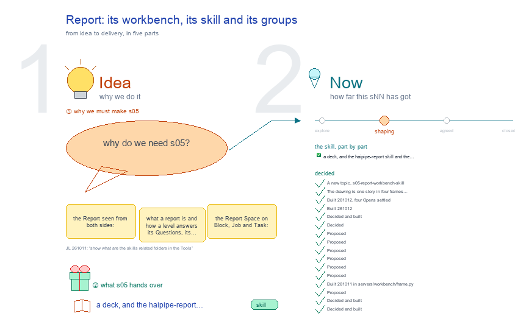

# s05 · Report: its workbench, its skill and its groups <!-- root #464e13 -->

**Stage:** shaping
**Tags:** `Structure` · `Report` · `UI`

- For <!-- @for #f78806 -->
  - a deck, and the haipipe-report skill and … <!-- @for/0 #c9294c -->
    a deck, and the haipipe-report skill and the Report Space on every level, for the people who write the toolkit skills
- Delivery type <!-- @delivery-type #58a44f -->
  - skill <!-- @delivery-type/0 #34b33e -->
- Topic <!-- @topic #7e13bd -->
  - the Report seen from both sides: what … <!-- @topic/0 #ba5bd3 -->
    the Report seen from both sides: what a report is and how a level answers its Questions, its workbench (the Report Space on Block, Job and Task: one card per Question, opened as Logic │ Report with the work inside the Report, b10 s32-D23) and its skill (`/haipipe-report`).
  - Unlike Studio, Delivery and Related, which the … <!-- @topic/1 #6d94c4 -->
    Unlike Studio, Delivery and Related, which the Block alone holds, every level keeps its own reports, as it keeps its own Runs (s06).
  - And how a Report groups its Questions, … <!-- @topic/2 #60788c -->
    And how a Report groups its Questions, theme by theme: one group bar at every level, each theme's suggested groups, a Block's own (merged from s07, below).
- Feeds <!-- @feeds #ffe8e9 -->
  - `reports/` q03_block_questions · q09_studio_report_on_screen <!-- @feeds/0 #5e1e45 -->
- What a report is <!-- @what-a-report-is #4ce823 -->
  - A report is a Page that answers … <!-- @what-a-report-is/0 #294c3a -->
    A report is a Page that answers one Question of its level, `reports/qNN_<topic>/qNN_<topic>.md`.
  - **Question**: asked in the level's face (a … <!-- @what-a-report-is/1 #2a123b -->
    **Question**: asked in the level's face (a Block's `board.md` `## Questions`); the Question and its
  - report share one id, `qNN` (s02-D30) <!-- @what-a-report-is/2 #8cc5a5 -->
  - **Work**: a Job or a Task names … <!-- @what-a-report-is/3 #936522 -->
    **Work**: a Job or a Task names the Question it answers on its own face, `answers: Q01` (or one need
  - of it, `Q01.E2`); a studio topic names … <!-- @what-a-report-is/4 #ac9222 -->
    of it, `Q01.E2`); a studio topic names the Questions it feeds, `**Feeds:** q01_<topic>`.
  - **Answer**: the report walks open → partial … <!-- @what-a-report-is/5 #8acf26 -->
    **Answer**: the report walks open → partial → answered, moved by its writer, never by a Run that
  - finishes alone; its Opening states the answer, … <!-- @what-a-report-is/6 #fc6b23 -->
    finishes alone; its Opening states the answer, then Answer · Evidence · Limits · Next.
  - **Drawing**: generated from the studio frames its … <!-- @what-a-report-is/7 #56c7fb -->
    **Drawing**: generated from the studio frames its `## Figures` lists, never drawn by hand.
  - Every level reports (s09-D02): the Block in … <!-- @what-a-report-is/8 #4888d0 -->
    Every level reports (s09-D02): the Block in `reports/`, a Job in `jNN_<job>/reports/`, a Task in `tNN_<task>/reports/` (s09-D08). A built pdf or docx goes to the Block's `delivery/reports/qNN_<topic>/` (s03).
- Files <!-- @files #6ce6c5 -->
  - [py] [build_s05_report_workbench_skill.py](build_s05_report_workbench_skill.py) <!-- @files/0 #82e270 -->
  - delivery/ <!-- @files/1 #404761 -->
  - history/ <!-- @files/2 #9a00ab -->
  - passes/ <!-- @files/3 #49b302 -->
  - [py] [report_groups.py](report_groups.py) <!-- @files/4 #4078a2 -->
  - [excalidraw] [s05-report-workbench-skill.excalidraw](s05-report-workbench-skill.excalidraw) <!-- @files/5 #36e439 -->
  - [md] [s05-report-workbench-skill.md](s05-report-workbench-skill.md) <!-- @files/6 #622df4 -->
  - [png] [s05-report-workbench-skill.png](s05-report-workbench-skill.png) <!-- @files/7 #06c684 -->
    
- In Tools <!-- @in-tools #f1ecea -->
  - Where its skills and code sit, under … <!-- @in-tools/0 #4e9c32 -->
    Where its skills and code sit, under `Tools/plugins/haipipe-toolkit/`. The drawing reads the same off the disk on every build: ⑥ In Tools, a map, the skill's folder as it is, its version and each function looked up in its file (JL 261011: "show what are the skills related folders in the Tools"); ④'s In Tools branch the files behind the group bar.
- What the drawing holds <!-- @what-the-drawing-holds #e0b05d -->
  - One story in five acts, each act … <!-- @what-the-drawing-holds/0 #887a94 -->
    One story in five acts, each act a row named at the left, a named arrow for every step (s05-D24; the six principles of excalidraw-studio, b31 s01):
  - Act 1, ① one map read left … <!-- @what-the-drawing-holds/1 #0bd53d -->
    Act 1, ① one map read left to right (s05-D25): the Studio sets what Block, Job and Task report, each in its own reports/ -asks-> the Question (the key point) <-feeds- a studio topic, with Q05 as this Block's example -answered by-> a Job, a Task, a Run -read-> open -> partial -> answered (this Block's ids by state, from disk) -> the report Page -> its drawing, built from ## Figures. Its colours are this topic's own: violet the Studio, blue a level, teal the Work, the report's state in the screen's status colours (gray, orange, green), gray a file; a key under the title says so. ② the Report Space as frame.py draws it, its Runs-panel buttons, /haipipe-report and the skills around it.
  - Acts 2 and 3, one frame per … <!-- @what-the-drawing-holds/2 #b9d9b8 -->
    Acts 2 and 3, one frame per theme: its Block, Job and Task rows, today read live through frame.render beside proposed, in the workbench's own colours; a red box and a red → note where not built. Each carries a 60 px title, one key point in the slight colour (#fff3bf), its 🔑 line, and a density badge (a screen is not measured). ③ and ④ are map frames (floor 70); ③'s key point is "The bar counts it", ④'s its centre.
  - Read from disk on every build: `board.md` … <!-- @what-the-drawing-holds/3 #7f061b -->
    Read from disk on every build: `board.md` `## Questions`, each report's `answer-status`, every topic's `**Feeds:**` line (read as `frame.py` reads it), `runs/*/run.yaml` targets, q01's `## Figures`, the Report Space through `servers/workbench/frame.py`, the two skills' versions, this face's Open list, each theme's Report on one real Block, Job and Task, b10's `studio/_groups.txt`, each theme file's Report settings, the paper Board's and Insight-SMSR2v1's own files. The folders read for Acts 2 and 3, in the SPACEs beside Tools (Block · Job · Task):
- Finding (read 261011) <!-- @finding-read-261011 #0ebb4e -->
  - This Block has 12 Questions and 12 … <!-- @finding-read-261011/0 #fe110a -->
    This Block has 12 Questions and 12 reports: 9 open, 2 partial (Q05, Q10), 1 answered (Q11).
  - Q05's Work cell says "no work yet", … <!-- @finding-read-261011/1 #875504 -->
    Q05's Work cell says "no work yet", though two Runs of this Block target it (`run-report-q05`,
  - `run-check-q05`): the row lists Jobs and Tasks … <!-- @finding-read-261011/2 #e811d7 -->
    `run-check-q05`): the row lists Jobs and Tasks only, and this Block has no Jobs.
  - s32's Feeds line says `Q08 (one shared … <!-- @finding-read-261011/3 #d6ff2e -->
    s32's Feeds line says `Q08 (one shared base, a theme each)`, without the folder name, so the
  - Report Space does not count s32 as … <!-- @finding-read-261011/4 #136dca -->
    Report Space does not count s32 as feeding Q08.
  - Report's third row is Ideation · Narrative … <!-- @finding-read-261011/5 #5b7b05 -->
    Report's third row is Ideation · Narrative · High-level logic + Low-level work · Related Questions;
  - the first two list studio topics inside … <!-- @finding-read-261011/6 #4dcc48 -->
    the first two list studio topics inside Report.
- Report groups across the themes (merged from s07, 261012) <!-- @report-groups-across-the-themes-merged-from-s07-261012 #576697 -->
  - How a Report groups its Questions, theme … <!-- @report-groups-across-the-themes-merged-from-s07-261012/0 #4ab474 -->
    How a Report groups its Questions, theme by theme. Today every Block of every theme shows the paper Board's four buttons, Ideation · Narrative · High-level logic + Low-level work · Related Questions (`AUDIENCE_VIEWS`, servers/workbench/frame.py, since 261009), and two of them list studio topics, not Questions. JL 261011, on a screenshot of b10's Report: "for the Report, definitely, the groups should not be design in this way ... these group names should be predefined and also can be added if we want? ... I think for the groups in the report, this will be an very important question to think about." Proposed here: the Report gets the group bar the Studio and Related already have; each theme brings its starting groups, the kinds of question it keeps asking; a Block adds its own; a Question's group is its register `group:` line.
  - Read on disk (261011): <!-- @report-groups-across-the-themes-merged-from-s07-261012/1 #426f49 -->
  - Of the Blocks with a Question register, … <!-- @report-groups-across-the-themes-merged-from-s07-261012/2 #49e266 -->
    Of the Blocks with a Question register, 2 use `group:` at all: a work Block (Corpus · Pilot ·
  - Evaluation · Learning strategy) and one paper … <!-- @report-groups-across-the-themes-merged-from-s07-261012/3 #3d3f0c -->
    Evaluation · Learning strategy) and one paper (a single group, `nmi-cgm-scaling-axes`). The 12 blueprint Blocks (50 Questions) and the 5 cowork Blocks (32 Questions) use none.
  - Where groups exist they name subjects (Corpus, … <!-- @report-groups-across-the-themes-merged-from-s07-261012/4 #cbd035 -->
    Where groups exist they name subjects (Corpus, Pilot) or the event kind a Question is about
  - (Food, Insulin, Medication, Exercise); a theme's kind … <!-- @report-groups-across-the-themes-merged-from-s07-261012/5 #5065bc -->
    (Food, Insulin, Medication, Exercise); a theme's kind and a Block's subject mix in one list.
  - The Report's second row differs by theme … <!-- @report-groups-across-the-themes-merged-from-s07-261012/6 #4ac727 -->
    The Report's second row differs by theme today: vanilla and b10 show the paper's four; paper adds
  - Related Papers, and its version Job shows … <!-- @report-groups-across-the-themes-merged-from-s07-261012/7 #9958e2 -->
    Related Papers, and its version Job shows Questions · Draft-Main · Draft-Appendix · Comments · Cover letter; cowork shows All plus its groups; design Elements · Evaluation; discovery Questions · Reports; insight one view per partition (D · I · K · W); work's Task Draft · Report.
  - Paper and insight today (read 261011, JL: … <!-- @report-groups-across-the-themes-merged-from-s07-261012/8 #00db71 -->
    Paper and insight today (read 261011, JL: "for this two, you need to think about this very carefully ... think about what is the current things looks like"), from servers/workbench-paper/paper_theme.py, servers/workbench-insight/insight_theme.py, insight_views.py and the real Boards:
  - The paper Board's buttons each read their … <!-- @report-groups-across-the-themes-merged-from-s07-261012/9 #a1f95d -->
    The paper Board's buttons each read their own rows (Paper-ScalingGlucose-NatSeries2026):
  - **Ideation**, 5 ideas with their verdicts (s01-ideation), … <!-- @report-groups-across-the-themes-merged-from-s07-261012/10 #a19abc -->
    **Ideation**, 5 ideas with their verdicts (s01-ideation), then register Questions with `group: ideation` (0 here); **Narrative**, 3 standing rows "Will it attract the editor / reviewer / public?", then `group: narrative` (0); **High-level logic + Low-level work**, the current Story's 7 research questions RQ0 to RQ6, which are the register's Q00 to Q06 under a second name, logic beside work; **Related Questions**, the register groups the Story does not feed (0 here: all 7 Questions sit in one group named after the Story, `nmi-cgm-scaling-axes`); **Related Papers**, the Story's paper table (no related/ yet). So four of the five are kinds of question, not the vanilla filter.
  - The paper version Job (j01_v1009_nmi): Questions (the … <!-- @report-groups-across-the-themes-merged-from-s07-261012/11 #d6da82 -->
    The paper version Job (j01_v1009_nmi): Questions (the standing J1 to J4, its own register empty) ·
  - Draft-Main · Draft-Appendix · Comments · Cover … <!-- @report-groups-across-the-themes-merged-from-s07-261012/12 #a743f0 -->
    Draft-Main · Draft-Appendix · Comments · Cover letter, the parts of the manuscript. A Section Task: Table · Reading · Questions · Comments.
  - The two older paper Boards (AnchorPK, FairGlucose) … <!-- @report-groups-across-the-themes-merged-from-s07-261012/13 #8ced67 -->
    The two older paper Boards (AnchorPK, FairGlucose) have no register, no reports/, no studio/: only
  - ideas (4 and 6), claims C1 to … <!-- @report-groups-across-the-themes-merged-from-s07-261012/14 #317f62 -->
    ideas (4 and 6), claims C1 to C8 and comment rounds.
  - Insight-S1023 (plan C) shows no buttons of … <!-- @report-groups-across-the-themes-merged-from-s07-261012/15 #faba49 -->
    Insight-S1023 (plan C) shows no buttons of questions at all: row 2 is the partitions, full · awake ·
  - asleep · cross, one cut at a … <!-- @report-groups-across-the-themes-merged-from-s07-261012/16 #806a5f -->
    asleep · cross, one cut at a time; row 3 the readings, Coverage · Tracks · Consistency · Findings; the body folds by Data · Information · Knowledge · Wisdom, read off each Question's id (release p2: 20 Questions, D 6 · I 6 · K 6 · W 2). A Job: the partitions, then Current · vs previous; a Task: Table · Reading. Its board.md register is empty: the Questions live in the Prototype's release (release.yaml, one question.md each). No `group:` anywhere.
  - Insight's subjects cut across its levels: sleep … <!-- @report-groups-across-the-themes-merged-from-s07-261012/17 #26568b -->
    Insight's subjects cut across its levels: sleep (I03 · K04 · K05), walking (I04 · K02), stress and
  - heart (I05 · K03), events (D05 · … <!-- @report-groups-across-the-themes-merged-from-s07-261012/18 #4d960a -->
    heart (I05 · K03), events (D05 · I06 · K06), glucose control (I01 · I02 · K01).
  - Read on the screens (261012): <!-- @report-groups-across-the-themes-merged-from-s07-261012/19 #e64dfd -->
  - On the bar today: the base (b10, … <!-- @report-groups-across-the-themes-merged-from-s07-261012/20 #2866c5 -->
    On the bar today: the base (b10, 12 cards); the work Block (b02_pretrain_corpus, 5 cards: Corpus 2 ·
  - Evaluation 1 · Learning strategy 1 · … <!-- @report-groups-across-the-themes-merged-from-s07-261012/21 #efb20d -->
    Evaluation 1 · Learning strategy 1 · Pilot 1), because work's Block and Job read as the base; and, since 261012, the cowork Block (Samsung b12, 2 cards, Untagged 2): `cowork_theme.py` leaves its Report to the base's `report_view`, and a report with an event table adds a Questions · Timeline row above the list, a lens (built by the b10-report session). Cowork's Job still lists the Questions that cite it, in a table.
  - Not on the bar: the paper its … <!-- @report-groups-across-the-themes-merged-from-s07-261012/22 #8ab468 -->
    Not on the bar: the paper its five buttons; insight its partitions, Period and level folds
  - (Executive · Data · Information · Knowledge … <!-- @report-groups-across-the-themes-merged-from-s07-261012/23 #cd6e47 -->
    (Executive · Data · Information · Knowledge · Wisdom); the older design board its own six; discovery Questions · Reports; labeling has no Questions on its one Block.
  - Since s05-D16, work and cowork set `report_groups`: … <!-- @report-groups-across-the-themes-merged-from-s07-261012/24 #fbda04 -->
    Since s05-D16, work and cowork set `report_groups`: Data · Pilot · Evaluation and Needs · Works · Blockers
  - show in amber on every Report of … <!-- @report-groups-across-the-themes-merged-from-s07-261012/25 #b4b757 -->
    show in amber on every Report of those themes, with Random thoughts on every theme's bar. No theme sets `report_fixed` or `report_cards` yet (the paper's will, b16).
- Decided <!-- @decided #55615a -->
  - s05-D01 · A new topic, s05-report-workbench-skill: the … <!-- @decided/0 #5c3072 -->
    s05-D01 · A new topic, s05-report-workbench-skill: the Report from both sides, its workbench and its skill, in JL's order: s02 Studio, s03 Delivery, s04 Related (held by the Block alone), s05 Report, s06 Run (the Spaces row, every level its own) (JL 261011).
  - s05-D02 · The drawing is one story … <!-- @decided/1 #95e066 -->
    s05-D02 · The drawing is one story in four frames joined by arrows, the report defined first, the way s06 defines the Run (JL 261011).
  - s05-D03 · Built 261012, four Opens settled: … <!-- @decided/2 #745d81 -->
    s05-D03 · Built 261012, four Opens settled: Open 3, a Question's Work cell also lists this level's own Runs whose run.yaml `target:` is its id (b10 Q05 reads "run-check-q05 done · run-report-q05 done"); Open 8, a bare `Q08` in a Feeds line is read as `q08`, so s32 counts for Q08 (both by the b10-report session in `servers/workbench/frame.py`, `_question_records`, `_note_facts`, `_report_page`). Opens 4 and 7 were settled by s05-D13: the Report's third row is gone, one card per Question under the group bar. Open 5 by s05-D17: every level shows its bar, and a Task with no Question lists its own Page under it.
  - s05-D04 · Built 261012 (JL: "Or just … <!-- @decided/3 #95c53a -->
    s05-D04 · Built 261012 (JL: "Or just the two columns, for the logic and report (which contains the work as well). How do you think about it?"; b10 s32-D23): an opened Question card is two columns, Logic │ Report; the Work (its Jobs, Tasks and this level's Runs, D03) is one line in the Report, under the answer and above the drawing. 11 of b10's 12 Questions have no work, so the middle column stood empty; the drawing gets the width.
  - s05-D05 · Decided and built (JL 261011: … <!-- @decided/4 #7030bf -->
    s05-D05 · Decided and built (JL 261011: "if the report card to show, it will be the same as the sNN, we can create and add the tags"): the Report gets the group bar, Current · the groups · Untagged · + Group, the same code as the Studio's and Related's (`frame.group_list`, a third kind beside `studio` and `related`), one row per Question under it. A Question's groups are its register `group:` line, comma-separated like a topic's **Tags:** line; dragging a row onto a group writes that line; `reports/_groups.txt` keeps the buttons' order (JL 261011: "these group names should be predefined and also can be added").
  - s05-D06 · Decided (JL 261011: "for someother … <!-- @decided/5 #647dd0 -->
    s05-D06 · Decided (JL 261011: "for someother report, the groups are of the special forms, and that ones are fixed, depending on different theme"); the hook is built, each theme fills it: the names come from three places. **Fixed** by the Question's own structure, always shown, never removed: insight's Data · Information · Knowledge · Wisdom, read off the id's letter (D01, I03), as a Related item's subfolder is its group (s04-D08). **Starting**, the theme's kinds of question, shown even when empty (`Theme.report_groups` in `servers/workbench-<theme>/<theme>_theme.py`). **Added**, "+ Group", the Block's subjects (Corpus, Pilot; Food, Insulin; insight's Sleep, Walking, Events, which cut across its four levels). Every theme also starts with **Random thoughts** (named by JL 261012, s05-D22): a question that came up outside the plan, from anyone, parked until it finds its group; it takes the place of `WHO_ASKS` and the Related Questions button, and who asked goes in the Question's text.
  - s05-D07 · Proposed (JL 261011; paper and … <!-- @decided/6 #8a244b -->
    s05-D07 · Proposed (JL 261011; paper and insight revised the same day from their real Reports): each theme's groups, and what stays a row above the list (a lens or another part, s05-D09):
  - The paper keeps what it has: Ideation … <!-- @decided/7 #fac949 -->
    The paper keeps what it has: Ideation (its ideas and their verdicts), Narrative (will it attract), Research questions (today's "High-level logic + Low-level work": the Questions the current telling's **Feeds:** line names, read by id, still drawn logic beside work; b16 s05-D01) and Random thoughts (where today's Related Questions go). Its first draft here, "Claims · Evidence", was written without reading the paper Report and is dropped.
  - s05-D08 · Proposed (JL 261011): Studio and … <!-- @decided/8 #ab585b -->
    s05-D08 · Proposed (JL 261011): Studio and Report share group names, not one list. A name on both shelves filters both: pick UI in the Studio, open the Report, and UI stays picked (the link's `studio_tag`). The Report's button order is `reports/_groups.txt`, then the Studio's order for the same names. A shared name links the two: the paper's Ideation names its s01-ideation topic in the Studio and its 5 ideas in the Report. Related keeps its own groups, its subfolders (s04-D08). Why not one list (the watcher's first proposal): the Report's fixed and starting groups (insight's four levels, Asked by others) would sit as empty buttons on the Studio bar, and the Studio's subjects as empty buttons on the Report's. The watcher session agreed the same day and withdrew the one-list option.
  - s05-D09 · Proposed (JL 261011; revised the … <!-- @decided/9 #5649f3 -->
    s05-D09 · Proposed (JL 261011; revised the same day): a Report's second and third rows hold three different things today, and only one goes on the bar. A **group** gathers rows into one list: Related Questions, cowork's All plus its groups, the paper's Ideation and Narrative. It goes on the bar, and a theme may put rows of its own in it, in the same Question │ Work │ Report shape (the paper's ideas, its "will it attract" rows). A **fixed section** comes from the Question itself (insight's level letter): it becomes a fixed group (s05-D06). A **lens** shows the same Questions another way, or another part of the work: insight's partitions, readings and periods; a Task's Table · Reading or Draft · Report; the paper version's manuscript parts; Related Papers, which reads related/. It stays a row above the list. The vanilla filter "High-level logic + Low-level work" becomes the plain list.
  - s05-D10 · Proposed (JL 261011): by level <!-- @decided/10 #c8f735 -->
    s05-D10 · Proposed (JL 261011): by level. A Block's Report groups its own register. A Job's shows the Block's Questions it answers (`answers: Q05`), with their groups, so picking a group at the Block and opening a Job keeps it. A Task's Report is its own result: no Questions, no bar (s09-D02).
  - s05-D11 · Proposed (JL 261011): b10's own … <!-- @decided/11 #ebfe22 -->
    s05-D11 · Proposed (JL 261011): b10's own 12 Questions in its existing Studio groups, so b10 needs no new name (from the watcher's mapping, with Q03 moved to Report, a group b10's Studio gained on 261011): Levels Q01 Q02 · Report Q03 · Structure Q04 · Run and Skill Q05 Q06 · UI Q07 Q08 Q09 · Guide Q10 Q11 · Server Q12.
  - s05-D12 · Proposed (JL 261011): a theme … <!-- @decided/12 #263dfb -->
    s05-D12 · Proposed (JL 261011): a theme may also predefine **standing Questions**, asked on every Board or version with no register line, each in its group. The paper already does: Narrative's three "Will it attract the editor / reviewer / public?" on the Board, and J1 to J5 on every version (What is the one-minute story? · Why this venue? · Which writing principles does it follow? · Is it ready to send? · What changed since the last send?, J5 a revision only; `STANDING` in paper_theme.py). This is where "what are the typical questions to ask" (JL 261011, to the sNN session) gets each theme's answer.
  - s05-D13 · Built 261011 in servers/workbench/frame.py (workbench … <!-- @decided/13 #2a5464 -->
    s05-D13 · Built 261011 in servers/workbench/frame.py (workbench 1.19.0). `report_view` draws each Question as a folding card, as a Studio topic is (⋮⋮ · its id and title · its chips · state and work · Add to Current), opened on its Logic │ Work │ Report row, under `group_list(kind="reports")`; the vanilla Report has no second row any more. `_question_records` reads the register once for the cards and for `question_rows`, which the paper and cowork themes still call. `_register_set_groups` writes the `group:` line in the face's `## Questions` yaml (replaced, added after `title:`, or removed), touching no other line. `Theme.report_fixed(row)` gives a theme's fixed groups (no ×; a remove is refused, "fixed by the theme"), `Theme.report_groups` its starting ones. Order: `reports/_groups.txt`, then the theme's starting groups, then the Studio's order for the same names. b10's 12 Questions got their `group:` lines through the same op (s05-D11, Q11 under Guide until Open 10). Checked live on 5623: the bar reads Structure 1 · Levels 2 · Guide 2 · Run and Skill 2 · Server 1 · UI 3 · Report 1, picking UI leaves Q07 · Q08 · Q09, and a save over HTTP writes and removes a group line. The paper and insight themes draw their own Report and do not use the hook yet (b16 for the paper; b11 for insight). For the paper, b16 asked for two more, added the same day (workbench 1.19.1): `report_fixed(row, owner)` (its fixed group comes from the telling's **Feeds:**; a one-argument rule still works), and `Theme.report_cards(level, folder, root)`, the theme's own cards that are no register row (its ideas, its standing Questions), drawn under the same bar, not draggable, their groups fixed.
  - s05-D14 · Proposed (JL 261012, on Insight-SMSR2v1's … <!-- @decided/14 #4170bb -->
    s05-D14 · Proposed (JL 261012, on Insight-SMSR2v1's Job Report: "besides the period, we can also have the topics: with different topics across D I K W"): an insight Report gets a **Topic** row under Period, and it is the group bar (Current · the topics · + Group). The level folds stay as they are today (Executive, added 261012 by the insight session, then Data · Information · Knowledge · Wisdom), each counting only the topic picked, instead of becoming fixed buttons (this revises s05-D06's insight example). Why: a topic gathers Questions (a group); the partitions and Period show the same Questions on another cut or time (lenses, s05-D09), and the levels are already the folds. Read 261012 off the Task names of release p1 (49 Questions), 12 topics, each across levels: Variants 9 (D02 · I02 I12 I18 I24 · K05 K11 · W01 W02), Timing 5 (I04 I09 · K03 K07 K17), Demographics 4 (I03 I07 I20 · K02), Data quality 4 (D01 D04 D05 · I19), Place and income 5, Medical context 4, Behaviour 4, Wording 3, Partitions 3, Sender 3, Prior messages 3, Funnel 2. The names are guessed from the Task names until agreed; a Question's topic is a `group:` line in its question.md in the Prototype (Open 15).
  - s05-D16 · Decided and built (JL 261012: … <!-- @decided/15 #52eaed -->
    s05-D16 · Decided and built (JL 261012: "for each group, I think we might have the things like the fixed groups (or the suggested default group labels), do we have that? if so, we might give them to different colors"): a Report group's button takes the colour of where its name comes from: **gray**, fixed by the theme (`Theme.report_fixed`, `report_cards`; no ×); **amber**, suggested by the theme and shown even when empty (`Theme.report_groups`, and "Random thoughts" in every theme, s05-D06, D22); **white**, the Block's own (+ Group). The bar's help line names the colours. Built in `servers/workbench/frame.py` (`group_list` takes `fixed`; `--grp-fixed-*`, `--grp-sug-*`, light and dark; `REPORT_SUGGESTED`). The suggested groups of s05-D07 are set for work (Data · Pilot · Evaluation, `work_theme.py`) and cowork (Needs · Works · Blockers, `cowork_theme.py`); the guessed ones (design, discovery, labeling) are not. A drawing shows the same colours through `canvas.UI_KIND` (a box's `customData.ui_kind`), and marks what is proposed or guessed with a red box and a red → note, never with a colour the screen does not have (JL 261012: "if we want to show the indicator, we can use the red box to circle them and give --> text to explain them, I don't want it to be mislead the UI design").
  - s05-D17 · Decided and built (JL 261012: … <!-- @decided/16 #9e4fda -->
    s05-D17 · Decided and built (JL 261012: "for the report, we might have the report group tags for both the block level, job level and task level"): every level's Report shows its group bar, Block, Job and Task, even before its first Question (then "No Questions at this level yet", or a Task's own Page row, under it). A Job with no Questions of its own shows the Block's it answers: `answers:` on its face, or, new, the Block's Questions whose register `work:` names a file of the Job (a cowork register); cowork's Job Report is now the base's cards. A work Task keeps Draft · Report as a lens and shows its bar under Report. This revises s05-D10 ("Task: no bar"). `report_view` always returns the bar (`empty` is the list under it). Tests: `_host/tests/test_frame.py` (`test_report_bar_at_every_level_and_its_kinds_coloured`) and `workbench-cowork/tests/test_cowork_theme.py`; 221 workbench tests pass.
  - s05-D20 · Decided (JL 261012: "yes, go … <!-- @decided/17 #1dd445 -->
    s05-D20 · Decided (JL 261012: "yes, go ahead and do it", on the plan to meet b31 s01-D01): the drawing is three large frames in one row joined by arrows: ① the screens, first and largest; ② a workflow map, how a group's name reaches the Report; ③ a mind map of every part. The 261011 frames (Across the themes, Paper and insight today, In Tools) are folded into ② and ③; their stale lines are corrected: a Task now has a bar (s05-D17), insight's levels stay folds and its topics are a group (s05-D14). The restored version is in `history/` (-261012d).
  - s05-D21 · Decided (JL 261012: "like each … <!-- @decided/18 #c942e9 -->
    s05-D21 · Decided (JL 261012: "like each theme will be a frame, and within the frame, we will have the report for the block, job, and task"): the screens become one frame per theme, eight frames, each with its Block, Job and Task Report today beside proposed. At a Job or Task the rows a theme draws today (a cut, Period, a manuscript part, Draft · Report) stay as lenses above the bar; the bar carries the theme's suggested groups at every level (s05-D17); insight's Topic row sits on its Job, where its Questions are. The discovery Block read is now SHIFT's b01_shift_proposal_evidence, which has a Job and a Task. The 261012d version is in `history/` (-261012e).
  - s05-D22 · Decided and built (JL 261012: … <!-- @decided/19 #8bc55a -->
    s05-D22 · Decided and built (JL 261012: "How about Random-Thoughts?", then "go"): the group every theme starts with is **Random thoughts**, renamed from "Asked by others": a question that came up outside the plan, from anyone, parked until it finds its group. Untagged stays the row with no group line; Random thoughts is parked on purpose. Spelled with a space, like every group name on the bar. `REPORT_SUGGESTED` in `servers/workbench/frame.py` (workbench 1.20.3); settles Open 12.
  - s05-D23 · Decided (JL 261012: "how do … <!-- @decided/20 #ac2bf4 -->
    s05-D23 · Decided (JL 261012: "how do you think you can update b10-s7 a bit without huge changes?", then "I think we should have the arc, please go ahead and do it"): four small changes, no new content. Big words (frame titles 60 px, steps 38, branches 34); one key point per frame in #fff3bf; the frames in three named acts with a named arrow for each step (Act 1 the themes whose bar is live, Act 2 those that draw their own Report, Act 3 the two maps); a density badge in each frame (② 117, ③ 72 words per million px, both map frames over the floor of 70; ③'s branches now leave the centre as arrows). Written with canvas.write(palette=False) after colour_ui and apply_font, so the key colour stays. The 261012e version is in `history/` (-261012f). s05-D15, D18, D19 · Withdrawn 261012 (JL: "I think you ruin the whole things. I just mean for the s00 to have the tree, why you make all the others to be the tree as well"): today's three-tree, box-map and flow redraws are undone; the drawing is the 261011 one with its first frame redrawn as the per-theme screens (s05-D16).
  - s05-D24 · Decided and done (JL 261012: … <!-- @decided/21 #b8f565 -->
    s05-D24 · Decided and done (JL 261012: "could you merge s07 to the s05?"; s00 had proposed it, to bring b10 back near 10 topics): s07-report-groups-across-themes is merged into this topic and its folder removed, as s04 went into s02 on 261010. Its decisions s07-D01 to D19 are s05-D05 to D23 and its Opens 1 to 8 are Opens 9 to 16, every citation renamed (Tools code and tests, skills and their CHANGELOGs, b10's and b16's faces and builders). One drawing, since the Studio opens only a topic's first: this topic's four frames are Act 1, s07's three acts are Acts 2 to 4 (its ② and ③ are ⑤ and ⑥), the reference row is Act 5; this replaces s05-D02's four frames. s07's builder is `report_groups.py`; the Still open frame reads this face's Open list. s07's Run passes are run-draw-s05's p06 to p18.
  - s05-D25 · Decided and done (JL 261012: … <!-- @decided/22 #3b1417 -->
    s05-D25 · Decided and done (JL 261012: "for the act 1, could you update it a bit, by merging the n frames into few frames? How do you think, and by adding the colors."): Act 1's four frames are two. ① Every level reports, ② Work names its Question and ③ The report says the answer were one idea in three thin frames (89, 58 and 75 words per million px, all under their floor); they are one map, ① A report, from its Question to its answer (114, a map frame, floor 70), the Question its key point. ④ Workbench and skill stays a screen, now ②, with a 60 px title and a key line. Act 4's ⑤ and ⑥ are ③ and ④. ① is in colour, for this topic only: violet the Studio, blue a level, teal the Work, the report's state in the workbench's own status colours (canvas.STATUS_UI), gray a file; red stays open, green a change. Q05's red ask (its Work cell missed its own Runs) is gone: frame.py lists them since s05-D03.
  - s05-D26 · Decided and done (JL 261012: … <!-- @decided/23 #c039fb -->
    s05-D26 · Decided and done (JL 261012: "yes, please do it", on doing Act 5 as Act 1 was done): Act 5's three frames are two. Still open and This Block's Questions are one frame, ⑤ Still open, and this Block's Questions: the register on top (each state in ①'s colour), the face's Open list in red in two columns under it, a key line counting answered, partial and open (179 words per million px, a text frame, floor 120). In Tools is s05's own ⑥, a map: where the skill sits, the two skills' folders, the code that draws the row, Around it and each SKILL.md, every box joined by a named arrow (84, a map frame, floor 70); the shared tools_frame, which s02 to s06 use, is left as it is. check.py: 14 frames, no ❌; its 👤 lines are judged: ①'s three tree lines and ⑥'s forty are real folders, and ⑤ is the register and the Open list, two lists kept as lists since Act 5 is for reference.
  - Carried in, decided elsewhere: every level reports … <!-- @decided/24 #1499a0 -->
    Carried in, decided elsewhere: every level reports (s09-D02), each in its own `reports/` (s09-D08); Studio and Report are separate Spaces (s02-D05); the button says Report (s02-D10); `qNN` is the Question and its report (s02-D30); a report's drawing is built from `## Figures` (s02-D23) and a frame's name is the contract (s02-D24); checked is not a fourth state (s21-D04).
- Open <!-- @open #cf9b77 -->
  - What must each level's report answer? <!-- @open/0 #40d8c4 -->
    What must each level's report answer? The Studio sets it, each level reports (s01, s09 Later 1).
  - List Job and Task reports in the … <!-- @open/1 #ffd05e -->
    List Job and Task reports in the Block's Report, by source (s09-D08), once a Job has one?
  - Settled 261012 by s05-D03 (the level's own … <!-- @open/2 #4ada31 -->
    Settled 261012 by s05-D03 (the level's own Runs are listed). Was: the Work column lists Jobs and Tasks only: show the level's own Runs on a Question too?
  - Settled by s05-D13 (s05-D03) <!-- @open/3 #010e73 -->
    Settled by s05-D13 (s05-D03). Was: Ideation and Narrative, on Report's third row, list studio topics; s02-D05 keeps Studio and Report
  - apart: keep them, or link out to … <!-- @open/4 #fee47b -->
    apart: keep them, or link out to Studio? (proposed: they move to the Studio, s05-D09)
  - Settled by s05-D17 (s05-D03) <!-- @open/5 #2371ef -->
    Settled by s05-D17 (s05-D03). Was: a Task without Questions shows its own face as its report; s09-D08 gives a Task
  - `reports/qNN_<topic>/`: which one? <!-- @open/6 #a51e57 -->
    `reports/qNN_<topic>/`: which one? (proposed: a Task's Report is its own result, s05-D10)
  - When a cited studio frame changes, flag … <!-- @open/7 #d9f421 -->
    When a cited studio frame changes, flag the report for review before its answer changes?
  - Settled by s05-D13 (s05-D03) <!-- @open/8 #871e9a -->
    Settled by s05-D13 (s05-D03). Was: the third row says "High-level logic + Low-level work", the row heads "Logic · Work · Report":
  - one name? <!-- @open/9 #5de965 -->
    one name? (proposed: that view becomes the plain list, s05-D09)
  - Settled 261012 by s05-D03 (a bare `Q08` … <!-- @open/10 #5a09b9 -->
    Settled 261012 by s05-D03 (a bare `Q08` is read). Was: a Feeds line that names a Question without its folder name is not read (s32): read `Q08` too, or
  - fix the line? <!-- @open/11 #6392b1 -->
  - Share the names (s05-D08, the recommendation; the … <!-- @open/12 #df9dae -->
    Share the names (s05-D08, the recommendation; the watcher session agreed 261011) or, as the
  - alternative, keep one list for Studio and … <!-- @open/13 #3d6a54 -->
    alternative, keep one list for Studio and Report? A real case, 261012: the Studio's Levels group went with its three topics, while Q01 and Q02 keep `group: Levels`; shared names keep their Report group (④ lists it after the Studio's names), one list would leave them Untagged.
  - Q11, how a Page's logic is drawn: … <!-- @open/14 #953ee8 -->
    Q11, how a Page's logic is drawn: Guide or UI?
  - The starting groups of discovery, design and … <!-- @open/15 #ada98d -->
    The starting groups of discovery, design and labeling are guesses: learn them on one real Block
  - each (s01's s09 Later 1 says the … <!-- @open/16 #8554c9 -->
    each (s01's s09 Later 1 says the same).
  - Settled 261012 by s05-D22: one name in … <!-- @open/17 #30abc9 -->
    Settled 261012 by s05-D22: one name in every theme, Random thoughts. Was: one name in every theme, or the
  - theme's own word (paper: Reviewers)? <!-- @open/18 #fd2bce -->
  - Each theme Block (b11 to b17) owns … <!-- @open/19 #739d98 -->
    Each theme Block (b11 to b17) owns its theme's list? For the paper, yes (b16 s05-D02, proposed
  - 261011): b10 keeps the rule and this … <!-- @open/20 #28e960 -->
    261011): b10 keeps the rule and this table, b16 the paper's four groups and its standing Questions. The other six theme Blocks have not answered.
  - Answered for the paper by b16 s05-D01 … <!-- @open/21 #337cda -->
    Answered for the paper by b16 s05-D01 (proposed 261011): a Question's `group:` is its kind
  - (Ideation, Narrative, or an asker: reviewer, coauthor, … <!-- @open/22 #737922 -->
    (Ideation, Narrative, or an asker: reviewer, coauthor, editor, reader). The telling is said once, in its **Feeds:** line (q00_ to q06_), so Research questions are the Questions it feeds, read by id; a research question needs no group line, and `nmi-cgm-scaling-axes` keeps working unedited. b16 s05 Open 5 asks which name the screen keeps, RQ0 or Q00 (JL's choice).
  - An insight topic (Sleep <!-- @open/23 #155a49 -->
    An insight topic (Sleep; Variants, Timing): a `group:` line in each question.md's front matter in the
  - Prototype, so every Board of that Prototype … <!-- @open/24 #3da07a -->
    Prototype, so every Board of that Prototype shares it? And agree the 12 SMS topic names (s05-D14).
  - A paper's research questions have two names, … <!-- @open/25 #6dc0c2 -->
    A paper's research questions have two names, RQ0 to RQ6 in the Story and Q00 to Q06 in the
  - register: which one does the screen keep … <!-- @open/26 #78e18e -->
    register: which one does the screen keep (b16 s05 Open 5, JL's choice)?
  - Agree its **For:** line and **Delivery type:** … <!-- @open/27 #09a2ba -->
    Agree its **For:** line and **Delivery type:** (skill), proposed by the agent 261030?
