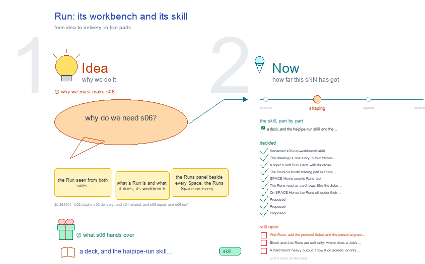

# s06 · Run: its workbench and its skill <!-- root #c6320a -->

**Stage:** shaping
**Tags:** `Structure` · `Run and Skill`

- For <!-- @for #f78806 -->
  - a deck, and the haipipe-run skill and … <!-- @for/0 #e84148 -->
    a deck, and the haipipe-run skill and the Runs panel beside every Space, for the people who write the toolkit skills
- Delivery type <!-- @delivery-type #58a44f -->
  - skill <!-- @delivery-type/0 #34b33e -->
- Topic <!-- @topic #7e13bd -->
  - the Run seen from both sides: what … <!-- @topic/0 #f43d98 -->
    the Run seen from both sides: what a Run is and what it does, its workbench (the Runs panel beside every Space, the Runs Space on every level) and its skill (`/haipipe-run`).
  - It started from JL 261007 ("how do … <!-- @topic/1 #db9dfe -->
    It started from JL 261007 ("how do we manage the runs here ... the soft run, the hard run, how the run looks like in the folder and workbench"); the earlier decisions are s01-D14 and s01-D15, and the change that put them in the skill is `../s01-overall-tree-structure/run-skill-draft.md`.
- Feeds <!-- @feeds #ffe8e9 -->
  - `reports/q01_bjtr_boundary/` (what a Run is, and where … <!-- @feeds/0 #d48792 -->
    `reports/q01_bjtr_boundary/` (what a Run is, and where it may sit), `q07_workbench_mapping/` (the Runs panel, the Runs Space, the pop-out).
- What a Run is <!-- @what-a-run-is #ac1cfc -->
  - A Run is one piece of work, … <!-- @what-a-run-is/0 #3542da -->
    A Run is one piece of work, asked for once. It has four parts:
  - **Target**: what it works on (one topic, … <!-- @what-a-run-is/1 #d679fa -->
    **Target**: what it works on (one topic, one report, one model fit).
  - **Ticket**: the ask, written down: who does … <!-- @what-a-run-is/2 #c02ba8 -->
    **Ticket**: the ask, written down: who does what, with which inputs.
  - **Close rule**: how we know it is … <!-- @what-a-run-is/3 #ff9686 -->
    **Close rule**: how we know it is done, or honestly not done.
  - **Output**: what stays after it: its own … <!-- @what-a-run-is/4 #e4abfe -->
    **Output**: what stays after it: its own `result/`, or the thing it changed.
  - It is one folder, `runs/<run>/`, in the … <!-- @what-a-run-is/5 #5cdb29 -->
    It is one folder, `runs/<run>/`, in the `runs/` of its level (Block, Job or Task). Each round of work on the same target is a **pass**, `passes/pNN-<MMDD>/`. A click, a tool call, a retry or a comment is not a new Run: it is a step inside a Run, or a new pass of it.
  - What it leaves behind decides its kind <!-- @what-a-run-is/6 #66ec19 -->
    What it leaves behind decides its kind. A **hard** Run makes new evidence (a number, a table, a figure) in its own `result/`, and only a work Task holds one. A **soft** Run changes something its level keeps (`draft/`, `studio/`, `reports/`, `delivery/`), at any level, and counts as work, not evidence.
- Files <!-- @files #6ce6c5 -->
  - [py] [build_s06_run_workbench_skill.py](build_s06_run_workbench_skill.py) <!-- @files/0 #2c2c5c -->
  - delivery/ <!-- @files/1 #404761 -->
  - history/ <!-- @files/2 #9a00ab -->
  - passes/ <!-- @files/3 #49b302 -->
  - [excalidraw] [s06-run-workbench-skill.excalidraw](s06-run-workbench-skill.excalidraw) <!-- @files/4 #12f34b -->
  - [md] [s06-run-workbench-skill.md](s06-run-workbench-skill.md) <!-- @files/5 #24d1ea -->
  - [png] [s06-run-workbench-skill.png](s06-run-workbench-skill.png) <!-- @files/6 #a0c6e0 -->
    
- In Tools <!-- @in-tools #f1ecea -->
  - Where its skill and code sit, under … <!-- @in-tools/0 #f573ca -->
    Where its skill and code sit, under `Tools/plugins/haipipe-toolkit/`. The drawing's "In Tools" frame reads the same off the disk on every build: the skill's folder as it is, its version, and each function looked up in its file (JL 261011: "show what are the skills related folders in the Tools").
- What the drawing holds <!-- @what-the-drawing-holds #e0b05d -->
  - Read from disk on every build: this … <!-- @what-the-drawing-holds/0 #0849aa -->
    Read from disk on every build: this Block's Runs (`runs/*/run.yaml`, each ticket's `close:` line), its Runs Space through `servers/workbench/frame.py`, and haipipe-run's version.
- Finding (read 261011) <!-- @finding-read-261011 #0ebb4e -->
  - Every Run in this Block names its … <!-- @finding-read-261011/0 #e4c64e -->
    Every Run in this Block names its close rule (read 261012: 12 Runs). Five still said `close: <what settles
  - it>`, the line `soft_run.py new` leaves when … <!-- @finding-read-261011/1 #a8591a -->
    it>`, the line `soft_run.py new` leaves when it is given none (`run-draw-s01`, `s02`, `s04`, `s08`, `s21`); they now say what `run-draw-s05` and `s06` say. `new_topic.py session` had made four of them; it now writes the close rule itself (s06-D06).
  - The Runs Space shows 4 columns (Run … <!-- @finding-read-261011/2 #1d7e6b -->
    The Runs Space shows 4 columns (Run · kind · type · status) and no pop-out; s06-D01 proposed seven
  - columns and a pop-out <!-- @finding-read-261011/3 #153aff -->
  - The hard example still sits in the … <!-- @finding-read-261011/4 #1dad72 -->
    The hard example still sits in the older layout (`runs/r01_rate_tir_hypo.sh` beside
  - `results/r01_rate_tir_hypo/`) <!-- @finding-read-261011/5 #499f6f -->
- Settled (in haipipe-run 0.33.1) <!-- @settled-in-haipipe-run-0-33-1 #2f8651 -->
  - A Run is hard or soft by … <!-- @settled-in-haipipe-run-0-33-1/0 #7ea4a5 -->
    A Run is hard or soft by where its output lands. Hard `rNN_<slug>`: its own `result/`, evidence,
  - a work Task only <!-- @settled-in-haipipe-run-0-33-1/1 #49c49f -->
    a work Task only. Soft `run-<type>-<target>`: writes into its scope's `draft/ studio/ reports/ delivery/`, not evidence, at a Block, a Job or a Task.
  - One Run is one folder in `runs/`: … <!-- @settled-in-haipipe-run-0-33-1/2 #873792 -->
    One Run is one folder in `runs/`: its ticket, `run.yaml` (the card), and `passes/pNN-<MMDD>/`;
  - a hard Run adds `config.yaml` and `result/` <!-- @settled-in-haipipe-run-0-33-1/3 #26fbd7 -->
    a hard Run adds `config.yaml` and `result/`. Folder name = ticket stem = `run.yaml` `run:`.
  - A pass is one more execution (hard) … <!-- @settled-in-haipipe-run-0-33-1/4 #ab2104 -->
    A pass is one more execution (hard) or one more round on the same target (soft); new inputs or a
  - new target make a new Run <!-- @settled-in-haipipe-run-0-33-1/5 #6e3d0e -->
  - Heavy output goes to `_WorkSpace/ProjectResult/<...>/<run>/` <!-- @settled-in-haipipe-run-0-33-1/6 #b803e8 -->
    Heavy output goes to `_WorkSpace/ProjectResult/<...>/<run>/`; `result/heavy.yaml` points to it.
- Decided <!-- @decided #55615a -->
  - s06-D04 · Renamed s06-run-workbench-skill (was s05-runs): the … <!-- @decided/0 #d879f5 -->
    s06-D04 · Renamed s06-run-workbench-skill (was s05-runs): the Run seen from both sides, its workbench and its skill, in JL's order: s02 Studio, s03 Delivery, s04 Related (held by the Block alone), s05 Report, s06 Run (the Spaces row, every level its own) (JL 261011).
  - s06-D05 · The drawing is one story … <!-- @decided/1 #df971b -->
    s06-D05 · The drawing is one story in four frames joined by arrows, and it defines the Run first, in plain words, before hard and soft, passes and the screen (JL 261011: "make the run to be a good definition and explanation, about what they are doing"). The 261010 five frames are in history/.
  - s06-D06 · A topic's soft Run starts … <!-- @decided/2 #9cb58f -->
    s06-D06 · A topic's soft Run starts with its close rule (261011; settles the old Open 7): `new_topic.py session` writes "a person moves the topic's Stage to agreed, or names what is still wrong in red on the drawing" into `run-draw-<sNN>`'s ticket (haipipe-studio 0.9.2). `soft_run.py new` still takes any rule with `--close`; it does not refuse a ticket without one, since other Run types have no default. b10's five placeholders were filled with the same words, naming JL.
  - s06-D07 · The Studio's fourth folding part … <!-- @decided/3 #78ff27 -->
    s06-D07 · The Studio's fourth folding part is Runs, under Delivery (JL 261019, on b01 Prediction reliability's Studio: "should also list another one to show the Hard Run, for each task, and just show their status"): every hard Run (`runs/rNN_*`) of every Task under the Block, Job → Task, one line each with its mark, status and finish day, a tally per Job and Task; read from each Run's `result/runtime.yaml`, else its `run.yaml`; soft Runs and history copies left out. Settles Open 4 for the Studio: rolled up from every level below. Built in `servers/workbench/frame.py` (`hard_runs`, `studio_runs`), tested in `_host/tests/test_frame.py`; Timeline and Folder moved to the fifth and sixth parts.
  - s06-D08 · SPACE Home counts Runs too … <!-- @decided/4 #9956c5 -->
    s06-D08 · SPACE Home counts Runs too (JL 261019: "能不能整个 project level 也看一下它跑得怎么样", "在 project level 下面，也可以加个 run"): a Project's line carries its hard Runs by status (`▶️ 284 · ✅96 ❌46 🟧90 ⏳4 ⬜48` for Proj12), each Block row its own tally, and an opened Block row a third group, ▶️ Runs (merged into Jobs, s06-D10), after Studio and Jobs, drawn by the same `frame.runs_list` as the Studio's Runs part. Built in `servers/space-home/home.py`, tested in haipipe-draft `tests/test_home.py`.
  - s06-D09 · The Runs read as card … <!-- @decided/5 #58dae1 -->
    s06-D09 · The Runs read as card rows, like the Jobs rows (JL 261019, on bare nested lists: "they are not in the good format, right?"): one folded card per Job with its Task and Run counts and its tally on the right; opened, each Task a heading and its Runs an aligned table (mark · Run · status · finish day); the legend one short line. One look on both pages: `frame.RUN_CSS`, used by the Studio and SPACE Home (class `rn-card`, not `topic`, so the Studio's topic scripts leave it alone).
  - s06-D10 · On SPACE Home the Runs … <!-- @decided/6 #fac15c -->
    s06-D10 · On SPACE Home the Runs sit under their Jobs, one group, not two (JL 261019: "put the run status under the jobs, I mean merge the jobs and runs and no need to separate them, to save the spaces"): a Job row reads `j01_… · 2 Tasks · 5 Runs` with its tally `✅2 🟧1 ⬜2` beside ↗; opened, each Task with its status and tally, its Runs under it (mark · Run · status · finish day), then the Job's face. The Jobs head reads `🗂 Jobs 3 · ⚙️ 145 Runs`; the legend is one line under the Jobs. Built in `servers/space-home/home.py` (`_job_rows`, `_task_runs`), one Run-line writer `frame.run_cells`; tested in haipipe-draft `tests/test_home.py`. The Studio's Runs part (s06-D07) keeps its own card per Job.
- Proposed <!-- @proposed #70cbd1 -->
  - s06-D01 · Proposed (261007): on screen, a … <!-- @proposed/0 #eb6480 -->
    s06-D01 · Proposed (261007): on screen, a Runs panel sits beside every Space at every level: that Space's run types as buttons (they copy a prompt and start nothing), then the recent Runs of that Space. Each level tab also has a Runs Space: one plain list of its Runs, read from each `run.yaml` (run · kind · type · target · status · passes · last), filtered by the third row (All · hard · soft · <type>). A row opens the Run pop-out: the card, its passes, a result preview (hard: metrics and the first figure; soft: before/after and the run table).
  - s06-D02 · Proposed (261007): a wet Run … <!-- @proposed/1 #fd130a -->
    s06-D02 · Proposed (261007): a wet Run is a hard Run a person carries out: an `rNN_<slug>.md` protocol ticket, a `result/` holding the data collected and an observation log, and a `runtime.yaml` the person signs. It cannot repeat exactly, so a replication is a new Run. Needs haipipe-run to accept a protocol ticket and a signed receipt (open 1).
  - s06-D03 · Proposed (261007): an agent session … <!-- @proposed/2 #744ab8 -->
    s06-D03 · Proposed (261007): an agent session that works on a studio topic is a pass of that topic's soft Run, `run-draw-<sNN>` (s02-D27): the ask, the summary, what changed. So a session needs no folder of its own, and it lists with every other Run.
- Open <!-- @open #cf9b77 -->
  - Wet Runs: add the protocol ticket and … <!-- @open/0 #97bf15 -->
    Wet Runs: add the protocol ticket and the person-signed receipt to haipipe-run?
  - Block and Job Runs are soft only: … <!-- @open/1 #470ab7 -->
    Block and Job Runs are soft only: where does a Job's batch launch (`run-launch-<group>`) go?
  - A hard Run's heavy output: show it … <!-- @open/2 #c9120d -->
    A hard Run's heavy output: show it on screen, or only its `heavy.yaml` pointer?
  - The Runs Space: this level's Runs only, … <!-- @open/3 #b42d0e -->
    The Runs Space: this level's Runs only, or rolled up from the levels below? (The Studio's Runs part rolls
  - up, s06-D07; the per-level Runs Space is … <!-- @open/4 #1ad06a -->
    up, s06-D07; the per-level Runs Space is still open.)
  - A soft pass: when does it close, … <!-- @open/5 #40b357 -->
    A soft pass: when does it close, and who writes its `touched.yaml`?
  - The older layout: when does haipipe-project `update` … <!-- @open/6 #b8959b -->
    The older layout: when does haipipe-project `update` move each Project's Runs?
  - The Runs Space: build s06-D01's seven columns … <!-- @open/7 #deb96c -->
    The Runs Space: build s06-D01's seven columns and the pop-out?
  - Agree its **For:** line and **Delivery type:** … <!-- @open/8 #09a2ba -->
    Agree its **For:** line and **Delivery type:** (skill), proposed by the agent 261030?
