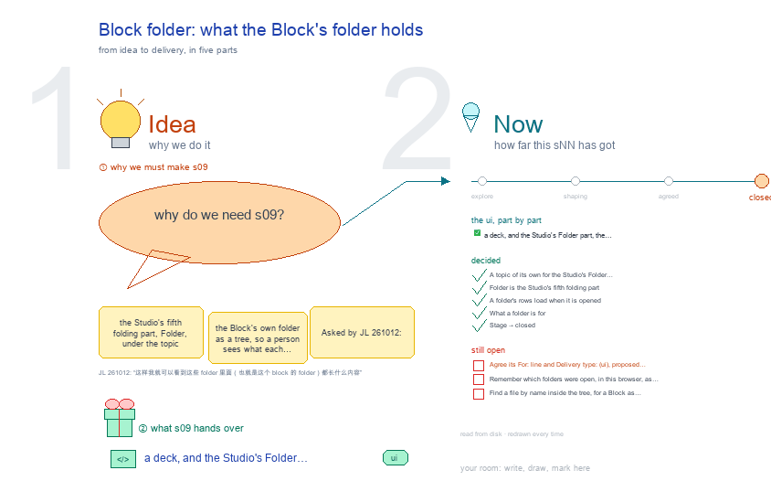

# s09 · Block folder: what the Block's folder holds <!-- root #884602 -->

**Stage:** closed
**Tags:** `UI` · `Structure`

- For <!-- @for #f78806 -->
  - a deck, and the Studio's Folder part, … <!-- @for/0 #7c2270 -->
    a deck, and the Studio's Folder part, the Block's own folder as a tree, for the people who build the workbench
- Delivery type <!-- @delivery-type #58a44f -->
  - ui <!-- @delivery-type/0 #636117 -->
- Topic <!-- @topic #7e13bd -->
  - the Studio's fifth folding part, Folder, under … <!-- @topic/0 #d6d492 -->
    the Studio's fifth folding part, Folder, under the topic cards, Related, Delivery and Timeline: the Block's own folder as a tree, so a person sees what each folder of the Block holds without leaving the workbench.
  - Asked by JL 261012: "我想创建一个 s09。这个 s09 … <!-- @topic/1 #767452 -->
    Asked by JL 261012: "我想创建一个 s09。这个 s09 我们是要创建 folder，也就是在 related 和 timeline 下面再搞一个 folder，这样我就可以 看到这些 folder 里面（也就是这个 block 的 folder）都长什么内容。" Then: "I want to make it to be the s09-block-folder" (s09-D10).
  - Its decisions start at D10: s09-D01 to … <!-- @topic/2 #0fa815 -->
    Its decisions start at D10: s09-D01 to D09 are the old s09's, kept in s01 since it merged there.
- Feeds <!-- @feeds #ffe8e9 -->
  - `reports/` q09_studio_report_on_screen <!-- @feeds/0 #20c6e5 -->
- What it shows <!-- @what-it-shows #e855ed -->
  - **One tree**: the Block's folder, its folders … <!-- @what-it-shows/0 #86e083 -->
    **One tree**: the Block's folder, its folders first and then its files, by name.
  - **A folder** folds; it says how many … <!-- @what-it-shows/1 #7aeb6b -->
    **A folder** folds; it says how many things it holds and what it is for: the shared names (studio/, reports/,
  - runs/, related/, delivery/, passes/, result/, history/) by … <!-- @what-it-shows/2 #2920ac -->
    runs/, related/, delivery/, passes/, result/, history/) by a fixed line, a Run by its card (kind · type · status · passes), any other folder by its face's title.
  - **Loads when opened**: the first level comes … <!-- @what-it-shows/3 #481404 -->
    **Loads when opened**: the first level comes with the page; a folder's rows load the first time it opens
  - (`?view=dir&path=`), so a Block of thousands of … <!-- @what-it-shows/4 #9d584f -->
    (`?view=dir&path=`), so a Block of thousands of files stays light (b00_rawdata holds 5,317). Past 300 rows a button loads the rest.
  - **A file** opens in the pop-out: a … <!-- @what-it-shows/5 #9bc804 -->
    **A file** opens in the pop-out: a .md in the reader, a drawing as the drawing, anything else as itself; it
  - says its size and the day it … <!-- @what-it-shows/6 #038f56 -->
    says its size and the day it last changed.
  - **Left out**: dotfiles (a drawing's `.seed.json`), `__pycache__`, … <!-- @what-it-shows/7 #901a9b -->
    **Left out**: dotfiles (a drawing's `.seed.json`), `__pycache__`, `node_modules`; a link that leaves the root
  - is named, not followed <!-- @what-it-shows/8 #3987c7 -->
  - It writes nothing <!-- @what-it-shows/9 #809762 -->
    It writes nothing. Code: `servers/workbench/frame.py` `studio_folder`, `folder_rows`, `_run_word`, the page script's Folder loader; `frame_view.py` answers `view=dir`. Shared viewers reach only their grant: the share doors check `path=` (s52).
- Files <!-- @files #6ce6c5 -->
  - [py] [build_s09_block_folder.py](build_s09_block_folder.py) <!-- @files/0 #00c4f7 -->
  - delivery/ <!-- @files/1 #404761 -->
  - passes/ <!-- @files/2 #49b302 -->
  - [excalidraw] [s09-block-folder.excalidraw](s09-block-folder.excalidraw) <!-- @files/3 #00fffb -->
  - [md] [s09-block-folder.md](s09-block-folder.md) <!-- @files/4 #c801a1 -->
  - [png] [s09-block-folder.png](s09-block-folder.png) <!-- @files/5 #e165df -->
    
- Decided <!-- @decided #55615a -->
  - s09-D10 · A topic of its own … <!-- @decided/0 #4bffcf -->
    s09-D10 · A topic of its own for the Studio's Folder part, s09-block-folder (JL 261012: "我想创建一个 s09 ... 在 related 和 timeline 下面再搞一个 folder"; then "where is our s09 for this ... I want to make it to be the s09-block-folder"). First made as s33-studio-folder the same day, since s09 had merged into s01 that morning (s01-D37); renamed at JL's ask. The old s09's decisions keep s09-D01 to D09 in s01, so this topic's start at D10, and its one session, `runs/run-draw-s09/`, moved to s01's `history/run-draw-s09/`.
  - s09-D11 · Folder is the Studio's fifth … <!-- @decided/1 #d5847b -->
    s09-D11 · Folder is the Studio's fifth folding part (fourth until s03-D09 put Delivery under Related), under Timeline: the Block's own folder as one tree, folders first, then files, by name; a folder says its count and what it is for, a file its size and its day; a file opens in the pop-out (JL 261012: "这样我就可以看到这些 folder 里面（也就是这个 block 的 folder）都长什么内容").
  - s09-D12 · A folder's rows load when … <!-- @decided/2 #92fdfd -->
    s09-D12 · A folder's rows load when it is opened (`?view=dir&path=`), 300 at a time with a button for the rest: a Block can hold thousands of files (b00_rawdata, 5,317), so the page carries only the first level (built 261012). `path=` is the key the share doors already check (s52).
  - s09-D13 · What a folder is for: … <!-- @decided/3 #95eedf -->
    s09-D13 · What a folder is for: the names every Block shares by a fixed line, a Run by its card (kind · type · status · passes), any other folder by its face's title; a title that only repeats the folder's name is left out (built 261012, after the first look showed "run-draw-s00/ 3 run-draw-s00").
  - s09-D14 · Stage → closed: the Folder … <!-- @decided/4 #f845a5 -->
    s09-D14 · Stage → closed: the Folder part is done (JL 261012: "we can close s09 now"). Its two open points move to Later, not needed now. The Report it feeds, q09_studio_report_on_screen, is still open.
- Open <!-- @open #cf9b77 -->
  - Agree its **For:** line and **Delivery type:** … <!-- @open/0 #7b11a4 -->
    Agree its **For:** line and **Delivery type:** (ui), proposed by the agent 261030?
  - (none: closed 261012, s09-D14) <!-- @open/1 #fa3106 -->
- Later <!-- @later #56e2f5 -->
  - Not needed now; each comes back as … <!-- @later/0 #09375d -->
    Not needed now; each comes back as a new point if it is wanted.
  - Remember which folders were open, in this … <!-- @later/1 #dc2aef -->
    Remember which folders were open, in this browser, as the Timeline keeps its level?
  - Find a file by name inside the … <!-- @later/2 #6e9306 -->
    Find a file by name inside the tree, for a Block as large as b00_rawdata?
