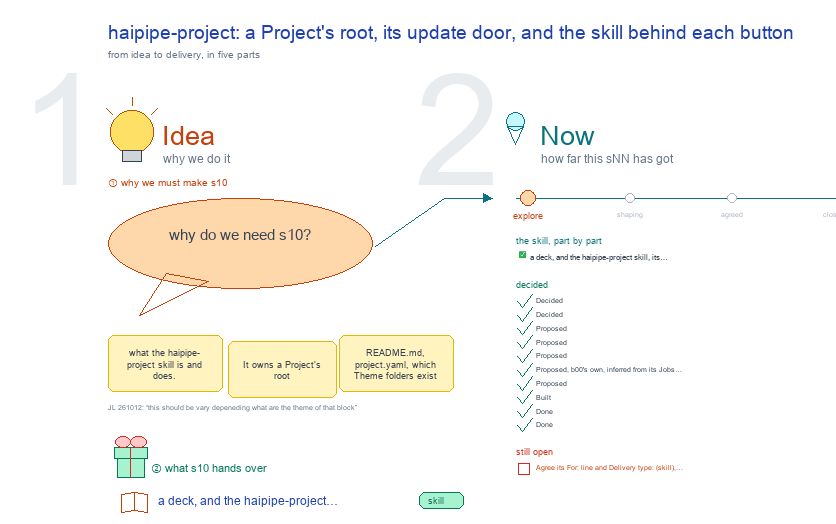

# s10 · haipipe-project: a Project's root, its update door, and the skill behind each … <!-- root #a6d01a -->

**Tags:** `Structure` · `Run and Skill`
**Stage:** explore

- For <!-- @for #f78806 -->
  - a deck, and the haipipe-project skill, its … <!-- @for/0 #c73c47 -->
    a deck, and the haipipe-project skill, its update door and the skill behind each button, for the people who write the toolkit skills
- Delivery type <!-- @delivery-type #58a44f -->
  - skill <!-- @delivery-type/0 #34b33e -->
- Topic <!-- @topic #7e13bd -->
  - what the haipipe-project skill is and does <!-- @topic/0 #a9425c -->
  - It owns a Project's root (README.md, project.yaml, … <!-- @topic/1 #f0ba82 -->
    It owns a Project's root (README.md, project.yaml, which Theme folders exist and which skill owns each) and checks the shape of every level below it (Block → Job → Task → Run → pass).
  - Its update door, `/wb update <Block>`, brings … <!-- @topic/2 #4d6c48 -->
    Its update door, `/wb update <Block>`, brings any Block, old or new and of any theme, up to today's rules.
  - Every Run button of the base frame … <!-- @topic/3 #40c19f -->
    Every Run button of the base frame names the one skill that does its work.
- Feeds <!-- @feeds #ffe8e9 -->
  - `reports/` q01_bjtr_boundary · q05_skill_per_level · q06_project_checker · … <!-- @feeds/0 #e0fec6 -->
    `reports/` q01_bjtr_boundary · q05_skill_per_level · q06_project_checker · q08_workbench_base
- Files <!-- @files #6ce6c5 -->
  - [py] [build_s10_haipipe_project.py](build_s10_haipipe_project.py) <!-- @files/0 #1f603f -->
  - delivery/ <!-- @files/1 #404761 -->
  - history/ <!-- @files/2 #9a00ab -->
  - passes/ <!-- @files/3 #49b302 -->
  - [excalidraw] [s10-haipipe-project.excalidraw](s10-haipipe-project.excalidraw) <!-- @files/4 #79d8a2 -->
  - [md] [s10-haipipe-project.md](s10-haipipe-project.md) <!-- @files/5 #87c15d -->
  - [png] [s10-haipipe-project.png](s10-haipipe-project.png) <!-- @files/6 #611461 -->
    
- Drawing <!-- @drawing #9de360 -->
  - Three acts, read top to bottom (excalidraw-studio's … <!-- @drawing/0 #4e38a9 -->
    Three acts, read top to bottom (excalidraw-studio's principles): what the skill owns, how it updates a Block, and who does each button's work. A frame's facts that can be read from disk (versions, folders, buttons) are read on every build; the words are here.
- Decided <!-- @decided #55615a -->
  - s10-D10 · Decided (JL 261016: "in the … <!-- @decided/0 #dd926f -->
    s10-D10 · Decided (JL 261016: "in the project level, we will have the note folder, that the other AI session will just write the quick note ... should ask the AI to try to go one step further"; "change the notes to note"; "sometimes the random thoughts will be helpful"): a Project's `note/` is its one inbox, at the Project level. Any session writes `note/YYMMDD-<slug>.md`, a finding, a gap or a random thought; its `next:` names the Block and the Job or sNN topic it feeds (or `new Block`; a thought's best guess marked `?`). No Block-level `s99-note`. Written in haipipe-project 0.16.0 (`ref/project-structure.md` § note/, `ROOT_DIRS` in `audit_projects.py`) and in Knowledge-SPACE `AGENTS.md` § Quick notes; the 14 old `notes/` folders renamed.
  - s10-D09 · Decided (JL 261012): s10 and … <!-- @decided/1 #041491 -->
    s10-D09 · Decided (JL 261012): s10 and s21 merge into `s10-haipipe-project`, a topic about the haipipe-project skill, drawn with excalidraw-studio's `draw.py` in three acts. s21's number is retired; its decisions keep their ids. Its old drawing stays in `history/` for q05's figure.
  - From s10 (Update a Block to today's … <!-- @decided/2 #011011 -->
    From s10 (Update a Block to today's rules, 261012):
  - s10-D01 · Proposed (JL 261012): one door, … <!-- @decided/3 #971e0b -->
    s10-D01 · Proposed (JL 261012): one door, `/wb update <path>` (the workbench skill's `cli/wb.py`), seven steps, each a dry run until `--apply`, each done by the skill that owns that part:
  - s10-D02 · Proposed (JL 261012: "this should … <!-- @decided/4 #4e03e3 -->
    s10-D02 · Proposed (JL 261012: "this should be vary depeneding what are the theme of that block"; revised the same day: "I don't ask the questions that is meaningless ... the questions that are closely related to the jobs and tasks"): the work decides steps 5 and 6, the theme only names the groups they fall in. Topics and Questions are inferred from what the Block's own Jobs and Tasks do and answer (s10-D05); a theme's kinds (s05-D07) group them and fill only what the work leaves unsaid (a paper's standing Questions, s05-D12). The rules of steps 1 to 4 are the same for every theme. A first draft here gave b00 one Question per work kind (Data · Pilot · Evaluation); it was meaningless and is replaced by s10-D04.
  - s10-D03 · Proposed: nothing proposed is written … <!-- @decided/5 #16e965 -->
    s10-D03 · Proposed: nothing proposed is written without a person's pick. Steps 5 and 6 list their proposals in the pass of `run-update-<bNN>`; a person ticks the ones to keep, and only those become `studio/sNN-*/` folders and register rows (as s05: the groups come with them, from the theme).
  - s10-D04 · Proposed, b00's own, inferred from … <!-- @decided/6 #9dba23 -->
    s10-D04 · Proposed, b00's own, inferred from its Jobs and Tasks (JL 261012): topics s01-table-profile (281 profile Tasks and their five sub-questions; `## Raw-data safety` joins it), s02-raw-families (the 7 `raw-family:` values and `raw_rules.md`), s03-source-handoff (14 source Tasks: 11 ready, 3 blocked), s04-drop-intake (14 intake Tasks). Block Questions, each answered by named Tasks and differing across the Jobs: Q01 Why are j52, j53 and j96 blocked from Source, and what settles each? (their source Tasks); Q02 Which tables lack an event time (60) or a person column (29), and can Source still read them by person and time? (those profile Tasks); Q03 What must the Source functions handle, family by family? (221 profile Tasks with something flagged, split by raw-family); Q04 Which drops lack tables of their family, and does it matter downstream? (7 intake Tasks). Each Job asks "Is <drop> ready for Source, and what is still open?", answered by its source Task's face (no new folder); each Task's report is its own face. Their groups share the topics' names (Profile · Families · Handoff · Intake, s05-D08). Dropped: "Is every raw drop inventoried?" (14 of 14 the same) and "Does each family's loader read every table?" (no Task asks it). `studio/raw-drop-manifest.tsv` moves beside `family_catalog.yaml` at the Block root.
  - s10-D05 · Proposed (JL 261012: "/haipipe-studio and … <!-- @decided/7 #f6a384 -->
    s10-D05 · Proposed (JL 261012: "/haipipe-studio and /haipipe-report to learn how to infer the relevant studios from the existing block job and task"): the method lives in the two skills, on one reading. `haipipe-studio` `scripts/block_inventory.py <block>` reads every Job and Task face (writes nothing): recurring Task kinds, the fields that split them, the sub-questions most Tasks of a kind answer and how the answers spread, what stands out. `haipipe-studio` `ref/infer-topics.md` turns it into topics (a recurring kind is a method topic, a split one topic, no work no topic); `haipipe-report` `ref/infer-reports.md` into Questions by level (a Task its own; a Job what its one Task of a kind answers where the Jobs differ; a Block where the answers differ), kept only if named Tasks answer it and not all the same way. Steps 5 and 6 of `/wb update` call them. Built 261012: haipipe-studio 0.10.0, haipipe-report 0.2.0, a test on a three-Job Block.
  - s10-D06 · Built (JL 261012: "is the … <!-- @decided/8 #2a7677 -->
    s10-D06 · Built (JL 261012: "is the /wb update ready to use now?" ... "examples-1-data/Proj01-CGM-RawData/work <--- next step, I want you to call the subagents to update the blocks here"): `/wb update <Block>` is workbench 1.20.0, `cli/wb_update.py` behind `cli/wb.py update`, with haipipe-project as the engine (Open 1). Step 2's checks are a `today:` key in haipipe-project `ref/ladder.md`, read by `ladder.py audit --today` and `update --today` (0.15.0; Open 2). A Project is one agent per Block (Open 3). `--apply` moves only a data file out of `studio/` (a drawing waits for its topic), then writes `runs/run-update-<bNN>/` with a pass holding `proposals.md`; the agent words it; nothing is made before a tick (D03). Not built yet: making the ticked lines in one command. Test: workbench `tests/test_wb_update.py`.
  - s10-D07 · Done (JL 261012: "could you … <!-- @decided/9 #b5582d -->
    s10-D07 · Done (JL 261012: "could you call the subagents to work on them together?", which stood in for the ticks): six agents, one per Proj01 Block, made every proposed line: `new_topic.py topic` per topic (each face with its **Tags:** group, Topic and Open), `block_questions.py add-question --group` per Block Question (haipipe-report 0.7.0 added `--group` and `set-group`), a register row per Job Question in the Job's face, the ticks in `proposals.md`, and pass p02 of each `run-update-<bNN>`. b01's and b51's loose drawings moved into their topics with their builders, and each builder ran from there. `audit --today` then passed on all six (6 Blocks, 72 Jobs, 562 Tasks, 1073 Runs, 0 debt); today's `keep:` accepts `question-map.excalidraw`, which the workbench's `question_map.py` writes into `studio/`.
  - s10-D08 · Done (JL 261012: "could you … <!-- @decided/10 #df59a8 -->
    s10-D08 · Done (JL 261012: "could you call the new agent to evaluate them? How about each of their s00 for the background and index?"): six fresh read-only reviewers (haipipe-block-reviewer-agent), one per Block, scored what D07 made: mechanical checks clean everywhere, but 9 of 22 new Block Questions only partly grounded (a wrong number, a `work:` list cut short by a cap of 6, a "why" no face answers) and overlaps flagged in five Blocks. Six fix agents then applied every finding: numbers corrected, `work:` lists complete, two Questions and one topic folded (b02 Q02, b03 Q03, b03 s02; their ids never reused), b10's groups made real (Splits · Build status · Inputs), Job rows made specific to each Job. Six writers wrote each Block's s00 background as two folder trees. Lessons for `/wb update`: no cap on `work:`; a Question's numbers are checked by someone who did not write them; `new_topic.py --feeds` takes `reports/q01_x` too (haipipe-studio 0.12.2).
  - From s21 (Project Run and skill, 261007 … <!-- @decided/11 #2486e0 -->
    From s21 (Project Run and skill, 261007 to 261012):
  - s21-D01 · Proposed (JL 261007): the base … <!-- @decided/12 #51bd70 -->
    s21-D01 · Proposed (JL 261007): the base skills are one per level and one per shared Space; each theme keeps its own skills over them, as its `<theme>_theme.py` does over the frame.
  - haipipe-block (new; the deleted one's name): the … <!-- @decided/13 #521017 -->
    haipipe-block (new; the deleted one's name): the Block's face and question register, its Spaces, a
  - new-Block scaffold, how a theme claims a … <!-- @decided/14 #757fdb -->
    new-Block scaffold, how a theme claims a Block (`Theme.claims`).
  - haipipe-job (new): the Job's face, its Tasks … <!-- @decided/15 #ed2cee -->
    haipipe-job (new): the Job's face, its Tasks in order, a new-Job scaffold, a theme's own Job names.
  - haipipe-task: not touched (JL 261007: "you should … <!-- @decided/16 #4db03a -->
    haipipe-task: not touched (JL 261007: "you should not touch the haipipe-task"); the Task level's
  - buttons name it as they are <!-- @decided/17 #4da088 -->
    buttons name it as they are. `skills/1_base/task/` keeps every folder: the task kinds (1_data … 10_evidence), agents, page-types, haipipe-task, haipipe-workflow, haipipe-page-task.
  - haipipe-studio (new): `sNN-<topic>/` at any level, its … <!-- @decided/18 #13e9be -->
    haipipe-studio (new): `sNN-<topic>/` at any level, its face and builders that keep marks, the
  - numbering (s0x concepts · s1x levels · … <!-- @decided/19 #206fd8 -->
    numbering (s0x concepts · s1x levels · s2x runs and skills · s3x Guide · s5x server), sessions as passes of `run-draw-<sNN>`; takes the scratch mode of excalidraw-report and `canvas.py` · `render_png.py`.
  - haipipe-report (new <!-- @decided/20 #6da5ee -->
    haipipe-report (new; JL 261007: "to define the question - work - report workflow in the Audience
  - report"): the Question │ Work │ Report … <!-- @decided/21 #66c54a -->
    report"): the Question │ Work │ Report row at any level, what each cell reads, how work links to a question (`answers:` on a Job or Task face, a need id like `QK10.E1`), the walk open → partial → answered (→ checked, proposed), the report Page (Opening · Answer · Evidence · Limits · Next), its `## Figures` and drawing; a comments batch is a report kind (b16). haipipe-report keeps the asking.
  - haipipe-run (extended): names without `<MMDD>`, `run.yaml` as … <!-- @decided/22 #99b195 -->
    haipipe-run (extended): names without `<MMDD>`, `run.yaml` as the Runs Space reads it, a Run type table
  - per Space that names each button's skill <!-- @decided/23 #4fee64 -->
  - s21-D02 · Proposed: every frame button names … <!-- @decided/24 #75a2ed -->
    s21-D02 · Proposed: every frame button names its skill (a `skills:` field on its run type), as the Page's run cards already do; `Update the description` → the level's skill, `Add a topic` → haipipe-studio, `Write the report` → haipipe-report, `Run` → haipipe-run.
  - s21-D03 · Decided (261007): Block and Job … <!-- @decided/25 #cb47ef -->
    s21-D03 · Decided (261007): Block and Job delivery stay in their level skills (haipipe-block, haipipe-job), following the theme's delivery rule; a Page Task's is haipipe-delivery (ref/page-delivery.md)'s. No haipipe-delivery until a theme's Block delivery needs more than the level skill holds. Reason: no Block or Job delivers anything yet, so a separate skill would have nothing to build.
  - s21-D04 · Decided (261007): "checked" is not … <!-- @decided/26 #c783f3 -->
    s21-D04 · Decided (261007): "checked" is not a fourth answer state. The walk stays open → partial → answered; the report Page's own CHECK verdict (run-check-<qNN>) is shown beside answered. Reason: the walk says where the answer stands, a check judges one version of the Page; one fact lives in one place.
  - s21-D05 · Decided (JL 261010): s21 is … <!-- @decided/27 #adedf8 -->
    s21-D05 · Decided (JL 261010): s21 is drawn as one story, four frames joined by arrows, each with its sentence; the reference table sits below the story, off its path. The 261007 tables (the skill folders before and after, the update plan) were finished work and stay in history/.
  - s21-D06 · Decided (JL 261011: "we also … <!-- @decided/28 #208137 -->
    s21-D06 · Decided (JL 261011: "we also need to show what is the skill folder looks like ... in the Tools/ what are the folders related to this"): a frame under ② shows each skill as its folder in `Tools/`, read from disk on every build, with the example's skill (`haipipe-report/`) opened file by file; an arrow from ② says "each skill is one folder in Tools/".
  - s21-D07 · Decided (JL 261012: "yes, rename … <!-- @decided/29 #61129d -->
    s21-D07 · Decided (JL 261012: "yes, rename haipipe-board to haipipe-block"): the Block's skill is named after its level, haipipe-block beside haipipe-job and haipipe-task (2.1.0). `aliases: [haipipe-board]` keeps the old name working; haipipe-board-reviewer-agent is now haipipe-block-reviewer-agent. The face file stays `board.md` for now: renaming it touches every Block and every reader, a separate step.
- Read on b00_rawdata (s10, 261012) <!-- @read-on-b00-rawdata-s10-261012 #e66185 -->
  - **Shape passes**: `haipipe-project` `scripts/ladder.py audit` finds 1 … <!-- @read-on-b00-rawdata-s10-261012/0 #2d7a00 -->
    **Shape passes**: `haipipe-project` `scripts/ladder.py audit` finds 1 Block, 14 Jobs, 310 Tasks and 621
  - Runs, all ok <!-- @read-on-b00-rawdata-s10-261012/1 #021215 -->
    Runs, all ok. The ladder's rules (`ref/ladder.md`) check folder shape only.
  - **Today's rules do not**: the face is … <!-- @read-on-b00-rawdata-s10-261012/2 #9de5ab -->
    **Today's rules do not**: the face is `board.md` (`board-kind: task-block`), but `studio/` holds no sNN
  - topic, only a data file (`raw-drop-manifest.tsv`, the … <!-- @read-on-b00-rawdata-s10-261012/3 #09d3dc -->
    topic, only a data file (`raw-drop-manifest.tsv`, the 14 drops' table); there is no `## Questions` register and no `reports/` at the Block, any Job or any Task; no `related/`, `delivery/` or `runs/`. No check finds this today.
  - **What the work already answers** (`haipipe-studio` `scripts/block_inventory.py`, … <!-- @read-on-b00-rawdata-s10-261012/4 #b17912 -->
    **What the work already answers** (`haipipe-studio` `scripts/block_inventory.py`, 261012): Task kinds
  - profile 281 · intake 14 · source … <!-- @read-on-b00-rawdata-s10-261012/5 #67f2f3 -->
    profile 281 · intake 14 · source 14 across all 14 Jobs; the `raw-family:` field splits them 7 ways; every profile Task answers the same five sub-questions (What is one row? · Whose data is it, and when was it recorded? · What does each column hold? · What should Source watch out for? · Where does it come from?); the source Tasks say 11 drops are `ready_for_sourcefn_review` and 3 `blocked` (j52, j53, j96); 60 profile Openings say `no event time`, 29 `no person column`; 7 intake Tasks list tables their family lacks.
  - **Seeds are there**: `board.md` has 11 sections … <!-- @read-on-b00-rawdata-s10-261012/6 #65319c -->
    **Seeds are there**: `board.md` has 11 sections (Rules · Axis · Job-series numbering · Raw-drop Jobs · Task
  - axis per family · Coverage and routing … <!-- @read-on-b00-rawdata-s10-261012/7 #eab847 -->
    axis per family · Coverage and routing contract · Raw-data safety · Execution order · two dated scans · an archived baseline), plus `raw_rules.md`, `family_catalog.yaml` and `TASK-TABLE.md`: what its topics and Questions would be made from.
- Run on Proj01-CGM-RawData (s10, 261012) <!-- @run-on-proj01-cgm-rawdata-s10-261012 #c2e2d3 -->
  - Six agents, one per Block, each ran … <!-- @run-on-proj01-cgm-rawdata-s10-261012/0 #ff5317 -->
    Six agents, one per Block, each ran the dry run, `--apply`, then worded its `proposals.md` from the Job and Task faces. Nothing ticked; no topic, register row or report made. The shape audit passed on all six.
  - **Faces carry the reading**: b00's Tasks answer … <!-- @run-on-proj01-cgm-rawdata-s10-261012/1 #0f25d4 -->
    **Faces carry the reading**: b00's Tasks answer `### ...?` headings, so the script found its Questions; in
  - b01 to b10 most Task faces say … <!-- @run-on-proj01-cgm-rawdata-s10-261012/2 #deab34 -->
    b01 to b10 most Task faces say "Not written yet" and every Job says `goal: open`, so the agents read configs, Openings and Run cards instead. The script found 0 Block Questions there; the agents found 3 to 5.
  - **Few Results**: b03 has 1 Result in … <!-- @run-on-proj01-cgm-rawdata-s10-261012/3 #c9dda3 -->
    **Few Results**: b03 has 1 Result in 64 Runs, b02 1 of 11 RecordSets counted, b10 11 of 29: those gaps
  - became Questions (b02 Q03, b03 Q02, b10 … <!-- @run-on-proj01-cgm-rawdata-s10-261012/4 #12fb98 -->
    became Questions (b02 Q03, b03 Q02, b10 Q02).
  - **b51 already had 35 Questions** (ids `Q-food-1`, … <!-- @run-on-proj01-cgm-rawdata-s10-261012/5 #b6953f -->
    **b51 already had 35 Questions** (ids `Q-food-1`, not `QNN`): its pass gives each a group (Food 7 ·
  - Exercise 7 · Medication 8 · Insulin … <!-- @run-on-proj01-cgm-rawdata-s10-261012/6 #53e203 -->
    Exercise 7 · Medication 8 · Insulin 8 · All events 5) and adds two.
- Finding (s21, read 261010, the folders 261011) <!-- @finding-s21-read-261010-the-folders-261011 #aed275 -->
  - 42 of 42 buttons name their skill: … <!-- @finding-s21-read-261010-the-folders-261011/0 #1a451d -->
    42 of 42 buttons name their skill: Block 9 · Job 9 · Task 9 · Page Task 15 (on 261007: 12 of 49), 21 rows once a button is counted once across levels. Every level has a Description button and a Studio button; the Studio one opens the Block's shared Studio. Work Details is called Work on screen. (An earlier read showed no Description button: the probe folders had no face; fixed 261010.)
  - In `Tools/` (261011): the buttons name 15 … <!-- @finding-s21-read-261010-the-folders-261011/1 #73263c -->
    In `Tools/` (261011): the buttons name 15 skills. Five of them are among the seven in `plugins/haipipe-toolkit/skills/1_base/project/`; `haipipe-report` is in `1_base/project/` and `haipipe-task` in `1_base/task/`; the Page Task's seven draft skills in `1_base/draft/workflow-runs/`, and `haipipe-display` in `1_base/display/`. Each reaches Claude through a link, `~/.claude/skills/<name>`. `haipipe-delivery` (0.2.2) is there but no button names it, and it holds only its `SKILL.md`: the Block's and Job's Delivery buttons name `haipipe-block` and `haipipe-job` (Open 1).
- Built (s21, 261007) <!-- @built-s21-261007 #e0d5bf -->
  - ✎ 261007 the five skills exist and … <!-- @built-s21-261007/0 #6703b3 -->
    ✎ 261007 the five skills exist and every frame button names one (phases 1-4); phase 5 moved `canvas.py`, `render_png.py` and `build_report_drawing.py` into the skills; folder moves went to b04. The full record, with each phase, is `history/s21_project-run-skill-261007.md (in this folder's history/)`.
- Open <!-- @open #cf9b77 -->
  - Agree its **For:** line and **Delivery type:** … <!-- @open/0 #09a2ba -->
    Agree its **For:** line and **Delivery type:** (skill), proposed by the agent 261030?
  - s10 1 <!-- @open/1 #0d29d6 -->
    s10 1. Make the ticked lines in one command (`wb.py update <Block> --keep`), or keep it the agents' step (D07)? s10 2. b51's register ids are `Q-food-1`, not `QNN`: rename to `QNN` on update, or let the register keep both? s10 3. b10 had 17 topics on 261012 (13 after the merges), against the suggested 10: does s10 belong in haipipe-project's own design Block? s10 4. Q-all-6 and Q-all-7 in b51 have no report picture: `studio/_build/build_reports.py`'s ALL has no row for them. s21 1. s21-D03 kept delivery in the level skills because no Block or Job delivered yet. Now every output is stored in Block/delivery/ (s02-D14) and Delivery has its own skill, haipipe-delivery: re-decide D03. s21 2. What must each level's report answer? The Studio sets it, each level reports (meeting 261010). s21 3. A Job holds soft Runs only: where does a batch launch, run-launch-<group>, go? (s06 open 2)
  - s10's Open 5 (the s00 index over … <!-- @open/2 #1241d8 -->
    s10's Open 5 (the s00 index over 2800 x 1600) is settled: since haipipe-studio 0.13.6 the index is one column, 2720 wide, and only its height grows.
