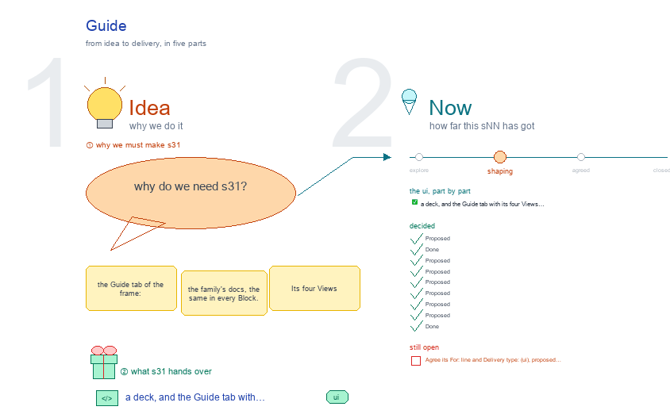

# s31 · Guide <!-- root #38d2b6 -->

**Tags:** `Guide`
**Stage:** shaping

- For <!-- @for #f78806 -->
  - a deck, and the Guide tab with … <!-- @for/0 #41d563 -->
    a deck, and the Guide tab with its four Views and the files each reads, for the people who build the workbench
- Delivery type <!-- @delivery-type #58a44f -->
  - ui <!-- @delivery-type/0 #636117 -->
- Topic <!-- @topic #7e13bd -->
  - the Guide tab of the frame: the … <!-- @topic/0 #b65db3 -->
    the Guide tab of the frame: the family's docs, the same in every Block.
  - Its four Views (Description · Method · … <!-- @topic/1 #15bf0f -->
    Its four Views (Description · Method · RoadMap Draw · Related Paper), the files each reads in `servers/workbench-<theme>/`, how those files relate, and each family's status.
  - Drawn in the style of `../s02-studio-workbench-skill` (moved … <!-- @topic/2 #150373 -->
    Drawn in the style of `../s02-studio-workbench-skill` (moved here from b02's s02 when b02 merged into b03;
  - JL 261007: "for Guide, we will use … <!-- @topic/3 #e1c562 -->
    JL 261007: "for Guide, we will use this structure"; "just follow the style of s03 (studio and report)": b02's s03 then, s04 now).
- Feeds <!-- @feeds #ffe8e9 -->
  - `reports/q08_workbench_base/` (one shared base, a theme each) <!-- @feeds/0 #bcdfe3 -->
- Files <!-- @files #6ce6c5 -->
  - [py] [build_s31_guide.py](build_s31_guide.py) <!-- @files/0 #6fe924 -->
  - delivery/ <!-- @files/1 #404761 -->
  - history/ <!-- @files/2 #9a00ab -->
  - [py] [method-canvas.py](method-canvas.py) <!-- @files/3 #f67d16 -->
  - [excalidraw] [s31-guide.excalidraw](s31-guide.excalidraw) <!-- @files/4 #9ba4a4 -->
  - [md] [s31-guide.md](s31-guide.md) <!-- @files/5 #4efe83 -->
  - [png] [s31-guide.png](s31-guide.png) <!-- @files/6 #e5549a -->
    
- What the drawing holds <!-- @what-the-drawing-holds #e0b05d -->
- Proposed <!-- @proposed #70cbd1 -->
  - s31-D01 · Proposed (261007): the Guide is … <!-- @proposed/0 #4c3b33 -->
    s31-D01 · Proposed (261007): the Guide is the frame's first tab, the family's docs, the same in every Block and at every level; its four Views are Description · Method · RoadMap Draw · Related Paper, its Run types Add a method · Add a paper.
  - s31-D02 · Done (261007): each theme keeps … <!-- @proposed/1 #b6735b -->
    s31-D02 · Done (261007): each theme keeps its Guide in `servers/workbench-<theme>/guide/` and `related/`; `guide_families.py` loads every `guide/guide.yaml`.
  - s31-D03 · Proposed (261007): Description shows the … <!-- @proposed/2 #238728 -->
    s31-D03 · Proposed (261007): Description shows the six Spaces by level in the theme's words, instead of the old board's Spaces.
  - s31-D04 · Proposed (261007): a Method step's … <!-- @proposed/3 #87483a -->
    s31-D04 · Proposed (261007): a Method step's "where in the workbench" names one of the six Spaces.
  - s31-D05 · Proposed (261007, JL's marks on … <!-- @proposed/4 #c478ff -->
    s31-D05 · Proposed (261007, JL's marks on frame 3: "separate each Guide's subview with three sections"): the four View tabs stay; each View's body is a header line, then three sections top to bottom, Block · Job · Task. Description: each level's role, its row of the six Spaces, its skills and folders. Method: each level's steps table and method cards. RoadMap Draw: each level's part of the theme's ladder. Related Paper: the papers behind each level's method (a level with none says so). Still one Guide per theme: `guide.yaml`, `method.md`, the ladder and `papers.md` each get a Block, a Job and a Task part. Refines s31-D01 and s31-D03.
  - s31-D06 · Proposed (261007, JL: "more like … <!-- @proposed/5 #978bf3 -->
    s31-D06 · Proposed (261007, JL: "more like the section card, from up to down to stack"; "for each theme, they have their own definitions, but I want the view of them to be consistent"): inside a level's section, its items stack top to bottom as cards, one card shape per View, the same in every theme; a theme gives the words, never the shape.
  - How they update, so a card never … <!-- @proposed/6 #66c4ae -->
    How they update, so a card never goes stale: the shape lives in the base's one renderer (`workbench_guide.py`); a Space card's `sub` and `runs` are read live from the frame (`spaces_for`: the base, then the theme's `<theme>_theme.py`); its words come from the base's defaults (`servers/workbench/guide/levels.yaml`, proposed), and a theme's `guide.yaml` `levels:` overrides only the words that differ. Step cards come from `method.md`'s `## Block · ## Job · ## Task` tables; paper cards from `papers.md` with a level column.
  - s31-D07 · Proposed (261007, JL: "I don't … <!-- @proposed/7 #cb677f -->
    s31-D07 · Proposed (261007, JL: "I don't want boxes in box"; "I want they are collapsable in the Block, Job and Task level"): a level is a heading, not a box; the cards under it are the only boxes (a drawing card's box is the drawing itself). Each level heading folds: ▾ open, ▸ folded with one line of what it holds (Description: "6 Spaces · skills · folders"); a click toggles it. Proposed: the tab you came from opens its level and the other two start folded. Drawn as the fifth screen of frame 3 (Description from the Block tab).
  - s31-D08 · Proposed (261007, JL: "for the … <!-- @proposed/8 #afa7d8 -->
    s31-D08 · Proposed (261007, JL: "for the roadmap draw, for each section, could we have cards as well, in case there are multiple draw to show"): RoadMap Draw's level sections hold drawing cards, one per drawing: ▸ title · what it shows, then its source and builder and ↗ full size; a click opens the card and its drawing fills it, view only, as an Idea Studio row does. On disk `guide.yaml` gets `roadmap:` with a list of drawings per level.
  - s31-D09 · Done (261007): the work theme … <!-- @proposed/9 #1aee1c -->
    s31-D09 · Done (261007): the work theme is on the card Guide. The base's words are `servers/workbench/guide/levels.yaml`; `workbench_guide.py` draws every View as three folding level sections of cards, the earlier body under a closed "All levels"; Space cards read `sub` and `runs` from `frame.space_cards`; the frame passes its level, so that section opens. The work family's key is `work` (`task` still answers), its `guide.yaml` has `levels:` and `roadmap:`, its `method.md` a step table per level, its `papers.md` a `level` column (table-papers accepts it as an optional first column). Tests: `_host/tests/test_guide_levels.py`; the other families are in the conformance test's GAPS until they move. Frame 6 tracks them.
- Open <!-- @open #cf9b77 -->
  - Agree its **For:** line and **Delivery type:** … <!-- @open/0 #7b11a4 -->
    Agree its **For:** line and **Delivery type:** (ui), proposed by the agent 261030?
  - `levels.yaml`: the base's home for the default … <!-- @open/1 #fd1360 -->
    `levels.yaml`: the base's home for the default card words (Block · Job · Task × the six Spaces)?
  - Folds: the tab you came from opens … <!-- @open/2 #08d7af -->
    Folds: the tab you came from opens its level and folds the other two; remember a person's folds?
  - The page family (`workbench/workbench-task-draft`): its own Guide, … <!-- @open/3 #706123 -->
    The page family (`workbench/workbench-task-draft`): its own Guide, or the Task sections of each theme's Guide?
  - A wrong "where": fail the tests, or … <!-- @open/4 #56d769 -->
    A wrong "where": fail the tests, or warn on the page?
  - RoadMap Draw per level: which drawings each … <!-- @open/5 #d8f13e -->
    RoadMap Draw per level: which drawings each theme lists first?
  - b03's s11 · s12 · s13: draw … <!-- @open/6 #fa3ab0 -->
    b03's s11 · s12 · s13: draw their screens in this style?
