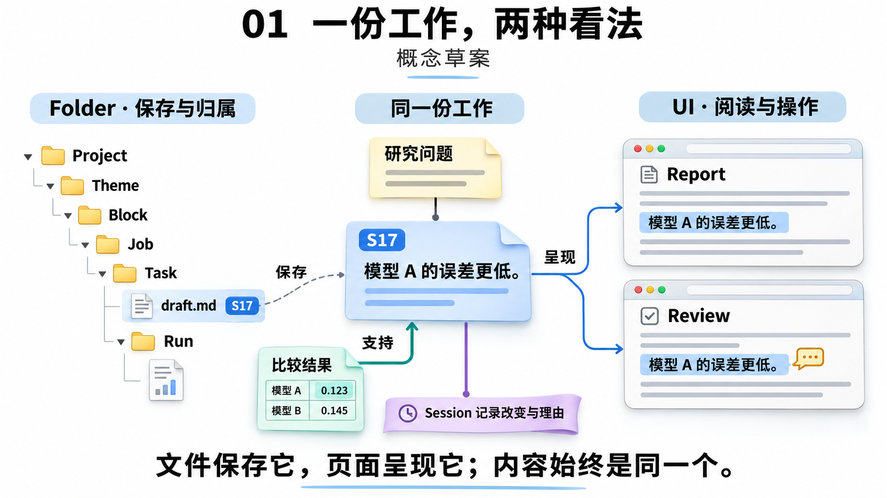
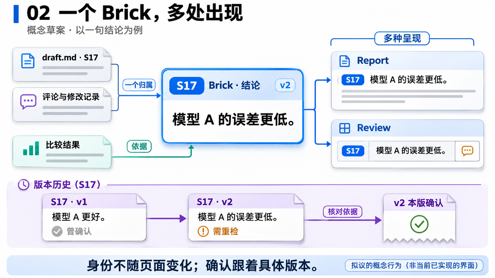
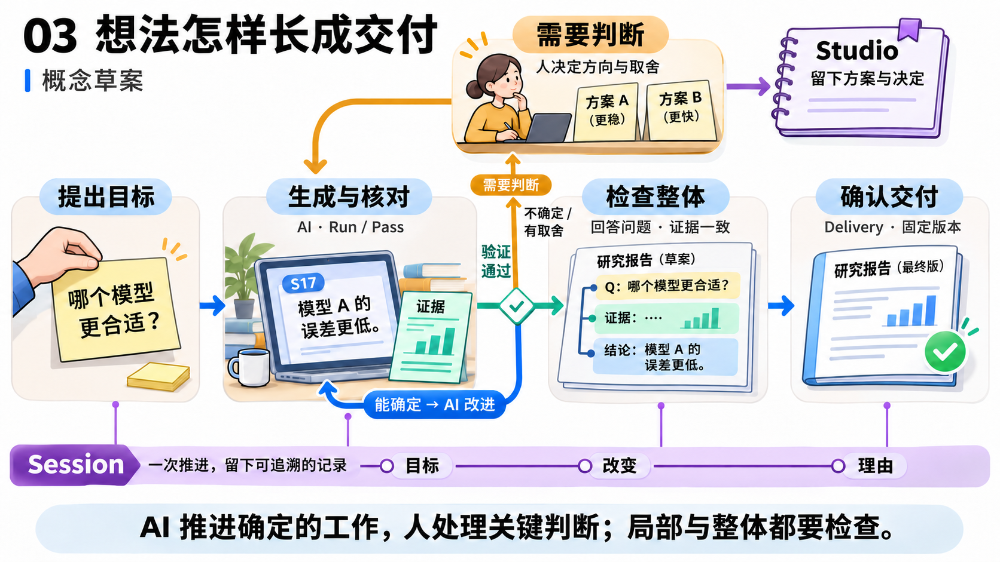
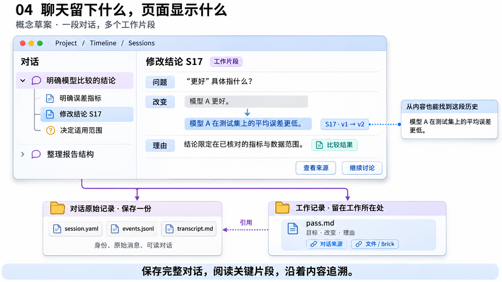

# Concept images

These are archived copies of the final concept pictures from this conversation, not screenshots of implemented UI.

## One work, two surfaces

## One Brick, many views

## How work evolves

## Sessions and records

## Source notes

- [Concept explanation](concept-notes.md)
- [First three image prompts and final edit](prompts.json)
- [Session design proposal](04-sessions-design.md)
- [Fourth image prompt](04-session-prompt.txt)
- [Copied-file provenance and hashes](manifest.json)

Generated with the built-in image_gen.imagegen tool during this session. The original files remain in the repository's output/imagegen/work-concept-2026-11-19 folder.
