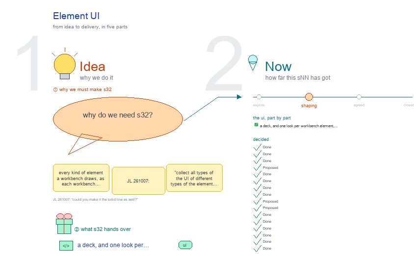

# s32 · Element UI <!-- root #ec6801 -->

**Tags:** `UI`
**Stage:** shaping

- For <!-- @for #f78806 -->
  - a deck, and one look per workbench … <!-- @for/0 #b42fee -->
    a deck, and one look per workbench element, picked from every theme's version, for the people who build the workbench
- Delivery type <!-- @delivery-type #58a44f -->
  - ui <!-- @delivery-type/0 #636117 -->
- Topic <!-- @topic #7e13bd -->
  - every kind of element a workbench draws, … <!-- @topic/0 #782332 -->
    every kind of element a workbench draws, as each workbench draws it today, side by side, so one look per element can be picked and the base draws it for every theme (JL 261007: "collect all types of the UI of different types of the element ... so we can unify them"; "for each type of the element, show the different versions, like the gallery, and we will pick and select.
  - Like for the audience report, we might … <!-- @topic/1 #090587 -->
    Like for the audience report, we might have different versions as well").
  - It answers JL's "the current UI is … <!-- @topic/2 #7a6638 -->
    It answers JL's "the current UI is very bad, not as good as the previous ones": the previous looks are all here to choose from.
- Feeds <!-- @feeds #ffe8e9 -->
  - `reports/` q08_workbench_base (one shared base, a theme … <!-- @feeds/0 #b33a0b -->
    `reports/` q08_workbench_base (one shared base, a theme each)
- Files <!-- @files #6ce6c5 -->
  - [py] [build_s32_element_ui.py](build_s32_element_ui.py) <!-- @files/0 #5d2d6d -->
  - delivery/ <!-- @files/1 #404761 -->
  - passes/ <!-- @files/2 #49b302 -->
  - [excalidraw] [s32-element-ui.excalidraw](s32-element-ui.excalidraw) <!-- @files/3 #40a0ef -->
  - [md] [s32-element-ui.md](s32-element-ui.md) <!-- @files/4 #f9b695 -->
  - [png] [s32-element-ui.png](s32-element-ui.png) <!-- @files/5 #55dc05 -->
    
  - shots/ <!-- @files/6 #4d5052 -->
- What the gallery holds <!-- @what-the-gallery-holds #69fd53 -->
  - The versions, one real folder each: base … <!-- @what-the-gallery-holds/0 #29740a -->
    The versions, one real folder each: base `b10_project_workbench` (Tools); work `b02_pretrain_corpus`, cowork Samsung `b12_epic_streaming`, paper `Paper-ScalingGlucose-NatSeries2026` (WellDoc); insight `Insight-SMSR2v1` and its Job j01, design `Design-SMSR2-Stage25-CarryOver-261008`, discovery `b01_experimental_learning_evidence` (DrFirst); labeling `b01_aci_bench` (Physician). Under each picture: its first control's computed style (font, corner radius, padding, border, fill), read live.
- Finding (read 261012) <!-- @finding-read-261012 #b32114 -->
  - The Report's group bar shows on 4 … <!-- @finding-read-261012/0 #bd382f -->
    The Report's group bar shows on 4 of 8: the base, work, cowork and labeling (cowork's Block moved onto
  - the base's cards on 261012, 09:17) <!-- @finding-read-261012/1 #23bb9f -->
    the base's cards on 261012, 09:17). Not yet on paper, insight, design and discovery (s05).
  - A cowork Job's Report is still its … <!-- @finding-read-261012/2 #ce788d -->
    A cowork Job's Report is still its own table of the Block's Questions that cite it, not cards.
  - Two older theme pages are still served: … <!-- @finding-read-261012/3 #d402bf -->
    Two older theme pages are still served: `/_board/insight-board` and `/_board/design-board` (no longer
  - in the gallery, s32-D24) <!-- @finding-read-261012/4 #44d9ea -->
    in the gallery, s32-D24). `/_board/paper-board` and `/_board/discovery-board` now redirect to the frame.
  - The Top of the page is one … <!-- @finding-read-261012/5 #2312f0 -->
    The Top of the page is one look on every theme on the frame: 16px, 6px corners, padding 6px 14px,
  - a grey border (s32-D01) <!-- @finding-read-261012/6 #38faee -->
  - b11_theme_insight's s32 has 33 frames but no … <!-- @finding-read-261012/7 #1343f9 -->
    b11_theme_insight's s32 has 33 frames but no decisions and no "Theme elements" list.
- Decided <!-- @decided #55615a -->
  - s32-D01 · Done (261007, JL's marks on … <!-- @decided/0 #121359 -->
    s32-D01 · Done (261007, JL's marks on frame 1: arrows from D and E to A; "what I mean is the style, not the content"): top tabs take the Insight and Design board pages' look, D · E: 16px text, 6px corners, padding 6px 14px, a grey border (#ced4da), the open one washed blue (#e7f5ff, #1864ab). The look only: each workbench keeps its own tabs and words, the frame its level row (Guide · Block · Job ▾ · Task ▾) and its six Spaces with their dividers; an optional Space's border is solid like the rest (JL 261007: "could you make it the solid line as well?"). The frame took it (`servers/workbench/frame.py`, the `.levels`/`.spaces` rules and the `--tab-*` tokens); the third row keeps its own look until picked.
  - s32-D02 · Done (261007, JL's tick on … <!-- @decided/1 #3b2800 -->
    s32-D02 · Done (261007, JL's tick on frame 2, card E; "do not use this one" on the small pills): the view row takes the Page workbench's view buttons, E: 16px, 6px corners, padding 5px 12px, a grey border, the open one washed blue; the look only. The frame took it (`.subs` rules in frame.py).
  - s32-D03 · Done (261007, JL: "some of … <!-- @decided/2 #ceb0d0 -->
    s32-D03 · Done (261007, JL: "some of them are old version and we will not use it ... flag them"): a card whose page is a theme's old board page (its theme draws on the frame now) or the old Page workbench (its views are the frame's Task Spaces) is flagged OLD in red, greyed, in a red dashed box; read off the code at build time (`old_reason`). Only the frame is current. A look from an old page may still be picked (D · E for the tabs were). (261012: the OLD cards are deleted, s32-D24.)
  - s32-D04 · Proposed (261007, JL: "we want … <!-- @decided/3 #469d0e -->
    s32-D04 · Proposed (261007, JL: "we want to unify things ... for each frame, add a new frame to the right of it and draw the proposed new one and explain why"): beside each element's gallery frame, a "· proposed" frame: one look for every theme, drawn by the base, a theme giving the words only. Where the frame already draws it in the picked look, its own version is the proposal, shot live (tabs, view row, Question rows, Space body, table, rows, Runs panel, Disk, header); tags have no frame version yet, so a mock in the frame's colours (one small pill, its colour the state). Each says why in two or three lines (`PROPOSALS` in the builder).
  - s32-D05 · Done (261007, JL on frame … <!-- @decided/4 #6c68ca -->
    s32-D05 · Done (261007, JL on frame 3: "Question label at the top, and then Question slug, and then short and concise question explanation ... remove the 'builds on' ... keep 'from the Idea Studio'"): the frame's Question cell reads as the Insight row: a label pill (Question 1) with its state dot (grey open, yellow partial, green answered), the Question's short name in bold (its register `slug:`, `name:` or title), one sentence of what is asked (the register's `question:`, cut at its first sentence), › More with the full question, hypothesis and acceptance, then "from the Idea Studio". `frame.question_cell`.
  - s32-D06 · Done (261007, JL on frame … <!-- @decided/5 #065e31 -->
    s32-D06 · Done (261007, JL on frame 4, card B: "for the idea studio, we will just keep this, move this to the right"): Idea Studio keeps the frame's look as it is, one closed row per topic with its facts and the Questions it feeds, opened in place; it sits in frame 4's proposed frame as its second picture.
  - s32-D07 · Done (261007, JL on frame … <!-- @decided/6 #f579c6 -->
    s32-D07 · Done (261007, JL on frame 4, card E: "move this to the right, this is for the Insight board only"): the Insight board's body (its partitions as views, its levels folded, a Question │ Work │ Report row per question) is kept for the insight theme only, the third picture of frame 4's proposed frame. And every proposed frame says in short green words what changed there, or that it is kept (JL: "my comments with the green short words in where the changes made"; `CHANGED`).
  - s32-D08 · Done (261007, JL on frame … <!-- @decided/7 #cb6d7a -->
    s32-D08 · Done (261007, JL on frame 8: "this one can be removed, as the Disk and Runs are together"): no Disk box element; element 7 is the Disk · Runs panel, the Disk list its first part. Tags and the header are now 8 and 9.
  - s32-D09 · Proposed (261008, JL on frame … <!-- @decided/8 #c85b49 -->
    s32-D09 · Proposed (261008, JL on frame 8: "I will propose we don't use any of them, just remove all"): no tags in any theme. A state is a word (open · partial · answered) or the Question's state dot; an id is plain text where it stands.
  - s32-D10 · Proposed (261008, JL: "I didn't … <!-- @decided/9 #dde767 -->
    s32-D10 · Proposed (261008, JL: "I didn't see where to have display for the design items"): a new element, 10 · One item's display: one design, one Insight question page, one Insight run, one labeling job, as their item pages draw them today (flagged OLD) and as the frame's design theme draws one design (its Task, Work Details). Proposed: an item opens in the frame, as its own level's Spaces or in the pop-out from its row; the item pages retire.
  - s32-D11 · Done (261008, JL: "we will … <!-- @decided/10 #3a7685 -->
    s32-D11 · Done (261008, JL: "we will in the Design-Job's Audience Report's Design Display show the Design Items ... we will have new frame for it"): a new element, 11 · Design display. On the ladder a design Job's items live in its Audience Report › Design display (b12): one row per design, the design as it reads │ its process (③) │ its review (④ ⑤), the first open, the dropped folded for the record. No Project holds a ladder design Job yet, so its card is drawn from the design tests' sample Block (design_fixture.py). An older board (Design-NN folders, also one in designs/_old/ such as AuthenUI) shows its old item view in place, its Task › Work Details › Designs (b12); the frame reads a Block kept in an archive inside a Theme folder in that theme (frame.theme_folder).
  - s32-D12 · Done (261008, JL: "for your … <!-- @decided/11 #6644ec -->
    s32-D12 · Done (261008, JL: "for your own s32, you should track these theme based element UI as well"): a "Theme elements" frame beside Pick reads every theme Block's own s32 (b11 insight, b12 design and b16 paper first, built by their own sessions; b13-b17 as they start) on every build: its folder, frames, decisions, open points and the list under its "Theme elements" heading (element · level · Space › view · the base's or its own, and whether the frame draws it). A theme with none reads "not started" in red. Each theme drew its list from its own s11 · s12 · s13. (Frame removed 261012, s32-D21.)
  - s32-D13 · Done (261008, built in the … <!-- @decided/12 #b425d2 -->
    s32-D13 · Done (261008, built in the frame and approved: "it is great", JL on the design Job's top: "How do you think we can replace the 🎨 Design · j04_… and [the level row] … I think we can merge the frame of 1, 2 and 9 together in one frame"; then "no, it will still be four lines"): the page header, the top tabs and the view row are drawn as one element, "1 · Top of the page" (the others renumbered 2-9; their shots unchanged). The page keeps its four lines, in this order (JL's sketch): the level row on top, then the title, then the Spaces row and the view row; the title heads what is open below it. JL: "make the first line like the page index and the second line to be the title of the webpage", with a larger gap: the level row is the navigation, a thin rule under it; the title is larger (26px) with a wide gap above and below. A faint line, as light as the one under the index, separates the Spaces row from the view row when there is one ("not that salient"). The title reads the theme's icon and name, the level and the folder's own title (its face's heading), the folder name on hover; in the level row a Job or Task shows in its dropdown by a short name, its tag and its parts' ids (jNN · gNN · mNN) or its tag and first words, the full folder name in the open list; the browser tab keeps the full name. The Spaces row and the view row stay as picked. (261011: the short-name sentence above is replaced by s32-D15; the rest stands.)
  - s32-D15 · Done (261011, replaces the short-name … <!-- @decided/13 #0542ef -->
    s32-D15 · Done (261011, replaces the short-name sentence of s32-D13): a Job or Task shows in the level row's dropdown by its folder name, exactly as it is on disk, with no " · " and nothing cut to ids. JL, shown `j01 · g01 · m01` on the design Job dropdown: "DON'T MAKE THE JOB LIKE THIS, NO ONE CAN UNDERSTAND THIS", then "could we do not use · … like the folder name of the j01. I want to make the j01 job folder name to be as readable as possible". So a folder name is made readable where it is made: a design Job is `jNN_<goal name>_<method name>` (`j01_prepare-before-visit_goal-only`; b12, haipipe-design ref/design-ladder.md), its ids kept in the face's pins. The rest of s32-D13 (the four lines of the page top) stands. `servers/workbench/frame.py` `short_name` returns the name; the delivery chip takes the Job's tag itself.
  - s32-D16 · Done (261012, JL: "please read … <!-- @decided/14 #a82d3e -->
    s32-D16 · Done (261012, JL: "please read s32, it is old enough, right? DO we want to update it again?"): the gallery is reshot from the frame. Its versions are the base and each theme on the shared frame, one real folder each, shot on the host serving that folder's SPACE (`HOSTS`, `--host`); an older theme page still served is a card flagged OLD in its own label. Each element's proposed frame is the base's own picture, the look every theme takes. The elements follow the page as it is now: Top of the page (Studio | Block · Job · Task | Delivery, s02-D18, s03-D04), Report, Studio, Delivery, Description, Work, the Runs panel and the Design display. Dropped: Tables and Rows and cards (each theme's Space body shows them), Tags (none, s32-D09) and One item's display (its pages moved or retired; s32-D10 stands). Pick and the theme Blocks' own s32 are one folder tree (haipipe-studio 0.12.0; removed 261012, s32-D21). (261012: the OLD cards and history/ are deleted, s32-D24; the rest stands.)
  - s32-D17 · Done (261012, JL on 3 … <!-- @decided/15 #c36aa6 -->
    s32-D17 · Done (261012, JL on 3 · Studio · proposed, a red box round s02's "studio-and-report ↗ studio-workbench-reference ↗": "for the studio, remove the content in the block box here"): a Studio topic's row links only its own drawing (↗) and Add to Current; its other drawings get no link on the row (the face lists them). `servers/workbench/frame.py` `_topic_row`.
  - s32-D18 · Done (261012, JL on 4 … <!-- @decided/16 #24af62 -->
    s32-D18 · Done (261012, JL on 4 · Delivery · proposed: "for the delivery, we should also have the group tags as well, and have the delivery card, similar to the studio"): the base's Delivery is one folding card per result under the group bar, as the Studio's: ⋮⋮, its name, its groups, where it came from ↗, when built, its size, its sends (the delivery.md rows naming it), Add to Current and each file ↗; opened, the result itself (a PDF, a web page, an image). A result is a file a reader opens, its twins one card, as s03-D08 counts. Its file kinds (PDF, Word, Deck, Web page, Sheet, Image) are fixed groups; + Group and a drag add a person's own, written in `delivery/result_groups.md` (| result | group |; no row, no file), the order in `delivery/_groups.txt`. The source row (Block · jNN · tNN) stays above as the part picked (s03-D06). `frame.py` `delivery_items` · `delivery_view` · `_delivery_card`, a fourth group kind `delivery`. Live on b11 and b12; checked over HTTP: a group added, a file kind refused, the group taken out. Settles s03 Open 3.
  - s32-D19 · Done (261012, JL on 6 … <!-- @decided/17 #6d51ac -->
    s32-D19 · Done (261012, JL on 6 · Work · proposed: "for the work, I want it can show the job to the task to the run results, show all the content. and there are special tasks that human need to interact with as well. Like the labeling the task for the section of writing"): the base's Work is one tree, Job → Task → Run → what it found: a Block shows one folding card per Job, a Job its Tasks open, a Task its Runs; each Run shows its kind and type, its status, its headline (`result/headline.txt`) and its `result/` files. A Task a person works in carries a button and a ✎ mark: ✎ Write opens a Page's Draft (its face says `page-type:`), 🏷 Label opens a labeling Task's Rounds (`Theme.task_action`, the labeling theme's). `frame.py` `work_tree`, `task_action`; `workbench-labeling/labeling_theme.py` `task_action`. Live on b02_pretrain_corpus (4 Jobs) and the labeling Block b01_aci_bench (🏷 Label on t02).
  - s32-D20 · Done (261012, JL on the … <!-- @decided/18 #bcda41 -->
    s32-D20 · Done (261012, JL on the Pick frame, which listed every line of the seven theme lists: "this is just not readable, how do you fix this?"): Pick shows each theme in numbers, its elements drawn by the base, its own and its gaps, then only the gaps, red, one short line each (`theme_entries` parses each list's `element · level · where · base or own · drawn, or GAP: …` lines). The full lists stay in each theme's s32. (Frame removed the same day, s32-D21.)
  - s32-D21 · Done (261012, JL on "Pick, … <!-- @decided/19 #69dffc -->
    s32-D21 · Done (261012, JL on "Pick, and each theme's own elements": "I cannot see the meaning of this, delete it"): the Pick frame is gone, and with it the theme Blocks' lists read into this drawing (s32-D12, D20). What is kept shows as the green line at the top of each element's frame; what is still open, red. Each theme's own elements stay in its own s32.
  - s32-D22 · Done (261012, JL: "please go … <!-- @decided/20 #12bab0 -->
    s32-D22 · Done (261012, JL: "please go ahead and do it", on moving the themes that draw their own Delivery and Work onto the base's): Delivery's result cards and group bar on every theme, each theme's own part kept below them: paper (a first view `delivery/`; a version's displays, Sections, Checks and Sent), cowork (Messages sent), insight (the Handoff), design (Released designs). Work's tree on paper (the Board's Jobs view, a version's All), cowork (All · open · waiting · done, each Job card with its state, who it waits on and what is next, opened on its timeline), discovery (Tasks). Two new theme hooks in `frame.py`: `work_meta` (a theme's words on a card) and `work_body` (what an opened Job shows under its Tasks); a soft Run shows its passes, or what its card says it wrote. Design's and insight's Work keep their own: design's tests hold b12's s32 rulings (one card per Job with its designs' words and verdicts), and insight's Job already draws its own Task tree by partition. Tests: the base and the seven themes, 153 passed.
  - s32-D23 · Done (261012, JL on the … <!-- @decided/21 #72cb8e -->
    s32-D23 · Done (261012, JL on the opened Q05 card: "we have the report card and it is collapsable, and you can opne it, it will should three columns, for the logic and work and report. Or just the two columns, for the logic and report (which contains the work as well). How do you think about it?"): two columns. An opened Question card is Logic │ Report; the work behind it (its Jobs, Tasks and Runs) is one line in the Report column, under the answer and above the drawing. Why: of b10's 12 Questions, 11 have no work, so a Work column stood empty on nearly every card; the work is the report's evidence, read after its answer; and the drawing gets the width (about 840 px in place of about 380). `frame.py` `Q_HEAD`, `_report_cell(..., work)`, `.q-row.q-two`. Insight keeps its own three columns: its Work cell holds each Question's steps and its run per cut.
  - s32-D24 · Done (261012, JL: "for the … <!-- @decided/22 #ee2571 -->
    s32-D24 · Done (261012, JL: "for the element UI we have just dropped, could you delete them, only keep the ones we are still using"): the gallery keeps only what is still used, the base and the seven themes on the frame, 8 versions per element, 4 a row. Deleted: the OLD cards (the old Insight and Design board pages on Top, Report and the Runs panel; s32-D03's flag goes with them) and history/ (the 261010 shots of the dropped elements, Tables, Rows and cards, Tags and One item's display, and the 261011 builder, face and preview); git keeps them all at commit d09005f7. The old pages themselves are still served until Open 4 retires them.
- Open <!-- @open #cf9b77 -->
  - Pick one look per element: write the … <!-- @open/0 #b65448 -->
    Pick one look per element: write the letter you keep on its frame, or draw a new one. Kept so far (the
  - green line on each frame): the top … <!-- @open/1 #28fc37 -->
    green line on each frame): the top of the page, the Report's bar, the Studio, Delivery, Work, the Runs panel and the Design display.
  - Once picked: the base (`servers/workbench/frame.py` CSS, `runs_panel.py`) … <!-- @open/2 #4a0ec2 -->
    Once picked: the base (`servers/workbench/frame.py` CSS, `runs_panel.py`) draws each picked look,
  - every theme gets it, and the older … <!-- @open/3 #2953af -->
    every theme gets it, and the older pages keep theirs until they retire.
  - The Report's group bar on paper, insight, … <!-- @open/4 #f1647d -->
    The Report's group bar on paper, insight, design, discovery and labeling (Finding 1): each theme's
  - starting groups are s05's (s05-D07); build them … <!-- @open/5 #63da88 -->
    starting groups are s05's (s05-D07); build them there.
  - The old Insight and Design board pages … <!-- @open/6 #2cb1e8 -->
    The old Insight and Design board pages (Finding 3): retire them, as paper's and discovery's were?
  - A cowork Job's Report (Finding 2): the … <!-- @open/7 #7fdc5f -->
    A cowork Job's Report (Finding 2): the Block's Questions it answers as cards, as s05-D10 proposes.
  - Settled 261012 by s32-D22, except design's and … <!-- @open/8 #9a6e08 -->
    Settled 261012 by s32-D22, except design's and insight's Work, which keep their own (b12's, b11's).
  - Agree its **For:** line and **Delivery type:** … <!-- @open/9 #7b11a4 -->
    Agree its **For:** line and **Delivery type:** (ui), proposed by the agent 261030?
