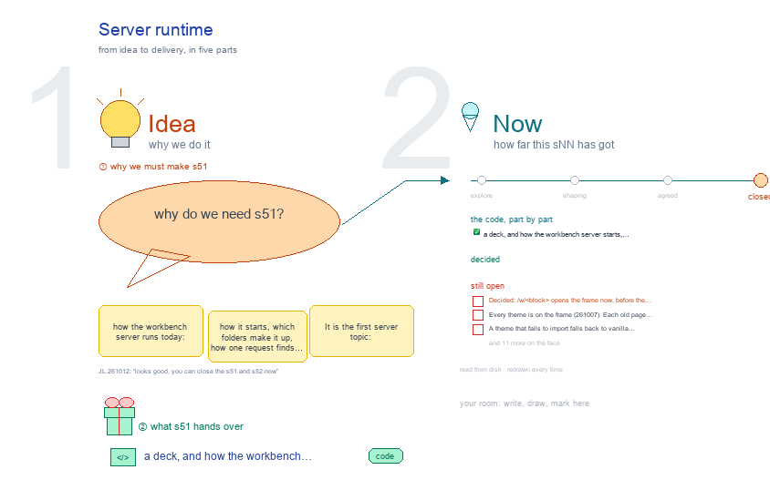

# s51 · Server runtime <!-- root #36b8be -->

**Tags:** `Server`
**Stage:** closed

- For <!-- @for #f78806 -->
  - a deck, and how the workbench server … <!-- @for/0 #b805e3 -->
    a deck, and how the workbench server starts, finds a page and answers its routes, for the people who build the workbench
- Delivery type <!-- @delivery-type #58a44f -->
  - code <!-- @delivery-type/0 #e6fb06 -->
- Closed <!-- @closed #88d86b -->
  - 261012 (JL 261012: "looks good, you can … <!-- @closed/0 #286f0f -->
    261012 (JL 261012: "looks good, you can close the s51 and s52 now").
  - The server runs as drawn: one host … <!-- @closed/1 #d6dbcd -->
    The server runs as drawn: one host per SPACE (settings.env's PORT, wb.py space_port), the old board names dropped.
  - Its hosting work went on in s52-host-and-share <!-- @closed/2 #ffe594 -->
  - The Open list below stays as a … <!-- @closed/3 #4248b3 -->
    The Open list below stays as a record for whoever reopens it.
- Topic <!-- @topic #7e13bd -->
  - how the workbench server runs today: how … <!-- @topic/0 #4cb4bb -->
    how the workbench server runs today: how it starts, which folders make it up, how one request finds its page, how the base frame draws a folder, which routes each workbench answers, and where SPACE Home's links land.
  - It is the first server topic: s01-s13 … <!-- @topic/1 #4834c9 -->
    It is the first server topic: s01-s13 design the ladder and the screens; s51 on are the served side of that design (JL 261007: "you can do it like s51_xxxx, for the front end part").
- Feeds <!-- @feeds #ffe8e9 -->
  - `reports/` q08_workbench_base · q09_studio_report_on_screen · q12_space_hosting · … <!-- @feeds/0 #bd39fc -->
    `reports/` q08_workbench_base · q09_studio_report_on_screen · q12_space_hosting · q07_workbench_mapping.
- Source <!-- @source #6da13a -->
  - every fact in the drawing is read … <!-- @source/0 #6b30dd -->
    every fact in the drawing is read off the server code at build time (`Tools/plugins/haipipe-toolkit/servers/`): the folders from `host_registry.server_folders()`, the mixins from `serve.py`'s `class Handler(...)`, the GET routes in `do_GET`'s order, the routes per workbench from `WORKBENCH_ROUTES`, the themes on the frame from each `*_theme.py`.
  - A rebuild redraws it from the code … <!-- @source/1 #cd8625 -->
    A rebuild redraws it from the code as it stands.
- Files <!-- @files #6ce6c5 -->
  - [py] [build_s51_server_runtime.py](build_s51_server_runtime.py) <!-- @files/0 #922942 -->
  - delivery/ <!-- @files/1 #404761 -->
  - history/ <!-- @files/2 #9a00ab -->
  - passes/ <!-- @files/3 #49b302 -->
  - [excalidraw] [s51-server-runtime.excalidraw](s51-server-runtime.excalidraw) <!-- @files/4 #f37ce5 -->
  - [md] [s51-server-runtime.md](s51-server-runtime.md) <!-- @files/5 #1c34a3 -->
  - [png] [s51-server-runtime.png](s51-server-runtime.png) <!-- @files/6 #147e5e -->
    
- How the server works <!-- @how-the-server-works #fe4bad -->
  - **One process, one root.** `servers/_host/serve.py` serves one … <!-- @how-the-server-works/0 #22fb1f -->
    **One process, one root.** `servers/_host/serve.py` serves one SPACE root. Nothing is built
  - ahead: every page is made from the … <!-- @how-the-server-works/1 #f4888a -->
    ahead: every page is made from the files on disk when it is asked for, so an edit on disk shows on the next reload. Code is different: the server never reloads, so a code change needs a restart.
  - **Many folders, one namespace.** Every folder under … <!-- @how-the-server-works/2 #c09ee4 -->
    **Many folders, one namespace.** Every folder under `servers/` (the host, `space-home`,
  - `workbench/workbench-task-draft/reader`, the base `workbench` and its `workbench-task-draft`, … <!-- @how-the-server-works/3 #eabf87 -->
    `workbench/workbench-task-draft/reader`, the base `workbench` and its `workbench-task-draft`, each `workbench-<theme>`) puts its `*.py` on one package, `live`, so `from live.frame import ...` works wherever the file sits. Their `assets/js` and `assets/css` are joined into one `board.js` and one `board.css`.
  - **One request.** `do_GET` checks sign-in, the terminal … <!-- @how-the-server-works/4 #d9c2b3 -->
    **One request.** `do_GET` checks sign-in, the terminal switch and `--only` first, then tries
  - Home, the short `/b/` and `/w/` addresses … <!-- @how-the-server-works/5 #88aefa -->
    Home, the short `/b/` and `/w/` addresses (a 302 to the long `/_board/<name>?path=…`), then each `/_board/<name>` in turn; anything else is a static file, except private ones.
  - **The frame.** `/_board/workbench?path=<folder>` draws any Block, Job … <!-- @how-the-server-works/6 #62b2c5 -->
    **The frame.** `/_board/workbench?path=<folder>` draws any Block, Job or Task folder: the
  - folder's name gives its level (`bNN_` · … <!-- @how-the-server-works/7 #16d4a6 -->
    folder's name gives its level (`bNN_` · `jNN_` · `tNN_`, a `board.md`, or the theme's own names, `Theme.level_patterns`: paper's `Ba-`/`Bb-`/`Bc-` groups are Jobs, its `S-` Sections Tasks), the Theme folder it sits in gives its theme, the vanilla defaults fill all six Spaces from the standard folders, and the theme's `<theme>_theme.py` replaces only the Spaces it fills. A theme that fails to import falls back to vanilla.
  - **The frame is the door (261007).** `/w/<block>`, … <!-- @how-the-server-works/8 #62ce33 -->
    **The frame is the door (261007).** `/w/<block>`, `/b/<block>` and every SPACE Home card
  - open the frame <!-- @how-the-server-works/9 #d59390 -->
    open the frame. It has no band line and no link to a theme's older page (JL 261007: "why I still have this? please remove that"); the level tabs say where you are, the folder's path is the title's tooltip. An old page answers only at its own address (`/_board/paper-board` now forwards to the frame). All seven themes are on it (cowork, design, discovery, insight, labeling, paper, work; the last three added 261007). A theme may claim a Block kept in another Theme folder by what it holds (`Theme.claims`): an Insight Block in `tasks/` (`workbench: insight`), a labeling Block in `tasks/` (its `schema.yaml`). An `--only <workbench>` host serves no frame, so it keeps the theme's own page. An older `?view=questions#question-QNN` link opens Audience Report on that row.
  - **Base styles only (JL 261007).** A frame … <!-- @how-the-server-works/10 #a1d2b7 -->
    **Base styles only (JL 261007).** A frame page carries the frame's own CSS and the base's shared
  - view styles (`SPACE_VIEW_CSS`, `WORK_ITEM_CSS`, `.st-ok` · `.st-warn` … <!-- @how-the-server-works/11 #7c597a -->
    view styles (`SPACE_VIEW_CSS`, `WORK_ITEM_CSS`, `.st-ok` · `.st-warn` · `.topic.missing`), never a theme's stylesheet; a theme's Space html uses base classes, and a missing component goes into the base. A guard test keeps those styles off the frame's own parts.
  - **The Guide by level.** A family whose … <!-- @how-the-server-works/12 #468b3a -->
    **The Guide by level.** A family whose `guide.yaml` has `levels:` (paper, work) draws every Guide
  - View as three folding sections, Block · … <!-- @how-the-server-works/13 #b405a4 -->
    View as three folding sections, Block · Job · Task, of cards; the words come from `workbench/guide/levels.yaml` with the theme's overrides, a Space card's `sub` and `runs` live from the frame; the frame passes its level so that section opens (frame ③; b03 `s31-guide`).
  - **A Page Task.** A theme whose Tasks … <!-- @how-the-server-works/14 #f64cfb -->
    **A Page Task.** A theme whose Tasks are Pages (paper's Sections) returns
  - `task_draft.draft_task_spaces`: Description Scope · Plan · Requirement … <!-- @how-the-server-works/15 #d99f3c -->
    `task_draft.draft_task_spaces`: Description Scope · Plan · Requirement · Records, Audience Report Table · Reading · Questions, Work Details Draft-… · Evidence-…, Delivery LaTeX · Word, each view the Page itself embedded (`/_board/draft?…&embed=1`); run cards per view, none on Table and Reading. The paper theme adds its own lines over it. Other Tasks keep the Page views as extra tabs (`PAGE_VIEWS`, design-b03-project), which step aside where a theme lays the Page out.
- Checked (261007) <!-- @checked-261007 #072893 -->
  - Host tests: `_host/tests` 47 passed <!-- @checked-261007/0 #1ca105 -->
    Host tests: `_host/tests` 47 passed; `workbench-work` 21, `workbench-cowork` 12,
  - `workbench-design` 5, `workbench-discovery` 4 passed <!-- @checked-261007/1 #0560da -->
  - A fresh server on the current code: … <!-- @checked-261007/2 #1b3851 -->
    A fresh server on the current code: Home and `/_board/health` 200; the frame on every Block
  - under the root (68), their first Jobs … <!-- @checked-261007/3 #788252 -->
    under the root (68), their first Jobs and Tasks, all six Spaces: 1,620 requests, all 200, none over 3 s; the Guide, 9 families × 4 Views, all 200.
  - `/w/<block>` for all 68 Blocks: all land, … <!-- @checked-261007/4 #33ee91 -->
    `/w/<block>` for all 68 Blocks: all land, except one slug two labeling Projects share (a 404 by
  - design; the long address works) <!-- @checked-261007/5 #bf2074 -->
  - Not fixed here: `haipipe-draft/tests/test_standalone_server.py`, 5 of 26 … <!-- @checked-261007/6 #3606b0 -->
    Not fixed here: `haipipe-draft/tests/test_standalone_server.py`, 5 of 26 fail, the same at the
  - last commit; they test the standalone `page.py … <!-- @checked-261007/7 #75145c -->
    last commit; they test the standalone `page.py serve` host, not the SPACE server.
  - About a dozen older `serve.py` processes from … <!-- @checked-261007/8 #2ff4cb -->
    About a dozen older `serve.py` processes from earlier sessions are still running on other
  - ports with the code they started with <!-- @checked-261007/9 #dd5a25 -->
  - Later the same day: `_host/tests` 70 passed, … <!-- @checked-261007/10 #52476f -->
    Later the same day: `_host/tests` 70 passed, work 21, paper 4, cowork 12, design 5, discovery 4;
  - the frame sweep 1,626 of 1,626; the … <!-- @checked-261007/11 #2d860d -->
    the frame sweep 1,626 of 1,626; the card Guide on every work Block, Job and Task, 908 of 908; paper's 9 Jobs and 50 Sections at their levels; the Sections' Page views, 50 × 17 screens, 850 of 850, every embedded view loading.
- Open <!-- @open #cf9b77 -->
  - Decided (JL 261007): `/w/<block>` opens the frame … <!-- @open/0 #378218 -->
    Decided (JL 261007): `/w/<block>` opens the frame now, before the theme files. Checked: all
  - 72 Home cards land in the frame, … <!-- @open/1 #bf3e72 -->
    72 Home cards land in the frame, 70 with an old page link, all 70 of those load.
  - Every theme is on the frame (261007) <!-- @open/2 #9ba623 -->
    Every theme is on the frame (261007). Each old page retires once its theme's Spaces hold all
  - it shows; still only on old pages: … <!-- @open/3 #088c4e -->
    it shows; still only on old pages: insight's Check gates, discovery's add-resource and add-drawing forms, labeling's annotation views (the frame links them; it never writes labels).
  - A theme that fails to import falls … <!-- @open/4 #5183da -->
    A theme that fails to import falls back to vanilla without a word: say so on the page?
  - No reload on a code change, and … <!-- @open/5 #f71097 -->
    No reload on a code change, and old processes keep serving old code: a restart command, or a
  - watch? <!-- @open/6 #13c668 -->
  - Hosting for colleagues (Q12): an always-on host, … <!-- @open/7 #4ee134 -->
    Hosting for colleagues (Q12): an always-on host, sign-in, a viewer mode with no writes. Now its own topic, s52-host-and-share (261012).
  - `do_GET` and `do_HEAD` each list every route: … <!-- @open/8 #275f9c -->
    `do_GET` and `do_HEAD` each list every route: one route table instead of two if-chains?
  - One mechanism for a Task's Page views: … <!-- @open/9 #397c36 -->
    One mechanism for a Task's Page views: `draft_task_spaces` for every Page Task, then `PAGE_VIEWS` goes?
  - Evidence-Supporting has no Task runs / Discovery … <!-- @open/10 #37f6e7 -->
    Evidence-Supporting has no Task runs / Discovery runs card in `run-cards.md` yet, and the cards'
  - `views` lines still put Structure revise, Evidence … <!-- @open/11 #ab1854 -->
    `views` lines still put Structure revise, Evidence embed and Auto write on Table and Reading.
  - A Section's Questions: the Work column should … <!-- @open/12 #ab406d -->
    A Section's Questions: the Work column should list the Runs that worked it and what they changed.
  - `question_rows`: one heading per group in All, … <!-- @open/13 #7f4fdf -->
    `question_rows`: one heading per group in All, for every theme?
  - Paper: `Ba-` (Main) and `Bb-` (Appendix) are … <!-- @open/14 #2c6e90 -->
    Paper: `Ba-` (Main) and `Bb-` (Appendix) are two Jobs today; s12 draws one version Job (Q01).
  - One SPACE, one host (261012): 12 extra … <!-- @open/15 #62b739 -->
    One SPACE, one host (261012): 12 extra hosts still run (WellDoc 4, Tools 3, Physician 5); stopping them
  - is JL's (`kill` of the 14 processes, … <!-- @open/16 #ecadb8 -->
    is JL's (`kill` of the 14 processes, given 261012). jluo41-repo runs 5665 while its settings say 5640.
  - 5623 runs Homebrew's python 3.14 with no … <!-- @open/17 #2382de -->
    5623 runs Homebrew's python 3.14 with no `claude_agent_sdk`: the page's chat answers 400. Run it on
  - `.venv/bin/python`? <!-- @open/18 #e3a1c0 -->
  - Agree its **For:** line and **Delivery type:** … <!-- @open/19 #173eaa -->
    Agree its **For:** line and **Delivery type:** (code), proposed by the agent 261030?
