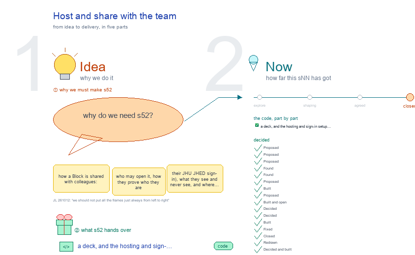

# s52 · Host and share with the team <!-- root #0d4b53 -->

**Tags:** `Server`
**Stage:** closed

- For <!-- @for #f78806 -->
  - a deck, and the hosting and sign-in … <!-- @for/0 #bd400b -->
    a deck, and the hosting and sign-in setup that lets colleagues open a Block, for the people who build the workbench
- Delivery type <!-- @delivery-type #58a44f -->
  - code <!-- @delivery-type/0 #e6fb06 -->
- Topic <!-- @topic #7e13bd -->
  - how a Block is shared with colleagues: … <!-- @topic/0 #79ec65 -->
    how a Block is shared with colleagues: who may open it, how they prove who they are (their JHU JHED sign-in), what they see and never see, and where it is hosted. s51 is how the server runs; s52 is who can reach it.
  - New on 261012 (JL: "how could I … <!-- @topic/1 #ec6632 -->
    New on 261012 (JL: "how could I host it and share it with others? ... share the block with others, could we use the JHU jhed accouunt to verify it? ...
  - How hard it will be?"; then "maybe … <!-- @topic/2 #d3f2c4 -->
    How hard it will be?"; then "maybe we can have the s52 about host and share with the team?").
- Feeds <!-- @feeds #ffe8e9 -->
  - `reports/` q12_space_hosting <!-- @feeds/0 #be7b13 -->
- Files <!-- @files #6ce6c5 -->
  - [py] [build_s52_host_and_share.py](build_s52_host_and_share.py) <!-- @files/0 #76f96a -->
  - delivery/ <!-- @files/1 #404761 -->
  - history/ <!-- @files/2 #9a00ab -->
  - passes/ <!-- @files/3 #49b302 -->
  - [excalidraw] [s52-host-and-share.excalidraw](s52-host-and-share.excalidraw) <!-- @files/4 #ce5389 -->
  - [md] [s52-host-and-share.md](s52-host-and-share.md) <!-- @files/5 #c781b0 -->
  - [png] [s52-host-and-share.png](s52-host-and-share.png) <!-- @files/6 #316a01 -->
    
- The drawing <!-- @the-drawing #a4f9df -->
  - Six maps of the current setup in … <!-- @the-drawing/0 #163264 -->
    Six maps of the current setup in three acts, a row each, read left to right and then down, and one frame at the right for what comes later (JL 261012: "do not use the later, just use the current settings ... put all the later in that new frame") (JL 261012: "we should not put all the frames just always from left to right"; the s51 shape, JL 261012: "one frame should be as large as possible, within the frame, we want the workflow map or the mindmap, the frames should be well arrange to form the narrative"). Edit the words here; `python build_s52_host_and_share.py` redraws.
- Decided <!-- @decided #55615a -->
  - s52-D01 · Proposed (JL 261012): share one … <!-- @decided/0 #af372c -->
    s52-D01 · Proposed (JL 261012): share one Block at a time, read-only, to people named on an allow list, who sign in with JHED; the gate (Cloudflare Access) sits in front of the server, so the server never sees a password, only the verified email. A one-time email code to JHU addresses stands in until the JHED app is registered.
  - s52-D03 · Proposed (JL 261012: "how could … <!-- @decided/1 #e0125c -->
    s52-D03 · Proposed (JL 261012: "how could I give differnt people to difference access to different blocks?"): one access table per SPACE, `.server_config/access.yaml` (git-ignored: emails stay out of the Blocks' repos), lines of who (an email or a group) · what (a Block, or a Project meaning all its Blocks) · level (view < comment < edit < owner; the highest matching line wins; no line, no access). The server checks it on every request and answers 404 where there is no access; each person's Home lists only their Blocks. A Share button on a Block (owner only) edits the table later; until then JL edits the file.
  - s52-D04 · Proposed (JL 261012: "how could … <!-- @decided/2 #ca6366 -->
    s52-D04 · Proposed (JL 261012: "how could they use the jhed to login?"): sign-in is OpenID Connect between Cloudflare Access and JHU's Microsoft Entra (frame ③): Access sends the browser to JHU's own page (JHED ID, password, MFA), takes back a token Microsoft signed, and passes the request on with a pass Cloudflare signed. The share host checks that signature and reads the email from it; a bare email header is refused. JHU IT registers one Entra app (tenant ID, client ID, secret, Access's callback as its return address); nothing is set per person.
  - s52-D05 · Found (261012 <!-- @decided/3 #c5acb0 -->
    s52-D05 · Found (261012; JL: "so I need this information? I need to ask the RIT for it?"): of the three values the sign-in needs, JHU's tenant ID is public (`9fa4f438-b1e6-473b-803f-86f8aedf0dec`, the same for jhu.edu and jh.edu, read from login.microsoftonline.com/jhu.edu's sign-in metadata). The client ID and its secret come only from an app registered in JHU's Entra, which is JHU IT's to do (Enterprise Authentication, Sam Bennett; cc RITRequest@jh.edu). The request gives them the return address, Cloudflare Access's `https://<team>.cloudflareaccess.com/cdn-cgi/access/callback`, so the Cloudflare team name is chosen first. The secret expires (IT sets when); its renewal date goes in the table of who to ask.
  - s52-D06 · Found (261012 <!-- @decided/4 #8655bb -->
    s52-D06 · Found (261012; JL: "we have a repo in JHU-CHDAI/Debate-AI ... check how do they give use the email?"): Debate-AI (now `platforms/HAIChat-SPACE/haichat-ai/debate-ai`, WellDoc-SPACE) does not use JHED. A person types a JHU email and gets a six-digit code (10 minutes, single use, a few tries) sent from `noreply@cdhai.com` through Azure Communication Services (`ACS_CONNECTION_STRING`, `MAIL_FROM`); entering it proves they own the mailbox. Only jhu.edu, jh.edu and jhmi.edu (and their subdomains) may hold an account, plus `EXTRA_EMAIL_DOMAINS`; jh.edu and jhu.edu fold into one account, jhmi.edu stays separate. The session is a signed cookie (HS256 with `SESSION_SECRET`, 7 days); what a person may do comes from per-course roles (owner, assistant) checked on the server, never from the account kind. `ADMIN_EMAILS` get their codes in the server log when mail is not set up. So a sign-in with no IT ticket already exists at CDHAI: the same emailed code, from CDHAI's own sender, could gate the share host (with CDHAI's OK to use its ACS sender).
  - s52-D07 · Proposed (JL 261012: "How do … <!-- @decided/5 #0f5087 -->
    s52-D07 · Proposed (JL 261012: "How do you think we can use the Debate-AI method? Do you think we can do the same things here?"): yes; the first sign-in is Debate-AI's emailed code, built into the share host (frame ③): a JHU email (jhu.edu, jh.edu folded into it, jhmi.edu its own), a six-digit code for 10 minutes and one use, sent from noreply@cdhai.com through Azure Communication Services, then a signed HTTP-only cookie for 7 days. One change from Debate-AI: a code goes only to an email the access table names, and everyone gets the same answer, so nobody learns who has access. It needs CDHAI's OK and its ACS connection string, not JHU IT; no Cloudflare Access gate in front. JHED (④) stays the later upgrade: the same table and the same cookie, a stronger proof. This changes D01's gate: Access only arrives with JHED.
  - s52-D08 · Built (JL 261012: "CDHAI is … <!-- @decided/6 #5e3f61 -->
    s52-D08 · Built (JL 261012: "CDHAI is me, it is okay. Go ahead and update it."): version 1 of the share mode. `serve.py --share` with `servers/_host/live/share.py`'s `ShareMixin` ahead of `AuthMixin`: sign-in at `/_share/signin` → a code (Debate-AI's rules; only to an owner or a named email; the same answer for everyone) → `/_share/verify` → a signed cookie for 7 days; then each request's paths (`path=`, `board=`, ... or the file asked for) must sit inside a grant of `.server_config/access.yaml`, else 404; a viewer's Home lists only their Blocks; POST, the terminal and chat are an owner's (levels above view come later); every granted request is a line in `share-log.tsv`. Mail is Azure Communication Services from noreply@cdhai.com once `ACS_CONNECTION_STRING` is in `.server_config/share.env`; until then an owner's code goes to the server log. Tests: `_host/tests/test_share.py`, 7, and all 215 server tests pass. Live on WellDoc-SPACE (127.0.0.1:5690, then stopped): sent to sign-in, code from the log, signed in, b00's page 200, a wrong code 401. WellDoc-SPACE's `.server_config/` now holds `access.yaml` (owner jluo41@jhu.edu, no grants yet) and `share.env`, git-ignored.
  - s52-D09 · Proposed: two doors on one … <!-- @decided/7 #6c4ebb -->
    s52-D09 · Proposed: two doors on one SPACE, one code. The tailnet host (WellDoc 5602) stays JL's private door with no sign-in, and every tool's link checks keep working; the share door is the same serve.py on the same SPACE root with `--share`, bound to 127.0.0.1 so only the tunnel reaches it. This revises D02 (which put share mode in the main host): the 261008 lesson was a host rooted at a folder with a password; this one is rooted at the SPACE and signs people in.
  - s52-D10 · Built and open (261012 <!-- @decided/8 #10bade -->
    s52-D10 · Built and open (261012; JL: "could you make it to be the block.jjluo.com? please do it"; "How could i share one block to others? For example, for the b10."): `block.jjluo.com` is live: a tunnel line in `~/.cloudflared/config.yml` and its DNS name to `serve.py --share` on 127.0.0.1:5690, rooted at WellDoc-SPACE (sign-in 200, everything else 303 to sign-in, from outside). `wb.py share <folder> <email>` writes a grant and prints the link (`cli/wb_share.py`); the host reads `access.yaml` again when it changes. b10 sits in the Tools SPACE, which WellDoc reaches only through its `Tools` link, and the workbench refuses a path that leads out of its root, so b10 does not open on this door. Two ways: (A) one door rooted at the Desktop (tested locally: b10 and b00 both 200), one table for every SPACE, but the permission check refused to put the whole Desktop behind the public tunnel; (B) one door per SPACE, Tools behind its own name (`.server_config/` ignored in Tools first).
  - s52-D11 · Decided (JL 261012, ran it; … <!-- @decided/9 #800218 -->
    s52-D11 · Decided (JL 261012, ran it; "I want the block.jjluo.com to share whatever blocks"): option A. The share host behind block.jjluo.com is rooted at the Desktop (`serve.py --root ~/Desktop --share`, 127.0.0.1:5690), so one table, `~/Desktop/.server_config/access.yaml`, can grant any Block of any SPACE; WellDoc's own table was removed. `wb.py share <folder> <email>` finds that table by itself. Checked from outside: sign-in 200; b10 and every other path 303 to sign-in; signed in as the owner, b10 and Proj01's b00 both 200. The risk taken: a gate bug would reach the whole Desktop, so the gate stays default-deny and its tests run with every change.
  - s52-D12 · Decided (JL 261012: "could you … <!-- @decided/10 #14dd44 -->
    s52-D12 · Decided (JL 261012: "could you give me a link and I can share?"; then "Only people I name"): b10's link is `https://block.jjluo.com/_board/workbench?path=Tools-SPACE/blueprints/Project-Ladder/work/b10_project_workbench&studio=1`, and it opens only for the emails added with `wb.py share`. A grant `who: anyone@jhu` (every jhu.edu, jh.edu and jhmi.edu email) now exists for a link meant for all of JHU (live/share.py `ANYONE_JHU`, tested), unused for b10; the running share host loads it at its next start.
  - s52-D13 · Built (JL 261012: "could I … <!-- @decided/11 #63185b -->
    s52-D13 · Built (JL 261012: "could I only prepare a list of jh emails, only these people can access it"): a group may read its members from a list file, `groups: {b10: "@people/b10.txt"}`, one JHU email a line, # for notes; the host watches the file, so a saved edit lets someone in or takes them out at their next click. `wb.py share <folder> --people <name>` makes `~/Desktop/.server_config/people/<name>.txt` (mode 600) and the grant. b10 is shared with group b10 this way; its list is empty until JL fills it. 9 share tests pass.
  - s52-D14 · Fixed (JL 261012, a screenshot: … <!-- @decided/12 #95c2d7 -->
    s52-D14 · Fixed (JL 261012, a screenshot: the code email arrived, then "No response."): five codes for one email in an hour had used up the limit, so later asks showed "Check your inbox" and sent nothing; and each new code had replaced the last, so a code from an earlier email failed. Now any code from the last 10 minutes works, one success ends them all, the limit is 10 an hour, and the page says so. An owner's Home is the share list, not a scan of every SPACE under the Desktop. Checked through block.jjluo.com: verify 303, Home 200, b10 200.
  - s52-D15 · Closed (JL 261012: "looks good, … <!-- @decided/13 #fbfc8f -->
    s52-D15 · Closed (JL 261012: "looks good, you can close the s51 and s52 now"): block.jjluo.com shares any Block of any SPACE on this Mac, read-only, to the JHU emails a people list names, signed in by a code from noreply@cdhai.com; b10 is shared with group b10 (xzhi2@jh.edu). What is left is frame ⑦ (Later): JHED, comment and edit, a Share button, surviving a restart, JHU groups, data rules, guests, the log's keeping.
  - s52-D16 · Redrawn (261012, excalidraw-studio's six principles, … <!-- @decided/14 #2f8483 -->
    s52-D16 · Redrawn (261012, excalidraw-studio's six principles, asked through b31-s01): each frame's key point is the box marked `key: true` above, in the one slight colour; frame titles 60 px (b10 `_build/story.py` `key_point`, `big_titles`); the story arrow between acts runs below the act's tallest frame, no longer through ③. The thin frames got true facts, not padding: ④ no open port, ⑤ every SPACE's own door, ⑥ what `wb.py share` writes and `--list`, ⑦ each Later item's open question. No person is named on the drawing. `check.py`: all 7 frames pass. The old builder, face and preview are in `history/` (`-261012-v1`).
  - s52-D17 · Decided and built (JL 261012: … <!-- @decided/15 #eb718b -->
    s52-D17 · Decided and built (JL 261012: "ok, so we will have physician.jjluo.com, welldoc.jjluo.com, drfirst.jjluo.com, reach.jjluo.com and jluo41.jjluo.com and knowledge.jjluo.com"): one door per SPACE, which replaces D11's one door for the Desktop. Each SPACE's `.server_config/access.yaml` holds its own table and names its door (`public_url:`, `port:`); `wb.py share --serve <SPACE>` starts it (serve.py --share, --root that SPACE, 127.0.0.1 only). Doors: block (Tools-SPACE) 5690 · physician 5691 · welldoc 5692 · drfirst 5693 · reach 5694 · jluo41 (jluo41-repo) 5695 · knowledge (Knowledge-Base) 5696. One mail key for every door, in `~/Desktop/.server_config/share.env` (share.py looks above the root). The b10 grant and its people list moved to Tools-SPACE's table (`blueprints/Project-Ladder/work/b10_project_workbench`); a link from the Desktop door (`path=Tools-SPACE/blueprints/...`) is sent on to the same page. A share door is never one of a SPACE's own hosts to `wb.py`. `.server_config/` is git-ignored in Tools-SPACE, Knowledge-Base and jluo41-repo now too. Checked through each public name: every door's Home 200 for the owner; b10 200 for xzhi2, the old b10 link 303 to it, another Block 404; LLMRec 200 on physician for the owner, 303 for xzhi2 and for block's cookie.
  - s52-D18 · Decided (JL 261012, on the … <!-- @decided/16 #5b918a -->
    s52-D18 · Decided (JL 261012, on the Tools-SPACE row of the door table: "we will drop this"): block.jjluo.com is dropped. Its door on 5690 is stopped, its tunnel line removed (the DNS name stays and answers 404 at the tunnel), and Tools-SPACE's table, secret and b10 people list are deleted, so b10 is no longer shared and xzhi2's link answers 404. Six doors remain, 5691 to 5696. `wb.py share` now refuses a SPACE with no table ("has no share door"), instead of writing a grant that nothing serves.
  - s52-D19 · Shared (JL 261012: "could we … <!-- @decided/17 #74bb89 -->
    s52-D19 · Shared (JL 261012: "could we share this to zdi1", Physician-SPACE's Project-LLMRec-Physician): group llmrec, `Physician-SPACE/.server_config/people/llmrec.txt` (zdi1@jh.edu), view on the whole Project. Link: https://physician.jjluo.com/_board/workbench?path=examples-3-nlp/Project-LLMRec-Physician&studio=1. Checked on the live door with zdi1's cookie: the Project and b02 200, their Home lists LLMRec only, PhyTrait's b01 404, a change 403. Fixed on the way: a grant kept the table's own note only by luck (now `_save_table` keeps it), and a new list's header named block.jjluo.com (now its own door).
  - s52-D20 · Built (JL 261012: "how could … <!-- @decided/18 #ec4eb1 -->
    s52-D20 · Built (JL 261012: "how could you update /wb xxxx to share?"): `/wb <folder> share <email>` does what `/wb share <folder> <email>` does; with no email it prints who can open that folder and its link, writing nothing. Asked the same day whether this makes the Mac Studio unsafe: the doors listen on 127.0.0.1 only (not reached from the Wi-Fi network, checked), a page with no sign-in is sent to the sign-in page, a chat with no sign-in gets 401, and the tables, secrets and mail key are git-ignored, mode 600. The open risk is not the doors (Open 10).
  - s52-D21 · Fixed (JL 261012, zdi1: "So … <!-- @decided/19 #7d1e5f -->
    s52-D21 · Fixed (JL 261012, zdi1: "So I can't get code from zdi1@jh.edu"): the code goes to the address as typed, jh.edu and jhu.edu stay one person only when matching a grant; and mail goes through Azure's REST API with the standard library, since five doors' Python had no azure package and had sent nothing. Checked live: codes to jluo41@jhu.edu and zdi1@jh.edu both accepted by Azure; six doors restarted.
  - s52-D02 · Proposed: the share mode is … <!-- @decided/20 #6b7ae0 -->
    s52-D02 · Proposed: the share mode is the main host's own (`serve.py --share`), not a second host rooted at a folder: the 261008 Samsung password host was that and was rolled back.
- Open <!-- @open #cf9b77 -->
  - Which Block is shared first, and with … <!-- @open/0 #ae81ae -->
    Which Block is shared first, and with whom?
  - Study data or PHI in a shared … <!-- @open/1 #2261b6 -->
    Study data or PHI in a shared Block: who approves, and must it be hosted inside JHU (⑤ B)?
  - Colleagues outside JHU: a JHU guest account, … <!-- @open/2 #e39cd2 -->
    Colleagues outside JHU: a JHU guest account, or no?
  - How long to keep the log of … <!-- @open/3 #665995 -->
    How long to keep the log of who opened what?
  - The four levels: is comment needed at … <!-- @open/4 #8f0def -->
    The four levels: is comment needed at first, or view and edit only?
  - Groups: kept in the table, or JHU's … <!-- @open/5 #584904 -->
    Groups: kept in the table, or JHU's own groups (a JHED group, as Research IT builds for JH-CDHAI)?
  - Sign-in: Debate-AI's emailed code (CDHAI's sender, no … <!-- @open/6 #fc6ad1 -->
    Sign-in: Debate-AI's emailed code (CDHAI's sender, no IT), Cloudflare's emailed code, or JHED? (D06)
  - Decided: one door for every SPACE (D11) <!-- @open/7 #e7c587 -->
    Decided: one door for every SPACE (D11). The share host stops at a reboot: keep it up with a LaunchAgent?
  - Decided (D17): one door per SPACE <!-- @open/8 #a71aa8 -->
    Decided (D17): one door per SPACE. Was: one door per SPACE after all (asked 261012, about Physician-SPACE's Project-LLMRec-Physician)? A host rooted at
  - one SPACE, its own table, secret and … <!-- @open/9 #13508e -->
    one SPACE, its own table, secret and cookie, behind its own name (e.g. physician.jjluo.com). Tested locally on 127.0.0.1:5691: LLMRec 200, other SPACEs 404, a block.jjluo.com cookie refused; `share.py` now finds the mail key in the nearest `.server_config/share.env` above the root. Waits on the names and two cloudflared lines.
  - The tailnet hosts (100.121.165.84, 10 of them) … <!-- @open/10 #09b621 -->
    The tailnet hosts (100.121.165.84, 10 of them) run `--no-auth`; the tailnet holds a second person's laptop (a
  - member, not a shared-in machine) <!-- @open/11 #9ced07 -->
    member, not a shared-in machine). Every one of them answers `/_board/chat`, which runs Claude with every tool and no prompts (`chat.py`, mode `bypass` by default), and 5601 (Physician) and 5607 (REACH) also give a shell (`/_term`). Close it with a tailnet rule that lets only JL's own devices reach the Mac, or remove that laptop.
  - Agree its **For:** line and **Delivery type:** … <!-- @open/12 #173eaa -->
    Agree its **For:** line and **Delivery type:** (code), proposed by the agent 261030?
