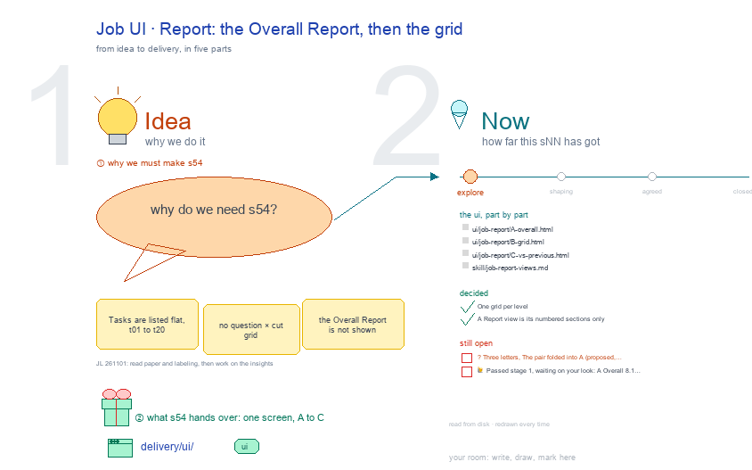

# s54 · Job UI: Report <!-- root #b2743c -->

**Tags:** `Job UI`
**Stage:** explore

- For <!-- @for #f78806 -->
  - a deck, and the Report screen of … <!-- @for/0 #b941ea -->
    a deck, and the Report screen of an insight Job (one analysis plan × one data freeze) on the focus page (`delivery/ui/job-report`), for the people who build the workbench
- Delivery type <!-- @delivery-type #58a44f -->
  - ui <!-- @delivery-type/0 #636117 -->
- Covers <!-- @covers #a6c44a -->
  - the Overall Report, then the question × … <!-- @covers/0 #d41037 -->
    the Overall Report, then the question × cut grid: A Overall (The pair's facts inside) · B Grid · C vs previous; each view 📊 Results, then ⚙️ Process.
- Excluded <!-- @excluded #980495 -->
  - the other eight cells of the 3 … <!-- @excluded/0 #1868ea -->
    the other eight cells of the 3 × 3 (s51, s52, s53, s55, s56, s57, s58, s59); the old five-Space Insight page (s02); every Theme's shared frame (b10).
- Topic <!-- @topic #7e13bd -->
  - One cell of the insight 3 × … <!-- @topic/0 #99fcdc -->
    One cell of the insight 3 × 3, an insight Job (one analysis plan × one data freeze) × Report (check), copied from the paper theme's (b16 j01) and the labeling theme's (b15 j01) (JL 261101: "Please understand the above two sessions and then work on the insights").
  - Its drawing is haipipe-studio's five parts, drawn … <!-- @topic/1 #99f975 -->
    Its drawing is haipipe-studio's five parts, drawn by `build_s54_job_ui_report.py` through j01's `insight_ui_cells.py`; its Design is every view as the same full screen, lettered, settled one round each.
  - Names are placeholders (`<dataset>`, `<d>`): a real … <!-- @topic/2 #906be5 -->
    Names are placeholders (`<dataset>`, `<d>`): a real Board holds one person's health data, and Tools is public.
- Feeds <!-- @feeds #ffe8e9 -->
  - `reports/` q01_insight_ladder <!-- @feeds/0 #b79a20 -->
- Files <!-- @files #6ce6c5 -->
  - [py] [build_s54_job_ui_report.py](build_s54_job_ui_report.py) <!-- @files/0 #672ece -->
  - review/ <!-- @files/1 #7928fb -->
  - [excalidraw] [s54-job-ui-report.excalidraw](s54-job-ui-report.excalidraw) <!-- @files/2 #e7ffe5 -->
  - [md] [s54-job-ui-report.md](s54-job-ui-report.md) <!-- @files/3 #a04945 -->
  - [png] [s54-job-ui-report.png](s54-job-ui-report.png) <!-- @files/4 #7d58ae -->
    
- Decided <!-- @decided #55615a -->
  - s54-D01 · One grid per level (Board … <!-- @decided/0 #36e7fe -->
    s54-D01 · One grid per level (Board question × Job, Job question × cut, Task cut × step); Report opens on the answer; Work opens on what waits on the person; no Task asks the person (JL 261101: "go ahead", on the proposal in chat).
- Open <!-- @open #cf9b77 -->
  - ? <!-- @open/0 #d3b45e -->
    ? Three letters, The pair folded into A (proposed, built live).
  - Round 2 drawn (the round 1 fixes … <!-- @open/1 #a15159 -->
    Round 2 drawn (the round 1 fixes taken): review it, letter by letter.
