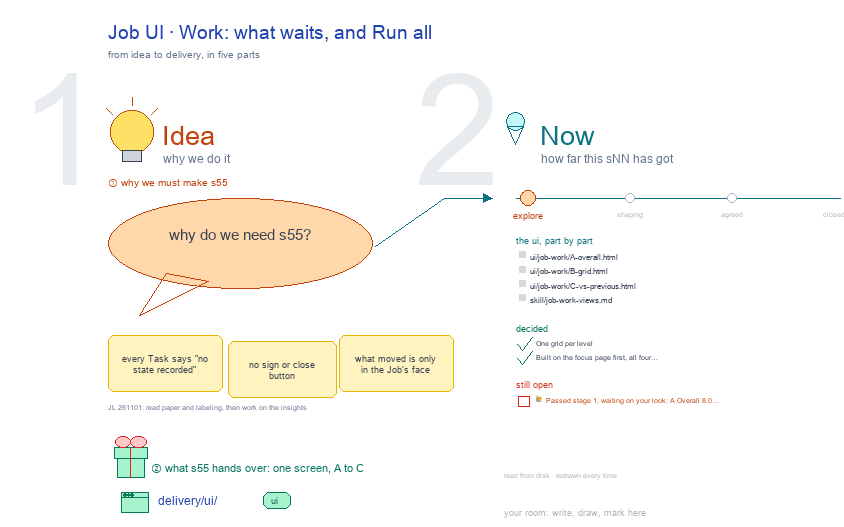

# s55 · Job UI: Work <!-- root #a9dfa8 -->

**Tags:** `Job UI`
**Stage:** explore

- For <!-- @for #f78806 -->
  - a deck, and the Work screen of … <!-- @for/0 #0bbcf5 -->
    a deck, and the Work screen of an insight Job (one analysis plan × one data freeze) on the focus page (`delivery/ui/job-work`), for the people who build the workbench
- Delivery type <!-- @delivery-type #58a44f -->
  - ui <!-- @delivery-type/0 #636117 -->
- Covers <!-- @covers #a6c44a -->
  - the same letters, your signs first: A … <!-- @covers/0 #f053b0 -->
    the same letters, your signs first: A Overall (write, then what the close freezes) · B Grid (launch, write, check) · C vs previous (compare, propose).
- Excluded <!-- @excluded #980495 -->
  - the other eight cells of the 3 … <!-- @excluded/0 #065df2 -->
    the other eight cells of the 3 × 3 (s51, s52, s53, s54, s56, s57, s58, s59); the old five-Space Insight page (s02); every Theme's shared frame (b10).
- Topic <!-- @topic #7e13bd -->
  - One cell of the insight 3 × … <!-- @topic/0 #173ce7 -->
    One cell of the insight 3 × 3, an insight Job (one analysis plan × one data freeze) × Work (do), copied from the paper theme's (b16 j01) and the labeling theme's (b15 j01) (JL 261101: "Please understand the above two sessions and then work on the insights").
  - Its drawing is haipipe-studio's five parts, drawn … <!-- @topic/1 #eddbf0 -->
    Its drawing is haipipe-studio's five parts, drawn by `build_s55_job_ui_work.py` through j01's `insight_ui_cells.py`; its Design is every view as the same full screen, lettered, settled one round each.
  - Names are placeholders (`<dataset>`, `<d>`): a real … <!-- @topic/2 #906be5 -->
    Names are placeholders (`<dataset>`, `<d>`): a real Board holds one person's health data, and Tools is public.
- Feeds <!-- @feeds #ffe8e9 -->
  - `reports/` q01_insight_ladder <!-- @feeds/0 #b79a20 -->
- Files <!-- @files #6ce6c5 -->
  - [py] [build_s55_job_ui_work.py](build_s55_job_ui_work.py) <!-- @files/0 #78fb49 -->
  - review/ <!-- @files/1 #7928fb -->
  - [excalidraw] [s55-job-ui-work.excalidraw](s55-job-ui-work.excalidraw) <!-- @files/2 #dd8516 -->
  - [md] [s55-job-ui-work.md](s55-job-ui-work.md) <!-- @files/3 #c41022 -->
  - [png] [s55-job-ui-work.png](s55-job-ui-work.png) <!-- @files/4 #c71923 -->
    
- Decided <!-- @decided #55615a -->
  - s55-D01 · One grid per level (Board … <!-- @decided/0 #bae438 -->
    s55-D01 · One grid per level (Board question × Job, Job question × cut, Task cut × step); Report opens on the answer; Work opens on what waits on the person; no Task asks the person (JL 261101: "go ahead", on the proposal in chat).
  - s55-D02 · Built on the focus page … <!-- @decided/1 #147935 -->
    s55-D02 · Built on the focus page first, all four letters (JL 261101: "start with s55", "follow the ones in the workbench-paper and workbench-labeling"): `servers/workbench-insight/insight_focus.py`, asked by `focus_page.py`'s hook `insight_job_work`; each view ⚙️ Process then 📊 Results with the shared ui_parts; the round 1 fixes taken (your signs first on every view, sign before close, Work B the Report's grid with each cell's next verb, state words on every row). "Run all, or one button per row": both (Launch all · Write all · Check all, and a verb in each cell).
- Open <!-- @open #cf9b77 -->
  - Round 2: review the built screens (live … <!-- @open/0 #49c09c -->
    Round 2: review the built screens (live on the focus page) against the rubric, letter by letter, at 1440 and 390.
