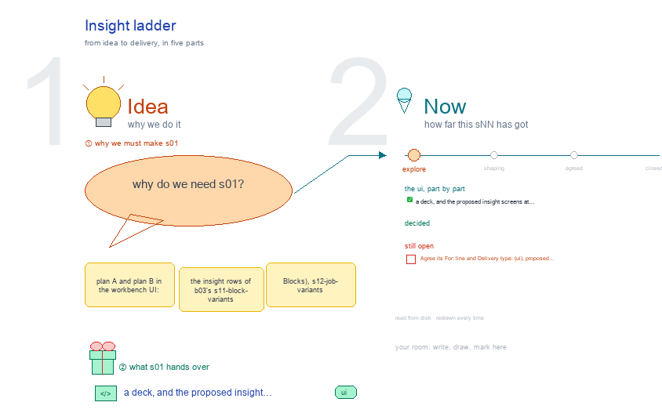

# s01 · Insight ladder <!-- root #6c1b85 -->

**Stage:** explore

- For <!-- @for #f78806 -->
  - a deck, and the proposed insight screens … <!-- @for/0 #7aaeee -->
    a deck, and the proposed insight screens at Block, Job and Task beside today's, for the people who build the workbench
- Delivery type <!-- @delivery-type #58a44f -->
  - ui <!-- @delivery-type/0 #636117 -->
- Topic <!-- @topic #7e13bd -->
  - plan A and plan B in the … <!-- @topic/0 #e5c016 -->
    plan A and plan B in the workbench UI: the insight rows of b03's s11-block-variants (Blocks), s12-job-variants (Jobs) and s13-task-variants (Tasks), each frame named for its level, with the proposed screens and today's beneath them.
  - Frames: Decide (the ladder and the open … <!-- @topic/1 #55d304 -->
    Frames: Decide (the ladder and the open points ① to ⑦ with my answers);
  - Board level A (DIKW on the board), … <!-- @topic/2 #2617d7 -->
    Board level A (DIKW on the board), B (DIKW in the Jobs) and the older register board, in the same columns so A and B compare screen by screen;
  - Job level A (no Job tab, a … <!-- @topic/3 #a8f3a8 -->
    Job level A (no Job tab, a note) and B (a level with the Block's six Spaces);
  - Task level (A and B alike) <!-- @topic/4 #74959a -->
- Colour <!-- @colour #f28563 -->
  - red only on the open points, each … <!-- @colour/0 #33d805 -->
    red only on the open points, each note tagged with its number; a "differs:" line (today against proposed) is gray.
- Source <!-- @source #6da13a -->
  - the trees, skills and screens of B … <!-- @source/0 #7b3697 -->
    the trees, skills and screens of B and of the Task level come from b03's `s01-overall-tree-structure/build_ladder_v4.py` and `level_views.py`; option A, the Decide frame and the cleanup (`tidy`: empty Description columns dropped, frames 300 apart, red numbered) are this builder's own.
  - Seed snapshot: `.s01-insight-ladder.seed.json`, beside the drawing <!-- @source/1 #ecc3d3 -->
- Feeds <!-- @feeds #ffe8e9 -->
  - `reports/` q01_insight_ladder (and b03's q07_workbench_mapping) <!-- @feeds/0 #74d7e2 -->
- Files <!-- @files #6ce6c5 -->
  - [py] [build_s01_insight_ladder.py](build_s01_insight_ladder.py) <!-- @files/0 #16b7dd -->
  - delivery/ <!-- @files/1 #404761 -->
  - [excalidraw] [s01-insight-ladder.excalidraw](s01-insight-ladder.excalidraw) <!-- @files/2 #c2b4d9 -->
  - [md] [s01-insight-ladder.md](s01-insight-ladder.md) <!-- @files/3 #da4ff0 -->
  - [png] [s01-insight-ladder.png](s01-insight-ladder.png) <!-- @files/4 #f26d2c -->
    
- Decided so far <!-- @decided-so-far #f1f0e3 -->
  - (261006, JL: the levels "are in the … <!-- @decided-so-far/0 #eb9a1f -->
    (261006, JL: the levels "are in the board level, do you think in the job level") A DIKW level is
  - a Job: Block › Work Details lists … <!-- @decided-so-far/1 #da294d -->
    a Job: Block › Work Details lists the four levels, and each level's Job tab takes the Block's six Spaces (s01-D24).
  - (261007) Today's insight question screens sit under … <!-- @decided-so-far/2 #d4ed25 -->
    (261007) Today's insight question screens sit under the proposed ones: Prototype (its ask and
  - needs) under Description, Insight (its partitions) under … <!-- @decided-so-far/3 #6e93e8 -->
    needs) under Description, Insight (its partitions) under Work Details.
  - (261007, JL: "make your name of frame … <!-- @decided-so-far/4 #cde462 -->
    (261007, JL: "make your name of frame to be of the board level, job level and task level")
  - Every frame is named for its level: … <!-- @decided-so-far/5 #b49cc7 -->
    Every frame is named for its level: Overview · Board level · Job level · Task level.
  - (261007, JL: "is DIKW in the board … <!-- @decided-so-far/6 #57f78c -->
    (261007, JL: "is DIKW in the board level or in the job level? Could you make both of them")
  - Two options side by side <!-- @decided-so-far/7 #e8c710 -->
    Two options side by side. A · DIKW on the board: the levels are the third row of Board › Work Details (Meta · Data · Information · Knowledge · Wisdom), each listing its questions; the level folders stay on disk with no Job tab (a note frame at the Job level). B · DIKW in the Jobs: Board › Work Details lists the four levels, each a Job with the Block's six Spaces. The Task level is the same in both. A is defined in this builder only (`define_option_a`); B and everything else come from b03's shared definitions. The overview frame compares them row by row.
  - (261007, JL: "could you reorganize this?", "make … <!-- @decided-so-far/8 #e891fd -->
    (261007, JL: "could you reorganize this?", "make it clean and use the red color to show the one I
  - should pay attention"; then "where is my … <!-- @decided-so-far/9 #b624ac -->
    should pay attention"; then "where is my original workbench UI?", "I want to see the plan A and plan B how to fit the workbench UI") The UI screens stay; a short text-only redraw that dropped them was undone. Cleaned instead: a Decide frame first, the Board rows' three empty Description columns dropped, frames 300 apart, "differs:" lines gray, and red only on the open points ① to ⑦.
  - (261007) The Run level follows haipipe-run 0.31.0 … <!-- @decided-so-far/10 #f3a2fa -->
    (261007) The Run level follows haipipe-run 0.31.0 and b10's s06-run-workbench-skill: each Run is one folder in `runs/`
  - (hard `rNN_<dataset>_<partition>/` with `result/`, soft `run-<type>-<target>/`), and … <!-- @decided-so-far/11 #2cd003 -->
    (hard `rNN_<dataset>_<partition>/` with `result/`, soft `run-<type>-<target>/`), and each level's Runs card is one list from `run.yaml` filtered by kind or type. Insight's move to it is open point ⑦.
  - (261007, JL: "Board a column, job a … <!-- @decided-so-far/12 #54cbdf -->
    (261007, JL: "Board a column, job a column and then task a column") The frames sit in a grid under
  - Decide: columns Board │ Job │ Task, … <!-- @decided-so-far/13 #2ca130 -->
    Decide: columns Board │ Job │ Task, a row per plan: row A = Board A · Job A (no tab) · Task (A and B alike), row B = Board B · Job B, then the older register board under Board. `layout()` places them.
  - (261007, JL: "why this is so thin?") … <!-- @decided-so-far/14 #51a3ab -->
    (261007, JL: "why this is so thin?") Job A is drawn as screens, like Job B: the same six Spaces,
  - each showing where that part of a … <!-- @decided-so-far/15 #0cc847 -->
    each showing where that part of a level lives under plan A (mostly a Board screen narrowed to the level; "no Job tab" where A has no home). Defined here only (`define_job_a`); B is b03's row.
- Open <!-- @open #cf9b77 -->
  - Agree its **For:** line and **Delivery type:** … <!-- @open/0 #7b11a4 -->
    Agree its **For:** line and **Delivery type:** (ui), proposed by the agent 261030?
  - ① A or B: is a DIKW … <!-- @open/1 #a6f8c5 -->
    ① A or B: is a DIKW level a group on the Board (A), or a Job with its own tab (B)? ② Does only j04_wisdom deliver; do D · I · K hand their answers up as cite needs? ③ Does a level get its own question map, or the Block's map at its frame? ④ Today's Check (a question's gates): chips on each need in Task › Work Details? ⑤ Meta stays on the Board? ⑥ The older register boards: carry over, or keep? ⑦ Insight's Runs under the new Run contract (haipipe-run 0.31.0, b10's s06-run-workbench-skill): `<dataset>_<partition>.sh` beside `results/` and `reports/` become `runs/rNN_<dataset>_<partition>/` with `result/` inside?
  - (the drawing's Decide frame gives my answer … <!-- @open/2 #f4078f -->
    (the drawing's Decide frame gives my answer to each; write here, or mark the drawing in red)
