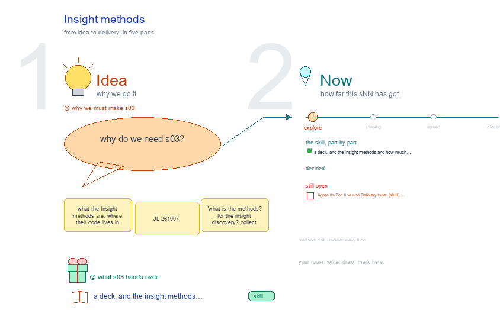
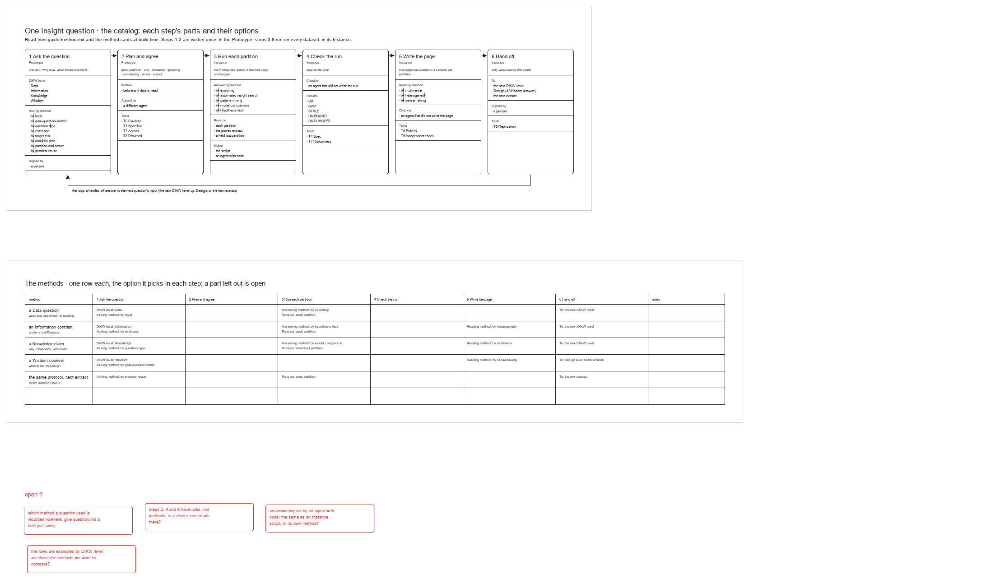

# s03 · Insight methods <!-- root #33eb48 -->

**Stage:** explore

- For <!-- @for #f78806 -->
  - a deck, and the insight methods and … <!-- @for/0 #6693a7 -->
    a deck, and the insight methods and how much of each the code runs today, for the people who write the toolkit skills
- Delivery type <!-- @delivery-type #58a44f -->
  - skill <!-- @delivery-type/0 #34b33e -->
- Topic <!-- @topic #7e13bd -->
  - what the Insight methods are, where their … <!-- @topic/0 #d9cd57 -->
    what the Insight methods are, where their code lives in Tools, and how much of them the code runs today (JL 261007: "what is the methods? for the insight discovery? collect all the related code in the Tools and then create the excalidraw").
  - Drawn in the shape of b03's s02-studio-workbench-skill <!-- @topic/1 #d0a083 -->
- Files <!-- @files #6ce6c5 -->
  - [py] [build_s03_insight_methods.py](build_s03_insight_methods.py) <!-- @files/0 #73fe33 -->
  - [py] [build_s03_insight_unit.py](build_s03_insight_unit.py) <!-- @files/1 #0674fd -->
  - delivery/ <!-- @files/2 #404761 -->
  - [py] [methods_drawing.py](methods_drawing.py) <!-- @files/3 #c09529 -->
  - [excalidraw] [s03-insight-methods.excalidraw](s03-insight-methods.excalidraw) <!-- @files/4 #ec2feb -->
  - [md] [s03-insight-methods.md](s03-insight-methods.md) <!-- @files/5 #046194 -->
  - [png] [s03-insight-methods.png](s03-insight-methods.png) <!-- @files/6 #579783 -->
    
  - [excalidraw] [s03-insight-unit.excalidraw](s03-insight-unit.excalidraw) <!-- @files/7 #807b2a -->
  - [png] [s03-insight-unit.png](s03-insight-unit.png) <!-- @files/8 #bc50dc -->
    
- What the drawing holds <!-- @what-the-drawing-holds #e0b05d -->
- What it found (261007) <!-- @what-it-found-261007 #b43400 -->
  - 16 method cards: 8 asking (in the … <!-- @what-it-found-261007/0 #6339d2 -->
    16 method cards: 8 asking (in the base skill `haipipe-report`), 5 answering and
  - 3 reading (in the insight server's `guide/methods/`) <!-- @what-it-found-261007/1 #0000b2 -->
    3 reading (in the insight server's `guide/methods/`). Steps 2, 4 and 6 have no methods, only rules.
  - The methods are text the workbench shows <!-- @what-it-found-261007/2 #99e99a -->
    The methods are text the workbench shows. No code reads a card. `run_question.py`,
  - `check_block.py`, `check_evidence.py` and `record_check.py` enforce the steps … <!-- @what-it-found-261007/3 #2ba44d -->
    `check_block.py`, `check_evidence.py` and `record_check.py` enforce the steps and T0-T6, not a method.
  - No file records which method a question … <!-- @what-it-found-261007/4 #b3e4cd -->
    No file records which method a question used. `haipipe-report` returns `method:`,
  - but `question.md` has no field for it, … <!-- @what-it-found-261007/5 #bf8cc6 -->
    but `question.md` has no field for it, and nothing names an answering or reading method.
  - 7 of the 16 cards name a … <!-- @what-it-found-261007/6 #b9b51d -->
    7 of the 16 cards name a skill that has no folder yet (`haipipe-insight-by-<method>`).
  - T7 (robustness) and T8 (replication) have no … <!-- @what-it-found-261007/7 #0fb0e2 -->
    T7 (robustness) and T8 (replication) have no code. `rivals` is a plan field only, and the
  - POOL · SPLIT verdict of By heterogeneity … <!-- @what-it-found-261007/8 #e4d085 -->
    POOL · SPLIT verdict of By heterogeneity is described only in `ref/partition.md`.
- Proposed (261007) <!-- @proposed-261007 #e4f68e -->
  - The proposed screens are one topic per … <!-- @proposed-261007/0 #b2c367 -->
    The proposed screens are one topic per level (JL 261007: "s11, s12, s13 ... instead of nesting all the things together"): `../s11-block-level/`, `../s12-job-level/`, `../s13-task-level/`. In short, each question names its three methods in its plan (Task), each row carries them as chips under its D · I · K · W heading with the partitions as the third row (Block and Job › Work Details), and a Job lists the cards that fit its level. The screen helpers and the card reader are shared in `../_build/insight_ui.py`.
- Open <!-- @open #cf9b77 -->
  - Agree its **For:** line and **Delivery type:** … <!-- @open/0 #09a2ba -->
    Agree its **For:** line and **Delivery type:** (skill), proposed by the agent 261030?
  - See the drawing's Questions frame (red) <!-- @open/1 #2ea0d3 -->
