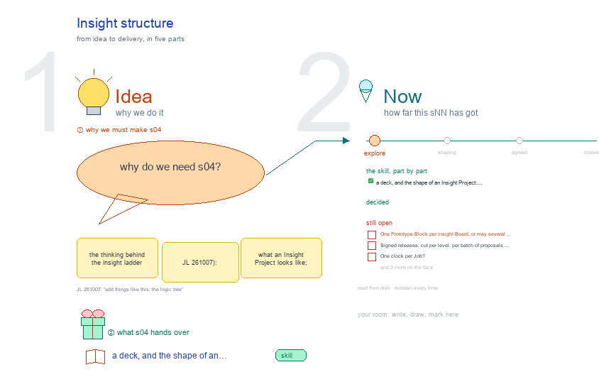

# s04 · Insight structure <!-- root #910c28 -->

**Stage:** explore

- For <!-- @for #f78806 -->
  - a deck, and the shape of an … <!-- @for/0 #0fe650 -->
    a deck, and the shape of an Insight Project: Prototype versions, data versions, two clocks, for the people who write the toolkit skills
- Delivery type <!-- @delivery-type #58a44f -->
  - skill <!-- @delivery-type/0 #34b33e -->
- Renumbered <!-- @renumbered #a325bf -->
  - s00-insight-structure became s04-insight-structure on 2026-10-12, so that … <!-- @renumbered/0 #8d71db -->
    s00-insight-structure became s04-insight-structure on 2026-10-12, so that s00 is the Block's background and index, the same in every Block (JL 2026-10-12: "for every block, we also want to have the s00-overview").
- Topic <!-- @topic #7e13bd -->
  - the thinking behind the insight ladder (JL … <!-- @topic/0 #7df77f -->
    the thinking behind the insight ladder (JL 261007): what an Insight Project looks like; the Prototype as its own work Block whose Jobs are Prototype versions; the insight Board whose Jobs pin one Prototype version and one data version; the two clocks; where a new release comes from and what triggers it; and the Block's questions with our ideas and the choices still open.
- Feeds <!-- @feeds #ffe8e9 -->
  - `reports/` q01_insight_ladder, q02_partitions_pooling, q03_question_gates, q04_level_delivery, q05_register_boards (and … <!-- @feeds/0 #ce4ec2 -->
    `reports/` q01_insight_ladder, q02_partitions_pooling, q03_question_gates, q04_level_delivery, q05_register_boards (and a proposed Q06, the Prototype and data versions).
- Files <!-- @files #6ce6c5 -->
  - [py] [build_s04_insight_structure.py](build_s04_insight_structure.py) <!-- @files/0 #766c6a -->
  - delivery/ <!-- @files/1 #404761 -->
  - [excalidraw] [s04-insight-structure.excalidraw](s04-insight-structure.excalidraw) <!-- @files/2 #52e143 -->
  - [md] [s04-insight-structure.md](s04-insight-structure.md) <!-- @files/3 #f036af -->
  - [png] [s04-insight-structure.png](s04-insight-structure.png) <!-- @files/4 #120f04 -->
    
- What the drawing holds <!-- @what-the-drawing-holds #e0b05d -->
  - An Insight Project: `work/bNN_<topic>_prototype/` (the questions and … <!-- @what-the-drawing-holds/0 #77ed9f -->
    An Insight Project: `work/bNN_<topic>_prototype/` (the questions and their code) beside
  - `insights/bNN_<topic>/` (one dataset, its versions, the answers); … <!-- @what-the-drawing-holds/1 #2b7b66 -->
    `insights/bNN_<topic>/` (one dataset, its versions, the answers); designs and discoveries optional; the data versions outside the Project.
  - The two Blocks, each a box, a … <!-- @what-the-drawing-holds/2 #3e0aeb -->
    The two Blocks, each a box, a definition and its tree. Prototype Block: one Job per Prototype
  - version (`j01_p1`, `j02_p2`), frozen when closed; a … <!-- @what-the-drawing-holds/3 #1b2abe -->
    version (`j01_p1`, `j02_p2`), frozen when closed; a version Job holds `release.yaml` (every live question, pointing to its Task here or in an earlier version) and only new or changed Tasks; `proposals/` is the backlog. Insight Board: one Job per pair, Prototype version × data version (`j03_p2_<d>v2`); its Tasks are the questions on that pair, its Runs one per partition. Arrows: the Board's Job uses a version by path and hash, never a copy; the Board sends proposals back.
  - Two clocks and the chain of Jobs; … <!-- @what-the-drawing-holds/4 #d498d5 -->
    Two clocks and the chain of Jobs; one clock per Job, so a change in an answer has one cause.
  - Where a new release comes from: six … <!-- @what-the-drawing-holds/5 #13c297 -->
    Where a new release comes from: six triggers (a level answered, a check failed, a weak answer, new
  - data fields, someone asks, a paper suggests … <!-- @what-the-drawing-holds/6 #3cba60 -->
    data fields, someone asks, a paper suggests it) feed `proposals/`, then the next version Job is opened, worked, reviewed, signed by a person and closed; the Board then adds a Job. New data needs no release.
  - Questions: the register's Q01 to Q05 and … <!-- @what-the-drawing-holds/7 #9d609f -->
    Questions: the register's Q01 to Q05 and a proposed Q06, each with our idea and the choice it
  - waits on in a red box (black … <!-- @what-the-drawing-holds/8 #74b18f -->
    waits on in a red box (black only since haipipe-studio 0.2.0, 261007).
  - The logic tree (JL 261007: "add things … <!-- @what-the-drawing-holds/9 #3245e3 -->
    The logic tree (JL 261007: "add things like this: the logic tree"), its own frame to the right: a box
  - per folder, plain lines for what holds … <!-- @what-the-drawing-holds/10 #9349a1 -->
    per folder, plain lines for what holds what, labelled arrows for how they relate (the Board's Job uses a version by path and hash; its Task runs that version's script; the Job pins a data version; its pages feed the answers across Jobs; the answers send proposals back; the signed handoff goes to Design), red dashed for what is open (when the backlog opens the next version; one clock per Job).
  - (261007, with s11 and s12) The cuts … <!-- @what-the-drawing-holds/11 #10be0a -->
    (261007, with s11 and s12) The cuts are plan: `partitions.md` and `thresholds.yaml` live in each
  - Prototype release, so a new or changed … <!-- @what-the-drawing-holds/12 #42b3fd -->
    Prototype release, so a new or changed cut is a new release; the Board's `meta/` keeps only the checker's `status.md`. The Board's `reports/qNN_<topic>/` hold the Block's own questions, a second D · I · K · W over the Jobs' answers.
  - (261007, JL: "we might want to propose … <!-- @what-the-drawing-holds/13 #becee6 -->
    (261007, JL: "we might want to propose more run-types") A frame, Run types by level: hard Runs only at
  - a question Task of a Job (rNN_<partition>, … <!-- @what-the-drawing-holds/14 #252af7 -->
    a question Task of a Job (rNN_<partition>, rNN_cross); soft Runs at every level (Prototype: propose, open a release, define cuts, sign, close, ask, plan, script, reviews; Board: add a version, add a Job, check, read across Jobs, handoff; Job: launch, power, compare with the previous Job, close; Task: write, check, sign). A Job's order: launch -> power -> runs -> cross -> write -> check -> compare -> close. The compare rule (what "held" means) is plan, in the release's thresholds.yaml; the Job's `reports/vs-<prev>.md`, written by run-compare, feeds Audience Report › vs previous.
- Open <!-- @open #cf9b77 -->
  - One Prototype Block per insight Board, or … <!-- @open/0 #6be2f1 -->
    One Prototype Block per insight Board, or may several Boards share one?
  - Signed releases: cut per level, per batch … <!-- @open/1 #8d7eaa -->
    Signed releases: cut per level, per batch of proposals, or on demand?
  - One clock per Job? <!-- @open/2 #c3585f -->
  - Versions: accumulate (compare, never pool) or batches … <!-- @open/3 #89d084 -->
    Versions: accumulate (compare, never pool) or batches (may pool)?
  - Does a signed handoff go stale when … <!-- @open/4 #33b392 -->
    Does a signed handoff go stale when a newer Job lands?
  - Agree its **For:** line and **Delivery type:** … <!-- @open/5 #09a2ba -->
    Agree its **For:** line and **Delivery type:** (skill), proposed by the agent 261030?
