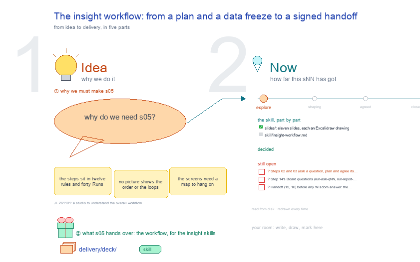

# s05 · The insight workflow: from a plan and a data freeze to a … <!-- root #93a865 -->

**Tags:** `Workflow`
**Stage:** explore

- For <!-- @for #f78806 -->
  - a deck, and the insight workflow as … <!-- @for/0 #496b8c -->
    a deck, and the insight workflow as one map (who does each step, what it writes, the screen it lives on), for the people who write the insight skills and build its workbench
- Delivery type <!-- @delivery-type #58a44f -->
  - skill <!-- @delivery-type/0 #34b33e -->
- Covers <!-- @covers #a6c44a -->
  - the whole insight workflow in five zones: … <!-- @covers/0 #fdb9e5 -->
    the whole insight workflow in five zones: A make the plan (01-04) · B run the Job (05-08) · C answer up the levels (09-10) · D compare and close (11-13) · E across Jobs, then hand off (14-16); the three loops back (a returned CHECK, proposals into the next plan, a new data freeze); what each step writes; how an answer holds.
- Excluded <!-- @excluded #980495 -->
  - the screens themselves (j01's 3 × 3, … <!-- @excluded/0 #de7edb -->
    the screens themselves (j01's 3 × 3, s51 to s59); the ladder's folders (s01, s04); each Run's card and skill (s21; haipipe-insight-workflow ref/run-cards.md); the DIKW methods (s03).
- Topic <!-- @topic #7e13bd -->
  - one map of how a question travels, … <!-- @topic/0 #996ab7 -->
    one map of how a question travels, as b15 s03 draws labeling's complete workflow (JL 261101: "we should have a studio to understand what is the overall workflow").
  - Insight answers what one dataset can and … <!-- @topic/1 #7f87a2 -->
    Insight answers what one dataset can and cannot say on two clocks: the plan moves in the Prototype, the data moves on the Board, and each Job pins one of each.
  - Agents plan, run, write and check; a … <!-- @topic/2 #bf3276 -->
    Agents plan, run, write and check; a person sets the cuts and signs the plan, closes each Job and signs the handoff.
  - Each card names its Runs and the … <!-- @topic/3 #f4ba65 -->
    Each card names its Runs and the 3 × 3 screen it lives on, so the map also reads the UI: a step with no screen shows.
  - The steps are haipipe-insight ref/insight-ladder.md's rules and … <!-- @topic/4 #f53552 -->
    The steps are haipipe-insight ref/insight-ladder.md's rules and Runs, in the order a question travels; the words are written once in `s05-insight-workflow-workflow.yaml`.
- Feeds <!-- @feeds #ffe8e9 -->
  - `reports/` q01_insight_ladder · q03_question_gates · q04_level_delivery <!-- @feeds/0 #f582cf -->
- Files <!-- @files #6ce6c5 -->
  - [py] [build_s05_insight_workflow.py](build_s05_insight_workflow.py) <!-- @files/0 #f4efdb -->
  - delivery/ <!-- @files/1 #404761 -->
  - [yaml] [s05-insight-workflow-workflow.yaml](s05-insight-workflow-workflow.yaml) <!-- @files/2 #44abc9 -->
  - [excalidraw] [s05-insight-workflow.excalidraw](s05-insight-workflow.excalidraw) <!-- @files/3 #a8d3c9 -->
  - [png] [s05-insight-workflow.full.png](s05-insight-workflow.full.png) <!-- @files/4 #22331d -->
    
  - [md] [s05-insight-workflow.md](s05-insight-workflow.md) <!-- @files/5 #93948e -->
  - [png] [s05-insight-workflow.png](s05-insight-workflow.png) <!-- @files/6 #81ef45 -->
    
- Decided <!-- @decided #55615a -->
  - (none yet: a decision is one line, … <!-- @decided/0 #7ca181 -->
    (none yet: a decision is one line, s05-D01 · <what was decided> (<who> <date>))
- Open <!-- @open #cf9b77 -->
  - ? <!-- @open/0 #2858b7 -->
    ? Steps 02 and 03 (ask a question, plan and agree its evidence) live in the Prototype: the Task screens show the plan, but no Board or Job screen asks for one. A Prototype page, or a Plan view on the Job?
  - ? <!-- @open/1 #003e1c -->
    ? Step 14's Board questions (run-ask-qNN, run-report-qNN) have no Board Work row yet.
  - ? <!-- @open/2 #95df58 -->
    ? Handoff (15, 16) before any Wisdom answer: the Board's Handoff view did not pass its review; this map shows it waits on the counsel.
