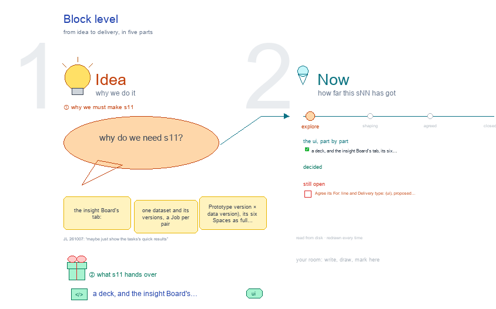

# s11 · Block level <!-- root #e301c1 -->

**Stage:** explore

- For <!-- @for #f78806 -->
  - a deck, and the insight Board's tab, … <!-- @for/0 #c7af0e -->
    a deck, and the insight Board's tab, its six Spaces as full screens with what is on disk, for the people who build the workbench
- Delivery type <!-- @delivery-type #58a44f -->
  - ui <!-- @delivery-type/0 #636117 -->
- Topic <!-- @topic #7e13bd -->
  - the insight Board's tab: one dataset and … <!-- @topic/0 #97e53c -->
    the insight Board's tab: one dataset and its versions, a Job per pair (Prototype version × data version), its six Spaces as full screens on the shared frame (Guide · Block · Job · Task), each with "on disk" under it (JL 261007: "s11, s12, s13 ... for the Block level, Job level and task level, to make each of them, instead of nesting all the things together").
  - It follows s00: a Job pins one … <!-- @topic/1 #c78fdd -->
    It follows s00: a Job pins one Prototype version and one data version; a DIKW level groups the questions inside a Job.
  - The method cards come from s03 <!-- @topic/2 #e174a8 -->
- Source <!-- @source #6da13a -->
  - the screens are drawn by `../_build/insight_ui.py`, shared … <!-- @source/0 #c9b2ca -->
    the screens are drawn by `../_build/insight_ui.py`, shared by s11 · s12 · s13 and s03; the cards (names, skills, the DIKW levels they fit) are read from their files at build time.
- Files <!-- @files #6ce6c5 -->
  - [py] [build_s11_block_level.py](build_s11_block_level.py) <!-- @files/0 #62f681 -->
  - delivery/ <!-- @files/1 #404761 -->
  - old-insight-board/ <!-- @files/2 #7ac8a6 -->
  - [excalidraw] [s11-block-level.excalidraw](s11-block-level.excalidraw) <!-- @files/3 #cef710 -->
  - [md] [s11-block-level.md](s11-block-level.md) <!-- @files/4 #02a3c4 -->
  - [png] [s11-block-level.png](s11-block-level.png) <!-- @files/5 #5fa7ce -->
    
- Proposed (261007) <!-- @proposed-261007 #e4f68e -->
  - Description's third row is Map · Prototype … <!-- @proposed-261007/0 #b4df17 -->
    Description's third row is Map · Prototype · Dataset · Partitions (JL 261007). Map crosses
  - the two clocks: the data versions as … <!-- @proposed-261007/1 #9b59e7 -->
    the two clocks: the data versions as columns, the Prototype releases as rows, a Job in each cell, Add a Job in an empty one.
  - Prototype: the releases (signed, questions by D … <!-- @proposed-261007/2 #3c137a -->
    Prototype: the releases (signed, questions by D · I · K · W, new · changed · retired, the Jobs on
  - each), then `proposals/`; the questions themselves live … <!-- @proposed-261007/3 #de9a13 -->
    each), then `proposals/`; the questions themselves live in the Prototype Block. Dataset: the data versions (extract, frozen, rows, what is new, the Jobs on each). Partitions: each cut's filter and why are defined in the Prototype release, with its power threshold (part of the plan, fixed before any outcome), so a new or changed cut is a new release (JL 261007: "for the partition, should we type this to the prototype as well?"). Under the definitions, the counts: a row per data version and a column per partition, so the table grows down as data arrives (JL 261007: "each row is a dataset, and columns are the partitions").
  - Work Details: the Jobs, one row each … <!-- @proposed-261007/4 #27a55d -->
    Work Details: the Jobs, one row each (pins, the clock that moved, answered by DIKW level, state); a
  - row opens in place to its Tasks' … <!-- @proposed-261007/5 #3930c3 -->
    row opens in place to its Tasks' quick results, each Task's result per partition, so the work is seen from the Block (JL 261007: "maybe just show the tasks's quick results"); the Job tab is for working on one.
  - Audience Report: two button rows, as the … <!-- @proposed-261007/6 #6b6222 -->
    Audience Report: two button rows, as the Job's (JL 261007: "we can have dimension 1 and dimension
  - 2"): Partition (Full · <partition A> · … <!-- @proposed-261007/7 #472c49 -->
    2"): Partition (Full · <partition A> · <partition B> · Cross) and Reading, the kinds of reading across Jobs; D · I · K · W are sections inside each, and every view is a Question │ Work │ Report table (JL 261007: "make sure it will follow the Question, Work, and Report format"): Logic the question it reads, Work the Board's soft Run that reads it (↗ the Run), Report what that Run says (JL 261007: "the D I K W should be the group sections in the page ... the same questions, how to across, how to check the consistency"). Coverage: what was asked and answered on which Job. Tracks: the same question Job by Job, and along one release a trend over the data versions (slices of time). Consistency: each step between Jobs moves one clock, so each change gets a verdict and a cause, by a rule per level (D counts within drift; I same direction, one test of the difference; K same sign and size, replicates, T8; W stands while its ground holds). Findings: the Block's own questions (q01 – q04, the second ladder), each citing the reading it rests on; W's signed counsel is the Delivery. Each reading is a soft Run of the Board (JL 261007: "we should have some soft run in the board level"): run-coverage, run-track-<q>, run-consistency-<jA>-<jB>, run-report-<qNN>, each reading the Jobs' results (never data) and writing the result its view shows. Compare only Jobs one clock apart; a question changed in a release is a new version of it, never pooled.
  - Delivery: the signed Wisdom counsel names its … <!-- @proposed-261007/8 #df3b8f -->
    Delivery: the signed Wisdom counsel names its Job (pN × vM).
- Open <!-- @open #cf9b77 -->
  - Agree its **For:** line and **Delivery type:** … <!-- @open/0 #7b11a4 -->
    Agree its **For:** line and **Delivery type:** (ui), proposed by the agent 261030?
  - See the drawing's Questions frame (red) <!-- @open/1 #2ea0d3 -->
  - The frames follow the Space row: Description, … <!-- @open/2 #e53b42 -->
    The frames follow the Space row: Description, Idea Studio, Audience Report, Work Details, Runs, Delivery (JL 261007), each holding all its views. Idea Studio's typical topics are listed to the right of its frame: s01-question-map (generated), s02-<what moved>, s03-<a pattern seen>, s04-<cut ideas>, s05-<handoff story>.
