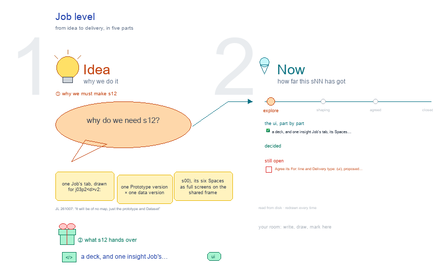

# s12 · Job level <!-- root #57c3ae -->

**Stage:** explore

- For <!-- @for #f78806 -->
  - a deck, and one insight Job's tab, … <!-- @for/0 #646ec9 -->
    a deck, and one insight Job's tab, its Spaces as full screens with what is on disk, for the people who build the workbench
- Delivery type <!-- @delivery-type #58a44f -->
  - ui <!-- @delivery-type/0 #636117 -->
- Topic <!-- @topic #7e13bd -->
  - one Job's tab, drawn for j03_p2_<d>v2: one … <!-- @topic/0 #29cb97 -->
    one Job's tab, drawn for j03_p2_<d>v2: one Prototype version × one data version (s00), its six Spaces as full screens on the shared frame (Guide · Block · Job · Task), each with "on disk" under it (JL 261007: "s11, s12, s13 ... for the Block level, Job level and task level, to make each of them, instead of nesting all the things together").
  - It follows s00: a Job pins one … <!-- @topic/1 #c78fdd -->
    It follows s00: a Job pins one Prototype version and one data version; a DIKW level groups the questions inside a Job.
  - The method cards come from s03 <!-- @topic/2 #e174a8 -->
- Source <!-- @source #6da13a -->
  - the screens are drawn by `../_build/insight_ui.py`, shared … <!-- @source/0 #c9b2ca -->
    the screens are drawn by `../_build/insight_ui.py`, shared by s11 · s12 · s13 and s03; the cards (names, skills, the DIKW levels they fit) are read from their files at build time.
- Files <!-- @files #6ce6c5 -->
  - [py] [build_s12_job_level.py](build_s12_job_level.py) <!-- @files/0 #451f67 -->
  - delivery/ <!-- @files/1 #404761 -->
  - [excalidraw] [s12-job-level.excalidraw](s12-job-level.excalidraw) <!-- @files/2 #790cff -->
  - [md] [s12-job-level.md](s12-job-level.md) <!-- @files/3 #207644 -->
  - [png] [s12-job-level.png](s12-job-level.png) <!-- @files/4 #074a24 -->
    
- Proposed (261007) <!-- @proposed-261007 #e4f68e -->
  - Description: Prototype · Dataset (JL 261007: "It … <!-- @proposed-261007/0 #20922f -->
    Description: Prototype · Dataset (JL 261007: "It will be of no map, just the prototype and Dataset").
  - Prototype: release p2, its questions by DIKW … <!-- @proposed-261007/1 #926733 -->
    Prototype: release p2, its questions by DIKW level (new · changed · retired), its cuts as defined in the release, its shared code, all read only. Dataset: <d>v2, its extract, frozen date, rows, what is new, then each cut's n, power and refused cells. No band beside the tabs (JL 261007: remove it on every frame page): the pair's line "p2 × <d>v2 · closed, frozen · moved from j02: the code (p1 → p2)" opens Description › Prototype.
  - Audience Report is the Question │ Work … <!-- @proposed-261007/2 #503e27 -->
    Audience Report is the Question │ Work │ Report table (JL 261007: "I actually want to put the Question Work
  - Report to the Audience Report"), under D … <!-- @proposed-261007/3 #f68809 -->
    Report to the Audience Report"), under D · I · K · W with the method chips, filtered by Partition (Full · A · B · Cross) × Period (Current · vs previous). Every cell opens a pop-out: the question (question.md from the release), the Run, the page, a chip's card. Under vs previous the Report cell carries the status (new · held · changed · dropped) and the summary line; on Cross it carries POOL or SPLIT.
  - Work Details is the Job › Task … <!-- @proposed-261007/4 #8fec61 -->
    Work Details is the Job › Task › Run tree (JL 261007: "maybe show the J-T-R structure?"): a Task row under
  - its DIKW level, opening to its Runs … <!-- @proposed-261007/5 #e3fbbc -->
    its DIKW level, opening to its Runs (hard, one per partition, and rNN_cross; then soft write and check), each with kind · status · passes · last; third row All · hard · soft. A Task's ↗ opens its tab (s13), a Run's ↗ the Run pop-out (run.yaml, pins, n and power, passes, a preview of result/, report.md, Rerun · Check). 3c. vs previous is produced by the Job's soft Run run-compare-<prev> (here run-compare-j02), which reads both Jobs' results and pages and writes reports/vs-j02.md; the view reads only that file. Its held rule is plan, fixed in the release's thresholds.yaml (compare: same direction and intervals overlap; D counts within a tolerance). Statuses: new question · new finding · held · changed · dropped · not comparable (JL 261007, via the s00/s01 session: "we might want to propose more run-types"). 3d. Runs: by type (hard · soft · launch · power · compare · close), then the Job's run order: Add a Job (Board) → run-launch → run-power → per Task rNN_<partition> → rNN_cross → run-write → run-check → run-compare → run-close (frozen). Beside it, the run types of every level (proposed). 3e. (261007) The Job proposes: run-propose-j03, a soft Run after run-compare-j02 and before run-close-j03, reads vs-j02.md's statuses and the gaps ("we cannot answer <what>") and files each new or changed question to the Prototype's `proposals/<slug>.md` (kind · DIKW level · from j03 · why). Button "Propose questions" on Audience Report › vs previous and in Runs. A Task no longer proposes (s13; JL 261007: "the question propose is conducted in the job level?"). Adding questions makes no new kind of Job: the proposal opens the Prototype's next version Job (j0N_p3), then the Board adds an ordinary pair Job (p3 × <d>v2, the code moved). Open: a new question answered on data already seen is exploratory until the next data version confirms it; the next Job reruns unchanged questions or links their Runs by hash. 3f. (261007) The Board's soft Runs in the Runs aside now use s11's words.
  - Idea Studio's typical topics, to the right … <!-- @proposed-261007/6 #1eb173 -->
    Idea Studio's typical topics, to the right of its frame: s01-<what moved>, s02-<a surprise>.
  - Delivery (?): only the latest Job's Wisdom … <!-- @proposed-261007/7 #44fe0c -->
    Delivery (?): only the latest Job's Wisdom counsel goes to the Board's handoff.
- Open <!-- @open #cf9b77 -->
  - Agree its **For:** line and **Delivery type:** … <!-- @open/0 #7b11a4 -->
    Agree its **For:** line and **Delivery type:** (ui), proposed by the agent 261030?
  - Changes are marked on the drawing in … <!-- @open/1 #947961 -->
    Changes are marked on the drawing in green (✎ <yymmdd>), and listed on its title frame.
  - See the drawing's Questions frame (red) <!-- @open/2 #2ea0d3 -->
