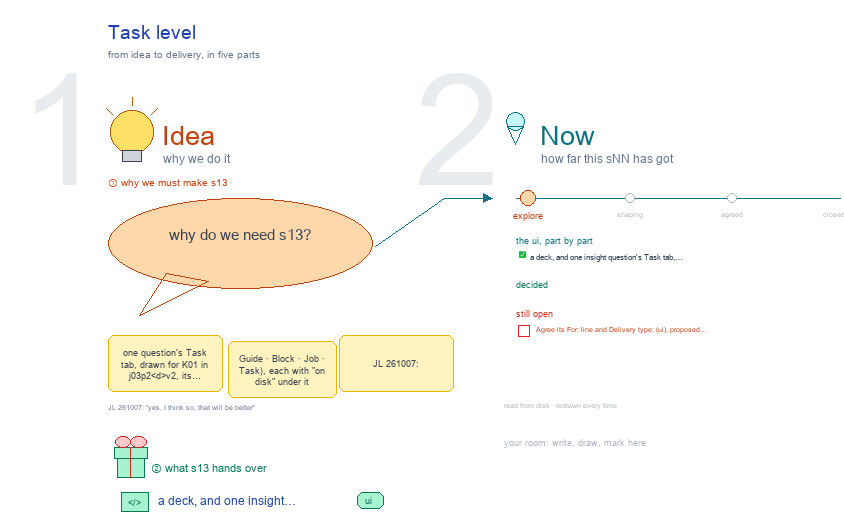

# s13 · Task level <!-- root #7281d5 -->

**Stage:** explore

- For <!-- @for #f78806 -->
  - a deck, and one insight question's Task … <!-- @for/0 #dad768 -->
    a deck, and one insight question's Task tab, its Spaces as full screens with what is on disk, for the people who build the workbench
- Delivery type <!-- @delivery-type #58a44f -->
  - ui <!-- @delivery-type/0 #636117 -->
- Topic <!-- @topic #7e13bd -->
  - one question's Task tab, drawn for K01 … <!-- @topic/0 #0abb2f -->
    one question's Task tab, drawn for K01 in `j03_code-v2_data-v2`, its Spaces as full screens on the shared frame (Guide · Block · Job · Task), each with "on disk" under it (JL 261007: "s11, s12, s13 ... for the Block level, Job level and task level, to make each of them").
  - It follows s00 (a Job pins one … <!-- @topic/1 #f39e14 -->
    It follows s00 (a Job pins one Prototype version and one data version) and s12 one level down (JL 261007: "yes, I think so, that will be better").
- Source <!-- @source #6da13a -->
  - the screens are drawn by `../_build/insight_ui.py`, shared … <!-- @source/0 #c465b8 -->
    the screens are drawn by `../_build/insight_ui.py`, shared by s11 · s12 · s13 and s03; the method cards are read from their files at build time. s31-insight-guide and the goal spec (`../goals/g01-insight-workbench.md`) read this builder's SCREENS.
- Files <!-- @files #6ce6c5 -->
  - [py] [build_s13_task_level.py](build_s13_task_level.py) <!-- @files/0 #8c7aa6 -->
  - delivery/ <!-- @files/1 #404761 -->
  - [excalidraw] [s13-task-level.excalidraw](s13-task-level.excalidraw) <!-- @files/2 #68cd22 -->
  - [md] [s13-task-level.md](s13-task-level.md) <!-- @files/3 #e2baac -->
  - [png] [s13-task-level.png](s13-task-level.png) <!-- @files/4 #0e7d2f -->
    
- Proposed (261007) <!-- @proposed-261007 #e4f68e -->
  - One Task type on the Insight Board: … <!-- @proposed-261007/0 #275c46 -->
    One Task type on the Insight Board: an insight question on one Job's pair. Its DIKW level changes what it may
  - say and which methods fit; a W … <!-- @proposed-261007/1 #dbf443 -->
    say and which methods fit; a W Task cites the levels below and is signed (JL 261007: "we just have the insight discovery tasks, right?").
  - No band beside the tab (JL 261007: … <!-- @proposed-261007/2 #a99968 -->
    No band beside the tab (JL 261007: remove it on every frame page). Its line,
  - `K01 · in j03_code-v2_data-v2 · release p2 … <!-- @proposed-261007/3 #df936a -->
    `K01 · in j03_code-v2_data-v2 · release p2 · <d>v2 · ✅ checked`, opens Description › Question.
  - Description: Question · Plan · Data <!-- @proposed-261007/4 #620531 -->
    Description: Question · Plan · Data. Question and Plan are the release's question.md, read only (the ask,
  - DIKW level, why now, signed; the three … <!-- @proposed-261007/5 #1764a2 -->
    DIKW level, why now, signed; the three methods; the needs with work spec, pass rule, Ask covered, agreed). Data is this question's n, base rate and power on each partition, before any outcome; a weak cut is refused and shown, never run. A new or changed question is proposed from the Job (run-propose), never from a Task (JL 261007: "the question propose is conducted in the job level?").
  - Audience Report: Question │ Work │ Report … <!-- @proposed-261007/6 #eb411b -->
    Audience Report: Question │ Work │ Report over the question's needs, need → the Run that answers it → the
  - page's sentence (or a cited Discovery Result), … <!-- @proposed-261007/7 #0155b7 -->
    page's sentence (or a cited Discovery Result), filtered by Partition × Period. Cross shows the difference test and its POOL or SPLIT; vs previous reads this question's rows of the Job's `reports/vs-j02.md`. The page's answer heads each view.
  - Work Details: the Task → Run tree, … <!-- @proposed-261007/8 #6148f2 -->
    Work Details: the Task → Run tree, hard (one per partition, then r04_cross) and soft (write, check), each with
  - kind · status · passes · last … <!-- @proposed-261007/9 #8815dd -->
    kind · status · passes · last and ↗ to its pop-out.
  - Runs: by type, then the order a … <!-- @proposed-261007/10 #207e76 -->
    Runs: by type, then the order a Task runs in: rNN_<partition> → rNN_cross → run-write → run-check (→ run-sign,
  - W only), inside its Job's run-launch … … <!-- @proposed-261007/11 #fdfebf -->
    W only), inside its Job's run-launch … run-close.
  - Delivery: none, except a W Task, whose … <!-- @proposed-261007/12 #438c1d -->
    Delivery: none, except a W Task, whose signed counsel goes to the Block's handoff.
  - Pop-outs: a need (spec, pass rule, answered … <!-- @proposed-261007/13 #1c1a26 -->
    Pop-outs: a need (spec, pass rule, answered by, cited by), the Run, the page, a method card.
- Open <!-- @open #cf9b77 -->
  - Agree its **For:** line and **Delivery type:** … <!-- @open/0 #7b11a4 -->
    Agree its **For:** line and **Delivery type:** (ui), proposed by the agent 261030?
  - See the drawing's open notes (red) <!-- @open/1 #db4102 -->
