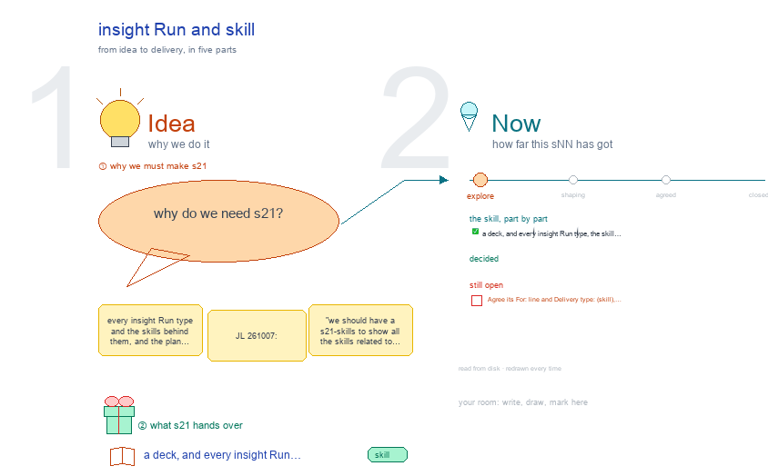

# s21 · insight Run and skill <!-- root #ebee43 -->

**Stage:** explore

- For <!-- @for #f78806 -->
  - a deck, and every insight Run type, … <!-- @for/0 #e642d9 -->
    a deck, and every insight Run type, the skill behind it, and the plan to update those skills, for the people who write the toolkit skills
- Delivery type <!-- @delivery-type #58a44f -->
  - skill <!-- @delivery-type/0 #34b33e -->
- Topic <!-- @topic #7e13bd -->
  - every insight Run type and the skills … <!-- @topic/0 #601ea0 -->
    every insight Run type and the skills behind them, and the plan to make the skills carry plan C (JL 261007: "we should have a s21-skills to show all the skills related to this … s21 should be s21-run-skill, it should include both runs and skills"; then "you should follow this one", b16's `s21-paper-run-skill`).
  - Drawn in that shape: lines-only tables in … <!-- @topic/1 #f7674a -->
    Drawn in that shape: lines-only tables in black, a decision in green and dated, red only for work another owner must do.
  - Named `s21-insight-run-skill`, as the paper's is `s21-paper-run-skill` <!-- @topic/2 #8444a2 -->
- Source <!-- @source #6da13a -->
  - read from disk on every build: <!-- @source/0 #497260 -->
- Feeds <!-- @feeds #ffe8e9 -->
  - `../reports/q01_insight_ladder/` (run types per level) and the … <!-- @feeds/0 #89d0d8 -->
    `../reports/q01_insight_ladder/` (run types per level) and the proposed Q06 (the Prototype and data versions).
- Files <!-- @files #6ce6c5 -->
  - [py] [build_s21_insight_run_skill.py](build_s21_insight_run_skill.py) <!-- @files/0 #3e30bf -->
  - delivery/ <!-- @files/1 #404761 -->
  - [excalidraw] [s21-insight-run-skill.excalidraw](s21-insight-run-skill.excalidraw) <!-- @files/2 #0396f9 -->
  - [md] [s21-insight-run-skill.md](s21-insight-run-skill.md) <!-- @files/3 #90b9f9 -->
  - [png] [s21-insight-run-skill.png](s21-insight-run-skill.png) <!-- @files/4 #ffad98 -->
    
- What the drawing holds <!-- @what-the-drawing-holds #e0b05d -->
  - "today" says where a run type stands: … <!-- @what-the-drawing-holds/0 #1ea811 -->
    "today" says where a run type stands: **card** (a run card names its skill, agent and sign; 261008), **base** (the shared frame runs it), **live** (the insight theme shows the button, but no card says who runs it), **drawn** (only in the drawing).
- Decided (261007) <!-- @decided-261007 #b885e6 -->
  - The Prototype Block's run types are typed … <!-- @decided-261007/0 #f2f77a -->
    The Prototype Block's run types are typed here: Take the proposals, Open a version, Ask, Review the questions,
  - Plan the evidence, Review the evidence plan, … <!-- @decided-261007/1 #eeb20b -->
    Plan the evidence, Review the evidence plan, Set the cuts, Write the script, Review the script, Draw the question map, Sign a release, Carry a board over.
  - A cut is set in the release … <!-- @decided-261007/2 #eddbe5 -->
    A cut is set in the release (Set the cuts, haipipe-insight); the Board only proposes one (Propose a cut), with
  - the s11 session <!-- @decided-261007/3 #7f01ec -->
    the s11 session. No new `haipipe-insight-partition` skill.
  - `haipipe-insight-bind` has no ladder Run: it stays … <!-- @decided-261007/4 #6a1f47 -->
    `haipipe-insight-bind` has no ladder Run: it stays for register boards and retires with the last one.
  - A run type with no table row … <!-- @decided-261007/5 #a0cc84 -->
    A run type with no table row gets its owner (the skill whose folder it writes) and its `run-<type>-<target>`
  - name here; phase 2 gives each its … <!-- @decided-261007/6 #7be0cc -->
    name here; phase 2 gives each its card.
  - The Guide's Add a method and Add … <!-- @decided-261007/7 #ec0126 -->
    The Guide's Add a method and Add a paper stay the Guide's own Runs.
  - A button the shared frame also has … <!-- @decided-261007/8 #d56576 -->
    A button the shared frame also has keeps the frame's Run name (haipipe-run `ref/run-types-by-space.md`,
  - b03 261007): `run-add-<jNN>`, `run-ask-<qNN>`, `run-report-<qNN>`, `run-check-<qNN>`, and … <!-- @decided-261007/9 #7cfb7d -->
    b03 261007): `run-add-<jNN>`, `run-ask-<qNN>`, `run-report-<qNN>`, `run-check-<qNN>`, and Idea Studio's one button `run-draw-<sNN>`. Insight-only buttons keep theirs. Owners match the live theme's `SKILLS` map.
  - Drawn in haipipe-studio 0.2.0's palette: black, red … <!-- @decided-261007/10 #ab4440 -->
    Drawn in haipipe-studio 0.2.0's palette: black, red for open `?`, green for changes. The gray is now black
  - (canvas.write applies the palette); a tree file … <!-- @decided-261007/11 #874734 -->
    (canvas.write applies the palette); a tree file with no change word beside it is kept. The builder prints anything off the palette.
  - (261008) Steps 1 and 2 are done: … <!-- @decided-261007/12 #9471be -->
    (261008) Steps 1 and 2 are done: the contract and scaffold (haipipe-insight 3.0.0), then the run cards
  - (haipipe-insight-workflow 3.0.0) and the table generated from … <!-- @decided-261007/13 #0bdd39 -->
    (haipipe-insight-workflow 3.0.0) and the table generated from them (workbench-insight 1.0.0). Frame 1 reads the cards.
- Open (another owner) <!-- @open-another-owner #da2c70 -->
  - The Prototype Block has no level drawing: … <!-- @open-another-owner/0 #4dc712 -->
    The Prototype Block has no level drawing: a session drawing it (as s11 · s12 · s13 do) should show these buttons.
- Open <!-- @open #cf9b77 -->
  - Agree its **For:** line and **Delivery type:** … <!-- @open/0 #09a2ba -->
    Agree its **For:** line and **Delivery type:** (skill), proposed by the agent 261030?
