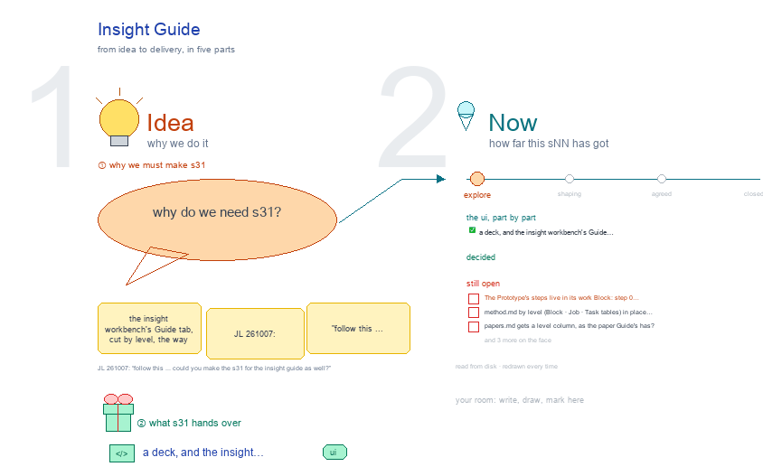

# s31 · Insight Guide <!-- root #c4024d -->

**Stage:** explore

- For <!-- @for #f78806 -->
  - a deck, and the insight workbench's Guide … <!-- @for/0 #674a87 -->
    a deck, and the insight workbench's Guide tab, cut by level, for the people who build the workbench
- Delivery type <!-- @delivery-type #58a44f -->
  - ui <!-- @delivery-type/0 #636117 -->
- Topic <!-- @topic #7e13bd -->
  - the insight workbench's Guide tab, cut by … <!-- @topic/0 #888b70 -->
    the insight workbench's Guide tab, cut by level, the way b16's s31-paper-guide cuts the paper's (JL 261007: "follow this ... could you make the s31 for the insight guide as well?"), in the style of b03's s31-guide: the four Views (Description · Method · RoadMap Draw · Related Paper), each body three folding sections Block · Job · Task, cards in one shape per View; one frame per level, its section open, the other two folded, "on disk" under each, then that level's open points in red.
- Feeds <!-- @feeds #ffe8e9 -->
  - `reports/` q01_insight_ladder (and b03's q08_workbench_base: one shared … <!-- @feeds/0 #2bd4fc -->
    `reports/` q01_insight_ladder (and b03's q08_workbench_base: one shared base, a theme each).
- Source <!-- @source #6da13a -->
  - the builder is b16's, adapted (`build_s31_insight_guide.py`, b03's … <!-- @source/0 #d3ed00 -->
    the builder is b16's, adapted (`build_s31_insight_guide.py`, b03's s31-guide screen and cards; was s03-guide).
  - Each level's content is its own file: … <!-- @source/1 #d3d983 -->
    Each level's content is its own file: `guide_block.py` · `guide_job.py` · `guide_task.py`.
  - What is read live (`insight_guide_live.py`): the six … <!-- @source/2 #fdfdaa -->
    What is read live (`insight_guide_live.py`): the six Space cards' third rows and run buttons from s11 · s12 · s13's screens (until `insight_theme.py` exists), today's six steps and the method cards from `guide/method.md`, the papers from `related/papers.md` by group, the drawings from b11's studio.
  - What is typed, in red, is the … <!-- @source/3 #aec27a -->
    What is typed, in red, is the proposal under plan C (a Job = a Prototype release × a data version).
- Files <!-- @files #6ce6c5 -->
  - [py] [build_s31_insight_guide.py](build_s31_insight_guide.py) <!-- @files/0 #cd6cd5 -->
  - delivery/ <!-- @files/1 #404761 -->
  - [py] [guide_block.py](guide_block.py) <!-- @files/2 #df25fe -->
  - [py] [guide_job.py](guide_job.py) <!-- @files/3 #d0e324 -->
  - [py] [guide_task.py](guide_task.py) <!-- @files/4 #16734f -->
  - [py] [insight_guide_live.py](insight_guide_live.py) <!-- @files/5 #fbe076 -->
  - [excalidraw] [s31-insight-guide.excalidraw](s31-insight-guide.excalidraw) <!-- @files/6 #30dc07 -->
  - [md] [s31-insight-guide.md](s31-insight-guide.md) <!-- @files/7 #3b0993 -->
  - [png] [s31-insight-guide.png](s31-insight-guide.png) <!-- @files/8 #2817f0 -->
    
- What each level says (proposed, red in the drawing) <!-- @what-each-level-says-proposed-red-in-the-drawing #4860b9 -->
  - Block: step 0 Make the Prototype (in … <!-- @what-each-level-says-proposed-red-in-the-drawing/0 #cfb952 -->
    Block: step 0 Make the Prototype (in its work Block: today's steps 1 and 2, a person signs the release),
  - 1 Add a data version, 2 Add … <!-- @what-each-level-says-proposed-red-in-the-drawing/1 #2f39df -->
    1 Add a data version, 2 Add a Job, 3 Read across Jobs (Coverage · Tracks · Consistency · Findings), then today's step 6 Hand off. Card: By protocol reuse. No card yet for reading across Jobs (replication, T8).
  - Job: 1 Launch, 2 Check the power, … <!-- @what-each-level-says-proposed-red-in-the-drawing/2 #e6ce98 -->
    Job: 1 Launch, 2 Check the power, today's step 3 (run each partition), 4 Compare with the previous Job
  - (the release's compare rule), 5 Close <!-- @what-each-level-says-proposed-red-in-the-drawing/3 #61aa05 -->
    (the release's compare rule), 5 Close. Cards: By partition and power, By heterogeneity.
  - Task: today's steps 3 · 4 · … <!-- @what-each-level-says-proposed-red-in-the-drawing/4 #6349e0 -->
    Task: today's steps 3 · 4 · 5 (run, check, write the page), then 6 Sign (Wisdom only). Cards: the five
  - answering and three reading methods <!-- @what-each-level-says-proposed-red-in-the-drawing/5 #635303 -->
- Open <!-- @open #cf9b77 -->
  - The Prototype's steps live in its work … <!-- @open/0 #196572 -->
    The Prototype's steps live in its work Block: step 0 here, or a link to the work Guide?
  - `method.md` by level (Block · Job · … <!-- @open/1 #624396 -->
    `method.md` by level (Block · Job · Task tables) in place of today's one six-step table?
  - `papers.md` gets a level column, as the … <!-- @open/2 #c20b54 -->
    `papers.md` gets a level column, as the paper Guide's has?
  - `guide.yaml` `roadmap:` per level (today the Guide … <!-- @open/3 #d95429 -->
    `guide.yaml` `roadmap:` per level (today the Guide shows only s02)?
  - `insight_theme.py`: then the Space cards read the … <!-- @open/4 #dab131 -->
    `insight_theme.py`: then the Space cards read the live frame, not s11–s13.
  - Agree its **For:** line and **Delivery type:** … <!-- @open/5 #7b11a4 -->
    Agree its **For:** line and **Delivery type:** (ui), proposed by the agent 261030?
