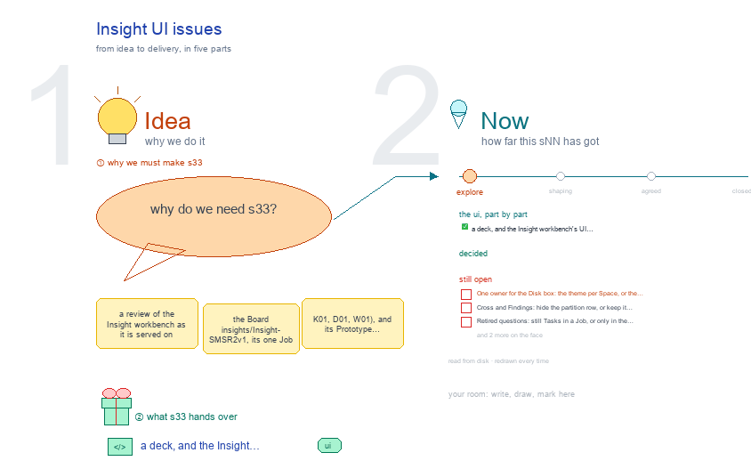

# s33 · Insight UI issues <!-- root #0b49dc -->

**Stage:** explore

- For <!-- @for #f78806 -->
  - a deck, and the Insight workbench's UI … <!-- @for/0 #67ce3b -->
    a deck, and the Insight workbench's UI problems, ranked worst first with who fixes each, for the people who build the workbench
- Delivery type <!-- @delivery-type #58a44f -->
  - ui <!-- @delivery-type/0 #636117 -->
- Topic <!-- @topic #7e13bd -->
  - a review of the Insight workbench as … <!-- @topic/0 #c3ab9d -->
    a review of the Insight workbench as it is served on 261008: the Board `insights/Insight-SMSR2v1`, its one Job `j01_p1_SMSR2v1`, three of its Tasks (K01, D01, W01), and its Prototype `tasks/Prototype-b01-SMSExperiement` with that Prototype's Job and two Tasks.
  - Every Space and every third-row view was … <!-- @topic/1 #943fb0 -->
    Every Space and every third-row view was opened, shot with headless Chrome (1500 × 1400) and curled for its links.
  - Each screen is judged against what JL … <!-- @topic/2 #59e312 -->
    Each screen is judged against what JL asked for (clean, no nested boxes, no filler repeated on every row; b03's Question │ Work │ Report row; each level as s11 · s12 · s13 draw it; every link inside the frame; the Disk box naming the files each view reads) and against s01, s11, s12, s13, s31, s32 and b03's s02-studio-workbench-skill.
  - Review only: no workbench file was changed <!-- @topic/3 #1ace2a -->
- Feeds <!-- @feeds #ffe8e9 -->
  - `reports/` q01_insight_ladder <!-- @feeds/0 #b79a20 -->
- Files <!-- @files #6ce6c5 -->
  - [py] [build_s33_ui_issue.py](build_s33_ui_issue.py) <!-- @files/0 #c6e8a6 -->
  - delivery/ <!-- @files/1 #404761 -->
  - [excalidraw] [s33-ui-issue.excalidraw](s33-ui-issue.excalidraw) <!-- @files/2 #6015d4 -->
  - [md] [s33-ui-issue.md](s33-ui-issue.md) <!-- @files/3 #091a24 -->
  - [png] [s33-ui-issue.png](s33-ui-issue.png) <!-- @files/4 #0bff2b -->
    
  - shots/ <!-- @files/5 #4d5052 -->
- The issues, worst first <!-- @the-issues-worst-first #45de73 -->
  - | # | where | what is … <!-- @the-issues-worst-first/0 #613fb3 -->
    | # | where | what is wrong | what it should be | evidence | owner | |---|---|---|---|---|---| | 1 | every tab › every Space › Disk box | lists the vanilla files (board.md, reports/q*, studio/s*, runs/*/, delivery/), mostly "not yet"; never the files the view reads | each view names what it reads: release.yaml, question.md, partitions.md, thresholds.yaml, tNN/runs/rNN/run.yaml and result/report.md, reports/vs-*.md | `insight_views.py` sets no `disk=`, so `frame.py` `vanilla_disk` shows; any shot | Block · Job · Task tabs | | 2 | Job › Audience Report (and Block › Coverage) › Logic cell | the id loses its DIKW letter: D01, I01, K01 and W01 all read "Question 1"; "builds on Knowledge questions 1, 2"; no "from the Idea Studio" line; status a bare dot or emoji | "K01 · Psychological Triggers", a status word, "from the Idea Studio: sNN ↗" | `_q_logic`; shots/J__Audience-Report__Full-Current.png | Job tab | | 3 | Job › Audience Report (and Block › Coverage) › Report cell | not b03's Report: no answer line, no drawing, no "report qNN · status"; the same filler on all 49 rows ("Ran on this cut", "run r01_full · 444691 rows", "the page: not written yet ↗ · CHECK —"); leads are raw column lines ("Gap_rest_pp: 12 of 13 intervals exclude zero") | title ↗, the answer in a sentence, the drawing, "report qNN · status"; "not written" said once | `_q_report`, `_job_current`; same shot | Job tab | | 4 | Board and Job › Description › Prototype; every question list | 6 retired questions (D04, I15, I16, I18, K07, K13) shown as live, "new" in this release, counted in "D 0/5"; their replacements share titles, so the lists show duplicates (D04 = I19, I15 = I22, I16 = I23, I18 = I24) | retired ones folded under "retired", each "→ replaced by I19"; out of counts and report rows | `retired:` in each question.md; `_prototype`, `_job_prototype`; shots/B__Description__Prototype.png | Block tab | | 5 | Job › Audience Report › Cross (and Board › Cross) | all 49 questions listed; 44 say "Not asked on this cut" twice, each with its full Task Work; no POOL or SPLIT | only the 5 questions asked on Cross, with the difference test and POOL or SPLIT | shots/J__Audience-Report__Cross.png | Job tab | | 6 | Task › Audience Report › Table · Reading | not Question │ Work │ Report: a partition table of "answer —, how sure —"; the run findings the Job shows are missing; Reading is "Read by: (— ↗) · Answer: —"; W01 says "Nothing here yet" despite 5 cite needs | one row per need: need │ the Run that answers it │ what it found, by Partition × Period | shots/Tt30__Audience-Report__Table.png, Tt30__Audience-Report__Reading.png, Tt48__Audience-Report__Table.png | Task tab | | 7 | Task › Description › Question · Records | Question dumps question.md as raw Python dicts (`needs: E1: {'kind': 'cite', …}`); no Plan, no Data view; Records is empty | Question · Plan · Data: the ask; the needs as a table (kind, what, pass rule, agreed); n, base rate and power per partition | `_question`, `_records`; shots/Tt30__Description__Question.png | Task tab | | 8 | Prototype Block, its Job and Tasks (all Spaces) | opens in the generic work theme: the Block shows only `board-kind` (`serves:` hidden); the release shows only "state: open"; each Task says "No face file … missing" though question.md and scripts/ are there; proposals/ unseen. The Job's four "… · data questions ↗" level links all open this same empty page | the release: its questions by DIKW level, cuts, thresholds, code, proposals; a Task: its question.md and its script | shots/P__home__.png, PJ__home__.png, PTt30__home__.png; `_release_links` | Block tab | | 9 | Job › Runs panel (every tab's) | each hard-run row reads "r01_full · a run of · Run a partition" with no Task: 38 identical "r01_full" rows | "t30 K01 · r01_full" | `runs_panel.py` `_card_html` (the theme sets no `_of`); shots/J__Runs__All.png | Job tab | | 10 | Runs panel "+N more" | the fold shows "+N more" but hides nothing: all 181 run boxes stay on screen | four rows, then "+N more" | `runs_panel.py` CSS: `.run-list .run-row{display:grid}` beats `[hidden]`; shots/Tt30__Work-Details__Partitions.png | shared frame (b03) | | 11 | Job › Runs › launch · power · compare · propose · close; Task › Runs | each Job view shows only the same run-order line; All folds the 181 Task runs closed; the Task's Runs panel says `rNN_<partition>` 0 while 6 runs exist | each view lists its runs or says "no launch run yet"; the Task's count matches | `_job_runs`, `task_spaces` Runs; shots/J__Runs__launch.png | Job tab | | 12 | Job › Work Details | three nested boxes (content card › level fold › a boxed fold per Task), every Task closed | flush rows (the `.dikw` / `.q-table` look): a Task a row, its runs opening in place | `_tree`; shots/J__Work-Details__All.png | Job tab | | 13 | Board › Work Details › quick results | "full ok · youngmale ok · youngfemale ok …" repeated as text on ~40 rows | a Task × partition grid, one mark per cell, by DIKW level | `_jobs`; shots/B__Work-Details__All.png | Block tab | | 14 | Board › Audience Report › Tracks · Consistency | with one Job, 49 rows of "j01 ok · no comparison yet" and 49 rows of "— —" | one line: "one Job: nothing to track or compare yet" | shots/B__Audience-Report__Full-Tracks.png, B__Audience-Report__Full-Consistency.png | Block tab | | 15 | Board › Audience Report › Findings | the partition row (Full … Cross) stays, but Findings ignores it | no partition row on Findings, or Findings by partition | `_findings`; shots/B__Audience-Report__Full-Findings.png | Block tab | | 16 | Board › Description › Partitions; Job › Description › Dataset | "Power floor: pp." (null shown blank); an empty "why" column on all 7 cuts; raw "youngmale" beside buttons "Young male"; Dataset says power "ok" per cut while no floor is set | "power floor: not set"; no empty column; one label per cut; power "not checked" until a floor exists | thresholds.yaml `power.smallest_effect_pp: null`; shots/B__Description__Partitions.png | Block tab | | 17 | Board and Job › Description › Prototype | "signed" reads a field question.md does not have (all "—") while `agreed: ✅ 261002` is on disk; "methods" empty on every row; release meta "open · · Jobs" | show agreed; fill or drop methods; no empty separators | `_prototype`, `_job_prototype`; shots/B__Description__Prototype.png | Block tab | | 18 | Job and Task › run and answer links | now open `/_board/insight-run`, the old run page s32 marks as retiring; inside it, Ticket · Run card · Receipt and files open raw files in a new tab (landed during the review) | the run in the frame's pop-out (the page reader); no retired route | `run_url`, `render_run_page` (uncommitted) | Job tab | | 19 | every tab › Disk box face link; Prototype › Description path | a plain link to `/_board/page`: 59 links that leave the frame | open it in the pop-out | `frame.py` `disk_markup` (`_link`, not `pop`) | shared frame (b03) | | 20 | Job › Audience Report and Coverage rows | "Question N", "Task Work" and "Report" drawn as pill chips on every row (138 on one view) | no tags: plain words (b03 s32) | `_q_logic`, `_q_work`, `_q_report` | Job tab | | 21 | Task (W) › Delivery | says "its answer goes up as a cite need", wrong for a Wisdom Task | a W Task's signed counsel goes to the Board's handoff (s13 point 7) | `task_spaces` Delivery; shots/Tt48__Delivery__.png | Task tab | | 22 | Task › Description · Audience Report | the carried board's answers (🟡 per cut in `source.cells`) are on disk in `_old/` but shown only as raw text; no link to the old page | "answered on the old board (🟡) ↗" until this Job's page is written | question.md `source.cells`; tasks/_old/b52_sms_question_dikw | Task tab | | 23 | Board › Runs › from below; Job › Delivery; Board › Prototype intro | Job names, "Board › Delivery › Handoff" and the Prototype path are plain text | link each in the frame | `_board_runs`, `_job_delivery`, `_prototype` | Block tab |
  - Owners: Block tab design_b11_theme_insight-s11 · Job tab … <!-- @the-issues-worst-first/1 #eeb9c9 -->
    Owners: Block tab design_b11_theme_insight-s11 · Job tab design_b11_theme_insight-v2-s12 · Task tab design_b11_theme_insight-v2-s13-task · shared frame b03.
- What works, kept <!-- @what-works-kept #1964a6 -->
  - Every Space and third-row view answers at … <!-- @what-works-kept/0 #38e3e7 -->
    Every Space and third-row view answers at Block, Job and Task; Job ▾ and Task ▾ keep the open Space.
  - No link to the old `/_board/insight-board` pages; … <!-- @what-works-kept/1 #5f54ef -->
    No link to the old `/_board/insight-board` pages; 3798 pop-out links, every target on disk.
  - Map: releases × data versions with the … <!-- @what-works-kept/2 #0eb282 -->
    Map: releases × data versions with the Job in its cell; the Board's and the Job's Dataset facts.
  - Board › Work Details' Job row: pins, … <!-- @what-works-kept/3 #bfbf76 -->
    Board › Work Details' Job row: pins, the clock that moved, answered by DIKW level, state.
  - Job Current's Task Work steps (Compute · … <!-- @what-works-kept/4 #485b54 -->
    Job Current's Task Work steps (Compute · Reuse · Answer → the file), "builds on", real numbers in the lead lines.
  - Job › Dataset: n and refused cuts … <!-- @what-works-kept/5 #e3138b -->
    Job › Dataset: n and refused cuts per partition (K17 in warn).
  - Partition buttons in words (Young male …); … <!-- @what-works-kept/6 #2982b0 -->
    Partition buttons in words (Young male …); vs previous on a first Job is one line.
  - Runs panel buttons named by their Run, … <!-- @what-works-kept/7 #42a901 -->
    Runs panel buttons named by their Run, with the words under and the owner skill.
  - The new flush D · I · … <!-- @what-works-kept/8 #904678 -->
    The new flush D · I · K · W level rows on Audience Report, as the old board drew them.
- Decided <!-- @decided #55615a -->
  - (none yet: a decision is one line, … <!-- @decided/0 #892510 -->
    (none yet: a decision is one line, s33-D01 · <what was decided> (<who> <date>))
- Open <!-- @open #cf9b77 -->
  - One owner for the Disk box: the … <!-- @open/0 #235dd1 -->
    One owner for the Disk box: the theme per Space, or the frame reading a theme's file list?
  - Cross and Findings: hide the partition row, … <!-- @open/1 #55f018 -->
    Cross and Findings: hide the partition row, or keep it greyed?
  - Retired questions: still Tasks in a Job, … <!-- @open/2 #1f2d46 -->
    Retired questions: still Tasks in a Job, or only in the release?
  - The Guide tab was not reviewed (a … <!-- @open/3 #76f7ce -->
    The Guide tab was not reviewed (a script mounts it; headless shots do not open it).
  - Agree its **For:** line and **Delivery type:** … <!-- @open/4 #7b11a4 -->
    Agree its **For:** line and **Delivery type:** (ui), proposed by the agent 261030?
