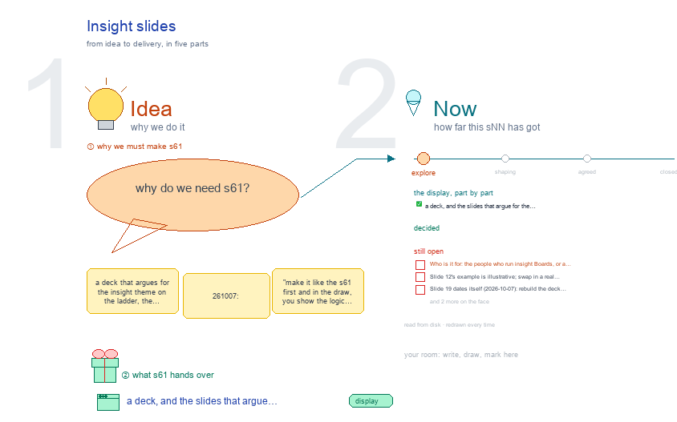

# s61 · Insight slides <!-- root #c1c3fb -->

**Stage:** explore

- For <!-- @for #f78806 -->
  - a deck, and the slides that argue … <!-- @for/0 #68d225 -->
    a deck, and the slides that argue for the insight theme on the ladder, for people new to the toolkit
- Delivery type <!-- @delivery-type #58a44f -->
  - display <!-- @delivery-type/0 #59b189 -->
- Topic <!-- @topic #7e13bd -->
  - a deck that argues for the insight … <!-- @topic/0 #8b7cbc -->
    a deck that argues for the insight theme on the ladder, the insight side of b12's s61-design-slides and in its shape (261007: "make it like the s61 first and in the draw, you show the logic flow, and then make it as the ppt slide"; b12's "is much better").
  - The deck's logic is drawn first; the … <!-- @topic/1 #8c2d11 -->
    The deck's logic is drawn first; the slides follow it.
  - One idea runs through it: an insight … <!-- @topic/2 #7bf36e -->
    One idea runs through it: an insight Job changes one thing at a time, so when an answer changes we can say why; and a claim leaves the Board only once it has earned it.
- Source <!-- @source #6da13a -->
  - the content of every slide is `slides.py` … <!-- @source/0 #994188 -->
    the content of every slide is `slides.py` (title, bullets, picture, the drawings it comes from, the reason the next slide follows, speaker notes), drawn from this Block's s00, s03, s11, s12, s13, s31 and the Insight Guide's `method.md` (the published evidence).
  - The slide layout is b12's `slide_kit.py`, loaded … <!-- @source/1 #05c5c5 -->
    The slide layout is b12's `slide_kit.py`, loaded by path, so the two theme decks lay out the same way and the storyboard and the deck cannot drift apart.
- Feeds <!-- @feeds #ffe8e9 -->
  - `../reports/` q01_insight_ladder · q02_partitions_pooling · q04_level_delivery <!-- @feeds/0 #266aca -->
- Files <!-- @files #6ce6c5 -->
  - [py] [build_deck.py](build_deck.py) <!-- @files/0 #2dc476 -->
  - [py] [build_s61_insight_slides.py](build_s61_insight_slides.py) <!-- @files/1 #102040 -->
  - delivery/ <!-- @files/2 #404761 -->
  - [excalidraw] [s61-insight-slides.excalidraw](s61-insight-slides.excalidraw) <!-- @files/3 #0a1d0e -->
  - [md] [s61-insight-slides.md](s61-insight-slides.md) <!-- @files/4 #043cd1 -->
  - [png] [s61-insight-slides.png](s61-insight-slides.png) <!-- @files/5 #c5b51e -->
    
  - [py] [slides.py](slides.py) <!-- @files/6 #1ccd5d -->
- The deck, slide by slide <!-- @the-deck-slide-by-slide #0c35df -->
- Open <!-- @open #cf9b77 -->
  - Who is it for: the people who … <!-- @open/0 #6117b7 -->
    Who is it for: the people who run insight Boards, or a wider room? It decides the depth.
  - Slide 12's example is illustrative; swap in … <!-- @open/1 #eae267 -->
    Slide 12's example is illustrative; swap in a real Board's four Jobs once one exists.
  - Slide 19 dates itself (2026-10-07): rebuild the … <!-- @open/2 #275151 -->
    Slide 19 dates itself (2026-10-07): rebuild the deck before each showing.
  - One slide kit for both decks: `slide_kit.py` … <!-- @open/3 #40ede9 -->
    One slide kit for both decks: `slide_kit.py` lives in b12's s61; move it to a shared place?
  - Agree its **For:** line and **Delivery type:** … <!-- @open/4 #eb3bab -->
    Agree its **For:** line and **Delivery type:** (display), proposed by the agent 261030?
