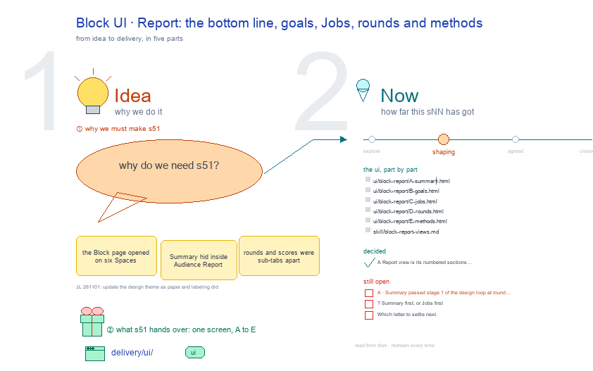

# s51 · Block UI: Report <!-- root #e37039 -->

**Tags:** `Block UI`
**Stage:** shaping

- For <!-- @for #f78806 -->
  - a deck, and the Report screen of … <!-- @for/0 #f3abf3 -->
    a deck, and the Report screen of the design Block on the focus page (`delivery/ui/block-report`), for the people who build the workbench
- Delivery type <!-- @delivery-type #58a44f -->
  - ui <!-- @delivery-type/0 #636117 -->
- Covers <!-- @covers #a6c44a -->
  - the bottom line, goals, Jobs, rounds and … <!-- @covers/0 #79097f -->
    the bottom line, goals, Jobs, rounds and methods; its views, each one full screen: A Summary · B Goals · C Jobs · D Rounds · E Methods.
- Excluded <!-- @excluded #980495 -->
  - the other eight cells of the 3 … <!-- @excluded/0 #2fc521 -->
    the other eight cells of the 3 × 3 (s52, s53, s54, s55, s56, s57, s58, s59); the older six-Space screens (s11, s12, s13); every Theme's shared frame (b10).
- Topic <!-- @topic #7e13bd -->
  - The Block's Report (check); one cell of … <!-- @topic/0 #854b28 -->
    The Block's Report (check); one cell of the design 3 × 3, copied from the labeling theme's (b15 j01), itself copied from the paper theme's (b16 j01;
  - JL 261101: "How about you to udpate … <!-- @topic/1 #ef8540 -->
    JL 261101: "How about you to udpate the theme_design?").
  - Its drawing is haipipe-studio's five parts, drawn … <!-- @topic/2 #8afb58 -->
    Its drawing is haipipe-studio's five parts, drawn by `build_s51_block_ui_report.py` through j01's `design_ui_cells.py`; its Design is every view as the same full screen, lettered, settled one round each.
  - Names are the Block's folder names; no … <!-- @topic/3 #b66f73 -->
    Names are the Block's folder names; no design text is drawn.
- Feeds <!-- @feeds #ffe8e9 -->
  - `reports/` q02_design_workbench <!-- @feeds/0 #9533a3 -->
- Files <!-- @files #6ce6c5 -->
  - [py] [build_s51_block_ui_report.py](build_s51_block_ui_report.py) <!-- @files/0 #544502 -->
  - review/ <!-- @files/1 #7928fb -->
  - [excalidraw] [s51-block-ui-report.excalidraw](s51-block-ui-report.excalidraw) <!-- @files/2 #1dffb8 -->
  - [md] [s51-block-ui-report.md](s51-block-ui-report.md) <!-- @files/3 #99f121 -->
  - [png] [s51-block-ui-report.png](s51-block-ui-report.png) <!-- @files/4 #5dd068 -->
    
- Decided <!-- @decided #55615a -->
  - (none yet: a decision is one line, … <!-- @decided/0 #ed3e7f -->
    (none yet: a decision is one line, s51-D01 · <what was decided> (<who> <date>))
- Open <!-- @open #cf9b77 -->
  - A · Summary passed stage 1 of … <!-- @open/0 #96bebe -->
    A · Summary passed stage 1 of the design loop at round 2 (mean 8.6; review/A-s1-r01.md 8.0, review/A-s1-r02.md 8.6); waits for JL to look once before it is built.
  - ? <!-- @open/1 #c9095d -->
    ? Summary first, or Jobs first
  - Which letter to settle next <!-- @open/2 #fe10a7 -->
