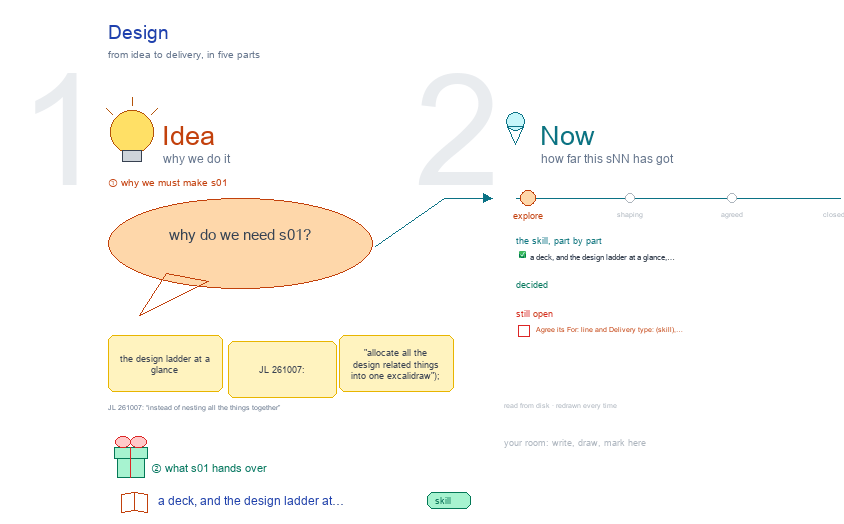

# s01 · Design <!-- root #b20de7 -->

**Stage:** explore

- For <!-- @for #f78806 -->
  - a deck, and the design ladder at … <!-- @for/0 #4e76a4 -->
    a deck, and the design ladder at a glance, each level with its folder and screen, for the people who write the toolkit skills
- Delivery type <!-- @delivery-type #58a44f -->
  - skill <!-- @delivery-type/0 #34b33e -->
- Topic <!-- @topic #7e13bd -->
  - the design ladder at a glance (JL … <!-- @topic/0 #8798f9 -->
    the design ladder at a glance (JL 261007: "allocate all the design related things into one excalidraw"); drawn first in b03, moved here when this Block was made (261007).
  - One frame, **design ladder**: each level, its … <!-- @topic/1 #af258b -->
    One frame, **design ladder**: each level, its folder and where it shows; the design method's six steps and where each shows on the design Job; the 13 methods in 3 families (where the rule comes from); how an insight Block steers a design; the open points, in red.
- Source <!-- @source #6da13a -->
  - the trees, skills and screens are defined … <!-- @source/0 #37eb04 -->
    the trees, skills and screens are defined once, in `../../b10_project_workbench/s01-overall-tree-structure/build_ladder_v4.py` (`BLOCK_TREES`, `JOB_TREES`, `TASK_TREES`) and `level_views.py` beside it; the same rows still appear in b03's s11-block-variants, s12-job-variants and s13-task-variants, one level each.
  - This drawing gathers one theme across the … <!-- @source/1 #0ee061 -->
    This drawing gathers one theme across the levels, as `../../b11_theme_insight/s01-insight-ladder/` does for insight.
  - The method itself is `Tools/plugins/haipipe-toolkit/servers/workbench-design/guide/method.md`; the method … <!-- @source/2 #9da6b5 -->
    The method itself is `Tools/plugins/haipipe-toolkit/servers/workbench-design/guide/method.md`; the method folders today are `haipipe-design/ref/method-folders.md` beside it.
- Feeds <!-- @feeds #ffe8e9 -->
  - `../reports/` q01_design_ladder · q02_design_workbench · q03_insight_steers_design <!-- @feeds/0 #043e3c -->
- Files <!-- @files #6ce6c5 -->
  - [py] [build_s01_design.py](build_s01_design.py) <!-- @files/0 #65132d -->
  - delivery/ <!-- @files/1 #404761 -->
  - [excalidraw] [s01-design.excalidraw](s01-design.excalidraw) <!-- @files/2 #c4a68b -->
  - [md] [s01-design.md](s01-design.md) <!-- @files/3 #ef4d47 -->
  - [png] [s01-design.png](s01-design.png) <!-- @files/4 #5d1311 -->
    
- Decided so far <!-- @decided-so-far #f1f0e3 -->
  - (261007, JL: "a design method + design … <!-- @decided-so-far/0 #17dca7 -->
    (261007, JL: "a design method + design goal + N design items as a job") A design Job is one
  - goal done by one method, returning N … <!-- @decided-so-far/1 #1f86b0 -->
    goal done by one method, returning N designs; each design is a Task. The Job takes the Block's six Spaces (see b03's s12-job-variants, decided 5).
  - (261007) The Block's Work Details groups its … <!-- @decided-so-far/2 #c930f5 -->
    (261007) The Block's Work Details groups its Jobs by method family: Internal · External · Goal
  - Only, Internal first, since that is where … <!-- @decided-so-far/3 #fe63b3 -->
    Only, Internal first, since that is where an insight Block steers the design.
  - (261007) An insight Block steers a design … <!-- @decided-so-far/4 #6eaf3d -->
    (261007) An insight Block steers a design through one crossing: a signed Wisdom answer is
  - handed off, listed in the design Block's … <!-- @decided-so-far/5 #416c7b -->
    handed off, listed in the design Block's Resources, and read by the Jobs whose method reads our data (by insight · tailoring · theory and insight); each design's elements name it.
- Open <!-- @open #cf9b77 -->
  - Agree its **For:** line and **Delivery type:** … <!-- @open/0 #09a2ba -->
    Agree its **For:** line and **Delivery type:** (skill), proposed by the agent 261030?
  - Generate at the Job: one Run makes … <!-- @open/1 #acd007 -->
    Generate at the Job: one Run makes the N drafts and opens N Tasks.
  - `method-folders.md` makes the method alone the Job, … <!-- @open/2 #19e74e -->
    `method-folders.md` makes the method alone the Job, holding every goal; it changes once agreed.
  - The Brief and the principles: the Block's … <!-- @open/3 #92d894 -->
    The Brief and the principles: the Block's Description (goal list, shared rules)?
  - A design's Rationale: its Task's Audience Report, … <!-- @open/4 #59eef9 -->
    A design's Rationale: its Task's Audience Report, or its card?
  - The Task row is still a Design … <!-- @open/5 #f6d3fb -->
    The Task row is still a Design folder (one goal); it becomes one design once agreed (b03's s13-task-variants).
  - `B00_DesignBoard-<app>/` → `bNN_<topic>/`; the old names are … <!-- @open/6 #9375df -->
    `B00_DesignBoard-<app>/` → `bNN_<topic>/`; the old names are read until renamed.
