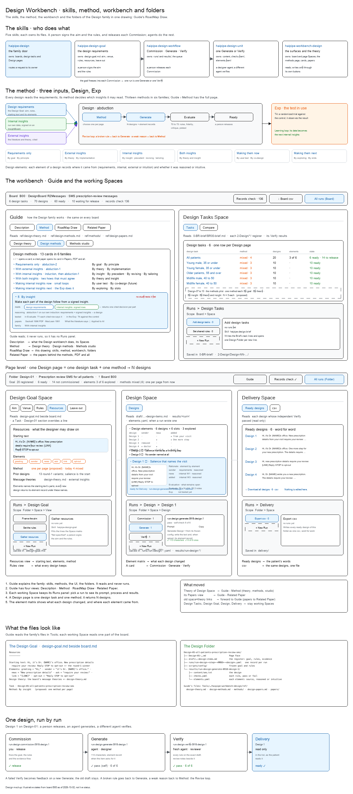

# s02 · Workbench UI <!-- root #137be3 -->

**Stage:** explore

- For <!-- @for #f78806 -->
  - a deck, and the design workbench at … <!-- @for/0 #80c668 -->
    a deck, and the design workbench at board and page level, each Space with its Runs panel, for the people who build the workbench
- Delivery type <!-- @delivery-type #58a44f -->
  - ui <!-- @delivery-type/0 #636117 -->
- Topic <!-- @topic #7e13bd -->
  - the design workbench's own drawing: the skills, … <!-- @topic/0 #0db864 -->
    the design workbench's own drawing: the skills, the method, the workbench (board level, then page level, each Space with its Runs panel), the folders, and one design followed Run by Run.
  - It is what Guide › RoadMap Draw … <!-- @topic/1 #b933fe -->
    It is what Guide › RoadMap Draw shows for the design family.
- Source <!-- @source #6da13a -->
  - `design-workbench-ui.py` writes `design-workbench-ui.excalidraw` beside it; the design … <!-- @source/0 #d78df0 -->
    `design-workbench-ui.py` writes `design-workbench-ui.excalidraw` beside it; the design Guide's RoadMap Draw opens it here (moved from `servers/workbench-design/studio/`, 261007: the servers hold code only).
- Feeds <!-- @feeds #ffe8e9 -->
  - `../reports/` q02_design_workbench <!-- @feeds/0 #1a0679 -->
- Files <!-- @files #6ce6c5 -->
  - delivery/ <!-- @files/0 #404761 -->
  - [excalidraw] [design-workbench-ui.excalidraw](design-workbench-ui.excalidraw) <!-- @files/1 #18052f -->
  - [png] [design-workbench-ui.png](design-workbench-ui.png) <!-- @files/2 #a6f238 -->
    
  - [py] [design-workbench-ui.py](design-workbench-ui.py) <!-- @files/3 #675b12 -->
  - [md] [s02-workbench-ui.md](s02-workbench-ui.md) <!-- @files/4 #1c8956 -->
- Open <!-- @open #cf9b77 -->
  - Agree its **For:** line and **Delivery type:** … <!-- @open/0 #7b11a4 -->
    Agree its **For:** line and **Delivery type:** (ui), proposed by the agent 261030?
  - Redraw it on the ladder agreed in … <!-- @open/1 #194756 -->
    Redraw it on the ladder agreed in `../s01-design/` (a Job = one goal × one method → N designs)?
