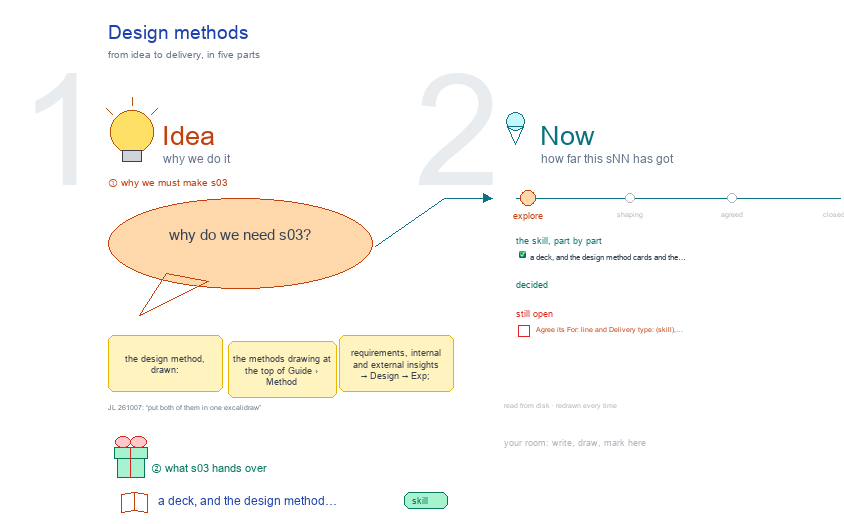

# s03 · Design methods <!-- root #b371ce -->

**Stage:** explore

- For <!-- @for #f78806 -->
  - a deck, and the design method cards … <!-- @for/0 #e41ebf -->
    a deck, and the design method cards and the five-step design unit, for the people who write the toolkit skills
- Delivery type <!-- @delivery-type #58a44f -->
  - skill <!-- @delivery-type/0 #34b33e -->
- Topic <!-- @topic #7e13bd -->
  - the design method, drawn: the methods drawing … <!-- @topic/0 #9d475a -->
    the design method, drawn: the methods drawing at the top of Guide › Method (requirements, internal and external insights → Design → Exp; thirteen method cards), and the design unit (one unit in five steps: see input, propose ideas, conduct, check each, check overall; one row per method).
- Source <!-- @source #6da13a -->
  - the two drawings and their scripts live … <!-- @source/0 #61b27b -->
    the two drawings and their scripts live here; the design workbench's Guide opens them here (moved from the skill's `ref/` and `servers/workbench-design/studio/`, 261007).
  - The method text and the papers table … <!-- @source/1 #028025 -->
    The method text and the papers table live with the design theme's server: `Tools/plugins/haipipe-toolkit/servers/workbench-design/` `guide/method.md` (cards in `guide/methods/`) · `related/papers.md` (PDFs in `related/papers/`).
- Feeds <!-- @feeds #ffe8e9 -->
  - `../reports/` q01_design_ladder · q02_design_workbench <!-- @feeds/0 #d2beed -->
- Files <!-- @files #6ce6c5 -->
  - [py] [build_s03_design_methods.py](build_s03_design_methods.py) <!-- @files/0 #801ffb -->
  - [py] [build_s03_design_unit.py](build_s03_design_unit.py) <!-- @files/1 #e38219 -->
  - chat/ <!-- @files/2 #20d4a6 -->
  - delivery/ <!-- @files/3 #404761 -->
  - [py] [design_unit_drawing.py](design_unit_drawing.py) <!-- @files/4 #b69675 -->
  - [py] [methods_drawing.py](methods_drawing.py) <!-- @files/5 #c09529 -->
  - parts/ <!-- @files/6 #e4d19a -->
  - [excalidraw] [s03-design-methods.excalidraw](s03-design-methods.excalidraw) <!-- @files/7 #65d905 -->
  - [md] [s03-design-methods.md](s03-design-methods.md) <!-- @files/8 #771faa -->
  - [png] [s03-design-methods.png](s03-design-methods.png) <!-- @files/9 #68e6c6 -->
    
- Open <!-- @open #cf9b77 -->
  - Agree its **For:** line and **Delivery type:** … <!-- @open/0 #09a2ba -->
    Agree its **For:** line and **Delivery type:** (skill), proposed by the agent 261030?
