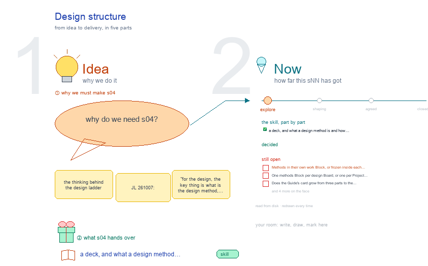

# s04 · Design structure <!-- root #cf405e -->

**Stage:** explore

- For <!-- @for #f78806 -->
  - a deck, and what a design method … <!-- @for/0 #67cf6d -->
    a deck, and what a design method is and how the design ladder holds methods, for the people who write the toolkit skills
- Delivery type <!-- @delivery-type #58a44f -->
  - skill <!-- @delivery-type/0 #34b33e -->
- Renumbered <!-- @renumbered #a325bf -->
  - s00-design-structure became s04-design-structure on 2026-10-12, so that … <!-- @renumbered/0 #af9d6e -->
    s00-design-structure became s04-design-structure on 2026-10-12, so that s00 is the Block's background and index, the same in every Block (JL 2026-10-12: "for every block, we also want to have the s00-overview").
- Topic <!-- @topic #7e13bd -->
  - the thinking behind the design ladder (JL … <!-- @topic/0 #e72b31 -->
    the thinking behind the design ladder (JL 261007: "for the design, the key thing is what is the design method, right?"), drawn as the design side of `../../b11_theme_insight/s04-insight-structure/`: what a design method is; the methods as their own work Block whose Jobs are method versions; the design Board whose Jobs pin a goal, one method version and one inputs version; the clocks; where a new method version comes from and what triggers it; and the Block's questions with our ideas and the choices still open.
- Feeds <!-- @feeds #ffe8e9 -->
  - `../reports/` q01_design_ladder, q02_design_workbench, q03_insight_steers_design (and a proposed … <!-- @feeds/0 #b0508c -->
    `../reports/` q01_design_ladder, q02_design_workbench, q03_insight_steers_design (and a proposed Q04, what a design method is and how it evolves).
- Files <!-- @files #6ce6c5 -->
  - [py] [build_s04_design_structure.py](build_s04_design_structure.py) <!-- @files/0 #b33f64 -->
  - delivery/ <!-- @files/1 #404761 -->
  - [excalidraw] [s04-design-structure.excalidraw](s04-design-structure.excalidraw) <!-- @files/2 #09e0d7 -->
  - [md] [s04-design-structure.md](s04-design-structure.md) <!-- @files/3 #d6d25b -->
  - [png] [s04-design-structure.png](s04-design-structure.png) <!-- @files/4 #5fbd87 -->
    
- What the drawing holds <!-- @what-the-drawing-holds #e0b05d -->
  - A Design Project: `work/bNN_<app>_methods/` (the methods, versioned) … <!-- @what-the-drawing-holds/0 #23090f -->
    A Design Project: `work/bNN_<app>_methods/` (the methods, versioned) beside `designs/bNN_<app>/`
  - (goals, inputs, Jobs, designs); insights and discoveries … <!-- @what-the-drawing-holds/1 #2c0e04 -->
    (goals, inputs, Jobs, designs); insights and discoveries optional; the Exp outside the theme.
  - What a design method is: a recipe, … <!-- @what-the-drawing-holds/2 #249ae1 -->
    What a design method is: a recipe, frozen per version, that turns a goal and its inputs into N
  - designs, in five parts: see input, reason … <!-- @what-the-drawing-holds/3 #4dac1c -->
    designs, in five parts: see input, reason ideas, conduct, check each (T0 to T3), check overall. T4, the Exp, is the Learning loop, not part of the method. Three layers: a generic card (the Guide's 13), a method version made concrete for one app (inputs named, prompt written, checks coded, a bench), and a Job that pins that version by path and hash.
  - The two Blocks, each a box, a … <!-- @what-the-drawing-holds/4 #fc2b43 -->
    The two Blocks, each a box, a definition and its tree. Methods Block: one Job per method version
  - (`j01_by-insight_m1`), frozen when closed, with `proposals/` as … <!-- @what-the-drawing-holds/5 #cd33bb -->
    (`j01_by-insight_m1`), frozen when closed, with `proposals/` as the backlog and `bench/` (fixed goals and inputs) so two versions compare on the same ground. Design Board: one Job per goal × method version × inputs version; its Tasks are the N designs. Arrows: the Board's Job uses a version, never a copy; the Board's answers send proposals back.
  - One goal, two clocks (method, inputs) and … <!-- @what-the-drawing-holds/6 #aa30c5 -->
    One goal, two clocks (method, inputs) and the chain of Jobs; one clock per Job, so a change in the
  - designs has one cause <!-- @what-the-drawing-holds/7 #08a57d -->
    designs has one cause. Comparing methods is a sibling Job on the same goal and inputs.
  - Where a new method version comes from: … <!-- @what-the-drawing-holds/8 #e309e8 -->
    Where a new method version comes from: six triggers (checks fail often, the N are alike, critique
  - or pretest finds a pattern, the Exp … <!-- @what-the-drawing-holds/9 #57bd9a -->
    or pretest finds a pattern, the Exp says it loses, a paper suggests a procedure, a new kind of input) feed `proposals/`; the next version Job is written, benched against the last, reviewed by another agent, signed by a person and closed; the Board then adds a Job. New inputs alone need no new version.
  - Questions: the register's Q01 to Q03 and … <!-- @what-the-drawing-holds/10 #91a3a3 -->
    Questions: the register's Q01 to Q03 and a proposed Q04, each with our idea (middle column) and the
  - choice it waits on (right column, outlined … <!-- @what-the-drawing-holds/11 #6bf171 -->
    choice it waits on (right column, outlined red: still open).
- Open <!-- @open #cf9b77 -->
  - Methods in their own work Block, or … <!-- @open/0 #70ffc7 -->
    Methods in their own work Block, or frozen inside each design Job (`method.md`, as today)?
  - One methods Block per design Board, or … <!-- @open/1 #46b62b -->
    One methods Block per design Board, or one per Project shared across apps?
  - Does the Guide's card grow from three … <!-- @open/2 #0d37bf -->
    Does the Guide's card grow from three parts to the unit's five?
  - When to cut a method version: on … <!-- @open/3 #bc7b06 -->
    When to cut a method version: on a bench gain, per batch of proposals, or on demand?
  - One clock per Job? <!-- @open/4 #c3585f -->
  - Does a newer handoff make a closed … <!-- @open/5 #c1d87b -->
    Does a newer handoff make a closed Job's designs stale?
  - Agree its **For:** line and **Delivery type:** … <!-- @open/6 #09a2ba -->
    Agree its **For:** line and **Delivery type:** (skill), proposed by the agent 261030?
