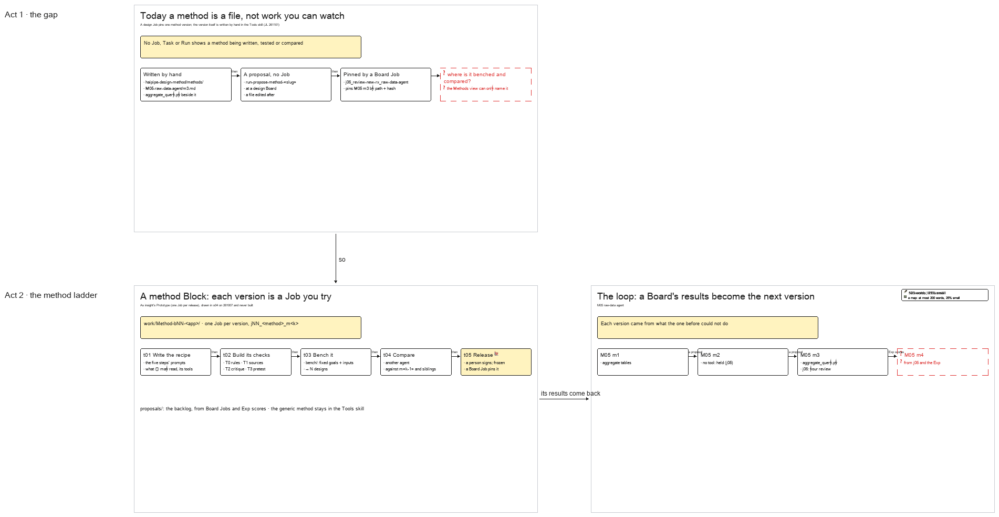

# s05 · Design method ladder <!-- root #00e3dc -->

**Tags:** `Structure`
**Stage:** explore

- For <!-- @for #f78806 -->
  - a deck, and the method Block's folder … <!-- @for/0 #068390 -->
    a deck, and the method Block's folder contract and its pages (a design method's versions as Jobs you try), for the people who write the design skills and the workbench
- Delivery type <!-- @delivery-type #58a44f -->
  - skill <!-- @delivery-type/0 #34b33e -->
- Covers <!-- @covers #a6c44a -->
  - where a design method's versions are made … <!-- @covers/0 #09fe25 -->
    where a design method's versions are made and tested on the ladder: the method Block, a version Job and its five Tasks (write the recipe, build its checks, bench it, compare it, release it), how a design Board's Job pins a released version, and how the Board's results come back as proposals for the next version.
  - M05's m1 → m2 → m3 is … <!-- @covers/1 #17e237 -->
    M05's m1 → m2 → m3 is the worked example.
- Excluded <!-- @excluded #980495 -->
  - making designs with a pinned method (the … <!-- @excluded/0 #e7bbd8 -->
    making designs with a pinned method (the design Board, s01 and j01's pages); what a method card is in general (the Guide's 13 cards, s03-design-methods); the insight Prototype it copies (b11 s04-insight-structure).
- Topic <!-- @topic #7e13bd -->
  - A design Job pins one method version, … <!-- @topic/0 #3e148f -->
    A design Job pins one method version, but the methods themselves (M01 to M05, versions m1 to m3) live only as files in the Tools skill registry (`haipipe-design-method/methods/`), written by hand; no Job, Task or Run shows a method being written, tested or compared, so the Block's Methods view can only name the method a Job pinned (JL 261101: "how could we highlight more about the methods? … where is the task or jobs for designing the design methods? … the designer itself should be some tasks to try"). s04 drew the answer on 261007 and it was never built: a methods Block beside the design Board, one Job per method version, a bench of fixed goals and inputs, proposals as its backlog.
  - The insight theme built the same shape … <!-- @topic/1 #e0f04b -->
    The insight theme built the same shape as its Prototype (`work/Prototype-bNN-<topic>/`, one Job per release, a Board Job pins a release), live on the SMS project.
  - This topic draws it for design, so … <!-- @topic/2 #aee59c -->
    This topic draws it for design, so a method version is work you try: written, benched, compared by another agent, signed, then pinned.
- Feeds <!-- @feeds #ffe8e9 -->
  - `reports/` q06_design_method_ladder <!-- @feeds/0 #091d94 -->
- Files <!-- @files #6ce6c5 -->
  - [py] [build_s05_design_method_ladder.py](build_s05_design_method_ladder.py) <!-- @files/0 #b4ee01 -->
  - delivery/ <!-- @files/1 #404761 -->
  - [excalidraw] [s05-design-method-ladder.excalidraw](s05-design-method-ladder.excalidraw) <!-- @files/2 #8ac398 -->
  - [md] [s05-design-method-ladder.md](s05-design-method-ladder.md) <!-- @files/3 #e7af5d -->
  - [png] [s05-design-method-ladder.png](s05-design-method-ladder.png) <!-- @files/4 #1c524d -->
    
- Proposed (261101) <!-- @proposed-261101 #a5416b -->
  - The generic method stays in the Tools … <!-- @proposed-261101/0 #d817a6 -->
    The generic method stays in the Tools skill (the Guide's 13 cards, each method's definition); a version written for one
  - app's inputs (its prompts, checks, and scripts … <!-- @proposed-261101/1 #b398ae -->
    app's inputs (its prompts, checks, and scripts such as `aggregate_query.py`) moves into the Project's method Block.
  - The design Block's Methods view becomes the … <!-- @proposed-261101/2 #9f08f4 -->
    The design Block's Methods view becomes the method ladder: each method × its versions, bench score, Exp score, the Jobs
  - that pinned it <!-- @proposed-261101/3 #81f16d -->
- Decided <!-- @decided #55615a -->
  - (none yet: a decision is one line, … <!-- @decided/0 #7ca181 -->
    (none yet: a decision is one line, s05-D01 · <what was decided> (<who> <date>))
- Open <!-- @open #cf9b77 -->
  - ? <!-- @open/0 #b2f664 -->
    ? One method Block per app (`work/Method-bNN-<app>/`), or one per Project shared by its design Boards.
  - ? <!-- @open/1 #709a14 -->
    ? Move the app-specific versions (M05 m3's `aggregate_query.py`) out of the Tools skill into the Project, or keep the
  - registry in Tools and link the Project's … <!-- @open/2 #5fd0f0 -->
    registry in Tools and link the Project's version Jobs to it.
  - ? <!-- @open/3 #c98a80 -->
    ? What the bench is: a fixed goal and inputs version from a design Board (`inputs/i1`), or its own small set.
  - ? <!-- @open/4 #444a0a -->
    ? Does a version Job need its own 3 × 3 pages, or does it reuse the design Job page with the five Tasks above.
