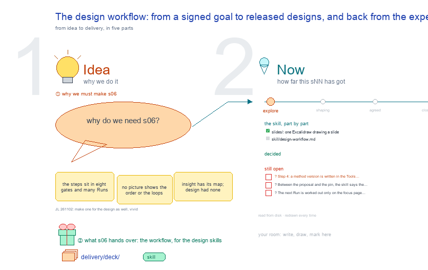

# s06 · The design workflow: from a signed goal to released designs, and back … <!-- root #8e936c -->

**Tags:** `Workflow`
**Stage:** explore

- For <!-- @for #f78806 -->
  - a deck, and the design workflow as … <!-- @for/0 #9bc099 -->
    a deck, and the design workflow as one map (who does each step, what it writes, the screen it lives on), for the people who write the design skills and build its workbench
- Delivery type <!-- @delivery-type #58a44f -->
  - skill <!-- @delivery-type/0 #34b33e -->
- Covers <!-- @covers #a6c44a -->
  - the whole design workflow in five areas, … <!-- @covers/0 #d0b4c7 -->
    the whole design workflow in five areas, 18 steps: A set up the Block (1-4: write the goal and sign it, sign the shared rules, freeze an inputs version; a method version comes registered from the design skill) · B launch a Job (5-8: launch it on one goal × one method version × one inputs version, pin all three and build the fence, reason five more ideas than the goal asks for, the reviewer agent checks the fence and one Task opens per idea) · C write each design (9-11: write, check it for rules, sources and, when the method asks, a critique; redraft on a fail) · D rank and release (12-14: rank, keep as many as the goal asks, predict each in percentage points with a range, a pretest when the method asks; one Review and approve freezes the predictions and releases; the close) · E learn (15-18: the experiment's totals per arm, the scores and the method scorecard, the Block's questions, reports and one-page summary, a method change you sign); where the goal lives and travels; the loops back; a held Job; a design's state walk; the Map's compare; who makes, who checks, who signs.
- Excluded <!-- @excluded #980495 -->
  - the screens themselves (j01's 3 × 3, … <!-- @excluded/0 #54c5db -->
    the screens themselves (j01's 3 × 3, s51 to s59); the ladder's folders (s01, s04); each Run's card and skill (s21; haipipe-design-workflow references/run-cards.md); the method cards (s03); where a method version is built (s05).
- Topic <!-- @topic #7e13bd -->
  - one map of how a design travels, … <!-- @topic/0 #14e60c -->
    one map of how a design travels, as b11 s05 draws insight's workflow (JL 261102: "we have the workflow for the insight, could you make one for the design as well? try to make it to be vivid").
  - It starts from the goal (JL 261102: … <!-- @topic/1 #bd728c -->
    It starts from the goal (JL 261102: "Where is the Goal?"): written once in the Block's goal list (`board.md`, Goals) and signed by a person, pinned by every Job that works on it, copied into the Job's fence (`inputs/goal.md`) as all the design work may see, read by the rules check on every design and by the ranking.
  - Each Job pins one signed goal, one … <!-- @topic/2 #ac9e1d -->
    Each Job pins one signed goal, one registered method version and one frozen inputs version, so a changed answer has one cause.
  - The designer agent makes, the reviewer agent … <!-- @topic/3 #1b5a82 -->
    The designer agent makes, the reviewer agent checks (never what it made), and a person signs five things: the goal, the shared rules, a Job's Review and approve, its close, and a method change.
  - What an experiment returns lands once at … <!-- @topic/4 #387e53 -->
    What an experiment returns lands once at the Block and starts the next round.
  - Every word is a full name, never … <!-- @topic/5 #92f3de -->
    Every word is a full name, never a short id (excalidraw-studio, the look, rule 5;
  - JL 261102) <!-- @topic/6 #e54133 -->
  - The steps are haipipe-design ref/design-ladder.md's rules and … <!-- @topic/7 #bd4545 -->
    The steps are haipipe-design ref/design-ladder.md's rules and Runs and haipipe-design-workflow's routes and gates, checked against the workbench (servers/workbench-design); the words are written once in `s06-design-workflow-workflow.yaml`.
- Feeds <!-- @feeds #ffe8e9 -->
  - `reports/` q01_design_ladder · q05_method_predictions · q06_design_method_ladder <!-- @feeds/0 #b0e449 -->
- Files <!-- @files #6ce6c5 -->
  - [py] [build_s06_design_workflow.py](build_s06_design_workflow.py) <!-- @files/0 #673a2e -->
  - delivery/ <!-- @files/1 #404761 -->
  - [yaml] [s06-design-workflow-workflow.yaml](s06-design-workflow-workflow.yaml) <!-- @files/2 #284bc1 -->
  - [excalidraw] [s06-design-workflow.excalidraw](s06-design-workflow.excalidraw) <!-- @files/3 #896c3b -->
  - [md] [s06-design-workflow.ideas.md](s06-design-workflow.ideas.md) <!-- @files/4 #930620 -->
  - [md] [s06-design-workflow.md](s06-design-workflow.md) <!-- @files/5 #ed325f -->
  - [png] [s06-design-workflow.png](s06-design-workflow.png) <!-- @files/6 #b56282 -->
    
  - [html] [s06-design-workflow.slides.html](s06-design-workflow.slides.html) <!-- @files/7 #5e42a8 -->
  - [json] [s06-design-workflow.slides.json](s06-design-workflow.slides.json) <!-- @files/8 #46a3d2 -->
  - [pptx] [s06-design-workflow.slides.pptx](s06-design-workflow.slides.pptx) <!-- @files/9 #e3fe99 -->
  - [py] [sketch_workflow.py](sketch_workflow.py) <!-- @files/10 #7fa56b -->
  - slides/ <!-- @files/11 #0e8ebe -->
- Decided <!-- @decided #55615a -->
  - (none yet: a decision is one line, … <!-- @decided/0 #da1597 -->
    (none yet: a decision is one line, s06-D01 · <what was decided> (<who> <date>))
- Open <!-- @open #cf9b77 -->
  - ? <!-- @open/0 #3ef46a -->
    ? Step 4: a method version is written in the Tools registry (`haipipe-design-method/methods/`), outside any Job or Run; only the proposal before it is a Block Run (`run-propose-method-<slug>`). s05 proposes a Task per version.
  - ? <!-- @open/1 #275f36 -->
    ? Between the proposal and the pin, the skill says the version is benched against the last version, reviewed by another agent and signed by a person; no Run type does the bench or that review yet.
  - ? <!-- @open/2 #303ffe -->
    ? The next Run is worked out only on the focus page (each Job's next move, `design_focus._job_next`); haipipe-design-workflow says no script prints it.
