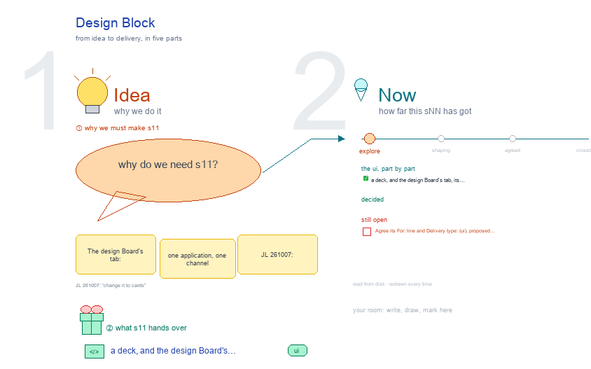

# s11 · Design Block <!-- root #19f05c -->

**Stage:** explore

- For <!-- @for #f78806 -->
  - a deck, and the design Board's tab, … <!-- @for/0 #234556 -->
    a deck, and the design Board's tab, its Spaces as full screens with what is on disk, for the people who build the workbench
- Delivery type <!-- @delivery-type #58a44f -->
  - ui <!-- @delivery-type/0 #636117 -->
- Topic <!-- @topic #7e13bd -->
  - The design Board's tab: one application, one … <!-- @topic/0 #5d6f1d -->
    The design Board's tab: one application, one channel (JL 261007: "s11, s12, s13 … for the Block level, Job level and task level … instead of nesting all the things together"), drawn the way b11 draws its levels (JL 261007: "check s11 s12 and s13 [of b11] … borrow their ideas").
  - It follows `../s04-design-structure/`: a Job pins one … <!-- @topic/1 #394485 -->
    It follows `../s04-design-structure/`: a Job pins one goal, one method version and one inputs version, and returns N designs, each a Task.
- Proposed (261007) <!-- @proposed-261007 #e4f68e -->
  - Every list is a folding card, as … <!-- @proposed-261007/0 #04a6c6 -->
    Every list is a folding card, as the Job's (s12, JL 261007: "change it to cards"); every design shows as it reads (a phone for an SMS, the rendered screen for a UI); "on disk" under each screen is a tree from `bNN_<app>/`; each change carries a green "✎ 261007" note at its spot. Beside it, "skills" (JL 261007): the skills behind that screen, each root a full path from `skills/`, each skill with what it does there; red = not in the skill yet (the method registry `haipipe-design-unit/methods/`, the Block's Run cards, `usage:` in a Run's receipt).
  - Description: Map · Goals · Methods · … <!-- @proposed-261007/1 #78d083 -->
    Description: Map · Goals · Methods · Inputs. Map crosses goals (down) and registered methods (across,
  - M01 … M05), the chain of Jobs … <!-- @proposed-261007/2 #bbaef5 -->
    M01 … M05), the chain of Jobs in each cell. Goals: one card per goal (aim, who, venue, N, its Jobs, signed; the Brief merged in ?). Methods: one card per registered method, read only from the design skill's registry (JL 261007: no methods Block); its type, versions, what step ① sees, who runs it, its scorecard; this Block's proposals go to the registry. Inputs: one card per inputs version, its parts labelled by step ①'s parts (Goal · how much is set, Information · whose, Information · form, Examples), as the Job's Inputs view. Each Job's own `inputs/` is its fence: relative links into one version plus a frozen `manifest.yaml`.
  - Audience Report: a Block report needs evidence … <!-- @proposed-261007/3 #045a7b -->
    Audience Report: a Block report needs evidence from two or more Jobs. Questions (each a
  - Question │ Task Work │ Report row, … <!-- @proposed-261007/4 #e2448f -->
    Question │ Task Work │ Report row, the workbench's own style: the question, the Jobs it rests on, its report) · Cost (one card per Job, read from the Job's Performance: tokens, time, rounds, first-try pass, tokens per passed design) · Predicted vs observed (each tested design as it reads, its prediction frozen at the Job's release beside the Exp's result for its arm) · Method scorecard (one card per method version, summed from the scores). What the Exp returns lands once, in the Block's `observed/eNN_<exp>/` (`arms.csv`: arm · jNN · dNN · n · outcome totals; its source, an insight Block's signed handoff or a vendor's per-arm report; a frozen `manifest.yaml`), filled by `run-add-observed-eNN`; raw Exp rows stay in their store. One soft Run per Exp, `run-score-<eNN>`, scores every arm's design (direction, in range, error); a Job's own Predicted vs observed (s12) shows its rows. An Exp spans Jobs, so it is not copied per Job. Comparing two Jobs of one Map cell is a pop-out from the Map, not a view.
  - Work Details: one card per Job (goal … <!-- @proposed-261007/5 #8a64ad -->
    Work Details: one card per Job (goal · method version · inputs · state); open, a preview of its
  - Tasks: t00's ideas, each design as a … <!-- @proposed-261007/6 #41d63e -->
    Tasks: t00's ideas, each design as a small phone with its state, t99's ranking, what it released; the Job tab is for working on one.
  - Runs: every Block Run is soft (JL … <!-- @proposed-261007/7 #7ea75b -->
    Runs: every Block Run is soft (JL 261007); hard Runs sit in a Job's Tasks. One folding card per Run,
  - `run-<type>-<target>`, grouped by purpose <!-- @proposed-261007/8 #b05dad -->
    `run-<type>-<target>`, grouped by purpose. Set up, before any Job: `run-add-goal-<goal>` (a person signs), `run-setup-rules`, `run-add-inputs-<iN>`. Launch a Job: `run-add-job-<jNN>` (needs a signed goal, a registered method, a frozen inputs version; makes the empty Job), then the Job's own setup Runs (s12). Report: `run-add-observed-<eNN>`, `run-score-<eNN>` (each arm's design scored, `scores.csv`), `run-propose-questions` (reads the Map, the scores and the scorecard, proposes the Block's questions into `board.md`, another agent agrees), `run-report-<qNN>`.
  - Delivery: every released design as it reads, … <!-- @proposed-261007/9 #bb2833 -->
    Delivery: every released design as it reads, in order, each naming its Job, to the Exp.
  - **Source:** the screens are drawn by `../_build/design_ui.py`, … <!-- @proposed-261007/10 #493161 -->
    **Source:** the screens are drawn by `../_build/design_ui.py`, shared by s11 · s12 · s13 (its `fold` and `phone` are the Job's card and display) and borrowed from `../../b11_theme_insight/studio/_build/insight_ui.py`; the method cards are read from `servers/workbench-design/guide/methods/` at build time. The rows of b03 (proposed above today's served screens) stay in `../../b10_project_workbench/studio/` s11-block-variants, s12-job-variants and s13-task-variants.
  - **Feeds:** `../reports/` q01_design_ladder · q02_design_workbench <!-- @proposed-261007/11 #5755ae -->
- Files <!-- @files #6ce6c5 -->
  - [py] [build_s11_design_block.py](build_s11_design_block.py) <!-- @files/0 #bdb1b9 -->
  - delivery/ <!-- @files/1 #404761 -->
  - [excalidraw] [s11-design-block.excalidraw](s11-design-block.excalidraw) <!-- @files/2 #cd0d33 -->
  - [md] [s11-design-block.md](s11-design-block.md) <!-- @files/3 #2e048f -->
  - [png] [s11-design-block.png](s11-design-block.png) <!-- @files/4 #5b5a67 -->
    
- Open <!-- @open #cf9b77 -->
  - Agree its **For:** line and **Delivery type:** … <!-- @open/0 #7b11a4 -->
    Agree its **For:** line and **Delivery type:** (ui), proposed by the agent 261030?
  - See the drawing's open notes (red) <!-- @open/1 #db4102 -->
