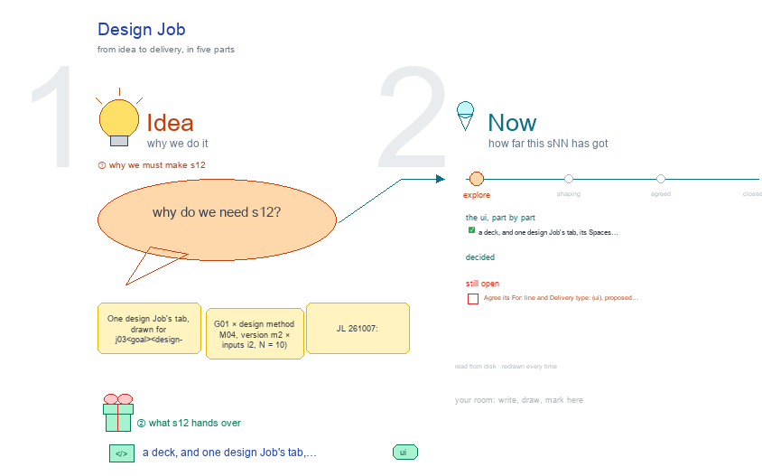

# s12 · Design Job <!-- root #4b2c05 -->

**Stage:** explore

- For <!-- @for #f78806 -->
  - a deck, and one design Job's tab, … <!-- @for/0 #323266 -->
    a deck, and one design Job's tab, its Spaces as full screens with what is on disk, for the people who build the workbench
- Delivery type <!-- @delivery-type #58a44f -->
  - ui <!-- @delivery-type/0 #636117 -->
- Topic <!-- @topic #7e13bd -->
  - One design Job's tab, drawn for j03_<goal>_<design-method> … <!-- @topic/0 #6f9ef1 -->
    One design Job's tab, drawn for j03_<goal>_<design-method> (G01 × design method M04, version m2 × inputs i2, N = 10) (JL 261007: "s11, s12, s13 … for the Block level, Job level and task level … instead of nesting all the things together"), drawn the way b11 draws its levels (JL 261007: "check s11 s12 and s13 [of b11] … borrow their ideas").
  - It follows `../s04-design-structure/`: a Job pins one … <!-- @topic/1 #394485 -->
    It follows `../s04-design-structure/`: a Job pins one goal, one method version and one inputs version, and returns N designs, each a Task.
- Proposed (261007) <!-- @proposed-261007 #e4f68e -->
  - Description: only what the Job pins: Goal … <!-- @proposed-261007/0 #bce030 -->
    Description: only what the Job pins: Goal (the aim, N, the rules it keeps), Method (the registered method M04, version m2, read only: its choices at each of the design unit's five steps, See input · Reason ideas · Conduct process · Review item · Review whole, read from `../s03-design-methods/design_unit_drawing.py`), Inputs (the Job's own `inputs/`, the only folder the design work sees: `goal.md`, relative symlinks to the Block's inputs and the insight handoff, and a frozen `manifest.yaml`; step ① decides what goes in). No Map: the Map of goals × methods is the Block's (s11).
  - Audience Report follows the design unit: Reason … <!-- @proposed-261007/1 #947dd4 -->
    Audience Report follows the design unit: Reason ideas (②, t00's reasoning chains, one card per topic, from `chains.yaml`) · Design display (③ ④, one card per design, in order: the design as the reader sees it, an SMS as a phone bubble, a UI as its rendered screen │ its process │ its review and expected outcome; dropped designs folded at the end) · Review whole (⑤, t99 ranks the 15 and keeps 10) · Predicted vs observed (each released design's frozen prediction beside the Exp, read from the Block's observed/eNN/arms.csv and run-score-eNN scores.csv rows for this Job) · Performance (each design: tokens, time, rounds, length, its prediction frozen at release). No vs last Job: Jobs are compared on the Block (s11's Method scorecard, or two Jobs in a Map cell).
  - Work Details: t00 reason ideas · t01 … <!-- @proposed-261007/2 #8c67b2 -->
    Work Details: t00 reason ideas · t01 – t15 one design each (a row opens its Task tab, s13) · t99 review whole; a looping method adds rounds (red).
  - Runs: the three setup Runs · run-open-designs-j03 … <!-- @proposed-261007/3 #c45c53 -->
    Runs: the three setup Runs · run-open-designs-j03 · each Task's hard Runs (t00 run-reason-t00 · tNN run-generate-dNN, run-verify-dNN-v1 · t99 run-rank-t99) and revise.
  - Delivery: the passed designs, word for word; … <!-- @proposed-261007/4 #3833c8 -->
    Delivery: the passed designs, word for word; a person releases.
  - **Source:** the screens are drawn by `../_build/design_ui.py`, … <!-- @proposed-261007/5 #5bb4e5 -->
    **Source:** the screens are drawn by `../_build/design_ui.py`, shared by s11 · s12 · s13 and borrowed from `../../b11_theme_insight/studio/_build/insight_ui.py`; the method cards are read from `servers/workbench-design/guide/methods/` at build time. The rows of b03 (proposed above today's served screens) stay in `../../b10_project_workbench/studio/` s11-block-variants, s12-job-variants and s13-task-variants.
  - **Feeds:** `../reports/` q01_design_ladder · q02_design_workbench <!-- @proposed-261007/6 #5755ae -->
- Files <!-- @files #6ce6c5 -->
  - [py] [build_s12_design_job.py](build_s12_design_job.py) <!-- @files/0 #be776a -->
  - delivery/ <!-- @files/1 #404761 -->
  - [excalidraw] [s12-design-job.excalidraw](s12-design-job.excalidraw) <!-- @files/2 #5eb6b9 -->
  - [md] [s12-design-job.md](s12-design-job.md) <!-- @files/3 #1deeba -->
  - [png] [s12-design-job.png](s12-design-job.png) <!-- @files/4 #8b3994 -->
    
- Decided (261007, JL) <!-- @decided-261007-jl #5223bd -->
  - ✎ 261007: every Run is named `run-<type>-<target>`, … <!-- @decided-261007-jl/0 #e91093 -->
    ✎ 261007: every Run is named `run-<type>-<target>`, hard ones too (JL: "unify the name to be run-xxx-xxx"): `run-reason-t00` · `run-generate-d<NN>` · `run-verify-d<NN>-v<k>` (v<k> = the draft it checks) · `run-rank-t99`; a looping method's second round is `run-reason-t00-r2` · `run-rank-t99-r2` (new inputs, so a new Run). Was `rNN_<type>_<target>`.
  - Every step of the method is a … <!-- @decided-261007-jl/1 #3c186b -->
    Every step of the method is a Task: `t00_reason-ideas/` (② Reason ideas), `t01_d01_<slug>/` …
  - `t15_d15_<slug>/` (③ ④, one design each), `t99_review-whole/` … <!-- @decided-261007-jl/2 #86a283 -->
    `t15_d15_<slug>/` (③ ④, one design each), `t99_review-whole/` (⑤ Review whole: rank the 15, keep 10).
  - A design and its review are one … <!-- @decided-261007-jl/3 #7b1ac0 -->
    A design and its review are one Task with two Runs: `run-generate-d<NN>/` (③) and `run-verify-d<NN>-v1/` (④,
  - another agent), then `run-revise-d<NN>` and a further … <!-- @decided-261007-jl/4 #2ca0b6 -->
    another agent), then `run-revise-d<NN>` and a further verify. A new object is a new Task; another step on the same object is another Run.
  - A Job is set up by three … <!-- @decided-261007-jl/5 #1abf5b -->
    A Job is set up by three soft Runs in its `runs/`: `run-setup-goal-j03`, `run-setup-method-j03`,
  - `run-setup-inputs-j03`; set up = all three closed <!-- @decided-261007-jl/6 #15cc3a -->
    `run-setup-inputs-j03`; set up = all three closed. No methods Block: a method is a registered card in the design skill, linked into `inputs/method.md`.
  - Settled with the Task session (s13, on … <!-- @decided-261007-jl/7 #225ae3 -->
    Settled with the Task session (s13, on JL's "use your own judgement"): `run-open-designs-jNN` (the Job's)
  - opens the design Tasks, and t00 only … <!-- @decided-261007-jl/8 #09ca94 -->
    opens the design Tasks, and t00 only writes `ideas.yaml`; T2 critique runs per design inside ④, and T3 pretest once per Job on the kept designs; t99's rank Run writes each prediction as a draft, frozen when a person releases; dropped designs keep their Tasks, marked dropped and folded; each reasoning step's `from` is a file in the manifest or "own knowledge", checked by the reviewer before the design Tasks open.
  - The goal is signed once, in the … <!-- @decided-261007-jl/9 #867caa -->
    The goal is signed once, in the Block's goal list; `run-setup-goal-jNN` only pins it (with s11).
  - The Exp's data and its scoring are … <!-- @decided-261007-jl/10 #4df8e1 -->
    The Exp's data and its scoring are the Block's, once per Exp (`observed/eNN/`, `run-score-eNN`); the Job's
  - Predicted vs observed view reads its own … <!-- @decided-261007-jl/11 #d9b828 -->
    Predicted vs observed view reads its own rows (with s11).
- Code change, waiting on decision ⑤ (registered methods) <!-- @code-change-waiting-on-decision-registered-methods #e57b19 -->
  - The Job folder is now `jNN_<goal>_<design-method>/` (JL … <!-- @code-change-waiting-on-decision-registered-methods/0 #715727 -->
    The Job folder is now `jNN_<goal>_<design-method>/` (JL 261007) in every b12 drawing; the code still reads `jNN_<goal>_by-<method>/`. Once ⑤ is settled, this session (the Job level) changes it in one pass, and the Block session reviews the Block side and rebuilds s11:
  - `servers/workbench-design/design_theme.py`: `method_of` reads the Job face's `method:` … <!-- @code-change-waiting-on-decision-registered-methods/1 #04a3d8 -->
    `servers/workbench-design/design_theme.py`: `method_of` reads the Job face's `method:` field, not the folder
  - name <!-- @code-change-waiting-on-decision-registered-methods/2 #32c836 -->
    name; `is_design_job` follows. `_block` takes each Job's goal from the face's `goal:` field (today it splits the folder name on `_by-`, in the goals set and in the Goal list table).
  - `FAMILY`: the family comes from the registered … <!-- @code-change-waiting-on-decision-registered-methods/3 #f6c4cc -->
    `FAMILY`: the family comes from the registered method's type (its card), not from the slug.
  - `skills/2_theme/design/haipipe-design/scripts/design_ladder.py` and `ref/design-ladder.md`: the scaffold and <!-- @code-change-waiting-on-decision-registered-methods/4 #1022bc -->
  - the contract name the new folder, write … <!-- @code-change-waiting-on-decision-registered-methods/5 #8b4e3b -->
    the contract name the new folder, write `goal:` and `method:` on the face, and make the Job's `inputs/` with its `manifest.yaml`.
  - `servers/workbench-design/tests/test_design_theme.py`: scaffold new-style Jobs; keep one test … <!-- @code-change-waiting-on-decision-registered-methods/6 #e5e458 -->
    `servers/workbench-design/tests/test_design_theme.py`: scaffold new-style Jobs; keep one test that an old
  - `_by-` folder still reads <!-- @code-change-waiting-on-decision-registered-methods/7 #91c17e -->
- Open <!-- @open #cf9b77 -->
  - Agree its **For:** line and **Delivery type:** … <!-- @open/0 #7b11a4 -->
    Agree its **For:** line and **Delivery type:** (ui), proposed by the agent 261030?
  - See the drawing's open notes (red) <!-- @open/1 #db4102 -->
