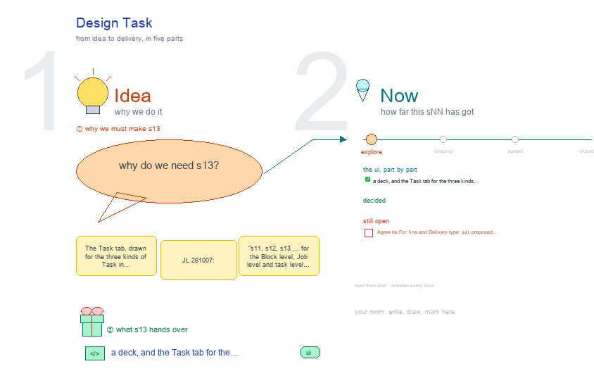

# s13 · Design Task <!-- root #a9e633 -->

**Stage:** explore

- For <!-- @for #f78806 -->
  - a deck, and the Task tab for … <!-- @for/0 #9b03c7 -->
    a deck, and the Task tab for the three kinds of design Task, for the people who build the workbench
- Delivery type <!-- @delivery-type #58a44f -->
  - ui <!-- @delivery-type/0 #636117 -->
- Topic <!-- @topic #7e13bd -->
  - The Task tab, drawn for the three … <!-- @topic/0 #ea778a -->
    The Task tab, drawn for the three kinds of Task in j03_<goal>_<design-method> (JL 261007: "s11, s12, s13 … for the Block level, Job level and task level … instead of nesting all the things together"), drawn the way b11 draws its levels (JL 261007: "check s11 s12 and s13 [of b11] … borrow their ideas").
  - Each step of the method is a … <!-- @topic/1 #664563 -->
    Each step of the method is a Task (s12, decided JL 261007), so a Job holds `t00_reason-ideas/` (②, one per Job), `t01_d01_<name>/` … `t15_d15_<name>/` (③ ④, one design each) and `t99_review-whole/` (⑤, one per Job).
  - One tab and the same six Spaces … <!-- @topic/2 #eab56b -->
    One tab and the same six Spaces serve all three; what each Space shows follows the Task's step.
- Proposed (261007) <!-- @proposed-261007 #e4f68e -->
  - One UI for every Task, with different … <!-- @proposed-261007/0 #f0bfb9 -->
    One UI for every Task, with different content (JL 261007: "different type of runs … the same UI, but different content?"): the tab, the six Spaces and the Runs panel are the same; a Task's run types decide what its Spaces show, because each view reads one run type's Result (the pop-out "run type → views"):
  - | Space | ② t00 reason ideas … <!-- @proposed-261007/1 #6e28be -->
    | Space | ② t00 reason ideas | ③ ④ a design (d04) | ⑤ t99 review whole | |---|---|---|---| | Description | Task: what it reads from `inputs/`, what it must return (15 ideas, each with a short name) | Design (the Job's design card, opened: the design as the reader sees it │ its process │ its review) · Evaluation | Task: what it reads, the rule (rank by predicted click-through, keep 10 of 15), who ranks | | Audience Report | Topics (the reasoning chains, one card per topic) · Ideas (I01 – I15, each with the design it became and what t99 did) | Tests (step ④, T0 – T3, from `inputs/method.md`) · Drafts (run-generate → run-verify v1 ✗ → revise → run-verify v2 ✓) · Performance (cost, length, a prediction frozen at release, the Exp's arm totals) | Ranking (`ranking.csv`) · Coverage (the 10 cover the goal, no two alike, every input used) | | Work Details | Chains (`chains.yaml`, a row per step) | Elements (`elements.yaml`: words · source · because · method step, the Rationale folded in) | Kept · Dropped, each opening its design | | Runs | `run-reason-t00` (hard); the Job's `run-open-designs-j03` read only | generate ③ · verify ④ (another agent) · revise · verify; t99's rank read only | `run-rank-t99` (hard, another agent) | | Idea Studio | drawings: the topic map · the idea spread | drawings: element options · draft 1 vs 2 | drawings: the 15 on a grid · near pairs | | Delivery | `ideas.yaml` to t01 – t15; nothing to the Block | released with the Job's Release (a person); the prediction freezes then | the 10 kept to Job › Delivery |
  - Every design has a short name, born … <!-- @proposed-261007/2 #bbe6f1 -->
    Every design has a short name, born with its idea in t00 (I04 reason-then-ask), so its Task is `t04_d04_reason-then-ask/` and its tab reads "Task · d04 · reason-then-ask". The Task dropdown lists the Job's Tasks by step, as Job › Work Details does; the dropped five are folded at the end.
  - Review against s11 and s12 (261007): the … <!-- @proposed-261007/3 #ab05e2 -->
    Review against s11 and s12 (261007): the Task now uses the Job's inputs fence and one Task per method step (s12), and the Block's rule that only arm totals come back (s11). s12 now agrees on release: its Performance view shows d04's prediction as a draft, frozen at release ⬜, as here. Still open in s12: inputs/ as relative symlinks plus sha256, or copies frozen at commission; either way a source is a file under inputs/, listed in the manifest.
- Decided (261007, JL) <!-- @decided-261007-jl #5223bd -->
  - ✎ 261007: every Run is named `run-<type>-<target>`, … <!-- @decided-261007-jl/0 #e91093 -->
    ✎ 261007: every Run is named `run-<type>-<target>`, hard ones too (JL: "unify the name to be run-xxx-xxx"): `run-reason-t00` · `run-generate-d<NN>` · `run-verify-d<NN>-v<k>` (v<k> = the draft it checks) · `run-rank-t99`; a looping method's second round is `run-reason-t00-r2` · `run-rank-t99-r2` (new inputs, so a new Run). Was `rNN_<type>_<target>`.
  - A design and its review are one … <!-- @decided-261007-jl/1 #e1f5d1 -->
    A design and its review are one Task with two Runs: `run-generate-d04/` (③) and `run-verify-d04-v1/` (④,
  - another agent), then `run-revise-d04` and a further … <!-- @decided-261007-jl/2 #f7f72a -->
    another agent), then `run-revise-d04` and a further verify, `run-verify-d04-v2/`. A new object is a new Task; another step on the same object is another Run. So a revision is a Run in this Task, never a new Task. Recorded with the Job's other decisions in `../s12-design-job/s12-design-job.md`.
  - Decided here (261007 <!-- @decided-261007-jl/3 #1676a3 -->
    Decided here (261007; JL: "have your own judgements"), each drawn as a green note under its screen:
  - The Job's `run-open-designs-j03` opens t01 – t15; … <!-- @decided-261007-jl/4 #68a823 -->
    The Job's `run-open-designs-j03` opens t01 – t15; t00 only writes `ideas.yaml`.
  - t00's reasoning keeps the fence: each step's … <!-- @decided-261007-jl/5 #575261 -->
    t00's reasoning keeps the fence: each step's from is a file in the manifest, or says "own knowledge";
  - the ④ ⑤ reviewer checks it before … <!-- @decided-261007-jl/6 #e02e15 -->
    the ④ ⑤ reviewer checks it before the design Tasks open.
  - A design keeps its short name through … <!-- @decided-261007-jl/7 #d35329 -->
    A design keeps its short name through a revise; a new idea is a new Task.
  - Verify is always a separate reviewer agent <!-- @decided-261007-jl/8 #094f93 -->
    Verify is always a separate reviewer agent. T2 critique runs per design inside ④; T3 pretest runs
  - once per Job, on the 10 kept <!-- @decided-261007-jl/9 #22c560 -->
  - Earlier drafts live only in the Runs … <!-- @decided-261007-jl/10 #4863ef -->
    Earlier drafts live only in the Runs (each generate or revise Run's result); no `drafts/` folder.
  - t99's rank writes each prediction; it is … <!-- @decided-261007-jl/11 #d1dac3 -->
    t99's rank writes each prediction; it is a draft until a person releases the design, frozen then.
  - A newer handoff never makes a released … <!-- @decided-261007-jl/12 #447488 -->
    A newer handoff never makes a released design stale: it is a new inputs version and a new Job.
  - The 5 dropped designs keep their Tasks, … <!-- @decided-261007-jl/13 #56c749 -->
    The 5 dropped designs keep their Tasks, marked dropped and folded.
  - The Rationale view is folded into Work … <!-- @decided-261007-jl/14 #4e8d06 -->
    The Rationale view is folded into Work Details › Elements.
  - **Source:** the screens are drawn by `../_build/design_ui.py`, … <!-- @decided-261007-jl/15 #04e7b1 -->
    **Source:** the screens are drawn by `../_build/design_ui.py`, shared by s11 · s12 · s13 (its `bands=` draws a level in bands, one per kind of folder) and borrowed from `../../b11_theme_insight/studio/_build/insight_ui.py`; the method cards are read from `servers/workbench-design/guide/methods/` at build time. The rows of b03 (proposed above today's served screens) stay in `../../b10_project_workbench/studio/` s11-block-variants, s12-job-variants and s13-task-variants.
  - **Feeds:** `../reports/` q01_design_ladder · q02_design_workbench <!-- @decided-261007-jl/16 #5755ae -->
- Files <!-- @files #6ce6c5 -->
  - [py] [build_s13_design_task.py](build_s13_design_task.py) <!-- @files/0 #4b3ce4 -->
  - delivery/ <!-- @files/1 #404761 -->
  - [excalidraw] [s13-design-task.excalidraw](s13-design-task.excalidraw) <!-- @files/2 #de3805 -->
  - [md] [s13-design-task.md](s13-design-task.md) <!-- @files/3 #e2294a -->
  - [png] [s13-design-task.png](s13-design-task.png) <!-- @files/4 #de75b6 -->
    
- Open <!-- @open #cf9b77 -->
  - Agree its **For:** line and **Delivery type:** … <!-- @open/0 #7b11a4 -->
    Agree its **For:** line and **Delivery type:** (ui), proposed by the agent 261030?
  - See the red boxes under each screen <!-- @open/1 #38faa2 -->
