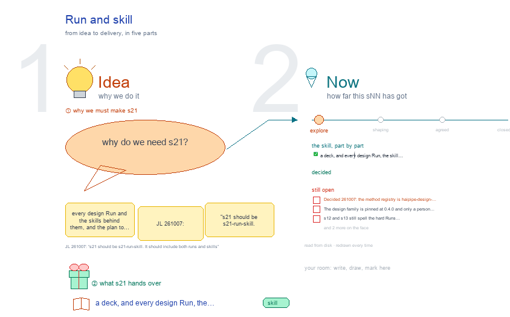

# s21 · Run and skill <!-- root #38dfa2 -->

**Stage:** explore

- For <!-- @for #f78806 -->
  - a deck, and every design Run, the … <!-- @for/0 #3e8aee -->
    a deck, and every design Run, the skill behind it, and the plan to update those skills, for the people who write the toolkit skills
- Delivery type <!-- @delivery-type #58a44f -->
  - skill <!-- @delivery-type/0 #34b33e -->
- Topic <!-- @topic #7e13bd -->
  - every design Run and the skills behind … <!-- @topic/0 #9f010e -->
    every design Run and the skills behind them, and the plan to make the skills carry the new ladder (JL 261007: "s21 should be s21-run-skill.
  - It should include both runs and skills"; … <!-- @topic/1 #5ff5fe -->
    It should include both runs and skills"; then "the current skill is not that powerful enough … make a plan to update the skills"; "a before after plan of the skill folders and what to change and why").
  - Drawn in b16's `s21-paper-run-skill` shape (JL 261007: … <!-- @topic/2 #bf5b52 -->
    Drawn in b16's `s21-paper-run-skill` shape (JL 261007: "this one is much better, follow it"): lines-only tables, black, red for what is open, green for what changed (the studio's three colours, 261007).
- Source <!-- @source #6da13a -->
  - read from disk on every build: <!-- @source/0 #497260 -->
- Feeds <!-- @feeds #ffe8e9 -->
  - `../reports/q01_design_ladder/` (the Runs per level) and `../reports/q02_design_workbench/` … <!-- @feeds/0 #8d2bad -->
    `../reports/q01_design_ladder/` (the Runs per level) and `../reports/q02_design_workbench/` (the Runs panel); a proposed Q04, "Which skill owns each part of the design ladder?".
- Files <!-- @files #6ce6c5 -->
  - [py] [build_s21_run_skill.py](build_s21_run_skill.py) <!-- @files/0 #99bbcd -->
  - delivery/ <!-- @files/1 #404761 -->
  - history/ <!-- @files/2 #9a00ab -->
  - [excalidraw] [s21-run-skill.excalidraw](s21-run-skill.excalidraw) <!-- @files/3 #2f3784 -->
  - [md] [s21-run-skill.md](s21-run-skill.md) <!-- @files/4 #713516 -->
  - [png] [s21-run-skill.png](s21-run-skill.png) <!-- @files/5 #fe13c8 -->
    
- What the drawing holds <!-- @what-the-drawing-holds #e0b05d -->
  - Every Run is named `run-<type>-<target>` (JL 261007: … <!-- @what-the-drawing-holds/0 #b32e82 -->
    Every Run is named `run-<type>-<target>` (JL 261007: "unify the name to be run-xxx-xxx"): hard or soft is its `kind:` and whether it has `result/`; a repeat names what it reads (`run-verify-d<NN>-v<k>`), never a counter. "as drawn" shows a level drawing's own spelling where it still differs (s12 · s13 write `rNN_<type>_<target>`).
  - "today" says where a Run stands: **card** … <!-- @what-the-drawing-holds/1 #ca3cbc -->
    "today" says where a Run stands: **card** (a run card names a button for it, though it is the old Space's), **screen** (the live workbench has the button, no card), **drawn** (only in the drawing).
- Finding (261007) <!-- @finding-261007 #59a794 -->
  - Of 22 Runs, 8 have an old … <!-- @finding-261007/0 #9b0702 -->
    Of 22 Runs, 8 have an old card, 1 is on the live screen and 13 are drawn only (Block 3 · 1 · 6, Job 3 · 0 · 4, Task 2 · 0 · 3). Even a carded Run's card is an old Space's button (Commission's Generate and Verify, Add design tasks), so no level of the new ladder runs on its own cards yet. The skills still write old names often: workbench-design 125 times, haipipe-design 78, haipipe-design-workflow 74, haipipe-design-unit 28. On disk, the 2 design boards hold only old-layout Runs (commission · generate · verify); none uses the ladder yet.
- Skill folders, before → after (proposed 261007) <!-- @skill-folders-before-after-proposed-261007 #937056 -->
  - Shaped like b16's paper plan: one ladder … <!-- @skill-folders-before-after-proposed-261007/0 #cf0f3e -->
    Shaped like b16's paper plan: one ladder contract in `ref/`, one scaffold script for every level.
  - The drawing's table gives every row its … <!-- @skill-folders-before-after-proposed-261007/1 #e3a7bb -->
    The drawing's table gives every row its what and its why; 6 files stay as they are.
- Skill update plan (proposed 261007) <!-- @skill-update-plan-proposed-261007 #04fa74 -->
  - **Contract** (haipipe-design): design-ladder.md as s11 – s13 … <!-- @skill-update-plan-proposed-261007/0 #2952fd -->
    **Contract** (haipipe-design): design-ladder.md as s11 – s13 draw it; scaffold Block · Job · t00 · tNN · t99,
  - every Run `run-<type>-<target>` <!-- @skill-update-plan-proposed-261007/1 #7c68df -->
    every Run `run-<type>-<target>`. Gains run-add-job, run-open-designs, run-close.
  - **Inputs and methods** (haipipe-design-goal, haipipe-design-method): the goal … <!-- @skill-update-plan-proposed-261007/2 #49e703 -->
    **Inputs and methods** (haipipe-design-goal, haipipe-design-method): the goal list with the Brief merged in,
  - rules, inputs versions, a Job's `inputs/` + … <!-- @skill-update-plan-proposed-261007/3 #afcf10 -->
    rules, inputs versions, a Job's `inputs/` + `manifest.yaml`; the 13 cards moved in from the Guide, versions with ① – ⑤ and T0 – T3, the scorecard.
  - **Worker** (haipipe-design-unit, agents): reason ② and rank … <!-- @skill-update-plan-proposed-261007/4 #c5bef2 -->
    **Worker** (haipipe-design-unit, agents): reason ② and rank ⑤ beside generate and verify; the Ticket pins
  - method + inputs; a reviewer agent verifies … <!-- @skill-update-plan-proposed-261007/5 #e3ab9d -->
    method + inputs; a reviewer agent verifies and ranks.
  - **Runs and release** (haipipe-design-workflow, haipipe-design-delivery): run cards … <!-- @skill-update-plan-proposed-261007/6 #036155 -->
    **Runs and release** (haipipe-design-workflow, haipipe-design-delivery): run cards by level × six Spaces;
  - routes; a design's state; the release, frozen … <!-- @skill-update-plan-proposed-261007/7 #a9fd30 -->
    routes; a design's state; the release, frozen predictions, `designs.json`.
  - **Screens** (workbench-design): the six Spaces × three … <!-- @skill-update-plan-proposed-261007/8 #e00d00 -->
    **Screens** (workbench-design): the six Spaces × three levels, run types read from the cards; the old page
  - stays for old boards <!-- @skill-update-plan-proposed-261007/9 #16a5d7 -->
  - **Old words out** (all): carry the old … <!-- @skill-update-plan-proposed-261007/10 #d2b6ee -->
    **Old words out** (all): carry the old boards over, the Brief retires, old refs into `legacy/`, versions.
- Applied (261007) <!-- @applied-261007 #504b1d -->
  - JL 261007: "go ahead and then apply … <!-- @applied-261007/0 #b2769d -->
    JL 261007: "go ahead and then apply them to update the skills". Phases 1 – 4 are in the skills; the drawing's "done" column checks each file against disk, and frame 1 now reads the ladder run cards (21 of 22 Runs carded; the 22nd, run-plan-test, stays outside the theme).
  - **Contract** (haipipe-design): door rewritten <!-- @applied-261007/1 #e8e902 -->
    **Contract** (haipipe-design): door rewritten; `ref/design-ladder.md` as s11 – s13 draw it; `design_ladder.py`
  - writes `jNN_g<NN>_m<NN>/`, `t00` · `tNN_d<NN>_<slug>` · `t99` … <!-- @applied-261007/2 #a73cf7 -->
    writes `jNN_g<NN>_m<NN>/`, `t00` · `tNN_d<NN>_<slug>` · `t99` and `run-<type>-<target>/` with `kind:`; the older Design Folder contract in `ref/legacy/`.
  - **Inputs and methods**: haipipe-design-goal rewritten (`make_inputs.py`: freeze … <!-- @applied-261007/3 #13a814 -->
    **Inputs and methods**: haipipe-design-goal rewritten (`make_inputs.py`: freeze iN, build a Job's fence from the
  - method's `sees:`); new haipipe-design-method (M01 – M05, … <!-- @applied-261007/4 #c53560 -->
    method's `sees:`); new haipipe-design-method (M01 – M05, versions, `pin_method.py`, `score_exp.py`); the Brief kept as legacy for older boards.
  - **Worker**: haipipe-design-unit as one method step (reason … <!-- @applied-261007/5 #aeb18d -->
    **Worker**: haipipe-design-unit as one method step (reason · generate · verify · rank), `check_unit.py
  - --ladder-result`; a new haipipe-design-reviewer-agent <!-- @applied-261007/6 #6f0a19 -->
  - **Runs and release**: haipipe-design-workflow rewritten, 30 ladder … <!-- @applied-261007/7 #c13fa5 -->
    **Runs and release**: haipipe-design-workflow rewritten, 30 ladder cards (the older board's 13 kept below them,
  - still parsed by the old page), `project_predictions.py`; … <!-- @applied-261007/8 #66b9bf -->
    still parsed by the old page), `project_predictions.py`; new haipipe-design-delivery (`release.py`).
  - Checked: 95 tests pass (4 browser renders … <!-- @applied-261007/9 #877cc5 -->
    Checked: 95 tests pass (4 browser renders skipped); one Job runs end to end through every script and the workbench's reader reads it; the release refuses a ranked Job whose ranking was not projected.
  - Not done: phase 5 (design_views.py reading its … <!-- @applied-261007/10 #cdcfe8 -->
    Not done: phase 5 (design_views.py reading its buttons from the cards, the Guide and design_reader.py reading the method registry; another session owns those files) and phase 6 (the carry-over of the older boards; the version). design_reader.py now reads `kind:` from a Run's run.yaml (one line), so a hard `run-<type>-<target>` reads as hard.
- Reviewed and fixed (261007, second round) <!-- @reviewed-and-fixed-261007-second-round #c1a9e8 -->
  - JL 261007: "go ahead and continue, could … <!-- @reviewed-and-fixed-261007-second-round/0 #aba1c6 -->
    JL 261007: "go ahead and continue, could you review them again?". Two fresh-context reviews: a cold read of every design skill (26 must-fix, 14 nice-to-have) and a hands-on run of the skills on a placeholder Job. Fixed:
  - **Projection has an owner**: `haipipe-design-workflow/scripts/project_draft.py` (draft → … <!-- @reviewed-and-fixed-261007-second-round/1 #60166b -->
    **Projection has an owner**: `haipipe-design-workflow/scripts/project_draft.py` (draft → the face's ## Design and
  - elements.yaml; verdict → state passed | revise) <!-- @reviewed-and-fixed-261007-second-round/2 #cbe44d -->
    elements.yaml; verdict → state passed | revise). Hard Runs write only result/; the workflow writes the Task.
  - **Verify names the draft it read** (`-v<k>`, … <!-- @reviewed-and-fixed-261007-second-round/3 #656ca2 -->
    **Verify names the draft it read** (`-v<k>`, k = 1 + revise passes), never a counter; a verify of an older draft
  - is refused <!-- @reviewed-and-fixed-261007-second-round/4 #83be7e -->
  - **Gates in the scripts**: run-add-job needs a … <!-- @reviewed-and-fixed-261007-second-round/5 #757024 -->
    **Gates in the scripts**: run-add-job needs a signed goal, signed shared rules, a registered method version and the
  - inputs version <!-- @reviewed-and-fixed-261007-second-round/6 #3eab61 -->
    inputs version; N is the goal's; the fence is not built before the method is pinned; a run type must fit its folder.
  - **The fence (T1) is strict**: a `from` … <!-- @reviewed-and-fixed-261007-second-round/7 #749c90 -->
    **The fence (T1) is strict**: a `from` names a fence file (or `rule r2.1`, `W-03 row 2`) or is exactly
  - `own knowledge`; a step may cite its … <!-- @reviewed-and-fixed-261007-second-round/8 #5e8f53 -->
    `own knowledge`; a step may cite its own source; ideas carry a `name`; a verify needs a `by:`.
  - **Release** refuses the scaffold's unfilled words and … <!-- @reviewed-and-fixed-261007-second-round/9 #51884d -->
    **Release** refuses the scaffold's unfilled words and a ranked Job whose ranking was not projected, checks every
  - design before writing anything, and puts screens … <!-- @reviewed-and-fixed-261007-second-round/10 #3b159c -->
    design before writing anything, and puts screens where both delivery folders can find them.
  - **One answer per contradiction**: T2 when the … <!-- @reviewed-and-fixed-261007-second-round/11 #3e38d2 -->
    **One answer per contradiction**: T2 when the method lists it, T3 in t99's rank; `arms.csv` column `observed`;
  - run-report is haipipe-report's; a person signs the … <!-- @reviewed-and-fixed-261007-second-round/12 #4507a8 -->
    run-report is haipipe-report's; a person signs the goal, the rules, the freeze with the release, and the close; the fence check is a reviewer-written pass of run-open-designs; run.yaml carries haipipe-run's card fields.
  - **Server and drawings**: the workbench reads the … <!-- @reviewed-and-fixed-261007-second-round/13 #b90155 -->
    **Server and drawings**: the workbench reads the method registry and the run cards (phase 5); s11 · s12 · s13 use
  - the unified Run names; the Workbench Table … <!-- @reviewed-and-fixed-261007-second-round/14 #8bfbd1 -->
    the unified Run names; the Workbench Table is generated from the ladder cards (`workbench-design/scripts/ cards_table.py`); the venue packs speak the ladder's words.
  - Checked: every design test suite passes, the … <!-- @reviewed-and-fixed-261007-second-round/15 #e107eb -->
    Checked: every design test suite passes, the server's design tests pass, and one Job runs end to end through every gate (each refusal fires in turn; a failed draft is revised, verified as v2, released with its revised words).
  - Left on purpose: haipipe-project's audit does not … <!-- @reviewed-and-fixed-261007-second-round/16 #780e4f -->
    Left on purpose: haipipe-project's audit does not check `designs/` (its own choice: "design keeps its family layout"); the older board pages and legacy refs keep the older words.
- Open <!-- @open #cf9b77 -->
  - Decided 261007: the method registry is `haipipe-design-method/methods/`; … <!-- @open/0 #2fa87e -->
    Decided 261007: the method registry is `haipipe-design-method/methods/`; s12's note and design_reader.py's comment
  - still say `haipipe-design-unit/methods/` <!-- @open/1 #97f21a -->
  - The design family is pinned at 0.4.0 … <!-- @open/2 #057ae1 -->
    The design family is pinned at 0.4.0 and only a person may change it: 0.5.0 for this rewrite?
  - s12 and s13 still spell the hard … <!-- @open/3 #2f6909 -->
    s12 and s13 still spell the hard Runs `rNN_<type>_<target>`: rename them in their builders.
  - Plan the test (`run-plan-test-<app>`): a design Run, … <!-- @open/4 #6baa0d -->
    Plan the test (`run-plan-test-<app>`): a design Run, or outside the theme with the Exp?
  - Agree its **For:** line and **Delivery type:** … <!-- @open/5 #09a2ba -->
    Agree its **For:** line and **Delivery type:** (skill), proposed by the agent 261030?
