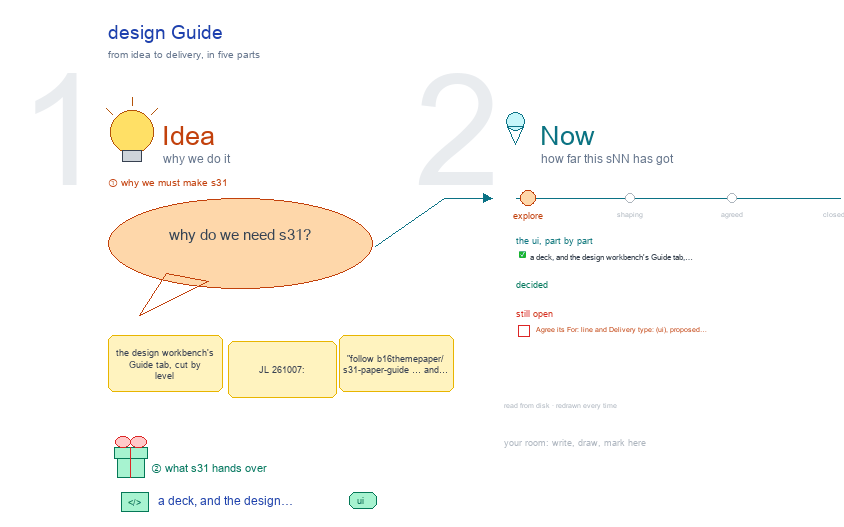

# s31 · design Guide <!-- root #28fff9 -->

**Stage:** explore

- For <!-- @for #f78806 -->
  - a deck, and the design workbench's Guide … <!-- @for/0 #faa1de -->
    a deck, and the design workbench's Guide tab, cut by level, for the people who build the workbench
- Delivery type <!-- @delivery-type #58a44f -->
  - ui <!-- @delivery-type/0 #636117 -->
- Topic <!-- @topic #7e13bd -->
  - the design workbench's Guide tab, cut by … <!-- @topic/0 #311c12 -->
    the design workbench's Guide tab, cut by level (JL 261007: "follow b16_theme_paper/s31-paper-guide … and Tools/blueprints/Project-Ladder/work/b10_project_workbench/s31-guide"), in the style of b03's s31-guide: four Views, Description · Method · RoadMap Draw · Related Paper, each in three folding sections Block · Job · Task, its items as cards of one shape per View.
  - One frame per level: the four Views … <!-- @topic/1 #d6a9ab -->
    One frame per level: the four Views opened from that level's tab, its section open and the other two folded, "on disk" under each, then that level's open points in red.
- Source <!-- @source #6da13a -->
  - read at build time from the live … <!-- @source/0 #e6710b -->
    read at build time from the live design Guide (`servers/workbench-design/guide/guide.yaml`, `guide/method.md`: the six steps, the 13 method cards, the five tests;
  - `related/papers.md`: its group column) and the design … <!-- @source/1 #2c68db -->
    `related/papers.md`: its group column) and the design theme's Spaces on the frame, over a placeholder design ladder that the design scaffold makes in a temp folder, by `design_guide_live.py`.
  - Each level's file adds its proposals, marked … <!-- @source/2 #5ceac6 -->
    Each level's file adds its proposals, marked "?" (red), from s00 and s11 to s13.
  - The screen and card shapes are s31's … <!-- @source/3 #f296ab -->
    The screen and card shapes are s31's (`../../b10_project_workbench/s31-guide/`); the builder is b16's s31, with the design Guide's words.
- Feeds <!-- @feeds #ffe8e9 -->
  - `../reports/` q01_design_ladder · q02_design_workbench; the proposed Guide … <!-- @feeds/0 #ef60a5 -->
    `../reports/` q01_design_ladder · q02_design_workbench; the proposed Guide text goes into `guide.yaml` (a `levels:` section) and `method.md` once JL agrees.
- Files <!-- @files #6ce6c5 -->
  - [py] [build_s31_design_guide.py](build_s31_design_guide.py) <!-- @files/0 #a9cb55 -->
  - delivery/ <!-- @files/1 #404761 -->
  - [py] [design_guide_live.py](design_guide_live.py) <!-- @files/2 #eb9eb7 -->
  - [py] [guide_block.py](guide_block.py) <!-- @files/3 #df25fe -->
  - [py] [guide_job.py](guide_job.py) <!-- @files/4 #d0e324 -->
  - [py] [guide_task.py](guide_task.py) <!-- @files/5 #16734f -->
  - [excalidraw] [s31-design-guide.excalidraw](s31-design-guide.excalidraw) <!-- @files/6 #4aa761 -->
  - [md] [s31-design-guide.md](s31-design-guide.md) <!-- @files/7 #b7d8be -->
  - [png] [s31-design-guide.png](s31-design-guide.png) <!-- @files/8 #731ec2 -->
    
- Proposed (261007) <!-- @proposed-261007 #e4f68e -->
  - Block: a step 0, Set the inputs … <!-- @proposed-261007/0 #035505 -->
    Block: a step 0, Set the inputs (rules · theory · handoff as one version a Job pins); step 1 split,
  - the goal list on the Block and … <!-- @proposed-261007/1 #7f21af -->
    the goal list on the Block and each goal's aim and N on its Job; a step 7, Score the predictions (predicted against observed per method version, its verdicts sent to the methods Block). The Block's RoadMap Draw lists s00, s01, s11 and s02.
  - Job: the thirteen method cards; check overall … <!-- @proposed-261007/2 #bb67f0 -->
    Job: the thirteen method cards; check overall (the method's part 5) on the N together; a card grows
  - from three parts to the design unit's … <!-- @proposed-261007/3 #9e1d40 -->
    from three parts to the design unit's five; the Job pins a method version, method.md is not copied. Its papers show under each method card.
  - Task: step 4 and the five tests … <!-- @proposed-261007/4 #41b162 -->
    Task: step 4 and the five tests T0 to T4; a step for the sources (T1: every cited source is in the
  - Job's inputs/manifest.yaml); a step for the numbers … <!-- @proposed-261007/5 #c242ef -->
    Job's inputs/manifest.yaml); a step for the numbers (tokens, time, rounds, length, a prediction that is a draft until a person releases the design, frozen then); draft 1 comes from the Job's Generate; T4 comes back as totals for an arm that names its design, never rows.
  - Across levels: the six steps' "where today" … <!-- @proposed-261007/6 #8cd901 -->
    Across levels: the six steps' "where today" names the old board and page; the design Guide gains a
  - `levels:` section in guide.yaml and a level … <!-- @proposed-261007/7 #5f8618 -->
    `levels:` section in guide.yaml and a level column in method.md and papers.md, as the paper Guide has.
- Open <!-- @open #cf9b77 -->
  - Agree its **For:** line and **Delivery type:** … <!-- @open/0 #7b11a4 -->
    Agree its **For:** line and **Delivery type:** (ui), proposed by the agent 261030?
  - See each frame's red "open at the … <!-- @open/1 #788e77 -->
    See each frame's red "open at the … level" lines.
