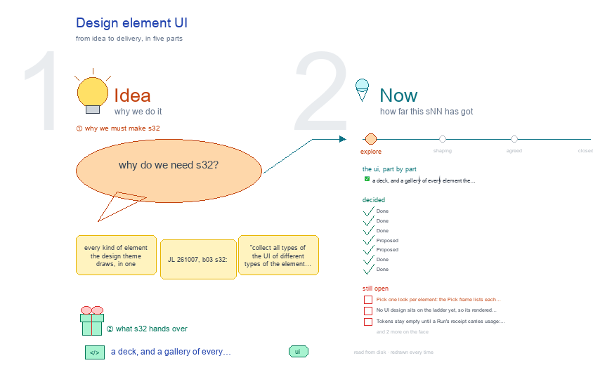

# s32 · Design element UI <!-- root #d8f49a -->

**Stage:** explore

- For <!-- @for #f78806 -->
  - a deck, and a gallery of every … <!-- @for/0 #e85350 -->
    a deck, and a gallery of every element the design theme draws, so the UI can be unified, for the people who build the workbench
- Delivery type <!-- @delivery-type #58a44f -->
  - ui <!-- @delivery-type/0 #636117 -->
- Topic <!-- @topic #7e13bd -->
  - every kind of element the design theme … <!-- @topic/0 #f257d9 -->
    every kind of element the design theme draws, in one gallery, so the UI can be unified (JL 261007, b03 s32: "collect all types of the UI of different types of the element ... so we can unify them").
  - Each element is shown three ways: as … <!-- @topic/1 #a5e7c3 -->
    Each element is shown three ways: as the design theme draws it today on the frame (`/_board/workbench` at its Block, Job and Task levels, every Space and view), as its old board and item pages draw it (flagged OLD), and as s11 · s12 · s13 plan it.
  - Beside each element, a "· proposed" frame: … <!-- @topic/2 #888931 -->
    Beside each element, a "· proposed" frame: one look, b03's picks kept, with why, a green line for what changed and a red line for what is open.
  - It is b03's `s32-element-ui` cut to one … <!-- @topic/3 #91313a -->
    It is b03's `s32-element-ui` cut to one theme, and it adds the elements that only design has.
- Feeds <!-- @feeds #ffe8e9 -->
  - `../reports/` q02_design_workbench · and b03's s32 (its … <!-- @feeds/0 #df6edd -->
    `../reports/` q02_design_workbench · and b03's s32 (its Theme elements list).
- Files <!-- @files #6ce6c5 -->
  - [py] [build_s32_design_element_ui.py](build_s32_design_element_ui.py) <!-- @files/0 #ccc416 -->
  - delivery/ <!-- @files/1 #404761 -->
  - [excalidraw] [s32-design-element-ui.excalidraw](s32-design-element-ui.excalidraw) <!-- @files/2 #61e9c2 -->
  - [md] [s32-design-element-ui.md](s32-design-element-ui.md) <!-- @files/3 #c2e04d -->
  - [png] [s32-design-element-ui.png](s32-design-element-ui.png) <!-- @files/4 #ba34c7 -->
    
  - shots/ <!-- @files/5 #4d5052 -->
- What the gallery holds <!-- @what-the-gallery-holds #69fd53 -->
  - The OLD pages are the design board … <!-- @what-the-gallery-holds/0 #af7795 -->
    The OLD pages are the design board page (`/_board/design-board`, the B01 and B00 boards) and the design item page (`/_board/design`, one design task; one AuthenUI login card). Both boards moved into `designs/_old/` on 261008. The frame on an older board (B01 at Block level, and one Design Folder that embeds its old item page) is the current frame, so it is not flagged.
- Theme elements <!-- @theme-elements #bfa59f -->
  - element · level · Space › view … <!-- @theme-elements/0 #bbee5c -->
    element · level · Space › view · from the base, or the theme's own and why · drawn today (GAP = open)
  - top tabs · every level · the … <!-- @theme-elements/1 #84f59b -->
    top tabs · every level · the level row and the six Spaces · the base; the Task select by step through
  - the theme's `option()` hook ("Task · d04 … <!-- @theme-elements/2 #b3e886 -->
    the theme's `option()` hook ("Task · d04 · ask-only", grouped ② · ③ · ⑤) · yes
  - view row · every level · every … <!-- @theme-elements/3 #61b63e -->
    view row · every level · every Space's views · the base · yes (one casing: Reason ideas · Conduct &
  - review · Review whole) <!-- @theme-elements/4 #ba100c -->
  - Question rows · Block · Audience Report … <!-- @theme-elements/5 #a830c5 -->
    Question rows · Block · Audience Report › Questions · the base (Insight's row) · yes
  - Question-style row · Block, Job, Task · … <!-- @theme-elements/6 #edc5d3 -->
    Question-style row · Block, Job, Task · Predicted vs observed; Description › Design · the base row,
  - with the columns Design │ Predicted │ … <!-- @theme-elements/7 #01a57f -->
    with the columns Design │ Predicted │ Observed · yes
  - Space body and Disk · Runs · … <!-- @theme-elements/8 #62f68b -->
    Space body and Disk · Runs · every level · every Space · the base · yes
  - table · every level · Map, Inputs, … <!-- @theme-elements/9 #db9732 -->
    table · every level · Map, Inputs, Cost, Ranking, Ideas, Elements, Tests, Runs, the Block's Job
  - preview, Delivery, Drafts · the base (wf-table; … <!-- @theme-elements/10 #c24836 -->
    preview, Delivery, Drafts · the base (wf-table; no tile grid) · yes
  - folding row (the "card" of s11 · … <!-- @theme-elements/11 #4e34ed -->
    folding row (the "card" of s11 · s12) · Block, Job, Task · Goals, Methods, Inputs, Runs, Method,
  - Kept · Dropped, Conduct & review (a … <!-- @theme-elements/12 #234f35 -->
    Kept · Dropped, Conduct & review (a row per design Task) · the base row · yes (dropped: plain, folded)
  - Runs panel · every level · every … <!-- @theme-elements/13 #c8563e -->
    Runs panel · every level · every Space · the base (4 rows per type, then +N more) · yes
  - tags · none (b03 s32-D09) · an … <!-- @theme-elements/14 #4fd442 -->
    tags · none (b03 s32-D09) · an id is mono text, its words after it · yes (chips removed)
  - header · every level · the top … <!-- @theme-elements/15 #bf45a9 -->
    header · every level · the top line · the base · yes
  - design card (Design │ Process │ Review) … <!-- @theme-elements/16 #d14435 -->
    design card (Design │ Process │ Review) · Job, Task · Audience Report › Design display; Task
  - Description › Design · its own: a … <!-- @theme-elements/17 #0581d5 -->
    Description › Design · its own: a design is read three ways side by side · yes
  - Design display · Job · Audience Report … <!-- @theme-elements/18 #024f7b -->
    Design display · Job · Audience Report › Design display · its own: the N designs in order, the
  - dropped folded · yes <!-- @theme-elements/19 #ac5337 -->
  - design as it reads · Block, Job, … <!-- @theme-elements/20 #990b9b -->
    design as it reads · Block, Job, Task · Design display, Drafts, Predicted vs observed, Delivery, the
  - Block's Job preview · its own (b03 … <!-- @theme-elements/21 #c50e7d -->
    Block's Job preview · its own (b03 261008): an SMS on a phone, a UI design as its screens/ PNG · yes · GAP: no UI design on the ladder yet to show the screen with
  - goal × method Map · Block · … <!-- @theme-elements/22 #3cce55 -->
    goal × method Map · Block · Description › Map, and its compare pop-out · its own: Jobs placed by
  - goal and method, a column per registered … <!-- @theme-elements/23 #f45383 -->
    goal and method, a column per registered method · yes
  - inputs fence · Block, Job · Description … <!-- @theme-elements/24 #3be79c -->
    inputs fence · Block, Job · Description › Inputs · its own: what the design work may see · yes
  - Reason ideas (chains) · Job, t00 · … <!-- @theme-elements/25 #1ea01c -->
    Reason ideas (chains) · Job, t00 · Audience Report › Reason ideas; t00 › Topics, Chains · its own:
  - step ②'s topics and chains · yes <!-- @theme-elements/26 #a5d0a1 -->
  - Review whole (ranking) · Job, t99 · … <!-- @theme-elements/27 #a8cf44 -->
    Review whole (ranking) · Job, t99 · Audience Report › Review whole; t99 › Ranking, Coverage,
  - Kept · Dropped · the base table … <!-- @theme-elements/28 #c71371 -->
    Kept · Dropped · the base table and its kept line · yes
  - Tests (④) · Task · Audience Report … <!-- @theme-elements/29 #be488e -->
    Tests (④) · Task · Audience Report › Tests; Description › Evaluation · the base table · yes
  - predicted vs observed, scorecard, cost · Block, … <!-- @theme-elements/30 #1e6da1 -->
    predicted vs observed, scorecard, cost · Block, Job, Task · Audience Report views; Performance · the
  - base table and the phone · yes … <!-- @theme-elements/31 #e66744 -->
    base table and the phone · yes · GAP: tokens are empty until the Run receipt has `usage:`
  - Idea Studio · every level · Idea … <!-- @theme-elements/32 #5d5f87 -->
    Idea Studio · every level · Idea Studio · the base (b03 s32-D06) · yes
  - one design's own page · old · … <!-- @theme-elements/33 #0a73ee -->
    one design's own page · old · `/_board/design` · retires: a design is a Task · old page
- Decided <!-- @decided #55615a -->
  - s32-D01 · Done (261008): b03's picks hold … <!-- @decided/0 #7b9b83 -->
    s32-D01 · Done (261008): b03's picks hold for the design theme too: top tabs in the D · E look, the view row in the E look, the Question cell as the Insight row, Disk inside the Runs panel, no tags (b03 s32-D01, D02, D05, D08, D09). The design theme gives the words, and the layout of its own elements only.
  - s32-D02 · Done (261008): the ladder levels … <!-- @decided/1 #d06dff -->
    s32-D02 · Done (261008): the ladder levels are shot live from the design tests' sample Project, served by its own host for the shoot, until a Project holds a design Block on the ladder. The old pages are shot from the SPACE's host and flagged OLD (`old_reason`, read off the code).
  - s32-D03 · Done (261008, asked by b03 … <!-- @decided/2 #268a5e -->
    s32-D03 · Done (261008, asked by b03 for JL): each element also shows its planned screen, drawn by s11 · s12 · s13's own builder functions (`../_build/design_ui.py`), so the gallery follows the level designs on every rebuild.
  - s32-D04 · Proposed (261008): six elements are … <!-- @decided/3 #4d3154 -->
    s32-D04 · Proposed (261008): six elements are the design theme's own (12 – 17). Each is proposed as the frame draws it today, built on the base's table, row and box. Only the phone's look is new, and it should move into the base's styles (Open 3).
  - s32-D05 · Proposed (261008): one design opens … <!-- @decided/4 #22e7cd -->
    s32-D05 · Proposed (261008): one design opens as its own Task (s13), and the design item page retires. An older Design Folder keeps its old item view inside the frame until it moves onto the ladder (b03 s32-D11).
  - s32-D06 · Done (261008, b03's rulings on … <!-- @decided/5 #dbf897 -->
    s32-D06 · Done (261008, b03's rulings on the nine gaps): the Task select is grouped by step through the theme's `option()` hook (`design_theme.option`); the Runs panel pages at 4 per type (base). In the design theme (`design_views.py`): no chips, an id in mono with its words; the tile grid replaced by the base table; the dropped designs plain and folded; a Map column per registered method; Job › Runs › Conduct & review one row per design Task; one casing for the Job's views; a UI design shows its `screens/` PNG where an SMS shows the phone. Tested in `test_design_ladder.py` (`test_the_b12_s32_rulings`).
  - s32-D07 · Done (261011, JL on a … <!-- @decided/6 #64cb54 -->
    s32-D07 · Done (261011, JL on a pre-visit questionnaire drawn as a text message: "I don't think this should be the message ... It is not message"): a design is drawn in its goal's channel (the goal's `venue:`), never as an SMS by default. A phone bubble only for sms, push and reminder (labelled so); tick boxes with the day labels for a checklist; numbered questions with answer boxes (sentence · sentences · time · yes-no · choice) for the new questionnaire channel (`skills/2_theme/design/venue/venue-questionnaire/`); a card named by its channel for the rest. A Block whose goals name no venue stays an SMS. `servers/workbench-design/design_views.as_read` draws it, `design_reader.venue_of` finds the channel from the Job's goal pin.
- Open <!-- @open #cf9b77 -->
  - Pick one look per element: the Pick … <!-- @open/0 #3c9055 -->
    Pick one look per element: the Pick frame lists each one, with b03's picks in green and the
  - proposal in red <!-- @open/1 #f36c8e -->
  - No UI design sits on the ladder … <!-- @open/2 #49f8c8 -->
    No UI design sits on the ladder yet, so its rendered screen is tested but not shot.
  - Tokens stay empty until a Run's receipt … <!-- @open/3 #acb6bb -->
    Tokens stay empty until a Run's receipt carries `usage:` (another owner, s11).
  - When `designs/Design-SMSR2-Stage25-CarryOver-261008/` (new 261008, still empty when … <!-- @open/4 #7d537d -->
    When `designs/Design-SMSR2-Stage25-CarryOver-261008/` (new 261008, still empty when this was shot)
  - holds the ladder, shoot its live pages … <!-- @open/5 #67b231 -->
    holds the ladder, shoot its live pages instead of the sample Project's.
  - Agree its **For:** line and **Delivery type:** … <!-- @open/6 #7b11a4 -->
    Agree its **For:** line and **Delivery type:** (ui), proposed by the agent 261030?
