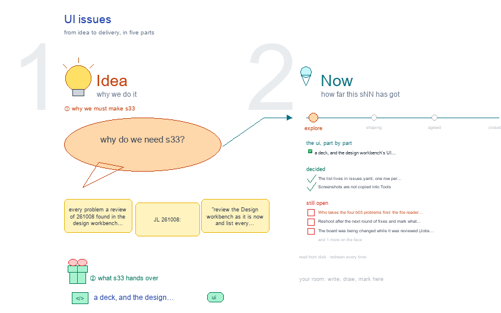

# s33 · UI issues <!-- root #41bf78 -->

**Stage:** explore

- For <!-- @for #f78806 -->
  - a deck, and the design workbench's UI … <!-- @for/0 #1593f1 -->
    a deck, and the design workbench's UI problems, ranked worst first with who fixes each, for the people who build the workbench
- Delivery type <!-- @delivery-type #58a44f -->
  - ui <!-- @delivery-type/0 #636117 -->
- Topic <!-- @topic #7e13bd -->
  - every problem a review of 261008 found … <!-- @topic/0 #da175c -->
    every problem a review of 261008 found in the design workbench as served, ranked worst first, each with where it is, what is wrong, what it should be, its evidence and who owns the fix (JL 261008: "review the Design workbench as it is now and list every problem ... we can call it s33-ui-issue").
  - The review opened the live design Block … <!-- @topic/1 #d7b264 -->
    The review opened the live design Block (`examples-5-design/Project-Application-SMSDesign/designs/Design-SMSR2-Stage25-CarryOver-261008/`) at every level, Space and view, shot each with headless Chrome, fetched every link, and checked the Disk box against the files.
  - It is the list the level owners … <!-- @topic/2 #cf182f -->
    It is the list the level owners work down; a fix is marked in `issues.yaml` and the drawing rebuilt, so the topic shows what is still open.
- Feeds <!-- @feeds #ffe8e9 -->
  - `reports/` q02_design_workbench <!-- @feeds/0 #9533a3 -->
- Files <!-- @files #6ce6c5 -->
  - [py] [build_s33_ui_issue.py](build_s33_ui_issue.py) <!-- @files/0 #c6e8a6 -->
  - delivery/ <!-- @files/1 #404761 -->
  - [yaml] [issues.yaml](issues.yaml) <!-- @files/2 #6dd27d -->
  - passes/ <!-- @files/3 #49b302 -->
  - [excalidraw] [s33-ui-issue.excalidraw](s33-ui-issue.excalidraw) <!-- @files/4 #6015d4 -->
  - [md] [s33-ui-issue.md](s33-ui-issue.md) <!-- @files/5 #091a24 -->
  - [png] [s33-ui-issue.png](s33-ui-issue.png) <!-- @files/6 #0bff2b -->
    
- Owners <!-- @owners #4eaec4 -->
  - The worst five: every plain `.md` link … <!-- @owners/0 #edba8b -->
    The worst five: every plain `.md` link opens a 404 "Not a Page" (b03); Disk-box `.md` rows leave the frame (b03); kept designs count as not passed, so the furthest-along Jobs read "0 of 10 passed" (s11); the Disk box says "not yet" for Runs that exist, because it still uses the old Run names (s12, s13).
- Decided <!-- @decided #55615a -->
  - s33-D01 · The list lives in `issues.yaml`, … <!-- @decided/0 #7e2036 -->
    s33-D01 · The list lives in `issues.yaml`, one row per problem; the drawing is built from it, never edited by hand (261008).
  - s33-D02 · Screenshots are not copied into … <!-- @decided/1 #5b50cd -->
    s33-D02 · Screenshots are not copied into Tools: they show the live Block's messages. Evidence names a view and a file and line, so anyone can reshoot it (261008).
- Open <!-- @open #cf9b77 -->
  - Who takes the four b03 problems first: … <!-- @open/0 #cf5936 -->
    Who takes the four b03 problems first: the file reader (any `.md` read-only in the pop-out) unblocks
  - every level <!-- @open/1 #da7003 -->
  - Reshoot after the next round of fixes … <!-- @open/2 #21a313 -->
    Reshoot after the next round of fixes and mark what closed (`fixed: <YYMMDD>`).
  - The board was being changed while it … <!-- @open/3 #d11640 -->
    The board was being changed while it was reviewed (Jobs renamed, j03 ranked): recheck the counts once it
  - settles <!-- @open/4 #10d949 -->
  - Agree its **For:** line and **Delivery type:** … <!-- @open/5 #7b11a4 -->
    Agree its **For:** line and **Delivery type:** (ui), proposed by the agent 261030?
