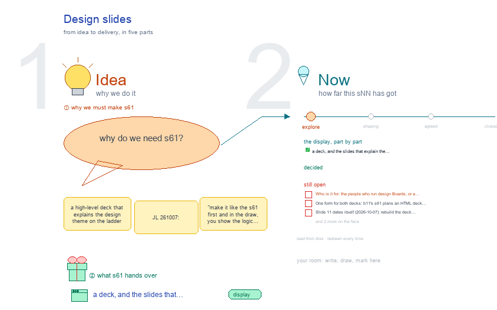

# s61 · Design slides <!-- root #d081b6 -->

**Stage:** explore

- For <!-- @for #f78806 -->
  - a deck, and the slides that explain … <!-- @for/0 #dfa10d -->
    a deck, and the slides that explain the design theme on the ladder, for people new to the toolkit
- Delivery type <!-- @delivery-type #58a44f -->
  - display <!-- @delivery-type/0 #59b189 -->
- Topic <!-- @topic #7e13bd -->
  - a high-level deck that explains the design … <!-- @topic/0 #5aa909 -->
    a high-level deck that explains the design theme on the ladder (JL 261007: "make it like the s61 first and in the draw, you show the logic flow, and then make it as the ppt slide"), the design side of b11's s61.
  - The deck's logic is drawn first; the … <!-- @topic/1 #8c2d11 -->
    The deck's logic is drawn first; the slides follow it.
  - One idea runs through it: a design … <!-- @topic/2 #a4176d -->
    One idea runs through it: a design Job changes one thing at a time, so when the designs change we can say why, and the Exp can teach the method, not only the designs.
- Source <!-- @source #6da13a -->
  - the content of every slide is `slides.py` … <!-- @source/0 #b2ff30 -->
    the content of every slide is `slides.py` (title, bullets, picture, the drawings it comes from, the reason the next slide follows, speaker notes), drawn from this Block's s00, s01, s03, s11, s12, s13, s21 and `../goals/g01-design-workbench.md`.
  - `slide_kit.py` lays a slide out once; the … <!-- @source/1 #3bcc50 -->
    `slide_kit.py` lays a slide out once; the drawing and the deck both draw with it, so the storyboard and the deck cannot drift apart.
- Feeds <!-- @feeds #ffe8e9 -->
  - `../reports/` q01_design_ladder · q02_design_workbench · q03_insight_steers_design <!-- @feeds/0 #043e3c -->
- Files <!-- @files #6ce6c5 -->
  - [py] [build_deck.py](build_deck.py) <!-- @files/0 #2dc476 -->
  - [py] [build_s61_design_slides.py](build_s61_design_slides.py) <!-- @files/1 #46d562 -->
  - delivery/ <!-- @files/2 #404761 -->
  - [excalidraw] [s61-design-slides.excalidraw](s61-design-slides.excalidraw) <!-- @files/3 #d03cb9 -->
  - [md] [s61-design-slides.md](s61-design-slides.md) <!-- @files/4 #958ea1 -->
  - [png] [s61-design-slides.png](s61-design-slides.png) <!-- @files/5 #9a7ef4 -->
    
  - [py] [slide_kit.py](slide_kit.py) <!-- @files/6 #6264f0 -->
  - [py] [slides.py](slides.py) <!-- @files/7 #1ccd5d -->
- What the drawing holds <!-- @what-the-drawing-holds #e0b05d -->
  - **logic flow**: one box per slide, top … <!-- @what-the-drawing-holds/0 #94c3d3 -->
    **logic flow**: one box per slide, top to bottom, its claim and the drawings it comes from; the words
  - on each arrow say why the next … <!-- @what-the-drawing-holds/1 #3ef4e9 -->
    on each arrow say why the next slide follows; the five groups bracket them: why (the pain) · what (the idea and the ladder) · how (one Job, kept honest) · learn (the loops that improve it) · now (where you see it, where it stands).
  - **storyboard**: every slide at half size, drawn … <!-- @what-the-drawing-holds/2 #19428c -->
    **storyboard**: every slide at half size, drawn by the deck's own layout.
  - **open**: what is still to decide, in … <!-- @what-the-drawing-holds/3 #86ea6e -->
    **open**: what is still to decide, in red.
  - The deck, slide by slide: <!-- @what-the-drawing-holds/4 #da61ff -->
- Open <!-- @open #cf9b77 -->
  - Who is it for: the people who … <!-- @open/0 #bfb9da -->
    Who is it for: the people who run design Boards, or a wider room? It decides the depth.
  - One form for both decks: b11's s61 … <!-- @open/1 #715000 -->
    One form for both decks: b11's s61 plans an HTML deck and a PDF; this one is a .pptx and a PDF.
  - Slide 11 dates itself (2026-10-07): rebuild the … <!-- @open/2 #c8a19d -->
    Slide 11 dates itself (2026-10-07): rebuild the deck before each showing.
  - A slide showing one design as the … <!-- @open/3 #1a7ba0 -->
    A slide showing one design as the reader sees it, once a real Job exists.
  - Agree its **For:** line and **Delivery type:** … <!-- @open/4 #eb3bab -->
    Agree its **For:** line and **Delivery type:** (display), proposed by the agent 261030?
